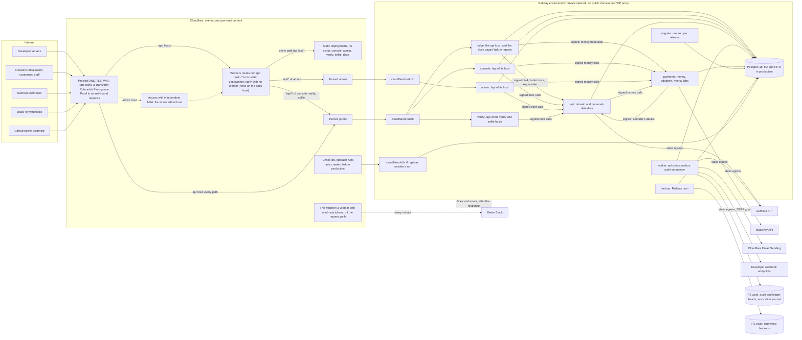

# fin-next: architecture

Status: the plan for the owner, written on Saturday 21 Nov 2026, revised the same day after the
critics' review (DECISIONS.md, appendix A), and then brought into line with every decision the
owner made overnight (the box below) and at the Saturday sitting (DECISIONS.md, "Owner decisions,
by deadline"), and with the decisions taken while the owner was away, each for the owner's review
(DECISIONS.md, "Decided while the owner was away"). Builders start from it on Saturday morning.
Where an older text disagrees with the box, the box holds. Everything else is decided, recommended,
or marked for the owner in DECISIONS.md.

## Decisions taken on 21 Nov 2026

The owner made these decisions while the plan was being written (times on the owner's clock). They override every
earlier draft, and this file applies them throughout.

| Time | Decision | Where |
|---|---|---|
| 02:40 | **Cloudflare Tunnels for every host**, Fin Admin included: no Railway public domain or TCP proxy; separate public and admin tunnels and tokens; connectors checked every minute; an evict runbook; Cloudflare's headers trusted only from connector peers. Railway Edge Rules only as an option after launch | §5; [FD-01], [FD-13] to [FD-16] |
| 03:00 | **Shape B stays, and the files leave Railway.** The console, Fin Admin, verify and the docs are built to static files that Cloudflare serves, with security headers from a static `_headers` file per app. Hono stays only as the API and auth server on Railway. Nothing that cannot move to another static host | §3.4, §5.16, §7.12; [FW-01], [SA-45] |
| 03:25 | **The UI is built on the UI SDK** (`@ui-sdk/react` and `@ui-sdk/core`), from the design system's token values and specs; the design system's private source is not vendored. The old product's redesign branch is the starting point, ported through fin-review (superseded at about 08:28: the owner answered [UI-12] no, so nothing is ported and the UI is built fresh from the canvases) | §3.4; [UI-10], [UI-12], [G-04] |
| 03:25 | **The sidebar's edge toggle**: a small round chevron on the sidebar's right edge near the top (‹ collapses, › expands). The logo is a plain 24 px mark linking Home, with no hover swap | §3.4; [UI-11] |
| 03:50 | **Assets-only static deployments, one host per app.** Files on `<app>.<zone>/*` from Workers static assets with no script; `<app>.<zone>/api/*` through a route with no Worker to the tunnel; no CORS. `__Host-` cookies, the session `Strict`, the rest `Lax`; CSRF by `Origin`, `Sec-Fetch-Site`, `X-Fin-App` and JSON-only bodies. `api.<zone>` straight to the tunnel. Proven by SP-25 on Saturday morning, else per-app API hosts (SP-25 passed on 21 Nov, 09:10 to 09:25: the per-app API hosts are not needed) | §5.1 to §5.3, §5.16, §5.17, §7.12; [FD-17], [FD-18], [SA-43], [SA-44] |

The 03:50 decision supersedes two earlier ones: the apps' files on Cloudflare Pages (03:00), and
same-host routing by Origin Rules (03:10), whose DNS-record and Host-header overrides are
Enterprise-only (research C1, checked in C3). With no server in front of the documents there is no
per-request style nonce, so the page policy is the strict one the UI SDK allows, with the framework
verdict's fallback (FW-X7) held in reserve (§3.4).

**Sources.** The owner's requirements R1 to R16 of 21 Nov 2026 and the owner's decisions above; the
phase-1 notes A1 to A8 and research notes B1 to B7 (read 20 and 21 Nov 2026); the framework panel's
three drafts and its judge's verdict (21 Nov); the research notes C1 to C3 (same-host routing,
cookies and CSRF, and the verdict on both) and D1 to D3 (the UI SDK, the old product's design
layer, from which nothing is ported since [UI-12]'s no, and the UI architecture), read 21 Nov; the
critics' findings on the first drafts (21 Nov); the 19 Nov Railway plan and its decision record; the
old product's repository, read only.
"UNVERIFIED" marks a fact not confirmed from a primary source. "SPIKE" marks a test that must pass
before the work it shapes (§11.11).

**Public by design.** This repository is public (R12). Nothing here names a credential, token, an
account or workspace ID, a tunnel ID, an internal address, a staff address or a real person.
Hostnames are written `<app>.<zone>`; the staging zone is `<staging-zone>`. Private settings live
outside the repository, in the private overlay ([G-09]): zone names, the staff list, account and
team IDs, Access team names, the on-call roster and its time zone, quiet hours, the numeric alert
thresholds ([OB-13]), and the private provider notes, which hold what Fin observed of a provider's
behaviour, fees and account terms (§12.12). Until hardening the overlay is kept only on the build
machines (machine A and machine B), outside every repository, where `pnpm fin` and the
public-safety check read it, its refuse list included. The overlay's ceremony, the owner giving it
at the secure prompt with its encryption and escrow, moves to hardening (D6).

**How to read the references.** `[XX-nn]` is a decision in DECISIONS.md. "Was Dnn" there names the
19 Nov decision a row carries. "R4" and the like are the owner's requirements of 21 Nov. `CF-nn` is
a critic finding in DECISIONS.md appendix A. `PG-nn` is a production gate in EXECUTION.md §7.
`SP-nn` is a spike (§11.11). `FW-Cnn`, `FW-Snn` and `FW-Xnn` are the framework conditions, spikes
and reversal triggers (§3.4). `S-nn` is a front-door spike run in EXECUTION.md §2.6, and `NF-n` a new
finding from a run, both logged in `docs/plan/spikes.md`. "(D6)" marks the owner's trim of Phase 0
(21 Nov, about 08:25): the builder account, the agents' own OS users, signed review receipts and the
overlay's ceremony move to hardening, and what stands in until then carries the same mark. "(D9)"
marks fin-review running locally until CI has an Anthropic credential (the owner, 21 Nov, about
08:49). Neither is the 19 Nov decision of that number.

## Requirement map

| Req | What the owner asked | Where it is answered |
|---|---|---|
| R1 | Production-ready code, from scratch, in a new repository | §1, §11.10, §14, §15; [G-02], [G-04], with no exception: the UI is built fresh (§3.4, [UI-12]) |
| R2 | Everything on Railway, including the database | §4; [P-01], [P-02]. The browser apps' static files are served by Cloudflare, by the owner's decision of 21 Nov (§5.16, [FD-17]) |
| R3 | Email through Cloudflare Email Sending | §9; [EM-01] |
| R4 | A Cloudflare proxy in front of Railway | §5: cloudflared tunnels for every host ([FD-01]); assets-only static deployments ([FD-17]) and one host per app, with `/api/*` handed to the tunnel by a route with no Worker ([FD-18]) (§5.1 to §5.3, §5.16); plain http and HSTS by zone class (§5.6, §5.8) |
| R5 | Better Stack replaces Grafana and Sentry | §10; [OB-01] |
| R6 | Auth with roles for the dashboard and Fin Admin; granular staff roles with prebuilt roles; a second factor to add someone; a mandatory second factor for every admin (Saturday) | §7.1 to §7.7, §7.12, §8 |
| R7 | Customer and business onboarding, and go-live: everything Sumsub covers (Sunday) | §2.3 (F7, F8, F21), §6.5, §6.6, §12.16; the reading of "everything" is [KY-13] |
| R8 | Provider integration, MassPay first, behind an adapter for several providers (Monday) | §12 |
| R9 | Everything completely audited | §8, §6.3 |
| R10 | fin-review: quality, bugs and performance, whole codebase and per commit and merge; faster CI; fast itself | §11.6 |
| R11 | Selectable review model and effort, high or above; a separate attack model and effort; Opus or Fable only; no Opus attack under Fable | §11.6; [RV-03], [RV-19] |
| R12 | A public repository, `aktharazif/fin-next` | §11.1; what stays private: the overlay ([G-09]), the private provider notes (§12.12) and, by [UI-12]'s no, the old product's design layer: nothing of it is committed (§3.4) |
| R13 | The plan first, saved in the repository | this file, DECISIONS.md and EXECUTION.md |
| R14 | The new designs (the two canvases) | §3.4: the canvases on the UI SDK, with the edge toggle ([UI-02], [UI-10], [UI-11]) |
| R15 | Bun or Node, checked | §3.2 |
| R16 | The public API, and a docs site with Try it on Sandbox keys | §13; the docs site is a static deployment ([FD-17], §13.10) |

What each requirement will look like when staging is complete, full or partial, is in EXECUTION.md
§0.2.

## Words used here

| Word | Meaning |
|---|---|
| console | The developer dashboard app at `console.<zone>`: static files from its static deployment at Cloudflare, and `/api/*` from the `console` service on Railway |
| Fin Admin | The staff app at `admin.<zone>` ([FD-10]); Cloudflare Access covers the whole host |
| verify | The hosted pages a developer's customer, or a business's person, opens (`verify.<zone>`), and the selfie host (`selfie.<zone>`); static files at Cloudflare, `/api/*` from the `verify` service |
| docs | The docs site at `developer.<zone>`: a static deployment at Cloudflare, with no `/api/*` path and no service on Railway; its pages send their failure reports to the edge at `api.<zone>/reports/docs` (§13.10, [P-07]) |
| edge | The public API gateway at `api.<zone>`. It verifies API keys, takes in provider hooks and forwards to `api` or `payments` |
| api | The private core service. It owns the domain and is the only path to personal data |
| worker | The private job runner. It runs api's code with api's keys, plus email. It has no money duty |
| payments | The private money service. It owns the money domain, the provider credentials, the money jobs and the provider hook door |
| app API service | The `console`, `admin` or `verify` service: Hono on Node, serving only `/api/*` of its host or hosts |
| static deployment | A Workers static assets deployment with no Worker script: files, a `_headers` file and the single-page fallback, and nothing that runs (§5.16, [FD-17]) |
| route with no Worker | A zone Workers route with no Worker attached. On an app host, `<app>.<zone>/api/*` is one: it hands `/api/*` back to the host's DNS record, the proxied CNAME to the tunnel (§5.1, [FD-18]) |
| tunnel, connector | A Cloudflare Tunnel, and one running `cloudflared` process connected to it. Each environment has a public and an admin tunnel from Phase 0, and a db tunnel for the operator's database route, created before production (§5.13, [FD-11]) |
| connector supervisor | Fin's small process that runs `cloudflared` inside its container, keeps its metrics on loopback and restarts it when it stops being ready (§5.4) |
| the watcher | A Cloudflare Worker outside Railway and off the request path that checks the front door, the zone and the vault every minute (§10.6) |
| mode | `sandbox` or `live`, chosen by the API key's prefix (`fin_test_`, `fin_live_`). The screens say Sandbox and Production ([UI-08]) |
| environment | A deployment: development, CI, staging or production |
| door | A signed, authenticated internal entry point of `api` or `payments`. Each door operation declares who may call it and what it checks (§7.9) |
| realm | One sign-in system: the developer realm (console) or the staff realm (Fin Admin) |
| step-up | A second factor shown in this session: within the last 5 minutes for a reveal (the window), or bound to one action and its parameters and used once (an intent) (§7.4) |
| enrolment code | A one-time code that never travels by email, handed over out of band, without which a new or reset staff member cannot register a first factor (§7.3) |
| edge toggle | The sidebar's collapse control: a small round chevron on the sidebar's right edge (§3.4) |
| kill switch | A switch that stops one kind of work at once without a deploy (§15.1) |
| tier S | A path class that gets the deepest review and the attack pass (§11.6) |
| control paths | The paths that define the review, its gate and what deploys, which need the owner ([CI-14]): `.github/**`, `tools/fin-review/**`, `tools/layout.json`, `docs/review/**`, `.claude/**`, `CODEOWNERS`, the rules files (`AGENTS.md`, `CLAUDE.md`, `CONTRIBUTING.md`, `SECURITY.md`), `pnpm-workspace.yaml`, `scripts/check-supply-chain.mjs`, `scripts/public-safety.mjs`, `ops/fin/**`, `ops/docker/**`, the `_headers` templates (`packages/web-host/src/static/**`), each app's `static.json`, and `tools/static-deploy/**` (§11.1) |
| builder account | The GitHub machine account agents use from hardening (D6); until then they work with the owner's login. It is a collaborator, not an admin, and its tokens cannot change workflows, settings or environments (§11.1) |
| `test` and `release` | The two targets of every image. Only `test` holds development seams; `release` is what deploys (§3.5) |

## 1. Principles

These hold for every service and every pull request. Where a later section seems to break one, the
principle wins and the section is a bug.

1. **Sound first, then fast.** Each day (R6 Saturday, R7 Sunday, R8 Monday) ends with that day's
   features complete and working on staging. Production adds the gates in §11.10. A gate is never
   treated as done because the feature works on staging ([G-05], was D44).
2. **The server decides.** Every check runs on the server, by permission name, on every request.
   A page or a dialog only mirrors it. Anything unlisted, unknown or unsure fails closed: an
   unlisted sign-in endpoint answers 404, an unknown role allows nothing, a gate that cannot decide
   gives no session, a door operation no caller list names is refused.
3. **Assume a platform credential leaks.** Railway's October 2026 breach exposed customers'
   variables, sealed ones included. So each service holds only its own secrets; callers sign with
   private keys that no callee holds (§7.9); the highest-value keys are escrowed off Railway;
   provider tokens are limited to static egress addresses where the provider allows it. A tunnel
   token is an interception credential, so each sits only on its own connector service, every
   connector is checked each minute from outside Railway, and one runbook drops every connector
   at once (§5).
4. **Least privilege everywhere.** One database login per service with a written, tested grant
   matrix. Provider credentials live only on the service that calls the provider. One token per
   purpose. From hardening, no agent holds a credential that can change the rules that review its
   work (§11.1). Until then, by the owner's trim of Phase 0 (D6), agents work with the owner's
   login, and the server-side ruleset, the control-path review cadence ([BD-02]) and [G-10]'s
   interim merge rule stand in.
5. **Every important action is audited** in the same transaction as the action, whoever or
   whatever acted: a developer, an API key, a customer on a hosted link, a staff member, the
   operator, a job or a provider event (R9, §8). The database refuses a commit to a critical table
   that carries no audit row (§8.2).
6. **Every unit of work writes one structured line**, shipped to Better Stack after the response;
   requests that Cloudflare answers from a static deployment are seen in its logs (§5.9). Every
   failure that matters has an alert, and every alert names a runbook that exists. Monitoring never
   breaks the work (§10).
7. **Personal data stays small and sealed.** Sumsub is the record of a live customer's personal
   data. Fin keeps a sealed name, keyed hashes for search and masked copies. Nothing personal goes
   into a log line, an event, an error report or a URL, and no bearer token stays in a URL after
   its first use (§6.5, §7.12).
8. **Fin owns the money facts.** Fin keeps a double-entry ledger, sealed account details and
   idempotency end to end. Providers execute behind one adapter interface. A provider call that may
   have happened is never treated as one that did not (§12).
9. **No third-party origin in a browser** at run time, except the recorded exceptions: Sumsub's
   WebSDK on the selfie host ([SA-26]) and, if the owner agrees, Turnstile ([FD-06]).
10. **Configuration is code, reviewed and checked for drift**: Railway settings, tunnel
    configurations, Cloudflare rules, Workers routes and static deployments, the `_headers` templates,
    Better Stack alerts, database grants, the GitHub settings and the OpenAPI document.
11. **One runtime, portable code.** Node 26 LTS runs everything. App code uses Web APIs, so Bun
    stays a later option, kept honest by lint rules and a non-blocking CI job (§3.2).
12. **Public repository, private operations.** No secret, account ID, staff list, roster or other
    private value is committed. The design never relies on the code or the plan being secret.
13. **Few dependencies.** The platform first. Each new package needs the owner's yes and the
    registry checks, and pnpm enforces the supply-chain policy (§7.13).
14. **Process rules replace the Workers rules.** Nothing at module scope reads the clock, makes a
    random value or an ID, starts a timer or opens a connection. Time comes from the injected
    `Clock`. Nothing in process memory decides about a person or must agree across replicas:
    limits, locks, claims and sessions live in Postgres. The one exception is load shedding, which
    refuses work before it reaches Postgres and never decides about a person (§13.6). A request
    holds one logical database unit of work and never holds a pooled client across outbound I/O.
15. **Stop safely, without a deploy.** Live money, live keys, sign-ups, hosted pages, outbound
    webhooks and Sumsub writes each have a kill switch that works in minutes, including while
    Railway's API is down (§15.1).
16. **No Fin code runs at Cloudflare on the request path.** Cloudflare serves the browser apps'
    files from assets-only deployments and hands `/api/*` to the tunnels by configuration alone; the
    files and their `_headers` move to any static host. The watcher is the one Worker, and it is off
    the request path; it stays one by [OB-18], which the owner decided at its default on 21 Nov
    (§5.16, §10.6).

## 2. The system and its data flows

### 2.1 Diagram

Arrows show the direction of requests. Connectors dial out from Railway to Cloudflare; nothing on
Railway accepts a connection from the internet, and no file of a browser app is served from Railway.



Nothing on Railway has a public domain, generated or custom, or a TCP proxy ([FD-01]); the watcher
pages within two minutes if one appears (§5.9). Requests reach Railway only through the outbound
connectors of the public and admin tunnels, and each tunnel's configuration maps an exact list of
hostnames and paths to exact services, with a 404 for everything else (§5.3). Files never reach
Railway: on each browser host a Workers route sends every request to the app's static deployment,
which runs no code, and a more specific route with no Worker hands `/api/*` on to the host's tunnel
(§5.1, §5.16). Every listener on the private network authenticates its caller: the API services
trust Cloudflare's headers only from their own tunnel's connectors with the per-host ingress proof
(§5.5), and the private services (`api`, `worker`, `payments`) answer only health checks and signed
calls (§7.9). `verify` holds no database login. The docs host has only its static route: no
`/api/*` route, no ingress rule and no service ([P-07]).

### 2.2 Who owns what

| Service | Owns | Calls |
|---|---|---|
| `cloudflared-public`, `cloudflared-admin` | One tunnel each. Each holds only its own tunnel token, sealed. The connector supervisor runs `cloudflared` with metrics on loopback (§5.4) | Cloudflare's edge, outbound; the services in its tunnel's ingress map |
| edge | The public API's front: load shedding, key checks, rate limits, CORS for the docs origin, `GET /v4/whoami`, the public hook routes (Sumsub, MassPay, GitHub) whose raw bodies it forwards to the owning service's hook door, GitHub's signature and the key check for secret scanning, and the docs pages' failure reports (`POST /reports/docs`, §10.5) | api (`/internal/v4`, the Sumsub hook door, the key-revoke door), payments (the money hook door) |
| api | The domain: customers, people, documents, links, requests for information, forms, go-live, developer events and webhook endpoints, sandbox, the audit log views, the kill switches' reads; the only holder of personal-data keys | payments (the money door, for the public API), Sumsub |
| worker | api's background work, in the same image and with the same keys: outboxes, Sumsub inbound events and polling, webhook delivery, email, the audit sequencer and anchoring, the database probe, sweeps. No money duty | Sumsub, Cloudflare Email Sending, developer endpoints, R2 |
| payments | The money domain: holders, virtual accounts, beneficiaries, transfers, the ledger, routing, provider adapters, provider events, reconciliation; its money door, its provider hook door and its money jobs under its own scheduler lease | MassPay (and later providers); api's holder door, for a holder's verified details |
| console | The developer realm (sign-in, sessions, factors), organisations, members, invitations, roles, API keys, and the console's app API routes on `console.<zone>/api/*`. Its screens are static files at Cloudflare | api, payments |
| admin | The staff realm, staff roles, enrolment codes, Fin Admin's preset reasons, templates and saved views, the switches, and Fin Admin's app API routes on `admin.<zone>/api/*`. Its screens are static files behind Access | api, payments |
| verify | The `/api/*` of the hosted pages and of the selfie host; no database, no domain data of its own. Its pages are static files at Cloudflare | api |
| Static deployments (at Cloudflare, not Railway) | console, admin, verify, selfie and docs: each a `dist/` with its `_headers`, and no code (§5.16). The docs site's include `openapi.json` | nothing |
| migrate | Schema changes, run once per release before code | Postgres |
| backup | The nightly encrypted logical dump, and the hourly dump of the high-value schemas | Postgres, R2 |
| `cloudflared-db` | The operator's database route, at 0 replicas outside a registered run; it holds the db tunnel's token only once that tunnel is created, before production ([FD-11]) | Postgres |

### 2.3 Data flows

Each flow writes one `request` or `job.run` line per service it crosses (§10.2). "Audit" means a
row in `audit.event` in the same transaction as the change (§8).

**F1. A public API call.**
1. A developer's server calls `https://api.<zone>/v4/...` with `Authorization: Bearer fin_...`.
2. Cloudflare terminates TLS, applies the managed WAF rules and the rate rule, adds the host's
   `Fin-Ingress-Proof` through a Transform Rule, and sends the request down the public tunnel.
3. A `cloudflared-public` connector forwards it over the private network to `edge`, with `Host`
   set to the public host by the tunnel configuration.
4. `edge`: trusts `CF-*` headers only when the TCP peer is a current `cloudflared-public` replica
   and the ingress proof matches (§5.5); makes `req_...`; sheds load before any database work (a
   per-replica token bucket per address and in all, and a local filter of key IDs known not to
   exist); checks the key's shape and checksum with this deployment's salt; refuses a non-sandbox
   key sent from the docs origin; reads the key record and the caller's bad-key window in one
   statement; compares the HMAC in constant time; checks expiry, revocation, the IP allowlist
   (required for live keys with money scopes, [MO-20]), the per-key rate window, live gating and
   the kill switches; forwards to `api` with an Ed25519-signed caller assertion (audience `api`,
   a nonce, organisation, mode, key ID, kind, scopes, client IP, request ID).
5. `api`: verifies the signature, the audience and the time window; validates the body with the
   route's schema; runs the domain operation in one unit of work (change, audit and developer
   events together); answers. Money routes pass the edge's assertion unchanged to `payments` (F11).
6. `edge` adds `Request-Id`, the rate-limit headers and `Cache-Control: no-store` and answers.

**F2. Try it on the docs site.** The browser loads the docs from `developer.<zone>`, a static
deployment at Cloudflare's edge. The panel's fetch guard sends only a well-formed `fin_test_` key
whose checksum verifies with this deployment's salt, and only to the API origin. The edge answers
the preflight itself, sends CORS headers to the exact docs origin only, refuses any non-sandbox key
from that origin before any lookup, and then follows F1 (§13.11).

**F3. Signing in to the console.** The browser already has the console's static document and assets
from Cloudflare's edge (F24). It posts to `console.<zone>/api/auth/...`; the route with no Worker
hands the request to the public tunnel, whose ingress matches the host and `^/api/` and forwards it
to `console`. The console's API service runs its front door in the fixed order of FW-C03: the origin
gate checks `Origin`, `Sec-Fetch-Site` and `X-Fin-App`, and the endpoint allowlist answers 404 for
anything unlisted, before the library sees the request. Limits are counted in Postgres. A new
session gets an assurance level (§7.3) and a host-only, `Strict` session cookie (§7.12). Security
notices are queued with `email.enqueue()` (F10).

**F4. A console action that needs a fresh factor**, for example inviting someone. The app API route
calls `requireActor({ permission: "member.invite", stepUp: "intent" })`. With no matching proof the
answer is `step_up_required` with an intent ID; the server has stored the intent (session, user,
action and a digest of its parameters, for 5 minutes). The root StepUp modal runs the ceremony for
that intent, and `api()` re-sends the same request once with the intent ID and the same idempotency
key. The server recomputes the digest, consumes the intent, and writes the invitation, its audit
event and its email row in one transaction (§7.4).

**F5. The console reads personal data** ("Show details"). After a fresh factor in the 5-minute
window, the console calls `api`'s door with a signed assertion naming the user, the session, the
organisation and the proof. `api` re-checks the session, the membership, the permission and the
proof against narrow views with the database's clock, applies the per-organisation read limit and
the per-person budget, reads Sumsub (live) or opens the sealed sandbox values, writes
`customer.details_shown`, and answers with `Cache-Control: no-store`.

**F6. A Fin Admin request.** Cloudflare Access covers the whole admin host, files and `/api/*`
alike. It lets in only addresses on the staff list, after its own second factor, with Access's
binding cookie on; the files then come from the admin static deployment. For `/api/*`,
`cloudflared-admin` validates the Access token at the connector before it forwards anything; `admin`
validates `Cf-Access-Jwt-Assertion` again on every request, before any other handler, then requires
a staff session at `aal2` for the same address and the permission, with a step-up intent where §7.6
says. Door calls to `api` forward the raw Access JWT, the staff session reference and the proof, and
`api` validates all three again.

**F7. A customer on a hosted page.** A hosted link is `https://verify.<zone>/c#<token>` (a
person's own link `/p#<token>`, an assisted link `/a#<token>`; Sandbox and live share these paths,
and the link record carries the mode). The token sits in the fragment, so the request Cloudflare
sees is only for `/c`, which loads the static verify app. The app reads the token, clears it from
the address and the history, and sends it in the body of `POST /api/link/open`; `verify` passes it
to `api`'s door, which hashes it, checks that the link is live and what it may open, and returns a
link session. `verify` sets the host-only, HttpOnly `__Host-fin-verify.ls` cookie bound to this
browser; later calls carry the cookie, never the token (FW-C21; spec 03 §2.5). Each save goes
through the sealed transit queue `kyc.applicant_write`. Values read back from Sumsub refill a form
only in the browser that entered them; any other browser sees masks. The selfie step opens
`https://selfie.<zone>/s#<sft id>.<secret>`, a separate static document that loads Sumsub's WebSDK and posts
the one-time ticket to `POST /api/selfie/session` on its own host, receiving an SDK token and the
`__Host-fin-selfie.s` cookie only (§7.12; spec 03 §2.6). Submit flushes the queue (or answers 503
`provider_unavailable` with `Retry-After`), then requests Sumsub's review. Every action is audited
with the link as the actor.

**F8. A Sumsub webhook.** Sumsub posts to `api.<zone>/hooks/kyc/sumsub`. `edge` forwards the raw
body (64 KB cap, a limit per address, no API key) to `api`'s hook door. `api` checks
`X-Payload-Digest` over the raw bytes, stores the event in `kyc.inbound_event` (deduplicated) and
answers 200 within a second. The worker claims it, reads the review back from Sumsub (the payload is
never trusted), applies the status change with a system-actor audit event and the developer events.
Polling with backoff is the safety net. On staging, polling is the path until the owner registers
the webhook, by Mon 23 Nov ([KY-02], §12.16).

**F9. Delivering a developer webhook.** The domain transaction calls `events.emit()`, which accepts
only the event types allowed for the calling role, and writes the event and one delivery row per
subscribed, enabled endpoint; then `NOTIFY` wakes the worker. The worker claims due deliveries with
a cap per endpoint and per target host, opens the endpoint's sealed secret, signs per Standard
Webhooks `v1`, and sends through the SSRF guard from its static egress addresses. Fin's own test
endpoints are flagged rows, delivered in-process to the test receiver, never over the network
(§13.7). It records the outcome and retries on the schedule in §13.7.

**F10. Sending an email.** A service calls `email.enqueue()` in its own transaction: a template its
role may send, parameters as IDs, and a recipient address or a reference the worker resolves. Only
the worker sends. It claims code and security templates first, spends from a token bucket below
Cloudflare's API limit, applies the per-recipient limits (a security notice past its limit is
folded into a digest, never dropped) and the budgets, renders Fin's template, calls Cloudflare's
REST API, and deletes rows that carried a one-time code (§9).

**F11. Sending money.** A developer calls `POST /v4/transfers` with an `Idempotency-Key`; `api`
passes the edge's signed assertion unchanged to `payments`' door. `payments` re-reads the key record
(it exists, is not revoked, and matches the organisation, mode and scopes), checks the kill
switches, the daily quotas and value caps, the idempotency scope, routes by mode and capability,
checks the beneficiary (a new beneficiary's first payout waits, [MO-19]) and the balance, places a
ledger hold, inserts the transfer with a deterministic provider business ID, writes the audit and
developer events, and commits. It confirms the commit has reached a replica before it calls the
adapter's `submitPayout`, outside any transaction, with a checkpoint callback, and applies the
outcome (`ok`, `refused`, `retry` or `unknown`) in a new transaction (§12.4, §12.7). From the
console, the Send money dialog reuses one server-issued transfer ID across retries, and a step-up
intent binds the amount and the beneficiary.

**F12. A MassPay webhook.** MassPay posts to `api.<zone>/hooks/money/masspay/<instance>`. `edge`
forwards it to `payments`' hook door. `payments` verifies `X-MassPay-Signature` (HMAC-SHA512 over
`t|raw body`, within 5 minutes), stores a neutral provider event and answers 2xx within 3 seconds.
A money job in `payments` reads the object back through the adapter and applies it if it is newer.

**F13. Reconciliation.** `payments` reads each non-final transfer when its `next_check_at` is due
(with backoff), looks for orphan payouts every few minutes, compares provider balances with the
ledger daily, walks the provider ledger to find deposits no event announced, and lists provider
objects Fin does not know. Every break is audited and alerts; breaks above a threshold trip the
money switch (§12.11, §15.1).

**F14. The schedulers.** One worker replica holds the worker's scheduler lease and one `payments`
replica holds the money lease. Each duty runs in its own loop, with its own still-running guard,
whenever it is due or overdue by `ops.duty_state`; a restart never skips a day's duty (§4.6).

**F15. Chaining and anchoring the audit trail.** Audited transactions insert their rows with no
global lock. Each second the worker's sequencer gives `seq` and hashes to the rows of finished
transactions, in a fixed order. Each minute, if the chain moved, the worker writes the head as a
write-once object to the R2 audit bucket and ships an `audit.head` line; once a day it does the same
for the ledger head. An hourly job verifies the chain against the stored heads (§8.3, §8.4).

**F16. Backups.** Railway cron starts `backup` nightly for the full dump (and the roles) and hourly
for the high-value schemas (`money`, `audit`, `keys`, `identity`, `staff`). It runs as `fin_backup`,
encrypts with `age` to the disaster recipient, uploads write-once to the R2 backups bucket and pings
its heartbeat (§4.5). On staging it runs once the owner gives CR-10 and the drill recipient
([BD-14]).

**F17. A release.** A merge to `main` builds, in GitHub Actions, the `release` target of every
changed image and every browser app's static artifact (its `dist/` with `_headers`, plus the
previous release's `/assets`), pushes the images to GHCR by digest, attests images and artifacts and
writes the release manifest. The staging deploy runs `migrate`, rolls the services in the order of
§11.8, uploads the static deployments last and runs the smoke tests. Until the owner is back it runs
from the operator machine through `pnpm fin`, on CI's attested artifacts ([BD-05]); after that it
waits for the owner's approval in the `staging` environment, batched at the day's checkpoints.
Production is deployed by the operator with the same digests and artifacts, after they have soaked
on staging (§11.8).

**F18. An operator database session** (once the db tunnel exists, before production; until then a
registered `pnpm fin task` run, §5.13). `pnpm fin db <env>` registers the run, scales
`cloudflared-db` to one replica, mints an Access service token for one hour, connects with TLS and
SCRAM channel binding as `fin_readonly` (or as `fin_owner` with a written reason and a password
valid only for that run), records a statement transcript to the ops bucket, and scales the
connector back to zero.

**F19. A leaked key reported by GitHub.** GitHub posts to `api.<zone>/hooks/github/secret-scanning`.
`edge` verifies the ECDSA signature with GitHub's published key set (cached, refreshed at most once
per interval whatever identifier arrives), checks each token's checksum with every known salt and
its HMAC with the pepper, and calls `api`'s key-revoke door with the key ID alone. `api` revokes the
reported key at once, whatever its mode ([SA-21]), writes the audit event as the system, queues the
security email and writes an alerting line.

**F20. Telemetry.** Each process keeps one batch of lines per unit of work, scrubs them, writes the
same scrubbed line to stdout for Railway, and ships the batch to Better Stack after the response.
Errors go through a thin Sentry-protocol client; browser errors go through the app's own origin,
where the server parses and scrubs them again before they leave (§10).

**F21. Going to Production (go-live).** A member with `golive.edit` fills the Production request
through `api`'s door; the company email is confirmed by a 6-digit code; each listed person gets
their own `/p/` link and is verified by Sumsub with a selfie. A Super admin sends it with a step-up
intent and accepts the terms. A staff member with `golive.decide` and a step-up intent reviews the
company on its answers, with every person approved by Sumsub ([KY-05]), and approves, asks for
changes or declines in Fin Admin; once a second staff member exists, an approval needs a second
approver ([SA-39]). `api` then sets the organisation's live status, which the edge reads with each
key, so `fin_live_` keys start working. Super admins are emailed, and the events are audited in the
staff and organisation scopes.

**F22. Watching the front door.** Every minute the watcher, a Cloudflare Worker outside Railway
with read-only tokens, lists each tunnel's connectors (their count, `cloudflared` version and origin
address, which must be one of the connector services' static egress addresses), hashes each
tunnel's configuration, and reads the DNS records and Workers routes on fin-next's names, the zone
settings, fin-next's own rules (refs starting `fin_next_`, [BD-11]), its static deployments (each
browser host has exactly its two routes, and no deployment has a script), its Access application
and the vault inventory. Any difference alerts; changes the old product makes to its own records
and rules on the shared staging zone do not ([FD-09], §5.9). It pings its own heartbeat (§5.9,
§10.6).

**F23. Stopping in an emergency.** A kill switch is a database row read on every request, with no
cache. Each switch stops one kind of work: live money (in all, or for one provider instance), live
keys, sign-ups, hosted verify, outbound webhooks or Sumsub writes. A switch is set from Fin Admin
with a step-up intent, or by `pnpm fin switch`; prepared Cloudflare WAF rules stop the same paths
at the edge when Railway cannot be reached (`pnpm fin killswitch`). An idempotency mismatch, a
transfer sent after its end, or reconciliation breaks above a threshold trip the money switch by
themselves (§15.1).

**F24. Loading an app.** A browser asks for `https://console.<zone>/customers`. Cloudflare
terminates TLS and applies the zone's rules; the route `console.<zone>/*` gives the request to the
console's static deployment, which finds no file of that name and answers `index.html` with its
`_headers` (the page policy, `no-cache`). No code runs and nothing reaches Railway. `theme.js`
applies the stored theme and sidebar width before first paint, the static skeleton shows, and the
entry fetches the viewer and the route's data from `/api/*` in parallel (FW-C10), which the route
with no Worker hands to the tunnel (F3). Hashed assets come from Cloudflare's edge as `immutable`.

## 3. Runtime and stack

### 3.1 Repository layout

One pnpm workspace with Turborepo. Every internal package is `@fin/<name>` and is depended on only
as `workspace:*`: the `@fin` scope on npmjs belongs to an unrelated organisation, so any registry
resolution of `@fin/*` would be dependency confusion. A check in `pnpm check` refuses one.

**One source for names and tiers.** `tools/layout.json` lists every package and app with its path,
its tier (§11.6) and its areas. This table, EXECUTION.md's lane tables, fin-review's tier mapping
and CODEOWNERS all cite it, and `layout:check` (in `pnpm check`) fails when a tracked path belongs
to no entry, when an `active` entry names a path that does not exist, or when a document in
`docs/plan/` names a package that the file does not list. A `planned` entry may be absent (spec 01
S0-15); a `planned` entry whose path exists is a warning, not a failure, so parallel lanes do not
each edit this control path, and the steward flips such entries to `active` at the Phase 0 exit
([BD-08]). A new package is a change to `tools/layout.json`, which is a control path (§11.1);
`packages/icons` and `packages/motion`, which the UI SDK design adds (§3.4), land in Phase 0 with
the steward.

| Path | What it is | Tier |
|---|---|---|
| `apps/edge` | Public API gateway (Hono on Node): load shedding, key checks, CORS, `whoami`, the public hook routes, and the docs pages' failure reports (`src/reports/docs.ts`) | S |
| `apps/api` | Core service. The same image runs `api` (`dist/main.js`), `worker` (`--worker`) and `migrate` (`--migrate`). Worker code lives in `apps/api/src/worker/<area>/` | S |
| `apps/payments` | Money service: the money door, the provider hook door (`src/hooks/`) and the money jobs (`src/jobs/`) in one process | S |
| `apps/console`, `apps/admin`, `apps/verify` | Web apps on Shape B (§3.4): a Vite single-page app in `src/client/`, built to static files for a static deployment, with its committed `static.json` (verify has two entries, the hosted pages and the selfie document, each with its own), and its Hono API server in `src/server/`, which serves `/api/*` only. No `_headers` lives in an app: the deploy renders it from `packages/web-host`'s template for the app's profile (§5.16) | S for `src/server/` and `static.json`; N for `src/client/` |
| `apps/docs` | Docs site: a static build of the guides and the Scalar reference for a static deployment, with its `static.json`. It has no server and no `_headers` of its own (its profile is a template in `packages/web-host`, §5.16); its pages report failures to the edge ([P-07], §13.10). Phase 0 ships a static placeholder page under the `docs` profile with no `/api/` path (P0-G, EXECUTION §2.10); the docs lanes build the site from Sunday | S for the Try-it guard, N otherwise |
| `apps/connector` | The connector supervisor that runs `cloudflared` (§5.4) | S |
| `packages/server` | Runtime for every Node service: config, ingress, caller signatures and the door matrix, database pool and unit of work, background registry, shutdown, health, scheduler lease and duty state, job claims, kill-switch reads, `deliveryFetch`, the private-DNS cache, log, telemetry (`src/telemetry/`), error reporting | S |
| `packages/web-host` | The host package the app API services share (FW-C02): the API front door in FW-C03's order, the origin gate, the error envelope, health and readiness, the scrubbing console, the route-policy test helper; the `_headers` templates of every static profile (`src/static/`: `app`, `hosted`, `selfie` and `docs`; a control path) and the renderer that writes each artifact's `_headers` and `env.json` at deploy; and the header-matrix test over every rendered `_headers` | S |
| `packages/core` | IDs, `Clock`, errors (`FinError`, problem documents), scrubbers, money amounts, shared result types | S |
| `packages/db` | Drizzle schemas per area, SQL migrations, grant fragments (`roles/grants/<area>.json`) and their renderer, the migration runner, the audit chain and guard SQL | S |
| `packages/crypto` | Keyring, seal and open, HKDF subkeys, keyed hashes, the name blind index, fingerprints, PHC argon2id, Ed25519 helpers | S |
| `packages/identity` | The realm factory over Better Auth, the endpoint policy, assurance, step-up windows and intents, trusted browsers, the rate-limit store, emailed-code binding, names | S |
| `packages/access` | The permission engine and both catalogues (organisation and staff), as fragments per area; browser-safe | S |
| `packages/orgs` | Organisations, members, invitations, custom roles, the team-change lock and the outrank rule (developer realm) | S |
| `packages/staff` | Staff members, staff roles, enrolment codes, factor resets, the staff-change lock, the Access token check | S |
| `packages/audit` | `AUDIT_EVENTS` (fragments in `src/events/<area>.ts`), `recordAudit`, the sequencer, chain verification, anchoring, the revocation journal | S |
| `packages/keys` | API key format and checksum salt, hashing and peppers, scopes, IP allowlists, the last-used touch | S |
| `packages/kyc` | Onboarding domain and state machines, the `KycProvider` port, the Sumsub adapter (`src/providers/sumsub/`), the sandbox provider (`src/providers/sandbox/`), hosted links | S |
| `packages/money` | Money domain and ledger (`src/{schema,ledger,domain}/`), the `ProviderAdapter` types (`src/provider/`), the Fin simulator (`src/providers/fin-simulator/`), the MassPay adapter (`src/providers/masspay/`), the conformance suite (`src/conformance/`) | S |
| `packages/events` | Developer events, webhook endpoints, Standard Webhooks signing, delivery, `events.emit()` | S |
| `packages/email` | `EmailPort`, the Cloudflare adapter, templates (`src/templates/<area>/`), `email.enqueue()`, the outbox sender | S |
| `packages/contract` | Zod schemas of the public API, OpenAPI fragments per area (`openapi/<area>.json`) and the assembler, the error-code catalogue, docs anchors | S |
| `packages/app-contracts` | Shared Zod contracts for the web apps' own JSON routes (FW-C08); browser-safe | N |
| `packages/tokens` | `@fin/tokens`: the design system's token values (from the team export), the Tailwind theme, the page base and the fonts (§3.4) | N |
| `packages/icons` | `@fin/icons`: glyph data, `createIcon` with the motion classes, flags and cues, brand marks (§3.4) | N |
| `packages/motion` | `@fin/motion`: Fin's own `fin-motion.css`, written from the motion spec and the token values ([UI-12]), and the motion helpers (§3.4) | N |
| `packages/ui` | `@fin/ui`: the Fin design system's controls and surfaces on the UI SDK; the only package that may import `@ui-sdk/*` ([UI-10]) | N |
| `packages/frame` | The browser shell: AppFrame, AdminFrame and AuthFrame with the edge toggle, the navigation trees, route states, `theme.js`, the one `env.json` schema (`src/env/`, §5.16), and the kit route (test build only) | N |
| `packages/testing` | Test-only code: the canon seed, the email-sink reader, the virtual-authenticator and TOTP helpers, the frozen clock, the Access stand-in, and the static test server that serves a built app with its `_headers` as rendered for CI and the single-page fallback. Built only into the `test` image target and the e2e harness (§3.5) | S |
| `tools/fin-review` | The review engine (§11.6) | S, control path |
| `tools/layout.json` | This table, machine-readable | S, control path |
| `tools/static-deploy` | The static uploader, with Node built-ins only and no dependency: it reads each app's `static.json` and uploads through Cloudflare's API ([FD-19], [BD-16]); never in an app or an image | S, control path |
| `ops/fin` | `pnpm fin`: Railway, Cloudflare (DNS, rules, tunnels, Access, Workers routes), R2, Better Stack and GitHub operations. Node built-ins only, no npm dependency | S, control path |
| `ops/monitoring` | Alerts, monitors, heartbeats, policies and dashboards as JSON, the event catalogue (`catalog/<area>.ts`), alert fragments (`<env>/alerts/<area>.json`) | S |
| `ops/docker` | `app.Dockerfile` (one, parameterised by service, with `test` and `release` targets), `connector.Dockerfile`, `backup.Dockerfile`. The browser apps' static builds are not images | S, control path |
| `ops/backup` | The backup uploader that `backup.Dockerfile`'s image runs (spec 01 S0-16); created in Phase 0 by P0-F (EXECUTION §2.10) | S |
| `ops/environments` | `staging.json`, `production.json`, `dr.json`: the public desired state, including each tunnel's host-role map and each app host's static deployment and routes. No private values ([G-09]) | S |
| `ops/credentials.json` | The credential inventory: names, holders, issuers, dates, cadences and runbooks, never values ([OP-05]) | S |
| `ops/watcher` | The watcher Worker (§10.6), uploaded by `pnpm fin watcher deploy` | S |
| `docs/plan`, `docs/flows`, `docs/security`, `docs/review`, `docs/operations`, `docs/runbooks`, `docs/api-changelog` | Plan (with the specifications per area in `docs/plan/specs/`, the only place specs live, EXECUTION EX-08), flows, threat model, review procedure, operations, runbooks, API changelog entries | D (`docs/review` is a control path) |

**Generated files are not committed.** TanStack Router's `routeTree.gen.ts` is generated at build
and typecheck. The public OpenAPI document and each app's route policy are assembled from per-area
fragments at build; only the fragments are committed, and CI rebuilds the assembled files and
compares them with `main`'s. No Drizzle Kit journal or snapshot is committed (§6.4). Each app's
`static.json` and the `_headers` templates in `packages/web-host/src/static/` are committed and are
control paths ([CI-14]). No `_headers` and no `env.json` is committed or built: the deploy renders
both into each artifact from the environment's settings (§5.16).

TypeScript settings, repository-wide: `erasableSyntaxOnly: true` (Node's type stripping refuses
enums, namespaces and parameter properties), `verbatimModuleSyntax: true`,
`rewriteRelativeImportExtensions: true`, no `paths` aliases (Node ignores `tsconfig.json`; use
package `imports` and workspace packages), never `preserveSymlinks`. Confirm the exact option names
with `tsc --showConfig` on 7.0.2 (UNVERIFIED as names).

### 3.2 Bun or Node (R15): Node

**Verdict: Node.js 26 LTS is the only runtime for production, tests, scripts and CI. Bun runs in
one non-blocking CI job so the code stays portable.** This re-confirms the 19 Nov decision
([P-05], was D17) on evidence read 20 and 21 Nov 2026:

1. Bun's blocking problems are still open. The heap cap is ignored (bun#34917, fix unmerged).
   AsyncLocalStorage is lost in `unhandledRejection` handlers (bun#40223); its fix was closed
   unmerged on 17 Nov, so request IDs vanish on the very path Fin reports errors from. Native
   OpenTelemetry (PR #39965) was closed unmerged on 19 Nov, and OpenTelemetry JS still labels Bun
   "Unsupported Runtime".
2. A new SSRF gap: Bun's built-in `undici` ignores the `dispatcher` option (bun#38840), so an SSRF
   guard built on a connect-time lookup silently does nothing. Webhook delivery to developers' URLs
   depends on that guard (§7.11).
3. Security fixes reach only Bun's newest release, with no LTS and no backports. Node 26 is LTS
   until 2029-04-30 and had five scheduled security releases in 2026, each backported.
4. The speed gain is real but small for Fin: about 1.5 times the throughput on Hono with `pg` in a
   local benchmark, and about 90 MB less memory per process (under 1 USD per replica-month). Fin's
   time goes to Postgres, Sumsub and MassPay round trips.
5. The tooling advantage has gone. pnpm 12 installs warm in milliseconds, Node 26 runs TypeScript
   natively, and Bun's installer lacks the settings the supply-chain policy needs (`trustPolicy`,
   strict release age, missing-time refusal).
6. Every library on the stack names Node as its supported runtime: Better Auth's passkey stack,
   the Postgres client, the test runners, the error SDK. On Bun, `eventLoopUtilization()` returns
   zeros and `process.report` writes nothing, which would blind two alerts.

| Option | Verdict |
|---|---|
| Node everywhere, pnpm 12 | **Chosen** |
| Bun for installs | No: loses the pnpm supply-chain guards |
| `bun test`, or Vitest under Bun | No: tests would run on another runtime than production; Vitest's forks pool breaks on Bun 1.4.5 |
| Bun for scripts | No: a second runtime in the trust base for about 55 ms per script |
| Bun runtime, Node tooling | No, for now: every point above |
| A non-blocking Bun canary job | **Yes** (§11.2) |

**Portability rules**, enforced by lint and the canary job: one runtime entry file per deployable
(`server.node.ts`, and an optional `server.bun.ts`); Web APIs and AsyncLocalStorage in app code,
never `async_hooks.createHook`; no `bun:*`, `Bun.*` or `drizzle-orm/bun-sql`; outside
`packages/server`, no `node:http`, `node:https`, `node:net`, `node:dns`, `node:cluster` or
`node:worker_threads`; no SSRF guard built only on undici's `dispatcher` (§7.11); the public URL is
never derived from `Host` (§5.5); Node-only diagnostics sit behind an interface that reports
"unavailable" rather than zeros; no chacha20-poly1305, rsa-pss, ed448, x448 or secp256k1.

**What would reopen it**, re-checked at each Node LTS decision (next: Node 27 LTS, October 2027): a
Bun LTS or backport policy; bun#34917 and bun#40223 fixed; OpenTelemetry support; bun#38840 fixed
and the SSRF refusal tests passing in the canary job; a Fin load test on Railway showing a saving
that matters.

### 3.3 Versions to pin

Read from the registries on 20 and 21 Nov 2026. The repository keeps `minimumReleaseAge: 4320`
(three days), so a version younger than that waits; "then" names the version to move to by a
reviewed Dependabot pull request once it clears. Re-check every pin when it is installed.

| What | Pin | Notes |
|---|---|---|
| Node.js | 26.13.1 | LTS "Lithium", security release of 2026-11-10. `.node-version` `26.13.1`; `engines.node` `>=26.13.1 <27` |
| Build image | `node:26.13.1-trixie-slim@sha256:e6bedef217677b276c591795e169840edd9096dbf13f29df8ef8d1856b8820bc` | |
| Run image | `gcr.io/distroless/nodejs26-debian13:nonroot@sha256:1d736cf8b5716c07a245301f92717143215d248fd55771ee1936ef4b3302e531` | uid 65532, no shell. SPIKE SP-02: it must report 26.13.1 |
| Break-glass image | `gcr.io/distroless/nodejs26-debian13:debug-nonroot@sha256:83deb906fb3afce7a7fe5c3cee296a01538836274acc0732691ccd5a8df7a79f` | Never the default; a logged, reverted step ([P-17]) |
| pnpm | 12.21.0 | Release tarball by checksum (linux-x64 `84c4773bcf4a217f4083cd7b2a91e4cee6103cf42426c1282ef37d308f55a410`). Fallback 11.28.12 if SP-01 fails ([P-06]). No Corepack (absent from Node 26) |
| TypeScript | 7.0.2 | |
| `@types/node` | 26.6.6 | |
| Biome | 2.6.8 | Lint and format |
| Turborepo | 2.11.11, then 2.11.13 | Exact pin, no caret |
| Vitest | 5.1.1 (from 21 Nov 07:35 UTC), else 5.1.0 | `pool: "threads"` where tests allow |
| `@playwright/test` | 1.65.1 | CI container `mcr.microsoft.com/playwright:v1.65.1-noble@sha256:1507cbfc550a63a6b7396791ca4f00df17beb56342d2447b3f106c306f525579` |
| `hono` | 4.13.19 | |
| `@hono/node-server` | 2.1.9, then 2.1.11 | `overrideGlobalObjects: false` until SP-02 shows the native Request is fine |
| `zod` | 4.6.7 | |
| `@hono/zod-openapi` | 1.6.3 | OpenAPI 3.1 from the route schemas |
| `drizzle-orm`, `drizzle-kit` | 0.45.4, 0.31.11 | `drizzle-orm/node-postgres` only; never 1.0 release candidates |
| `pg` | 8.23.1 | TLS options set in code, never in the URL |
| `better-auth`, `@better-auth/core`, `@better-auth/passkey`, `@better-auth/drizzle-adapter` | 1.7.25 now; all four to 1.7.27 together on Monday 23 Nov (it clears the release age at 10:53 UTC) in one dependency pull request | The identity lane reads the 1.7.26 and 1.7.27 release notes before its first merge; an advisory on a mounted plugin takes [SA-27]'s fast path instead. `overrides` pins `@better-auth/core`, outside [G-06]'s set, approved under the owner's delegation with a dated comment and flagged for the owner's explicit review ([BD-09]); never `1.8.0-beta` ([SA-02]) |
| `@better-auth/utils`, `better-call` | the exact versions the pinned `better-auth` declares | `@better-auth/utils` 0.5.1 for 1.7.27 |
| `@simplewebauthn/browser` | 13.3.0 | The passkey plugin's peer; server 13.3.2 comes with the plugin |
| `@sentry/core`, `@sentry/react`, `@sentry/vite-plugin` | 11.14.0, then 11.16.0 | Pointed at Better Stack; the browser integrations that inject styles (feedback, replay) stay off. The Vite plugin brings Sentry's new CLI under the FSL-1.1-Apache-2.0 licence, which the dependency rules require us to name |
| `react`, `react-dom` | 19.3.1 | |
| `@types/react`, `@types/react-dom` | exact versions, at least 19.2.10, the UI SDK's optional peer (spec 06 §14 item 6) | Outside [G-06]'s set; approved by the build under the owner's away-time authority, each with a dated comment, for the owner's review ([BD-09]) |
| `vite`, `@vitejs/plugin-react` | 8.3.8, 6.3.0 | One group ([FW-01], FW-C18). `html.cspNonce` is never set; `build.assetsInlineLimit: 0` |
| `tailwindcss` | 4.3.5 | |
| `@ui-sdk/react`, `@ui-sdk/core` | the newest exact beta that has cleared the three-day release age when the install pull request runs: `0.1.0-beta.9` at P0-4, or `0.1.0-beta.10` only if the install pull request runs after 09:47 UTC ([G-06]); both to `0.1.0-beta.13` together after 12:24 UTC on Sunday 22 Nov, in one dependency pull request | Exact, one version for both, listed only by `packages/ui`. Apache-2.0; no runtime dependency and no install script; trusted publishing with provenance since beta.2; one npm maintainer; a beta under Vercel's beta terms ([UI-10], [G-06], §3.4) |
| `@scalar/api-reference` | 1.78.1 | The version the old product themed and tested; a monthly reviewed bump with a bundle diff |
| `fuse.js` | the exact version Scalar resolves | Docs search; no new code |
| `@tanstack/react-router`, `@tanstack/router-plugin` | 1.170.46, 1.169.0 (build only) | Moved together ([FW-01], FW-C01). `@tanstack/react-start` is refused by the lockfile check; `seroval` and `seroval-plugins` at 1.6.11 or later |
| `@anthropic-ai/claude-agent-sdk` | newest at least three days old (0.3.326 on 21 Nov) | `tools/fin-review` only; proprietary licence; owner's yes ([RV-11]) |
| Postgres | 18 (Railway's template) | HA image 18.7; the standalone image may still be 18.6. PITR forbids pinning a minor |
| `cloudflared` | `cloudflare/cloudflared:2026.11.1@sha256:e613aadbc2d9511785d2e67a86b0c8ac18dd63a3f9af0d06faf04cbfdcb35f2d` | The binary in `fin-next-connector`, for every tunnel (§5.4); `--no-autoupdate`, `--protocol http2`. Its path matching was tested in SP-25 on 21 Nov (this version, run on the operator machine, [BD-10]) and is tested again on every upgrade |
| `age` | 1.3 or newer, release binary by checksum | Escrow, backups, sealed review findings |
| CI tools | `oasdiff` v1.39.0, `vacuum` v0.42.1, `zizmor` 1.32.0, `actionlint` 1.7.12, `gitleaks` 8.30.1, `osv-scanner` 2.7.1, `squawk` 2.73.0, `hadolint` 2.15.1, and `grype` and `syft` for `containers.yml`, each at an exact version read from its releases when `.github/scripts/install-tools.sh` is written, never through an `anchore/*` action ([BD-03], spec 01 §5.1) | Release binaries checked against published checksums, or built through Go's checksum database. Never `npm install oasdiff`: that npm name is a placeholder |
| Bun (canary job only) | 1.4.5 | Bun's release archive, downloaded and checked against a pinned SHA-256 like the other CI tools, with no setup action: the repository allows GitHub-owned actions only ([BD-03], spec 01 §3.2). Never from npm |

Not used, by decision: `tsx` (Node runs TypeScript), `@logtail/*` (Fin's own transport),
OpenTelemetry SDKs (no tracing at launch, [OB-08]), `libphonenumber-js` (phones are accepted only in
E.164, so no parsing library is needed), Redis clients, `pg-boss` (fallback only, [P-11]),
`@scalar/hono-api-reference` (it loads Scalar from a CDN by default), Railway's npm CLI (its
`postinstall` downloads a binary), `@tanstack/react-start` and every server-function or
server-component package (FW-C01), `@radix-ui/*`, `@phosphor-icons/react`, `clsx` and
`tailwind-merge` (the UI SDK, the in-house `cn` and the glyph data in `packages/icons` replace them),
`@fontsource-variable/inter` (the team export ships the font files), and Wrangler anywhere: the
static files go through Cloudflare's API from `tools/static-deploy` ([BD-16], reversible), and the
watcher through Cloudflare's API by `pnpm fin`. Not at first, and only with the owner's yes: a DOM
test environment (jsdom, happy-dom or Vitest's browser mode), `@axe-core/playwright`, and a QR
encoder package (§7.12).

### 3.4 Front end: the design system and the framework (FW-01)

**The design system** (R14; the owner's decisions of 21 Nov at 03:25, and [UI-12]'s no at about
08:28):

- **The source.** Screens are built fresh from the two canvases ("Fin Dashboard · new design" and
  "Fin Admin · new design"): their boards, their brief and their shell rules, with round 2 of the
  brief (20 Nov) authoritative over earlier boards and the owner's 21 Nov decisions over both
  ([UI-02], [UI-12]). A canvas snapshot is pinned in P0-1 (EXECUTION §2.1), and re-pinned only by
  a reviewed change ([UI-06]). The canvases' `fin-motion.css` is not copied: [UI-12] is no, so Fin
  writes its own from the motion spec and the token values (Motion, below).
- **On the UI SDK** ([UI-10], superseding [UI-01]'s vendoring). The components are built on
  `@ui-sdk/react` and `@ui-sdk/core` (vercel-labs/ui, Apache-2.0). The SDK is headless: behaviour,
  focus, keyboard, dismissal, positioning and ARIA come from it, and the look is Fin's, from tokens
  through Tailwind utilities keyed to the SDK's state attributes (`data-open`, `data-highlighted`,
  `data-disabled`, `data-starting-style`, `data-ending-style` and the like). Only the token values,
  the specs, the open-source fonts (Inter, Fira Mono) and the Fin logo come from the design system's
  team export and the canvases, as the canvases use them; nothing comes from the old product's
  redesign branch ([UI-12]). The design system's private, Radix-based source is not vendored, which
  also removes the private-into-public licence question vendoring raised. Overlays render in place
  in the browser's top layer, with no portal.
- **Five packages** (D3):

  | Package | Holds |
  |---|---|
  | `packages/tokens` (`@fin/tokens`) | `tokens.css` (every `--fin-*` value, light and dark, density, reduced motion); `theme.css` (Tailwind 4's `@theme` with Tailwind's own scales cleared, Fin's utilities, variants on the SDK's state attributes); `base.css`; `fonts.css` with the woff2 files (Inter variable, Fira Mono 400 and 500) and their OFL notice, as the canvases use them; a pin of the export's token names and values for a drift test |
  | `packages/icons` (`@fin/icons`) | Phosphor's path data (MIT) for the glyphs Fin uses, in bold and fill; `createIcon`, which adds the motion classes; the duo glyph for the sidebar's current item; flags and asset cues; the brand marks, each with its licence |
  | `packages/motion` (`@fin/motion`) | `fin-motion.css`: Fin's own file, written from the motion spec and the token values ([UI-12]), with a hash test; `Enter`, `Swap`, `NavigationBar` and `usePrefersReducedMotion` |
  | `packages/ui` (`@fin/ui`) | Every control and surface, router-free (links come in through `linkAs` or the SDK's `render`); the helpers (`cn`, failures, identifiers, amounts, formats); the third-party notices. The only package that may import `@ui-sdk/*` |
  | `packages/frame` | AppFrame, AdminFrame and AuthFrame; the navigation trees filtered by permission; route states; the edge toggle's wiring; `theme.js`; the kit route, in the test build only |

- **Rules.** Screens import `@fin/ui`, `@fin/icons` and `packages/frame` only: no raw `<svg>`, no
  `dangerouslySetInnerHTML`, no hex colour, no arbitrary Tailwind value (the cleared scales mean a
  Tailwind default draws nothing), and no `*Frame` or `forceState` export outside the kit route.
  Inside `@fin/ui` these are refused as well: `@ui-sdk/*/agent` (the bridge that lets an agent read
  and press the UI), `@ui-sdk/react/preferences` and `token-input` (an inline script or inner HTML),
  `@ui-sdk/core/web.css` (the starter look), every entry whose exports are all experimental (Label,
  Timeline, Segmented Control and others), and core's experimental grid, virtualiser, cell-range
  and lasso helpers. Labels are native `<label>` elements. Spoken updates go through the SDK's
  `announce()`. Every action that can throw goes through the failure-reporting seam to the app's
  browser error reporting.
- **Built fresh** ([UI-12], decided by the owner, 21 Nov 2026, about 08:28: "actually NO", "follow
  the new design from artifacts"). Nothing is ported from the old product's redesign branch: no
  code, text or comments, and [G-04] has no exception. The packages are built fresh on the SDK from
  the canvases' boards, brief and shell rules and the export's specs, one pull request per group
  (tokens; icons and cues; motion; foundation; overlays; inputs; data and shell) within each wave,
  and on Saturday within each step of the build order that the steward set for the owner's review
  (EXECUTION §3.3; spec 06 §3.4), each checked against the SDK version in use; `packages/frame` is
  built fresh too. The similarity check at the ship step flags any copy. A match lying wholly inside
  the reused assets named next is recorded in the pull request by path and counts only, and any
  other match stops the ship (spec 07 §11.3). Reused, as the canvases use them: the token values,
  Inter and Fira Mono, and the Fin.com logo's paths, which are reserved for Fin's own products
  ([G-03]). By the steward's estimate, building fresh costs a few extra hours on the UI lane; auth's
  backend lanes run in parallel, so the day still holds (EXECUTION §3.3, §11).
- **Versions** ([G-06]). `@ui-sdk/react` and `@ui-sdk/core` stay at the same exact version: the
  newest beta that clears the three-day release age when the install pull request runs
  (`0.1.0-beta.9` at P0-4, cleared at 03:02 UTC; `0.1.0-beta.10` only if the install pull request
  runs after 09:47 UTC, when it clears). One dependency pull request moves both to `0.1.0-beta.13` after 12:24 UTC on Sunday 22 Nov, before Monday's money screens. Installing beta.13 on Saturday
  would need a dated, exact-version exclusion and the owner's explicit yes, so it is never the
  default. Every bump reads the registry facts and the provenance (trusted publishing from
  `release.yml` on `main` since beta.2), reads every changelog section (each is labelled "Patch
  Changes", even when behaviour changes), and re-runs the kit, page-policy and screenshot checks.
  The SDK is a beta under Vercel's beta terms with one npm maintainer, no runtime dependency and no
  install script; `trustPolicy: no-downgrade` refuses a later release without provenance, and
  Apache-2.0 means it can be forked.
- **What Fin builds itself** on the SDK's parts: Table (a native `<table>`, one row in the Tab
  order, `aria-sort`, the narrow layout and every state), WizardLayout, MoneyRoute, CopyField, the
  Skeleton family, Stepper and the status blocks; Toast with eviction instead of a queue, errors
  that stay and `shortcut="F8"`; Drawer on the SDK's Dialog, not its Drawer, which adds dragging;
  OTPInput's status model and resend; DateRangePicker's presets, in UTC days; Timeline as Fin's own
  markup. BalanceChip and RateCalculator are not built.
- **The shell** (shell-v2 and the owner's 21 Nov decisions; Option A, [UI-09]):
  - AppShell lays out by width: from 1280 px the 224 px sidebar, or the 64 px rail if the person
    collapsed it; from 1024 to 1279 px the rail, forced by the width; below 1024 px a menu button
    opens the sidebar as a sheet. `<main>` is the scroll container, after a skip link.
  - **The edge toggle** (the owner, 21 Nov 03:25, [UI-11]): a 24 px round secondary IconButton
    centred on the sidebar's right border at the brand row, 40 px from the top in the console (under
    the 24 px Sandbox strip) and 16 px in Fin Admin. It is always visible at 1280 px and wider and
    hidden below: "always visible" means shown at rest on every page wherever the sidebar is
    expanded or collapsed by choice, and from 1024 to 1279 px the width forces the rail and the
    stored choice is ignored. On the expanded sidebar it is "Collapse sidebar" (CaretLeft, ‹), on
    the rail "Expand sidebar" (CaretRight, ›), with `aria-expanded`, `aria-controls` naming the
    navigation and a tooltip; focus stays on it after a press. It follows the brand link in the DOM,
    outside the scrolling navigation, so the Tab order matches what is seen. The brand is a plain
    link with no button and no hover swap: the Fin.com lockup when expanded, a 24 px F mark on the
    rail, linking Home. The toggle replaces round 2's brand-cell button and its `.fin-brand-swap`.
    The choice is stored per viewer in `localStorage` (`fin-sidebar`), read and written in
    `try`/`catch`, and applied before first paint by `theme.js`. Fin Admin has the same toggle.
    IconButton's 24 px size and the toggle are UI requests to the design system.
  - The header: the organisation switcher, then the EnvironmentSwitch, on the left; the AccountMenu
    on the right (name, email and role, Account security, Theme, Log out); no balance. Fin Admin
    shows the deployment as a Badge and the staff menu, with no strip and no theme choice (it follows
    the system).
- **Motion.** Fin writes its own `fin-motion.css` from the motion spec and the token values, with no
  verbatim copy ([UI-12]), and the hash test pins it. Its CaretDown rule matches `aria-expanded`,
  which the SDK writes, so no selector needs a remap. `fin-shimmer` sits once on `<body>`.
  `.fin-enter` is keyed by pathname only, so `?tab=` and `?view=` do not replay
  it. `.fin-swap` goes wherever content replaces a skeleton in place, and the navigation bar runs
  over the content. Overlay exits sit on the SDK's `data-ending-style`. Reduced motion stops
  transforms and the shimmer, caps fades at 140 ms and keeps spinners turning. Icons get the
  `fin-ico` classes from `createIcon` only.
- **Theme and sidebar before first paint** ([UI-13]; [UI-05]'s cookies are superseded, because the
  documents are static and no server can write the choice in). Each `index.html` loads a small,
  render-blocking, same-origin `theme.js` in `<head>`, which `script-src 'self'` allows. It reads
  the stored choices from `localStorage` in `try`/`catch` and sets, from closed sets only:
  `data-theme` (explicit even for System, because the motion layer's dark shimmer keys on
  `[data-theme="dark"]`), `data-sidebar`, and `data-boot` (`app` or `auth`, from a fixed list of
  signed-out path prefixes, to show the matching static skeleton). It follows `matchMedia` while the
  choice is System and keeps open tabs in step. Each host remembers its own choice; Fin Admin
  follows the system theme only.
- **The canvases render with React 18.** Their workarounds (`anchor()` spans, drawn `*Frame`
  overlays, wrapper `div`s, state-keyed remounts) are not copied into code.
- **Missing UI** is a UI request to the design system; until it lands, a screen may hold a marked
  pending composition from design-system primitives and tokens ([UI-03]). By the owner's decisions
  the code diverges from the design system's README in the motion layer, the edge toggle, the 24 px
  rail mark, the header's organisation switcher, AccountMenu's role and "Account security",
  "Sandbox" alone on the strip, and the Production lock sentence; each is listed with its board.
- Fonts are files on the app's own origin; no `data:` fonts.

**The framework: Shape B for all three apps** ([FW-01]: the framework panel's recommendation,
decided by the owner at 03:00, with the hosting amended at 03:50, [FD-17]). The console, Fin
Admin and the hosted verify pages are each a Vite 8, React 19.3.1 single-page app with TanStack
Router, built to hashed static files that Cloudflare serves from a static deployment on the app's
own host (§5.16). Each app has its own Hono process on Node 26.13.1 behind its tunnel, one Railway
service per app, which serves only `/api/*` of its host:

- the app's auth realm (the console and Fin Admin only), under `/api/auth/*`;
- Fin's **app API routes**: each validates its input with Zod, runs Fin's guards, and calls `api`
  or `payments` over the private network with signed calls;
- the app's browser reports, under `/api/monitoring/*`.

There is no React on the server, no server functions, no React Server Components, and no document
on any server: the HTML is a static file. The docs site uses the same static hosting and has no
server of its own: its pages send their failure reports to the edge (§13.10).

| Option | The judge's weighted score, of 10 | Unweighted |
|---|---|---|
| Shape B | 8.2 | 8.1 |
| TanStack Start | 6.8 | 6.9 |
| React Router 8.5 | 6.3 | 6.4 |
| React Router 7.18 | 6.0 | 6.0 |

Why Shape B, in short: the smallest server surface where attackers have no session (TanStack Start
decodes every server function's body with `seroval` before any guard runs, verified in the
installed source); the strictest page policy (`script-src 'self'` and `style-src 'self'`, with no
nonce and no inline script); every failure state reachable with one `page.route` on a named JSON
route; `style` props pass the page policy, because React sets them through the CSSOM in the
browser; a document with no personal data, so a caching mistake can leak only a shell; and a tie on
speed this weekend, because the router is the same. Static hosting adds no origin round trip for the
document and no file served from Railway. What it costs: a cold first load that shows the static
skeleton until JavaScript runs (felt most on verify), about 500 to 800 lines of Fin-owned glue
(UNVERIFIED), and two files per feature (a route and a client call) with a contract to keep in step.
Each cost is paid by a condition below and measured by a spike.

**Conditions FW-C01 to FW-C22.** These bind every web app. The framework verdict's conditions are
kept, rewritten where static hosting changed them (FW-C02 to FW-C06, FW-C10, FW-C13, FW-C16,
FW-C17, FW-C20 and FW-C21).

| ID | Condition |
|---|---|
| FW-C01 | **Pins, exact, with grouped upgrades**, as in §3.3. A lockfile check refuses `@tanstack/react-start`, `@tanstack/start-*`, `@vitejs/plugin-rsc`, `react-server-dom-*`, `@rsbuild/core` and `@radix-ui/*`, requires `seroval` and `seroval-plugins` (pulled in by `router-core`) at 1.6.11 or later, and allows `@ui-sdk/*` only in `packages/ui` |
| FW-C02 | **One host package**, `packages/web-host` (§3.1), shared by the three app API services and the static builds: the API front door (FW-C03), the origin gate (FW-C09), the error envelope and the request line, health and readiness (FW-C16), the scrubbing console (FW-C15), the route-policy test helper (FW-C07), the `_headers` templates and the deploy-time renderer of `_headers` and `env.json` (§5.16), and the header-matrix test over every rendered `_headers` (FW-C05) and its one Cache-Control table. An app declares its routes and nothing else. The header-matrix test runs against all three API services and every template rendered with each environment's public settings, and asserts the exact `Strict-Transport-Security` value for each zone class (§5.8) |
| FW-C03 | **The API service's front door, in this order:** 1. health (`/healthz` and `/readyz` for Railway's checker; `/api/health` through the tunnel, with no database work); 2. ingress: the TCP peer must be a current replica of the app's tunnel's connector service and the host's ingress proof must match (§5.5), `CF-*` headers are trusted only then, and the URL is rebuilt from the configured origin, never from `Host`; 3. a body limit; 4. on Fin Admin, the Access token, checked on every request before any route runs; 5. the origin gate (FW-C09) on every unsafe method, auth routes included; 6. `/api/auth/*`, through the exact allowlist, then Better Auth; 7. the app's JSON routes; 8. 404 for anything else, including every path outside `/api/`. Security headers and `Cache-Control: no-store` go on every response, errors included. Files and the document never reach this service: Cloudflare serves them, and Access protects Fin Admin's at Cloudflare (§5.10) |
| FW-C04 | **The document is a static file.** Each app's `index.html` holds the module entry and its `modulepreload` links, the hashed stylesheet, the nonce-less `<meta property="csp-nonce">` (FW-C06), the render-blocking `theme.js`, `<body class="fin-shimmer">`, and a static, themed skeleton inside `#root` (the frame or the AuthLayout card, chosen by `data-boot`). It carries no personal data, no inline script, style or handler, and no nonce attribute; Vite's `html.cspNonce` is never set, because it would freeze one nonce into every page. `_headers` gives it `Cache-Control: no-cache`. A build test checks all of this |
| FW-C05 | **The page policy** ([SA-45]), from the static `_headers` (§5.16, §7.12): `default-src 'none'; script-src 'self'; style-src 'self'; img-src 'self'; font-src 'self'; connect-src 'self'; manifest-src 'self'; worker-src 'none'; frame-src 'none'; object-src 'none'; base-uri 'none'; form-action 'self'; frame-ancestors 'none'`, with reports to `/api/monitoring/csp` on the app's own origin (§10.5). No nonce, no `'strict-dynamic'`, no `style-src-attr` exception. A test renders every profile (spec 01 §7.4, each app's one header source) and refuses any `unsafe-*`, `data:`, `ws:` or other origin in a production policy, except the selfie deployment's listed Sumsub hosts (FW-C20) and the docs deployment's listed exception: `connect-src` naming the API origin for Try it ([AP-10]) and, only once the owner's yes is recorded under [AP-11], `style-src 'unsafe-inline'` and `img-src data:` for Scalar's run-time styles and images (spec 05 §8.11). The test allows each value only in its own profile and directive: `'unsafe-inline'` only in the `docs` profile's `style-src` (or in every `style-src` once FW-X7 is recorded), `data:` only in the `docs` profile's `img-src`. A policy belongs to the document first loaded, so an exception for one screen needs its own HTML entry reached by a full navigation, or applies to the whole app. The one `blob:` is `img-src 'self' blob:` in verify's `hosted` profile, applied to the whole verify app, for the photo preview (spec 03 SD3-04), and the test refuses `blob:` anywhere else. Fin Admin's document viewer needs no exception: it loads images and PDFs from a single-use same-origin URL (spec 03 §12.2, SD3-17). `build.assetsInlineLimit: 0`, and a build check refuses `data:` and `http` URLs in emitted CSS (the docs build allows `data:image/` URLs in Scalar's bundled stylesheet alone, spec 05 T05-50). If FW-S1 finds a violation the SDK's path cannot fix on an engine, styles fall back to `style-src 'self' 'unsafe-inline'` (FW-X7), which the owner accepted on 21 Nov; scripts stay `'self'` |
| FW-C06 | **Injected styles, with no nonce.** The UI SDK writes its CSS through one function. With the nonce-less `csp-nonce` meta present it adopts constructed style sheets, which `style-src 'self'` does not block: 13 violations without the tag and none with it, in Chromium (D1, D3). Each app's global stylesheet starts with `@layer ui-sdk;`, without which the SDK's reset quietly beats Fin's Tailwind utilities with no violation at all (D3), so the kit spec asserts computed styles, not only the absence of violations. Fin's code sets dynamic styles only through the CSSOM (React `style` props in the browser), never `setAttribute("style")`. Sentry's browser integrations that inject styles (feedback, replay) stay off |
| FW-C07 | **Route policy: unlisted means refused.** Each JSON route is listed with its guard (`requirePerson`, `requireActor` or `requireStaff`), its permission, its step-up kind (`none`, `window` or `intent`), its input schema and its audit event, in one fragment per area. A test walks the Hono app's routes and fails on any route missing from the policy or without a schema. The per-route refusal tests are generated from it |
| FW-C08 | **The client.** One `api()` wrapper and the router's loaders; no TanStack Query at first. Calls are relative (`/api/...`) and same-origin, and every unsafe method carries `X-Fin-App: <app>`. `api()` maps the error envelope: `step_up_required` opens the root StepUp modal for the named intent and, after the proof, re-sends the same request once with the intent ID and the same idempotency key; `second_factor_required`; 401 goes to `/sign-in?next=`; 429 honours `Retry-After`; a network failure, or an answer that is not Fin's JSON (a Cloudflare block, a 502, or a 530 or 1033 when no connector is healthy), is its own type, "couldn't reach Fin", with the status; a different `Fin-Release` shows the reload toast; on Fin Admin, `redirect: "manual"`, and an opaque redirect (the Access session ended) reloads the page. Types come from `packages/app-contracts`, with a contract test per route. Hono's `hc` types are not used |
| FW-C09 | **The origin gate** ([SA-44]), on every unsafe method (POST, PUT, PATCH, DELETE), failing closed, in this order: `Origin` must equal the configured app origin, and a missing or `null` Origin is refused, with no `Referer` fallback; `Sec-Fetch-Site`, when present, must be `same-origin`, which refuses a sibling host on its own; `X-Fin-App` must name the app; a body must be `application/json`, except named upload routes, which take `multipart/form-data`, and body-less POSTs such as sign-out carry no content type. A refusal answers 403 `invalid_origin` and writes one `csrf.refused` line with the reason. The only exemption is `GET /api/auth/callback/google`, a top-level navigation (`POST /api/auth/callback/*` is refused), as [SA-44] words it. The report endpoints under `/api/monitoring/` are not exempt: [SA-44] lists no such exemption, and the browser posts those reports itself, with no `X-Fin-App` and a body that is not JSON, so the gate refuses them as written (§10.5). Exempting them, because they read no cookie, change nothing and are parsed as untrusted input, needs the owner to amend [SA-44] through DECISIONS appendix C; EXECUTION §3.1, spec 01 §4.4, spec 02 §2.3 and AC-SAT-27 would then follow. Hono's `csrf()` is not relied on, and there are no CORS headers. Better Auth's own origin check runs underneath (§7.5). A sign-in redirect's `next` must be a path that starts with a single `/` and is in the route list |
| FW-C10 | **First load.** The document and assets come from Cloudflare's edge, with no origin round trip. The entry starts the viewer request and the matched route's data in parallel, and the API is the guard: a signed-out viewer gets 401 and the client goes to `/sign-in?next=`. Nothing runs before the static document, so there is no server redirect for a document without a session cookie. `autoCodeSplitting` is on and the entry is `modulepreload`ed. CI enforces bundle budgets ([FW-04]). D3 measured 177 KB gzip for React, the router and the SDK parts of the console's frame before any Fin code (against 250 KB), and about 123 KB for verify's sign-in set (against 150 KB): routes are split, Select, Combobox, Drawer and DateRangePicker stay out of first routes, and the phone sheet and Sentry load lazily |
| FW-C11 | **Loaders and pending UI.** `loaderDeps` carry only the search params a loader reads; `view` and `tab` never enter a list route's deps, so opening a drawer or switching a tab does not refetch the list (a test counts the calls, FW-S5). Mutations call `router.invalidate()` for what they changed. Pending UI keeps the router's defaults (1000 ms and 500 ms). Every route has a `pendingComponent` that draws its own skeleton |
| FW-C12 | **The boundary.** A web app's client code depends on no server package and imports no `node:*`; a dependency check enforces it. Builds take public settings only, and CI scans the built client and the static artifact for server-only markers, setting names, secret shapes and source maps |
| FW-C13 | **Deploy skew.** Assets are hashed and `immutable`. A new static deployment reaches Cloudflare's locations over some time, during which a document and its assets can come from different versions, and an upload never adds files to earlier versions. So each static deployment also carries the previous release's `/assets`, copied by the release build from the previous release's static artifact, with a test that they are present (owned by the CI lane, tested in FW-S6). A `vite:preloadError` triggers one reload. A chunk still missing gets the single-page fallback's `index.html`, and [BD-12]'s rule gives that answer `Cache-Control: no-store`, so it is never cached under the chunk's URL (NF-1, §5.8). Every API answer carries `Fin-Release`. API changes stay additive within a release, and the static deployments are uploaded only after every service has rolled (§11.8) |
| FW-C14 | **Sign-out** ends with a full document load. A `pageshow` with `persisted` set re-checks the session before anything is shown |
| FW-C15 | **Errors and monitoring.** Each API service's `main.ts` installs a scrubbing `console` before any library loads, with a test that throws an error carrying a fake address and asserts stderr has none. Browser errors go through the app's own `/api/monitoring/envelope`, parsed and scrubbed again on the server (§10.5). One request line per request with the route pattern, never the raw path. Event-loop delay and page-policy report counts per service, with alerts |
| FW-C16 | **Readiness.** `/readyz` answers ready only after the configuration and the database pool (where the service has one) are ready, and only to callers that are not connectors (§4.3). The root sets `data-ready` on `<body>` once the first route has resolved, and e2e helpers wait for it |
| FW-C17 | **Tests.** Journeys run against the built static files, served by the static test server in `packages/testing` (Node built-ins only), which applies the app's `_headers` as rendered for CI and the single-page fallback and proxies `/api/*` to the `test` image of the app's API service; `vite preview` is not used, because it ignores `_headers`. Failure states are reached with `page.route` on named JSON routes; refusals are tested with `app.request()`; a `securitypolicyviolation` listener runs on every page; the kit spec's computed-style checks (FW-S1) and the computed sizes of Avatar, Flag and Textarea are asserted. In development, `vite dev` proxies `/api` to the app server, and the relaxed development policy exists only in `vite dev` on localhost |
| FW-C18 | **Upgrades.** `@tanstack/*`, Better Auth, Hono, Vite, React and `@ui-sdk/*` each move as one group, with a human read of the release diff or changelog; CI installs with no secrets in scope; each project's releases are watched, not only its advisories; security releases take [SA-27]'s fast path (whether it covers `@ui-sdk/*` is the owner's question). Lint bans `@tanstack/react-start*`, `@remix-run/*`, `react-router-dom`, `@radix-ui/*`, TanStack Router's server-rendering helpers (`HeadContent`, `Scripts`, `ScriptOnce`), any `@ui-sdk/*` import outside `packages/ui`, and `dangerouslySetInnerHTML` everywhere |
| FW-C19 | **The Bun canary** starts each app API server and probes `/healthz` (§3.2) |
| FW-C20 | **Verify's selfie document.** The selfie page is a second Vite entry deployed as its own static deployment on `selfie.<zone>`, with its own `_headers`, the only one in Fin that names Sumsub's hosts, under the owner's Sumsub exception ([SA-26]). It answers `/s`, opened as `https://selfie.<zone>/s#<sft id>.<secret>` with the one-time ticket in the fragment (one path for Sandbox and live; spec 03 §2.6, SD3-03); the page clears the fragment and posts the ticket to `POST /api/selfie/session`, whose `/api/*` reaches the `verify` service through a route with no Worker; the ticket is redeemed once for the Sumsub SDK token and the host-only `__Host-fin-selfie.s` cookie. Links into and out of it are full document loads. A test fails if any other deployment's `_headers` names a Sumsub host |
| FW-C21 | **The link token.** A hosted link carries its token in the fragment: `https://verify.<zone>/c#<token>`, `/p#<token>` or `/a#<token>`, with no `/test/` paths (spec 03 §2.5, SD3-02). The fragment never reaches Cloudflare, a log or a `Referer`, so the static app is served for `/c`. Before any other code runs, the app reads the token from `location.hash`, replaces the history entry with the bare path, so the token leaves the address bar and the history, and sends the token in the body of `POST /api/link/open`; the service hashes it before lookup, never logs it, sets the host-only, HttpOnly `__Host-fin-verify.ls` cookie bound to the browser, and answers (§7.12). A mail scanner that fetches the link without running scripts never opens it. The request line records the route pattern. A route-table test fails on any verify, selfie or invitation route pattern with a path segment for a token, or any `/test/` route. `Referrer-Policy: no-referrer` |
| FW-C22 | **Verify's budget and ladder.** The landing route's JavaScript is within its budget ([FW-04]); the AuthLayout skeleton is in the HTML; the link data and the first step's data are requested in parallel at entry |

**Verify's ladder**, if FW-S3 misses verify's budget. Step 1 is the default: static documents at
Cloudflare's edge with FW-C20 to FW-C22. The verdict's old step 2, verify's documents cached at the
edge, is now how every app is served, so [FW-03] is withdrawn, moot under [FD-17]. Step 2,
when JavaScript execution still dominates on slow phones: verify alone renders on the server with
TanStack Start used as a renderer only (loaders call the same JSON routes; Hono refuses
`/_serverFn/*`; nothing calls `createServerFn`). Verify's documents would then come from Railway
through the tunnel, which changes verify's routing (§5.2) and needs the owner's yes; UNVERIFIED until
triggered. If the owner requires verify to work without JavaScript apart from the selfie ([FW-02]),
verify alone moves to React Router 8.5 with progressive forms, rendered on Railway, under the same
yes.

**Spikes** (§11.11):

- **FW-S1**, the page policy on the built apps, Saturday 12:15 to 13:00, on Chromium, Firefox and
  WebKit: no violation; computed styles prove the popover reset and the layer order hold and that
  `[data-slot][hidden]` stays hidden; the page behind an open drawer does not scroll. It replaces the
  verdict's nonce build, which static hosting removed; the console lane starts on route stubs
  meanwhile.
- **FW-S2**, Better Auth 1.7.25 on Hono at `/api/auth/*` behind the allowlist, on a staging host once
  SP-25 has passed (Phase 0): passkeys, a step-up intent re-sent by `api()`, the cookie lines of
  §7.12 as the browser stores them, and the origin gate's refusals, a sibling host's POST and a POST
  without `X-Fin-App` among them.
- **FW-S3**, cold and warm first loads of the console's sign-in and of a stub verify landing route
  from the staging static deployments, deployed on Saturday night and measured on Sunday morning
  before the verify work.
- **FW-S4**, sign out, then Back, shows no personal data. **FW-S5**, a `?view=` drawer makes no list
  request. **FW-S6**, deploy skew at the first staging deploy: an old tab against a new release, and
  the previous release's assets present. **FW-S7**, the console's first slice timed against
  EXECUTION's estimate.

**What would reverse it** (each is a trigger, not a score): FW-X1, FW-S3 misses verify's budget with
static documents (verify alone moves to step 2 of the ladder, with the owner's yes); FW-X2, the owner
requires verify without JavaScript (verify alone moves to React Router); FW-X3, FW-S7 runs over 1.5
times its estimate in Shape B's own layer (reopen FW-01 for the console and Fin Admin and put the
date-or-surface trade to the owner); FW-X4, painted-on-first-response becomes a product requirement
for the console or Fin Admin (re-run the panel with Start as a renderer only); FW-X5, Start moves
`seroval` off the request path and goes six months without a critical advisory (re-score at the next
review); FW-X6, a critical unfixed flaw in TanStack Router (swap the router only, to React Router
with `ssr: false`); FW-X7, FW-S1 finds a style violation the SDK's path cannot fix (not a reversal:
`style-src 'self' 'unsafe-inline'`, scripts unchanged; not expected, because the strict policy is
proven in Chromium); FW-X8, the owner relaxes R1 and R14 to port the old screens (not expected).

**Invariants**, for every web app: cookies are `__Host-` prefixed and host-only, never with
`Domain`, `SameSite=None` or `Partitioned`; every unsafe method passes the origin gate; every
redirect target is same-origin; no inline script and no nonce anywhere; no code of any app runs at
Cloudflare; builds hold no secret; calls to `api` and `payments` happen only on the servers, never
from the browser; browser errors go through the app's own origin; every journey has a Playwright
test; the step-up dialog is one root-level modal that completes the intent it was opened for and
re-sends the request once.

Counts for anyone comparing with the old product: 158 server-function call sites outside tests (68
console, 56 Fin Admin, 34 verify), 79 route files (37, 20, 22), 42 `validateSearch` files and 55
Playwright spec files.

### 3.5 Server conventions

**Process.** One process per container; capacity is replicas. Node is PID 1 through an exec-form
`CMD`; never a `pnpm start` wrapper, which swallows `SIGTERM`. The command carries the flags; no
`NODE_OPTIONS`:

```dockerfile
CMD ["--max-old-space-size-percentage=70", "--disable-proto=throw", "--enable-source-maps", "dist/main.js"]
```

`--max-old-space-size-percentage` depends on Railway's memory limit being a cgroup limit Node can
see (SP-02, [P-15]). **No heap snapshots in release images** ([P-17]): a snapshot of a service that
holds keys contains them in clear, and an attacker who can push a process towards its heap limit
would choose when one is written. A snapshot is a break-glass step: a logged, reverted deploy of the
debug image with the flag set, writing to a memory-backed path and encrypting to the operator's
`age` recipient before the file leaves the container; it is never served over HTTP. Server bundles
ship their source maps inside the image, unserved, so error stacks show original positions; browser
maps are uploaded to Better Stack and deleted from what is served. `--permission` is tried in
staging with `--permission-audit` before production ([P-16]).

**Two image targets** ([SA-38]). `ops/docker/app.Dockerfile` builds two targets from the same
sources:

- **`test`** holds the development seams: the email sink, the Access stand-in, the provider
  stand-ins, relaxed limits, the controllable clock and `packages/testing`. It refuses to start
  when `FIN_ENVIRONMENT` is `staging` or `production`. CI's journeys run against it.
- **`release`** holds none of them. It is the only target pushed to GHCR, attested and deployed.
  Its allowlists are compiled in: the email provider is Cloudflare only; the Access issuer is built
  as `https://<team>.cloudflareaccess.com` from a team name, never read as a URL; provider base URLs
  come from the adapter's allowlist in code. A CI job starts every release image with each seam
  variable set and expects exit code 78; CI also greps the release bundles for the seams' markers.

**Configuration.** `process.env` is read once in `main()` and validated with Zod. A missing or
malformed setting stops the process with exit code 78, naming the setting and never its value.
Images carry `ENV FIN_CONTAINER=1`; a process refuses `FIN_ENVIRONMENT=development` when it is set,
and requires an `https://` public origin outside development.

**HTTP.** Listen on `::` port 8080. `keepAliveTimeout` 95 s and `headersTimeout` 96 s, longer than
cloudflared's 90 s idle reuse (SP-04d); `requestTimeout` 110 s, under Cloudflare's 125 s read
timeout. Hono's `bodyLimit` on every route (256 KB JSON; 20 MB for document uploads). A route that
calls a provider has its own timeout. Every response sets `Cache-Control`. The public URL is rebuilt
as the configured origin plus the raw request target, never from `Host` (§5.5).

**Database unit of work.** One `pg.Pool` per process. A request holds one logical unit of work, and
a physical client only while a statement or transaction runs. A test hook fails any outbound
`fetch` that starts while the unit holds a client. No session-level `SET` (only `SET LOCAL`), with a
test that fails on a bare `SET`. A client whose transaction status is not idle is destroyed, not
returned. Pool settings in §4.5.

**Background work.** A `waitUntil` registry runs work after the response, catches every rejection,
and is drained on shutdown. Unhandled rejections are reported and logged, never silent.

**Thread pool.** `UV_THREADPOOL_SIZE=8` on `console` and `admin`, where password hashing runs; a
per-process semaphore allows two concurrent hashes per vCPU and answers 503 with `Retry-After` past
a short queue wait, so a sign-in flood cannot starve the DNS lookups that `pg` and `fetch` need.

**Shutdown.** On `SIGTERM`: a 10 s pre-stop window that keeps answering with `Connection: close`,
then `server.close()` and `closeIdleConnections()`, in-flight requests up to 30 s, background work
drained, the scheduler lease released, error client and telemetry flushed, `pool.end()`, exit
before Railway's draining time ends. `FIN_DRAIN_SECONDS` is required and must equal the service's
Railway draining setting (§4.3).

**Time and IDs.** Domain code takes the `Clock` it is given. IDs are `<prefix>_<26 Crockford base32
characters>`, time-ordered, made by `newId(prefix, clock)` inside a request or job (§6.2). Each
process reports the offset between its clock and the database's `now()` in its health line
(§10.2); signed calls, codes, Access tokens and leases all depend on it.

## 4. Railway

Railway runs every service and the database (R2, [P-01]). The deliberate off-Railway pieces are
Cloudflare (front door, tunnels, Access, the browser apps' static files, email, R2 vault, the
watcher), Better Stack, Sumsub, MassPay and GitHub ([P-02]). The static files are off Railway by the
owner's decision of 21 Nov (§5.16).

### 4.1 Workspaces, projects and region

- Two Railway Pro workspaces, one for staging and one for production, each with one project and
  its default environment only ([P-03], was D6 and D22). On Pro every workspace Member reads every
  project's variables and logs, so a separate workspace is the only way to keep staging
  collaborators away from production secrets.
- Production's workspace has no workspace SSH keys and no stored workspace token; who holds its
  admin roles is in the private overlay ([OB-13]). Two-factor sign-in is enforced in both
  workspaces. Deploys use one project token per environment ([CI-03], [CI-04]). Staging's workspace
  token is a setup fallback only: the project token is the standing credential, nothing depends on
  the workspace token after setup (no code, runbook or check), and the owner revokes it on Mon
  23 Nov.
- Region `us-east4-eqdc4a` for every service, no multi-region ([P-04]). A database volume is locked
  to its region, so a move to `europe-west4-drams3a` for EU residency must be decided before the
  production database exists.
- Never on Railway: public domains of any kind (generated `*.up.railway.app` or custom), TCP
  proxies, PR environments (they would inherit staging's unsealed variables), Config as Code files
  (`railway.json`, `railway.toml`: deprecated, no longer read after 2026-12-01), Railway's builders
  (images come from CI), image auto-updates, Railway's CDN, a server for the browser apps' files
  (Cloudflare serves them, §5.16), Edge Rules (nothing to protect: no service has a domain; an option
  after launch only, [FD-16]), hard usage limits on production (they would stop the service; §4.11).

### 4.2 Services

Per environment. "Door" means the service accepts signed calls from the named callers only, for
the operations the door matrix lists (§7.9).

| Service | Image and command | Reached by | Replicas staging / production | Static egress IPs | Database login |
|---|---|---|---|---|---|
| `cloudflared-public` | `fin-next-connector` (supervisor and `cloudflared`), the public tunnel's token | nothing inbound; dials out to Cloudflare | 1 / 2 | yes (the watcher's origin check) | none |
| `cloudflared-admin` | `fin-next-connector`, the admin tunnel's token | nothing inbound; dials out to Cloudflare | 1 / 2 | yes | none |
| `cloudflared-public-b`, `cloudflared-admin-b` | `fin-next-connector`, no token until a swap | nothing; the standby side of the evict runbook (§5.14) | 0 / 0 | yes | none |
| `edge` | `fin-next-edge`, `dist/main.js` | `cloudflared-public`: the whole `api.` host | 1 / 2 | no | `fin_edge` |
| `api` | `fin-next-api`, `dist/main.js` | edge (`/internal/v4`, hook doors, key revoke), console, admin, verify, payments (doors) | 1 / 2 | yes (Sumsub) | `fin_api` |
| `worker` | `fin-next-api`, `dist/main.js --worker` | nothing (health only) | 1 / 2 | yes (Sumsub, the email token's filter, developer webhooks) | `fin_worker` |
| `payments` | `fin-next-payments`, `dist/main.js` | edge (money hook door), api, console, admin (money door) | 1 / 2 | yes (MassPay allowlist) | `fin_payments` |
| `console` | `fin-next-console` | `cloudflared-public`: `/api/*` of the `console.` host | 1 / 2 | no | `fin_console` |
| `admin` | `fin-next-admin` | `cloudflared-admin`: `/api/*` of the `admin.` host, after Access | 1 / 2 | no | `fin_admin` |
| `verify` | `fin-next-verify` | `cloudflared-public`: `/api/*` of the `verify.` and `selfie.` hosts | 1 / 2 | no | none |
| `migrate` | `fin-next-api`, `dist/main.js --migrate` | nothing | one run per release, restart Never | no | `fin_owner`, with a password valid for that run ([AU-08]) |
| `backup` | `fin-next-backup` (Postgres 18 client, `age`, a small uploader) | nothing | Railway cron, nightly and hourly (§4.5) | no | `fin_backup` |
| `cloudflared-db` | `fin-next-connector` (supervisor and `cloudflared`); the db tunnel's token once that tunnel exists, before production ([FD-11]), and no token until then | nothing inbound | 0, 1 only during a registered operator run | no | none |
| `postgres` | Railway's Postgres 18 template | the services above | standalone with PITR / HA with PITR | n/a | the superuser: see [P-18] |

What each service holds is in §7.8. Staging runs 15 services (three of them at 0 replicas outside a
run or a swap; there is no `docs` service, [P-07]); production adds the 8 extra members of the HA
cluster (§4.5). The browser apps' files are not on Railway: five static deployments per environment
at Cloudflare (§5.16).

### 4.3 Settings per service

Set and checked by `pnpm fin` ([P-13]); a drift check runs in `pnpm fin verify` after each deploy
and daily.

| Setting | edge, api, console, admin, verify | worker, payments | `cloudflared-public`, `cloudflared-admin` | migrate | backup | `cloudflared-db` |
|---|---|---|---|---|---|---|
| Health check | `/readyz`, timeout 60 s | `/readyz`, 60 s | the supervisor's `/readyz`, 60 s | exit code | exit code | the supervisor's `/readyz` |
| Overlap / draining | 15 s / 40 s | 15 s / 60 s | 15 s / 35 s | 0 / 0 | 0 / 0 | 0 / 35 s |
| Restart policy | Always | Always | Always | Never | Never (cron) | Never |
| Memory limit | 1 GB (edge and verify 512 MB) | 1 GB | 256 MB | 1 GB | 1 GB | 256 MB |
| Static outbound IPs | `api` only | yes | yes | no | no | no |
| Outbound IPv6 | off | off | off | off | off | off |
| Domains and TCP proxies | none, ever | none | none | none | none | none |
| Image | by digest from GHCR | by digest | by digest | by digest | by digest | by digest |

Railway's defaults are dangerous and are always set: draining and overlap default to 0 s; health
checks run only at deploy time (Railway never polls them afterwards; Better Stack and the watcher do,
§10.6); a pre-deploy command has no timeout (Fin uses none; migrations run in the `migrate` service).

**Health and readiness.** `GET /health` never touches the database; Better Stack's monitors call it
on `api.`, and each service behind an app host answers the same at `GET /api/health`, the only
health path the tunnel maps on an app host. `GET /readyz` checks the configuration, runs `SELECT 1`
(cached for one second) and the release's minimum schema version (§6.4), and answers only to
Railway's health checker (`Host: healthcheck.railway.app`) and to private-network callers that are
not connectors. A request that arrives through a tunnel (a connector peer, or one carrying an
ingress proof) gets 404 for `/readyz`, so no member of the public can make a database query happen;
on an app host the tunnel maps nothing outside `/api/` anyway. The test suite asserts `/readyz` is
404 through every public host.

### 4.4 Networking

- **Private network.** A WireGuard mesh per environment; names are `<service>.railway.internal`;
  plain `http://` inside. A new project resolves both IPv4 and IPv6, so every service listens on
  `::`. There is **no network policy inside an environment**: any service can reach any port of any
  other. Therefore every listener authenticates its caller: the services the tunnels reach trust
  Cloudflare's headers only from their tunnel's connectors with the host's ingress proof (§5.5); the
  private services answer only `/healthz`, `/readyz` and signed calls (§7.9). An unsigned
  non-health request is refused with 403 and an `api.outside_request` line, which alerts. The
  connectors' metrics listen on loopback only (§5.4).
- **Private DNS.** Every internal call and every new database connection resolves a
  `*.railway.internal` name, and Node does not cache lookups; Railway's private DNS failed for about
  5 minutes on 30 Sep 2026. `packages/server` therefore gives `pg` and internal `fetch` a `lookup`
  for `*.railway.internal` only, with a short cache and stale-if-error answers for up to 5 minutes,
  and writes `dns.lookup_failed` lines that alert ([P-21]). Public names use the normal resolver.
  How Railway answers for several replicas, and how fast a draining replica leaves DNS, is
  measured in SP-08.
- **Static egress.** Pro only, per service, three IPv4 addresses, load-balanced, tied to the region.
  Railway says they "may be shared with other customers", so a provider allowlist, or the watcher's
  check of a connector's origin address, narrows the source to Railway's pool; it does not prove the
  caller is Fin. The credential stays the real control. Services with static egress: the connector
  services (so the watcher can tell a Railway connector from a rogue one), `api` and `worker` (Sumsub
  tokens limited to them, the email token's IP filter, developer webhooks from published addresses),
  `payments` (MassPay's allowlist). Price on Pro is unpublished: read the invoice preview after
  enabling on staging (SP-08).
- **Outbound safety.** Any call to a URL a person supplied (developer webhooks) goes through
  `deliveryFetch` (§7.11). Calls to fixed provider hosts use plain `fetch` with timeouts and a host
  allowlist in the adapter.
- **No public edge on Railway.** Traffic reaches Railway only through the connectors, over the
  private network. Railway's shared edge, its limits and its request logs are out of the path; the
  request line and Cloudflare's Logpush take their place (§5.9, §10.2).

### 4.5 Postgres

- **Version and images.** Postgres 18 on Railway's template: `postgres-ssl:18` standalone in
  staging, `postgres-patroni:18` HA in production ([P-09], was D2). Check `SHOW server_version`
  after provisioning; expect 18.7 on HA and possibly 18.6 standalone (Railway's standalone builds
  had stalled since 23 Oct). PITR forbids pinning a minor, so the minor is what Railway last built.
  Railway patches and restarts databases on its own schedule, with no maintenance window: graceful
  reconnects and idempotency are mandatory, not optional.
- **High availability (production).** Primary plus 2 replicas, 3 etcd, 3 HAProxy (9 services).
  Connect only through HAProxy. Failover is automatic, in seconds, and drops in-flight connections.
  Replication is asynchronous by default, so a failover can lose up to about 1 MiB of recently
  committed WAL. The default is Patroni's synchronous mode with `synchronous_mode: true` and
  `synchronous_mode_strict: false`, so the cluster keeps accepting writes if the only synchronous
  standby is lost, and an alert fires when it is ([P-10], [OB-15]). Money transactions are confirmed
  on a replica before a provider is called, whichever mode runs ([MO-18]). How Railway places HA
  nodes on hosts, and whether it switches the leader over before patching the primary, is asked of
  Railway before production (UNVERIFIED).
- **Connections.** `max_connections` is 500 in both images (Railway's wrapper writes it), less 3
  reserved for the superuser. No PgBouncer at launch ([P-12]). Pool sizes and the budget:

  | Process | Pool max | Extra | Production replicas | Connections |
  |---|---|---|---|---|
  | edge | 8 | | 2 | 16 |
  | api | 8 | | 2 | 16 |
  | worker | 6 | 1 `LISTEN` | 2 | 14 |
  | payments | 6 | 1 `LISTEN` | 2 | 14 |
  | console | 6 | | 2 | 12 |
  | admin | 3 | | 2 | 6 |
  | deploy overlap (largest service doubles) | | | | 16 |
  | migrate, backup, operator, probe | | | | 8 |
  | **Total** | | | | **102 of 497 (21%)** |

  The edge's pool is larger than at first because key lookups and its limiter share it; its own
  ceiling alert watches waiting clients ([SA-19]). `pnpm fin verify` refuses a configuration above
  60%, and then PgBouncer (transaction mode, web tier only; jobs, `LISTEN` and migrations stay
  direct) becomes the next step. Each role gets `CONNECTION LIMIT` = pool max × replicas × 2 + 2;
  `pnpm fin scale` recomputes the limit and the budget before it changes a replica count, so new
  replicas can connect during an incident ([P-12]). Pool timeouts: connect 5 s, idle 30 s, maximum
  lifetime 1,800 s; per role `statement_timeout` 15 s, `lock_timeout` 5 s,
  `idle_in_transaction_session_timeout` 30 s; client query timeout 20 s; `application_name` per
  service. A session can change those settings for itself, so no design relies on them to protect
  others (§8.3). HAProxy closes connections idle for 30 minutes, so a `LISTEN` connection sends
  `SELECT 1` every 30 s and reconnects with backoff, reporting `listenConnected` in its health line.
- **Logins.** Each service has two login roles that inherit one NOLOGIN group role holding its
  grants (for example `fin_api_a` and `fin_api_b` in `fin_api`), so a password rotates without an
  outage: set a new password on the idle login, switch the service's variable, deploy, then disable
  the old login ([P-20]).
- **TLS.** Railway's server certificate is self-signed, valid 820 days, and its SAN includes the
  private domain, so `verify-full` works with the volume's `root.crt` pinned. Services use
  `ssl: { ca, servername }` set in code (`pg` 8.23 reads `sslmode=require` in a URL as
  `verify-full`, so TLS options never go in the URL). In HA each Patroni node has its own volume and
  so probably its own CA, and its SAN names the node, not HAProxy (TCP pass-through): SP-05 and SP-17
  read every member's certificate, fail over, and confirm services reconnect. If the CAs differ, the
  pin is the bundle of every member's CA, updated when members change, and the hostname is checked
  against the member names; if that proves impractical, `require` inside WireGuard is recorded as an
  accepted risk ([P-18]). The operator path always pins the certificate and uses SCRAM with channel
  binding; the migration runner refuses cleartext and MD5 authentication.
- **The superuser** is used only to provision and for break-glass, and rotates only through
  Railway's coordinated Regenerate, which keeps Patroni's own management, rewind and replication
  logins working. Regenerate stores the value in the template's variables, so "kept only in escrow"
  does not hold on HA: the threat model records that the superuser password lives in the cluster's
  own variables, sealed if that is possible without leaving support scope ([P-18]). SP-05 confirms
  where it lives; a failover and a `pg_rewind` are tested after a rotation.
- **Extensions.** None needed. Fin's IDs are made in the app, sealing is in the app, and names are
  searched by the keyed blind index, not `pg_trgm`. `pg_stat_statements` is preloaded and read by the
  database probe.
- **The database probe** (a worker duty, every minute, as `fin_probe`, which holds `pg_monitor` and
  nothing else): `pg_stat_archiver` (`last_archived_time`, `failed_count`, `last_failed_time`) on
  the primary; `pg_stat_replication` (streaming count, `replay_lag`, `sync_state`); the timeline
  from `pg_control_checkpoint()`, to detect a failover; long transactions; connections per role;
  database size. Alerts in §10.8 ([OB-15]).
- **Backups.** PITR on in both environments (pgBackRest to a Railway bucket, a window of about four
  weeks, WAL archived every 60 s). Railway's pgBackRest follows a never-halt rule: when its bucket
  is unreachable it drops WAL to keep Postgres up, and with bad or deleted credentials it drops WAL
  at once, leaving a silent gap in the PITR window. So the probe pages when no WAL has been archived
  for 5 minutes or the failure count rises, `pnpm fin verify` reads Railway's PITR status, and the
  PITR-gap runbook takes a manual base backup and records the gap in the incident. Volume backups:
  daily (kept 6 days), weekly (27 days) and monthly (89 days). Railway's bucket has no object lock
  and its credential sits on the database service, so a Railway-only chain is deletable by one
  leaked credential: the dumps go to the locked R2 vault off Railway (§6.10). The `backup` service
  runs nightly (`pg_dump` of the whole database, plus `pg_dumpall --roles-only`) and hourly (the
  high-value schemas `money`, `audit`, `keys`, `identity` and `staff`), each `age`-encrypted. On
  staging the dumps start once the owner gives CR-10 and the drill recipient ([BD-14]); until then
  PITR and the volume backups cover staging. Dumps leave out session, verification, proof,
  rate-window, idempotency and outbox data, which a restore would throw away anyway ([DA-15]).
- **Restore drills.** In production, a weekly automated restore of the newest dump into a throwaway
  service checks the audit head, the ledger head and one sealed field (a junk dump of the right size
  passes a freshness check but not this), and a monthly full drill measures the times. In staging,
  the automated restore runs monthly and the full drill quarterly. The drill identity's private key
  enters only the one-off drill task, for the length of a registered drill, and the recipient is
  rotated after each drill through a reviewed change to the settings file ([DA-15]).
- **Recovery targets** ([P-14], UNVERIFIED until SP-17 and a staging drill measure them): inside
  Railway, RPO about 1 minute while archiving is healthy and RTO 2 hours, following the restore
  runbook (§15.3); after losing Railway, RPO about 1 hour for the high-value schemas and 24 hours
  for the rest, with a rebuild within a day (§15.4).

### 4.6 Queue, jobs, scheduler and cron

Railway has no queue product and its cron runs at most every 5 minutes, skips a run while the last
is still going, and drifts by minutes. So all per-minute and event-driven work runs in long-lived
`worker` and `payments` processes, in Fin's own code over Postgres ([P-11]). No Redis.

- **Outbox and job tables.** Each kind of work has its own table carrying its domain state
  (`events.delivery`, `email.outbox`, `kyc.applicant_write`, `kyc.inbound_event`,
  `money.provider_event`), plus a generic `ops.job` for one-off jobs. A row is written in the same
  transaction as the change that needs it, through the checked functions of [DA-14] where the table
  is shared. Payloads hold IDs only, except the sealed transit queue.
- **One loop per queue**, each with fixed concurrency and its own still-running guard, so a slow
  queue never blocks another. Email claims code and security templates first (a priority column),
  and a share of the worker's concurrency is reserved for them.
- **Claiming, per item.** `UPDATE ... SET lease_until = now() + interval '2 minutes', leased_by = $me
  WHERE id IN (SELECT id ... WHERE due_at <= now() AND (lease_until IS NULL OR lease_until < now())
  ORDER BY priority, due_at LIMIT $n FOR UPDATE SKIP LOCKED) RETURNING ...`. Each handler has a
  budget under half the lease; a long item (a document upload) renews its lease; a holder whose
  renewal failed stops before `lease_until` (fencing). Handlers are idempotent; failures back off; a
  row that exhausts its attempts goes to `failed` with a code and alerts.
- **Waking.** After commit a writer sends `NOTIFY <channel>` with no payload. Workers `LISTEN` on a
  dedicated unpooled connection and also poll every 5 s, so correctness never depends on `NOTIFY`
  (any login can send one).
- **The scheduler.** One lease row per scheduler (`ops.scheduler_lease`: `worker`, `payments`), not
  advisory locks, which any login can take. `UPDATE ... SET holder = $me, until = now() + interval
  '90 seconds' WHERE name = $1 AND (until < now() OR holder = $me) RETURNING until`, renewed every
  30 s, released on shutdown; only the scheduler's role may update its row. The ticker fires 250 ms
  after each minute boundary. Each duty records its last success in `ops.duty_state` and runs
  whenever it is due or overdue, so a lease holder that was restarting at a daily duty's minute does
  not skip the day.

| Duty | Runs in | Cadence | Heartbeat or success alert |
|---|---|---|---|
| Developer webhook first attempts and retries | worker | on wake, and every minute | `webhook-dispatcher` |
| Email outbox | worker | on wake, and every minute | `duty-stalled-email` and `email-outbox-age` |
| Sumsub inbound events; transit queue flush | worker | on wake, and every minute | `duty-stalled-sumsub-inbound` |
| Sumsub polling safety net (backoff 1, 5, 15, 60 minutes, then hourly) | worker | every minute | `duty-stalled-sumsub-poll` |
| Sandbox outcomes and steps; RFI expiry | worker | every minute | `duty-stalled-sandbox` |
| Audit sequencer | worker | every second | `audit-unsequenced` (§8.3) |
| Audit and ledger anchoring | worker | every minute (ledger daily) | `duty-stalled-anchor`; second check by `audit-check` |
| Audit chain verification | worker | hourly | `audit-check` |
| The database probe | worker | every minute | `duty-stalled-db-probe` |
| Credential expiry check ([OP-05]) | worker | daily | `credential-check` |
| Sweeps: rate windows, idempotency (24 h), expired sessions and verification rows, deliveries older than 30 days | worker | hourly | `duty-stalled-sweeps` |
| Email delivery counts from Cloudflare's analytics | worker | every 5 minutes | `duty-stalled-email-analytics` |
| Sandbox purge (90 days after last change) | worker | daily | `sandbox-purge` |
| Erasure sweep | worker | daily | `erasure-sweep` |
| Money: holders owed, transfers whose next check is due, provider events | payments | every minute, and on wake | `provider-sync` |
| Orphan payouts (§12.11) | payments | every 5 minutes | `duty-stalled-orphans` |
| Reconciliation: balances, ledger walk, orphans, unclosed accounts | payments | daily | `reconcile-daily` |
| MassPay conformance run on synthetic data (staging) | payments | nightly | notifies only |
| Encrypted dumps | backup (Railway cron) | nightly, and hourly for the high-value schemas | `backup-nightly`, `backup-hourly` |
| Restore checks and drills | operator, and a scheduled one-off task | weekly and monthly in production; monthly and quarterly in staging | `restore-check`, `restore-drill` |
| `pnpm fin verify` (drift: Railway, tunnels, Cloudflare, Better Stack, grants, GitHub) | operator or scheduled job | daily and after each deploy | `verify-daily` |

Each scheduler also has its own minute heartbeat (`scheduler-worker`, `scheduler-payments`), and
`monitoring:check` refuses a duty that names neither a heartbeat nor a success alert. A success
alert fires when no `job.run result=ok` line for that duty has been seen for three times its
cadence. If H-07 shows webhook delivery contending with email or Sumsub work, the delivery loop
moves to its own `worker-deliveries` service.

### 4.7 Environments

| Environment | Where | Data | Providers | Alerts |
|---|---|---|---|---|
| Development | Laptop: Node 26, Postgres 18 in Docker Compose (not PGlite, which cannot test `LISTEN`, `NOTIFY` or locks), the email sink, local stand-ins for Google, Sumsub and MassPay | local | stand-ins or provider sandboxes | none |
| CI | GitHub Actions, Postgres 18 service container pinned by digest; `test` images, and the static builds on the static test server | per run | stand-ins only; no provider secret in CI | none |
| Staging | Railway staging workspace; the existing Cloudflare account and the shared staging zone ([FD-09]), which the old product's staging also uses, with the tunnels, email, vault and watcher; Better Stack team `fin-staging` | fresh, test data only ([P-03], was D20) | Sumsub sandbox app, MassPay sandbox | email only ("staging stays quiet"), plus the shadow count (§10.12) |
| Production | Railway production workspace, HA Postgres; its own Cloudflare account and zones ([FD-10]); a separate vault account and a separate watch account; Better Stack team `fin-production` | real | Sumsub and MassPay production | pages |

In both deployed environments, a request's **mode** decides the provider path ([MO-05], [KY-01]):
Sandbox mode never calls Sumsub or MassPay (Fin's sandbox KYC provider and the Fin simulator
adapter answer); live mode calls the real providers, which are their sandboxes in staging. So
staging's "live" exercises the real adapters end to end on synthetic data. A third environment,
`dr` (§15.4), exists only as a settings file and a rehearsed rebuild.

### 4.8 Replicas and scaling

- Two replicas of every long-running service in production; one in staging. Replica counts change
  without a full redeploy, and removed replicas are drained. Scaling goes through `pnpm fin scale`,
  which applies the connection limits first (§4.5).
- Leases make two `worker` and two `payments` replicas safe; only one runs each scheduler at a time.
- Traffic to replicas is random, with no sticky sessions; nothing relies on stickiness.
- Railway scales a replica's CPU and memory up to the plan limit. The memory limits in §4.3 bound
  cost and give Node a known heap size.
- Internal callers retry an idempotent call once on connection failure.

### 4.9 Variables and secrets on Railway

- Every secret is a **sealed** variable on the one service that needs it (§7.8). Sealed values are
  never shown or returned by Railway's API, are not copied into duplicated environments, and cannot
  be unsealed; Railway still decrypts them to run the service.
- No shared variables for secrets: they are referenced into many services and widen who holds them.
- Database URLs point to Fin's own login roles, never the template's superuser URL (§4.5).
- Distroless images have no shell, so `railway ssh` cannot read a process's environment. Debugging
  uses in-process tools or a logged, reverted break-glass deploy of the debug image ([P-17]).
- Every rotation follows "escrow first, then Railway, then verify, then revoke the old value", by
  the runbook of its family (§15.6); on staging the escrow step waits for the owner's recipient
  (CR-10, [BD-14], §6.10). A changed variable stages a redeploy.
- Staged but undeployed changes are reported by `pnpm fin verify`, so none lingers unnoticed.

### 4.10 Deploying on Railway

- Images are built in CI from the `release` target and pushed to public GHCR packages ([P-08]);
  Railway pulls them without a registry credential and never builds Fin's code or sees its
  variables at build time (the October breach leaked sealed values through Railway's build
  histories).
- `pnpm fin deploy` sets each service's image by digest (`serviceInstanceUpdate`), deploys
  (`serviceInstanceDeployV2`), waits for `SUCCESS` and for `/readyz`, and checks the running digest
  through the API. Whether Railway accepts an `@sha256:` reference is UNVERIFIED (SP-03); if not,
  immutable per-commit tags plus a digest check after deploy.
- GraphQL errors arrive as HTTP 200 with an `errors` array; the deploy tool always checks it.
- Railway's project webhooks for deployment events go to a Better Stack incoming webhook. A
  deployment outside a registered deploy window pages, classified by digest so Railway's own
  restarts of the same digest and its database image patches do not; the watcher checks that the
  webhook still exists ([OB-11]). An attacker with workspace admin rights can delete the webhook
  first, which the watcher's check and the daily `pnpm fin verify` then show.
- GHCR is a run-time dependency: Railway pulls an image whenever it restarts or moves a container
  (host maintenance, patches), so a GHCR outage at that moment leaves the service down. Whether
  Railway caches pulled images is UNVERIFIED (SP-03). GHCR packages are kept for at least 90 days,
  so rollback digests exist; Railway keeps images for 120 hours on Pro.
- Railway can redeploy any service itself at any time, and its API and builders were down for about
  two days in October 2026. Nothing in a runbook may require a deploy to keep the service running,
  and every stop has a path that needs no deploy (§15.1).

### 4.11 Cost (UNVERIFIED until measured; compared with the first invoices)

| Item | Monthly |
|---|---|
| Railway production: 10 long-running services × 2, HA Postgres, volumes, PITR | about 95 to 130 USD |
| Railway staging (15 services, three of them at 0 replicas, standalone Postgres) | about 30 to 40 USD |
| Railway static egress addresses (7 services per environment: the four connector services, two of them standby, and `api`, `worker` and `payments`) | unpublished; read from the staging invoice preview (SP-08) |
| Railway egress: API responses through the connectors (the browser apps' files are not on Railway: Cloudflare serves them), PITR uploads (B2: 60 to 150 GB a month), dumps to R2, telemetry | 0.05 USD per GB; Railway may throttle above 100 GB a month, so it is told in writing beforehand and `pnpm fin verify` alerts at 70 GB ([P-22]) |
| Cloudflare: production zones (main and hosted Pro, admin Free, [FD-04]), Workers Paid on each account that sends email or runs the watcher; requests for static assets are free | about 50 to 65 USD |
| Better Stack: responders, extra monitors and heartbeats, telemetry | about 90 to 160 USD (plus 208 to 250 USD if the audit-log add-on is bought, [AU-05]) |
| GitHub Pro ([CI-06]) | 4 USD |
| Review model spend (fin-review), within the caps of [RV-13] | to be measured; EXECUTION estimates 30 to 60 USD per tier S gate, so likely several hundred USD a day during the build once reviews bill through the API, with daily and monthly caps and the `review-cost-high` alert |
| Contingency | 20% of the platform lines |
| Total before review spend | about 290 to 420 USD |

Sumsub and MassPay are extra. No hard usage limit is set on Railway production (it would stop
production): soft alerts only. On Better Stack, no spending cap, or one far above the forecast with
an alert at 80%, because a cap answers 402 and stops ingest; `telemetry-gaps` fires on any 402.

### 4.12 Railway risks carried

No SLA on Pro and frequent incidents (15 published reports from October 2025 to October 2026,
including an 8-hour platform-wide outage in May and a 4.3-hour US East outage in July); variables
can leak, as in October; Railway's own bucket and volume backups are deletable from inside Railway;
Railway may restart the database at any time; pgBackRest drops WAL rather than halting; static
egress addresses may be shared; on Pro, any workspace Member reads every variable; outbound
bandwidth above 100 GB a month may be throttled; Railway lists "traditional banking" as an
unsupported use case, has no ISO 27001 or PCI, and its SOC 2 report must be requested ([P-02]);
configuration surfaces change at short notice (Config as Code removed on 1 Dec 2026). The plan for
losing Railway is §15.4.

## 5. The Cloudflare front door

### 5.1 Shape: Cloudflare Tunnels for every host, and the files at Cloudflare's edge

**Decided by the owner on 21 Nov 2026**: tunnels at 02:40 ([FD-01]); the files and the routing at
03:00 and 03:50 ([FD-17], [FD-18]). Every public host and Fin Admin are reached through Cloudflare.
Proxied Cloudflare DNS points each hostname at its tunnel; outbound-only `cloudflared` connectors on
Railway carry the API traffic over Railway's private network to the service. No Railway service has
a public domain, generated or custom, and none has a TCP proxy. The browser apps' files never reach
Railway: each is served by a static deployment at Cloudflare that runs no code (§5.16), and only
`/api/*` crosses a tunnel.

- **Three tunnels per environment**, each with its own token, and each token a sealed variable on
  its own connector service only ([FD-13]); the public and admin tunnels from Phase 0, the db tunnel
  from before production ([FD-11]):
  - **public**: `api.`, and `/api/*` of `console.`, `verify.` and `selfie.`, carried by
    `cloudflared-public`. The docs host, `developer.`, has no `/api/*` route and no ingress rule; its
    CNAME points at this tunnel only so that a missing static route meets the catch-all 404;
  - **admin**: `/api/*` of Fin Admin, behind Cloudflare Access, carried by `cloudflared-admin`;
  - **db**: the operator's database route, with no connector outside a registered run
    (`cloudflared-db`, §5.13).
- **One host per app** ([FD-18]). On each browser host a Workers route `<host>/*` sends every
  request to the app's static deployment, and a second, more specific route `<host>/api/*` with **no
  Worker** hands `/api/*` back to the hostname's DNS record, the proxied CNAME to the tunnel.
  Cloudflare's own rule is that a route with no Worker negates every less specific pattern, and the
  most specific pattern wins. The tunnel's ingress matches the hostname and the path `^/api/`
  (§5.3). `api.<zone>` has no route: the whole host goes to the tunnel. Page and API share one
  origin, so there is no CORS between an app and its API (§7.12).
- **The ingress map is code**: an explicit list from hostname and path to service, with a 404 for
  everything else (§5.3).
- **Every connector is watched every minute from outside Railway**, from the first staging deploy:
  their count, their `cloudflared` version and their origin address, which must be one of the
  connector service's static egress addresses (§5.9). The routes and static deployments are watched
  the same way.
- **An evict runbook** drops every connector of a tunnel at once by swapping in a fresh tunnel
  (§5.14).
- **Cloudflare's headers are trusted only from the connector peers**, and only with the host's
  ingress proof (§5.5).
- **The routing is proven.** SP-25 (S-01) passed on 21 Nov, from 09:10 to 09:25, on a throwaway
  staging host (`docs/plan/spikes.md`): the route with no Worker hands `/api/*` to the tunnel, so one
  host per app stands. §5.17's per-app API hosts stay documented as the fallback, not needed.

**Why, and what it costs.** No Fin service is reachable from the internet except through
Cloudflare: there is no public origin to find, and no origin certificate leg to authenticate. Plain
http reaches the app, so a key sent in clear is still seen and dealt with (§5.6). Serving the files
from Cloudflare's edge saves the origin round trip on a cold load and Railway's egress for every
file (the owner's reasons), and it moves no code to Cloudflare: the files, their `_headers` and two
route patterns per host are all that is there, so the shape moves to any static host with a
path-routing proxy in front. The price of the tunnels is that a tunnel token is an **interception
credential**: anyone holding it can run a connector and receive a share of real traffic
(passwords, session cookies, API keys, Access tokens), and rotating the token does not evict
running connectors. The controls are built around that: one token per tunnel on one service, a
watch every minute, a fixed ingress map, a drilled evict, and the token's rotation runbook (§5.14,
§15.6). Other costs: two connector services per environment, their metrics port (kept on loopback,
§5.4), Railway health checks that run only at deploy (a watchdog in the supervisor), API responses
that leave Railway through the connectors as egress (§4.11), and a no-code static product whose
settings must be watched, because a Worker attached to an app route could rewrite every page (§5.9).

**The proxied option** (proxied DNS to Railway custom domains, locked by Railway Edge Rules and a
per-host origin key) is an option to revisit after launch, not the design ([FD-16]). If it is ever
revisited: Cloudflare's address ranges are shared by every Cloudflare customer's Workers, so an
"only from Cloudflare's addresses" rule proves nothing, and the per-host secret header would be the
only control.

### 5.2 Hostnames and zones

`<zone>` below is the zone that serves the host; the shapes are the same on any zone. Static
deployments are named `fin-next-<env>-<app>-static` (spec 01 §7.4, S0-03); `routes apply` and the
watcher compare routes to deployments by that name.

| Host | Files | `/api/*` and the rest | Tunnel | Notes |
|---|---|---|---|---|
| `console.<zone>` | `fin-next-<env>-console-static` on route `console.<zone>/*` | route `console.<zone>/api/*` with no Worker, then `console` | public | Passkey RP ID is this host |
| `admin.<zone>` | `fin-next-<env>-admin-static` on route `admin.<zone>/*` | route `admin.<zone>/api/*` with no Worker, then `admin` | admin | One Access application covers the whole host (§5.10); passkey RP ID is this host |
| `verify.<zone>` | `fin-next-<env>-verify-static` on route `verify.<zone>/*` | route `verify.<zone>/api/*` with no Worker, then `verify` | public | The hosted pages |
| `selfie.<zone>` | `fin-next-<env>-selfie-static` on route `selfie.<zone>/*` | route `selfie.<zone>/api/*` with no Worker, then `verify` | public | Only the selfie document, with Sumsub's WebSDK (FW-C20) |
| `developer.<zone>` | `fin-next-<env>-docs-static` on route `developer.<zone>/*` | none: no `/api/*` route, no ingress rule and no service; the pages report failures to `api.<zone>/reports/docs` (§13.10) | none (the CNAME points at the public tunnel, whose catch-all answers 404 if the static route vanished) | "Try it" calls `api.` cross-origin, without credentials, with Sandbox keys only |
| `api.<zone>` | none | the whole host, then `edge` | public | JSON only; no browser features; CORS for the docs origin only |
| `db.<zone>` | none | Access TCP application, then `cloudflared-db` | db | Operator only (§5.13) |
| `status.<hosted zone>` | none | Better Stack | none | Production only, on the hosted zone ([FD-10], [OB-09]): a DNS-only CNAME to Better Stack, not proxied, not on Railway. Never on the main or the admin zone, where a host another company serves would be same-site with the console and `api.` |

**Staging's names** ([FD-09]). The zone is the owner's decision of 21 Nov; the names are the
steward's, chosen within the owner's instruction, final for staging and for the owner's review.
Each role keeps the shape above. Static deployments keep the app's role name
(`fin-next-staging-admin-static` serves `staff.`, `fin-next-staging-verify-static` serves
`onboard.`).

| Role | Generic name | Staging |
|---|---|---|
| The console | `console.<zone>` | `console.<staging-zone>` |
| Fin Admin, behind Access | `admin.<zone>` | `staff.<staging-zone>` |
| The hosted pages (verify) | `verify.<zone>` | `onboard.<staging-zone>` |
| The selfie host | `selfie.<zone>` | `selfie.<staging-zone>` |
| The docs site | `developer.<zone>` | `docs.<staging-zone>` |
| The public API | `api.<zone>` | `gateway.<staging-zone>` |
| The operator's database route, built in hardening ([FD-11]) | `db.<zone>` | `pg.<staging-zone>` |
| The status page | `status.<hosted zone>` | none: production only |
| The sending subdomains ([EM-08]) | `auth.<zone>`, `notify.<zone>` | `auth.<staging-zone>`, `notify.<staging-zone>` |
| The per-app API hosts, only under §5.17's fallback (not needed) | `console-api.<zone>`, `admin-api.<zone>`, `verify-api.<zone>` | `console-api.<staging-zone>`, `staff-api.<staging-zone>`, `onboard-api.<staging-zone>` |
| SP-25's throwaway hosts, deleted after the spike | none | `c1-spike.<staging-zone>`, `c1-spike-admin.<staging-zone>` |

Where requests go, for example:

| Request | Answered by |
|---|---|
| `https://console.<zone>/` | the console's static deployment: `index.html` |
| `https://console.<zone>/settings/team` | the same: no file matches, so the single-page fallback answers `index.html` |
| `https://console.<zone>/assets/app-3f9c.js` | the same: the hashed file, `immutable` |
| `https://console.<zone>/api/auth/sign-in/email` | the route with no Worker, the public tunnel, then `console` |
| `https://admin.<zone>/` | Access first, then the admin static deployment |
| `https://admin.<zone>/api/staff` | Access, the admin tunnel (the Access token checked at the connector), then `admin` |
| `https://verify.<zone>/c#<token>` | the verify static deployment: `index.html` (Cloudflare sees only `/c`; the token is in the fragment); the app posts the token to `POST /api/link/open` (FW-C21) |
| `https://selfie.<zone>/s#<sft id>.<secret>` | the selfie static deployment (Cloudflare sees only `/s`); the page posts the ticket to `POST /api/selfie/session` (FW-C20) |
| `https://developer.<zone>/reference` | the docs static deployment |
| `https://api.<zone>/v4/customers` | the public tunnel, then `edge` |
| `http://console.<zone>/` | a 308 to https from a Single Redirect (§5.6) |

Staging uses its own names on `<staging-zone>`, in the staging table above ([FD-09]); the generic
names in this section stand for the roles and for production.

**Zones** ([FD-09], [FD-10]). Staging puts every host on `<staging-zone>`, the shared staging zone
that the old product's staging also uses, in the existing Cloudflare account, under the names above.
That is an accepted risk, the owner's choice: the old product's Cloudflare credentials have authority
over the shared zone, so they could change fin-next's staging DNS, routes and Access, and under
[FD-18] re-point its hosts. Staging holds test data only, and the risk is accepted until the
cutover. The same credentials also reach fin-next's account-level objects in the shared account
(its tunnels, Workers scripts, R2 vault buckets and the tokens it minted, [DA-09]). Accepting that
reach is for the owner (DECISIONS, the away-time section), and the shared account stays meanwhile.
Every host on the zone is same-site with every other, old and new; every cookie is host-only and
`__Host-` prefixed anyway (§7.12). fin-next touches only its own names: `pnpm fin` checks every
staging write against an allow-list in code (the names above and the names under them, and in the
account only its own `fin-next-staging-` tunnels, Workers scripts and R2 buckets, the tokens it
minted and its own Access application) and refuses anything else, and the old product's records, the
zone's apex `_dmarc` and its DKIM records included, are never touched (the steward's rule, [FD-09]).
Staging and production are different registrable domains, so their cookies, Access sessions and
passkey RP IDs cannot mix. Production's split is [FD-10]'s, still the owner's to decide by Tuesday:
by default three registrable domains, a main zone for the console and `api.`, an admin zone for Fin
Admin, and a hosted zone for verify, the selfie host, the docs and the status page, so the selfie
host's third-party script, the docs bundle and the host Better Stack serves are never same-site with
the console or Fin Admin. The origin gate refuses a sibling host on any split (FW-C09); the split
adds SameSite separation on top. Under [FD-10]'s single-zone alternative the status page takes a
registrable domain of its own. Wherever it sits, the watcher's dangling-record check names its
record (§5.9) and the sibling-host CSRF tests include its host (§7.12). The zone names themselves
are in the private overlay.

**Rules.** Every browser host and `api.` is a proxied CNAME to its tunnel's
`<tunnel id>.cfargotunnel.com`; on a browser host the static route answers every path but `/api/*`
before that record is used, and if a static route ever vanished the tunnel's catch-all would answer
404 (§5.3). Names stay one level below their zone, because Universal SSL covers only `*.<zone>`. No
CAA record may exclude Cloudflare's Universal SSL authorities. DNS stays in Cloudflare. Every cookie
uses the `__Host-` prefix; the theme and sidebar choices are not cookies ([UI-13]).

### 5.3 The ingress map

The connectors route by a fixed map in code, not by anything a dashboard or an API token can
change on its own ([FD-13]).

- **The map** lives in `apps/connector` and names host roles and services, never hostnames:
  - for the public tunnel, `api` on every path to `http://edge.railway.internal:8080`; `console`
    with the path `^/api/` to `console`; `verify` and `selfie` with `^/api/` to `verify` (the
    selfie host reaches only verify's selfie operations); `developer` has no rule, so only the
    catch-all answers it;
  - for the admin tunnel, `admin` with `^/api/` to `admin`.

  Each entry sets `originRequest.httpHostHeader` to the public host, so the service sees its own
  host in `Host`. `cloudflared` matches the path but forwards it whole, so each API service mounts
  its routes at `/api`. The last rule is `http_status:404`, which also answers any static path that
  reaches a tunnel because a static route went missing.
- **Path matching is tested, not assumed.** `cloudflared` 2026.10 added path normalisation before
  matching (dot segments, backslashes, repeated slashes, and from 2026.11 `;` parameters), off by
  default and due to become the default. SP-25 recorded on 21 Nov, for the pinned 2026.11.1 and
  Cloudflare's edge in front of it: the edge normalises `/x/../api/ping` and `//api/ping` for route
  matching and sends them to the tunnel, but `cloudflared` receives the raw path, matches no rule,
  and its catch-all answers 404 (safe, but the edge and the tunnel disagree); `/api%2Fping` goes to
  static, with a 307 to `/api/ping`; `/api` with no slash, `/API/ping`, `/apix` and
  `/api/../settings` go to static. [BD-13]'s WAF rule refuses the disagreeing shapes at the edge,
  matched on the raw path that the tunnel receives, not the normalised one (§5.7). A `cloudflared`
  upgrade repeats the test. A path that matches neither rule is answered by the static deployment or
  by the 404 rule, never by another service, as SP-25 showed, and each API service answers 404
  outside `/api/`.
- **The hostnames** for each role come from non-secret settings on the connector service, set by
  `pnpm fin` from the private overlay. At start the supervisor renders `cloudflared`'s
  configuration from the map and those hostnames, and refuses to start if a hostname is not the one
  its environment's settings give that role (on staging, [FD-09]'s names, since the shared zone also
  holds the old product's names), a role is unknown, or a target is anything but the map's own. No
  setting can point a public hostname at `payments`, Postgres or any other private address: that
  needs a new, reviewed and attested image.
- **The admin tunnel** also validates the Access token at the connector
  (`originRequest.access.required`, with the team name and the application's audience tag from the
  overlay), so a request without a valid Access token never reaches `admin`, which checks it again.
- **The tunnels are locally managed**, so no remote configuration applies; the watcher pages if a
  tunnel becomes remotely managed or a remote configuration appears (§5.9). Whether a locally
  managed tunnel runs from a token as needed here is SP-04a (UNVERIFIED). If it does not, the
  fallback is a remote configuration pushed only by `pnpm fin` from the same map: validated against
  the map before every push, the previous version kept for rollback, and its hash checked by the
  watcher every minute (`tunnel-config-drift` pages).

### 5.4 The connector services

- **Image** `fin-next-connector`, built by CI from `ops/docker/connector.Dockerfile`: the
  `cloudflared` binary copied from `cloudflare/cloudflared:2026.11.1` pinned by digest, and the
  connector supervisor (`apps/connector`, Node, no dependency) on the distroless run image.
  Dependabot watches the digest; a new `cloudflared` is a reviewed change.
- **The supervisor** starts `cloudflared tunnel --no-autoupdate --loglevel info
  --transport-loglevel warn --protocol http2 --metrics 127.0.0.1:20241 run` with the rendered
  configuration and the token from its sealed variable, forwards `SIGTERM`, and:
  - keeps the metrics port on loopback, so `/config`, `/diag/*` and `/debug/pprof/*` are never
    served to neighbours on the private network;
  - polls `cloudflared`'s `/ready` every 5 seconds and exits after repeated failures, so Railway's
    restart policy replaces a connector stuck at zero connections (Railway checks health only at
    deploy);
  - answers only `/healthz` and `/readyz` on `[::]:8080`, for Railway's deploy health check, with
    `/readyz` true only while `cloudflared` is ready;
  - writes `connector.health` every minute (connections, restarts, `cloudflared` version) and
    `connector.exited` lines, shipped to Better Stack like any other service.
- **Protocol** `http2`, unless SP-04e shows outbound UDP 7844 (QUIC) works from Railway.
- **Replicas** 1 in staging and 2 in production, overlap 15 s, draining 35 s, restart Always, static
  egress on (§4.3).
- `cloudflared` logs at `info` never print paths or query strings; the level is pinned and checked.

### 5.5 What the app trusts from the request

**The ingress check** (`packages/server`, first after health). A request is **tunnel traffic** when
both hold:

1. **The TCP peer is a current replica of the service's own connector services** (for `admin`,
   `cloudflared-admin` and its standby `cloudflared-admin-b`; for the others, `cloudflared-public` and
   `cloudflared-public-b`). The addresses come from resolving `<connector>.railway.internal` every 15
   seconds, with `::ffff:` forms normalised. A request from
   an unknown peer that carries a valid proof triggers one re-resolve, at most once a second,
   before it is refused, so a connector redeploy does not drop traffic.
2. **The host's ingress proof matches.** A Cloudflare Request Header Transform Rule per host adds
   `Fin-Ingress-Proof: <32 random bytes>`, on an app host only to paths under `/api/`, so the proof
   never accompanies a request for a file; the service holds the current and previous values as a
   sealed variable and compares in constant time. The proof is removed before any handler runs and
   never logged.

Tunnel traffic may have its `CF-*` headers trusted. Anything else drops every `CF-*`, `X-Real-IP`,
`X-Forwarded-*`, `True-Client-IP`, `Fin-Ingress-Proof` and `Cf-Access-Jwt-Assertion` header and gets
403 with `ingress.untrusted_peer`, which alerts, except `/healthz` and `/readyz` for Railway's
health checker and non-connector private callers (§4.3). The two checks cover each other: the peer
check stops a neighbour on the private network, and the proof stops an address that another
service inherits after a redeploy, which SP-04b and SP-08 measure.

| Fact | Header | Trusted when |
|---|---|---|
| Client address | `CF-Connecting-IP` | tunnel traffic |
| Country | `CF-IPCountry` (IP Geolocation on in the zone) | tunnel traffic |
| Visitor scheme | `CF-Visitor` (`{"scheme":"http"}` for plain http) | tunnel traffic |
| Host | `Host` (set by the connector's `httpHostHeader`) | always compared with the configured host; otherwise 421 |
| Access identity (admin) | `Cf-Access-Jwt-Assertion` | tunnel traffic, and the signature, `iss`, `aud`, `exp` and `nbf` are valid and the address is on Fin's staff list |

The request target must start with exactly one `/` and contain no `\`, otherwise 400. The URL the
app uses is the configured public origin joined with the raw target as a string (never
`new URL(path, origin)`, which `//evil.example/...` would redirect), and the result's origin is
asserted. Internal calls never forward Cloudflare's headers.

### 5.6 Plain http

Always Use HTTPS stays **off** zone-wide (it would redirect every host the same way). On the shared
staging zone fin-next needs it off but does not set it (§5.11).

- **Browser hosts**: one Single Redirect sends GET and HEAD over http to the https URL with 308; one
  WAF custom rule blocks every other method over http with 403. The redirect protects a browser only
  on its first visit; after its first https answer, HSTS (§5.8) keeps the browser on https. On the
  admin and hosted zones the preload list covers the first visit too. On the main and staging zones
  a first visit over http can still be intercepted, and a non-GET over http has already sent its body
  before the WAF rule refuses it: an accepted risk, recorded here, until the main zone is preloaded.
- **`api.`** ([FD-03]): plain http reaches the edge through the tunnel with `CF-Visitor` naming
  `http`. The edge refuses the call with 403 `https_required` and checks whether the bearer is a real
  key. If it is, the edge calls `api`'s key-revoke door with the key ID, and `api` revokes a live key
  at once, emails the organisation's Super admins and Admins that the key crossed the internet in
  clear and was revoked, and writes the audit event as the system; the edge fires `key-sent-in-clear`.
  A Sandbox key gets the same email without the revocation.

### 5.7 WAF and rate limits

Cloudflare's limits are a first filter only; Fin's own limits stay authoritative (§7.5, §13.6).

- **Staging (Free plan: 5 custom rules, 1 rate rule matching on path only, 10 s period):** the two
  plain-http rules; one WAF custom rule on the app hosts and the docs host that refuses `..`, `//`,
  `%2E`, `%2F`, `\`, `;` and `*.map` in the raw path, `raw.http.request.uri.path`, because the WAF
  sees the normalised path while the tunnel receives the raw one ([BD-13], amended by the build on
  21 Nov: one shared rule, because Free allows five); no rate rule while the zone is shared: a Free
  rate rule cannot match on host, so a rule on `/v4/` would also count and block the old product's
  requests on that path ([FD-09]), and Fin's own limits stand alone on staging. The Free Managed
  Ruleset is zone-wide: on the shared staging zone fin-next reads it back and never deploys or
  changes it ([FD-09], [BD-11]). On the shared staging zone these limits are the zone's, shared with
  the old product's rules (the redirect phase already holds one of them). Every staging rule is
  written alone, through the per-rule endpoints, with a `fin_next_` ref, never by replacing a phase
  that holds another product's rules, and names only fin-next's hosts, checked against [FD-09]'s
  allow-list ([BD-11]). With the plain-http WAF rule and [BD-13]'s rule in place, three custom rules
  remain, kept for three of §15.1's four switches, which hardening prepares (H-04, [OP-01]):
  `killswitch-api` (all of `gateway.` except `/hooks/`), `killswitch-money` (its money routes) and
  `killswitch-signups` (the sign-up paths on fin-next's app hosts) (spec 01 §7.6). The fourth,
  `killswitch-verify` for the verify and selfie hosts, and the monitors' WAF skip rule are not
  prepared on staging: there is no room.
- **Production (Pro, [FD-04]):** Cloudflare Managed Ruleset and the OWASP Core Ruleset on, first on
  the browser hosts; on `api.`, the managed rules first and then tuned, rule group by rule group.
  The same path rule as staging ([BD-13]), on the same hosts and one rule per zone, is Recommended,
  for the owner's review, as defence in depth against S-01 (g)'s disagreement (§5.3).
  Rate rules: `api.` per address over 1 minute, **excluding `/hooks/`**, because Sumsub and MassPay
  send from few addresses and retry in bursts (signatures and Fin's own limits protect those paths);
  the sign-in and email-sending paths under `/api/` on the console, admin and verify hosts per
  address over 1 minute; and a rule on the rate of refused keys (401s) per address, which needs
  Pro's counting fields (UNVERIFIED on Pro; otherwise Fin's own limiter alone). Custom JSON block
  bodies (a problem document with `type .../errors/rate_limited`; Cloudflare sends `Content-Type:
  application/json`, not `application/problem+json`, and the docs say so). Thresholds come from
  measured traffic and live in the private overlay ([OB-13]).
- **Optional, in production only:** a custom rule on `/hooks/money/masspay/*` that allows only
  MassPay's published source addresses. The signature check is the real control. Staging has no
  custom rule left for it: the Free plan's five are all in use (spec 01 §7.6).
- **No challenge action** (Managed Challenge, JavaScript challenge, Bot Fight Mode) on `/api/*` of
  any app host or on `api.`: a `fetch` or an API client can never pass a challenge page. WAF actions
  there block or rate-limit, with JSON bodies, and `api()` reports them as "couldn't reach Fin"
  (FW-C08).

### 5.8 Bots, Turnstile and caching

- **Bot Fight Mode off** on every zone that serves `api.`: it is zone-wide, cannot be skipped by any
  rule, challenges API clients and webhook senders, and injects a script. On the shared staging zone
  fin-next needs it off but does not set it (§5.11). Super Bot Fight Mode off at launch ([FD-07]).
  Browser Integrity Check off and Security Level `essentially_off` on `api.` and on `/api/*` of
  every app host, through a Configuration Rule (a challenge page breaks JSON clients and `fetch`
  calls).
- **Turnstile** ([FD-06], the owner's call because it adds a third-party origin): on the
  unauthenticated forms that make Fin send email or test a password (sign-up, "email me a sign-in
  code", password reset, Fin Admin's code request, verify's "email the link to me"). One server-side
  `siteverify` per submit, 5 s timeout, an idempotency key per token, checking `success`, `hostname`
  and `action`. Fail closed for sign-up and reset; fail open with a stricter limit for sign-in. The
  page policy then allows `https://challenges.cloudflare.com` for scripts and frames in the documents
  that hold those forms; a policy is per document, so they are entries of their own or the whole app
  takes the exception (§7.12). Forms ship first with Fin's limits alone; Turnstile is added before
  production if approved.
- **Caching:** every response sets `Cache-Control`; dynamic answers are `no-store`. The static
  deployments' files are served and cached at Cloudflare's edge by the static-assets service, and
  `_headers` tells browsers: `index.html` `no-cache`, `/assets/*` `public, max-age=31536000,
  immutable` (§5.16). An answer under `/assets/` that is HTML (a missing file, answered by the
  single-page fallback) gets `Cache-Control: no-store` from a Response Header Transform Rule on the
  app hosts and the docs host ([BD-12], NF-1), so a deploy-skew race never caches HTML under a
  chunk URL; real assets keep `immutable` and `index.html` keeps `no-cache`. Cache Rules bypass the
  cache for everything on `api.` and for `/api/*` on every browser host, with Cache Deception Armor
  on. No "cache everything" and no edge TTL overrides.
- **Off and watched**, because they rewrite pages or inject scripts and break the page policy:
  Rocket Loader, Email Address Obfuscation, Automatic HTTPS Rewrites, Web Analytics automatic setup,
  Zaraz, Polish and Mirage on HTML, Markdown for Agents, Hotlink Protection.
- **TLS:** Universal SSL on; minimum TLS 1.2; TLS 1.3 on; **0-RTT off** (replayable early data on a
  money API); Automatic SSL/TLS set to **Custom**. The connector-to-app leg is plain http inside
  Railway's WireGuard network; there is no origin certificate to validate. **HSTS** is sent on every
  https response, by the rendered `_headers` for files and by the app for API answers, with exactly
  one of two values, set by the zone's class:
  - **the admin zone and the hosted zone** ([FD-10]), which hold only browser hosts:
    `Strict-Transport-Security: max-age=63072000; includeSubDomains; preload`. Both zones are
    submitted to the browsers' HSTS preload list before production opens (§11.10). The submission
    needs the zone's apex to answer https with the same header and to redirect http to https first;
    whether that is Cloudflare's zone HSTS setting on those two zones only, or an assets-only
    deployment on the apex, is checked then (UNVERIFIED).
  - **the main zone and the staging zone**: `Strict-Transport-Security: max-age=63072000;
    includeSubDomains`, with no `preload`, and these zones are not submitted. Preload would bind every
    present and future name on the zone for months and is slow to undo, and the API host (`api.`,
    `gateway.` on the staging zone, §5.2) deliberately answers plain http so that a key sent in clear
    reaches the edge and is revoked ([FD-03]). Browsers under HSTS never send a key in clear, but
    other clients ignore HSTS, so the edge's check stays either way. The main zone's preload is
    reconsidered after launch.

  `includeSubDomains` on a host covers only the names below that host. Apart from the two preloaded
  zones' apex, Cloudflare's zone HSTS setting stays off. The header-matrix test asserts the exact
  value for each zone class (FW-C02).

### 5.9 Monitoring the front door

The watcher (§10.6) runs these checks every minute from outside Railway, from the first staging
deploy. Each difference writes a line to Better Stack that alerts; production pages.

- **Connectors** (`tunnel-connectors`), for each tunnel: the count equals the expected replicas (the
  db tunnel, once it exists: zero outside a registered run); every connector's `cloudflared` version
  equals the pinned one; every connector's origin address is one of its connector service's static
  egress addresses. A rogue connector (any count, version or address that is not expected) pages
  within two minutes and is answered by the evict runbook (§5.14).
- **Configuration** (`tunnel-config-drift`): each tunnel is still locally managed with no remote
  configuration (or, under the fallback, its configuration hash equals the expected one); each
  public hostname's DNS record is a proxied CNAME to its own tunnel; no record on the zone points at
  a target that no longer exists (whoever claimed a dangling name could flood the zone's hosts with
  cookies and force sign-outs, research C2), with the status page's CNAME to Better Stack named
  explicitly, because it points at another company; on the shared staging zone this check reads the
  old product's records too, and a finding there is reported to the owner, never changed by
  `pnpm fin` ([FD-09]); the hash of fin-next's own Request Header Transform Rules (refs starting
  `fin_next_`, [BD-11]) includes every host's ingress proof rule, and leaves out the old product's
  rules on the shared zone.
- **Railway** (`railway-exposed`): no service has a public domain or a TCP proxy. This needs a
  Railway credential that can read service settings and cannot deploy (SP-21). Until one exists,
  `pnpm fin deploy` refuses to finish while any service has a domain or a TCP proxy, `pnpm fin
  verify` checks daily, and the gap is recorded; meanwhile every service refuses non-tunnel traffic
  anyway (§5.5).
- **Static hosting** (`static-deployment-changed`, spec 01 S0-10): each browser host has exactly its
  two Workers routes, `/*` to its own static deployment and `/api/*` to none; `api.` has none; no
  static deployment has a script, a binding, `run_worker_first`, a `workers.dev` address or preview
  URLs; no fin-next Worker but the watcher has code, and no Worker script is attached to a route or
  custom domain on fin-next's hosts (the staging account is the existing one and also holds the old
  product's own Workers, [FD-09]); each deployment's asset manifest hash equals the release
  manifest's. Any difference pages, because a Worker attached to an app route could rewrite every
  page.
- **Cloudflare:** the zone settings (§5.11), the hash of fin-next's own rules in every rule set
  (refs starting `fin_next_`, [BD-11]), [BD-12]'s header rule and [BD-13]'s path rule included, the
  Access application and policy hash including MFA and binding-cookie settings, and the Email
  Sending settings.
- **Logpush** of each zone's `http_requests` and `firewall_events` to Better Stack through the HTTP
  destination, with a Transformer that keeps an allowlist of fields and drops client addresses,
  query strings, cookies, user agents and ID-bearing path segments, and redacts every path on the
  verify, selfie and console invitation routes, with a test ([FD-08]). On the shared staging zone
  each job keeps only requests whose `ClientRequestHost` is one of fin-next's names ([FD-09]), and
  `pnpm fin logpush apply staging` checks each job against [FD-09]'s allow-list before it writes and
  never changes a job it did not make (spec 08 §7.12, EXECUTION EX-27). The filter's form is checked
  when the job is built (UNVERIFIED). Logpush shows what Fin's processes cannot: the requests the
  static deployments answer, WAF blocks, and the 530 and 1033 errors when a tunnel has no healthy
  connector.
- **Alerts:** `tunnel-connectors`, `tunnel-config-drift`, `railway-exposed`,
  `static-deployment-changed` and `ingress.untrusted_peer` (all P); 530 and 1033 rates (P); WAF
  rate-rule blocks spiking (N); and `cloudflare-config-changed`: fin-next's Access application or
  policy, one of its `fin_next_` rules ([BD-11]) or an email setting on `auth.` or `notify.` changed
  outside a `pnpm fin` run (P). Changes the old product makes to its own records and rules on the
  shared staging zone do not raise it.

### 5.10 Fin Admin and Cloudflare Access

- A self-hosted Access application on `admin.<zone>`, covering the whole host: the files from the
  admin static deployment and `/api/*` alike. `app_launcher_visible: false`, HTTP-only and
  `SameSite=Lax` cookie, **binding cookie on**, session of 8 hours or less. One Allow policy whose
  include is an **exact list of staff addresses**, kept outside the repository and set by `pnpm fin`
  from the private overlay ([G-09]); never a domain, never "Everyone", never a bare one-time-PIN
  include.
- Access runs at Cloudflare before the routes, so Fin Admin's bundle is served only to someone Access
  let in; the bundle holds no secret or data, and its code is public anyway. The static deployment
  has no `workers.dev` address and no preview URLs, so no copy of it exists outside Access (watched,
  §5.9). The app's own calls are same-origin, so Access needs no CORS settings; when the Access
  session ends, a call meets Access's redirect, which `api()` turns into a reload (FW-C08). SP-25
  proved it on 21 Nov: on the admin spike host, `/`, a hashed asset, `/api/` and `/api/ping` all met
  Access's redirect, and the `workers.dev` copy answered error 1042.
- **Access independent MFA** required on the application: security keys and platform biometrics in
  production, TOTP also allowed in staging; MFA session no longer than the Access session; AMR
  matching off in production, so Access always asks its own factor ([FD-05]). SP-09 confirms it is
  available on the Zero Trust Free plan (up to 50 users). Access's identity provider in production
  is Google Workspace with 2-Step Verification enforced. On staging, Access lets the staff addresses
  on the exact list in with a One-time PIN, as the old product's staging did ([FD-05]; the steward's
  decision of 21 Nov, for the owner's review). A one-time PIN alone is never the way in where real
  provider credentials exist, because the first person to arrive with the mailbox would enrol
  Access's own factor. On staging an agent enrols the first staff admin's Access factor at that
  address's first Access sign-in: a TOTP whose secret is held only on the build machine, like Fin
  Admin's (§7.3, §7.8; spec 02 §10.6; the steward's decision of 21 Nov, for the owner's review).
- The Access token is validated at the admin connector (§5.3) and again by the `admin` service on
  **every** request it serves, before any other handler (FW-C03), with Web Crypto (RS256 by `kid`
  against the team's published keys, cached briefly; keys rotate every 6 weeks with 7 days of
  overlap; check `iss`, `aud`, `exp`, `nbf`), and the address must be on Fin's staff list and equal
  the staff session's address.
- **The Access list and the staff table** are compared every hour by the worker (both are readable
  without a write token), and any difference pages (`admin-access-drift`). Adding staff is two acts
  in a fixed order: the address is added to the Access list by `pnpm fin` from the overlay first,
  then the staff member is added in Fin Admin with a step-up intent and an enrolment code (§7.3).
  Removing someone removes them from Fin first (sessions end at once), then from the Access list,
  and revokes their Access sessions ([SA-39]).
- Removing someone's Access MFA authenticators (a lockout) is an audited, two-person procedure once
  a second staff member exists.

### 5.11 Zone settings, watched

TLS 1.2 minimum; TLS 1.3 on; 0-RTT off; Automatic SSL/TLS Custom; Always Use HTTPS off; Bot Fight
Mode off; IP Geolocation on; every content transform in §5.8 off; Email Sending preview and
drop-suppressed off (§9.6); the DMARC records present (on staging, both sending subdomains' records,
`_dmarc.auth.<staging-zone>` and `_dmarc.notify.<staging-zone>`, at `p=reject`, [BD-17]); the Workers
routes of §5.2 on fin-next's names, and no other route on the zone that matches one of them.
`pnpm fin verify` compares each setting, each of fin-next's own rules (by its `fin_next_` ref,
[BD-11]), and each route, static deployment and DNS record on fin-next's names with the settings
file and reports drift; on the shared staging zone it leaves the old product's records and rules
out ([FD-09]). On that zone every zone-wide setting in this list is also the old product's, so
`pnpm fin` reads them and reports a difference to the owner, never changing one ([FD-09]). The
watcher checks them every minute.

### 5.12 Tokens

- One **account-owned** operator token per environment for `pnpm fin` (prefix `cfat_`): Zone DNS,
  Zone Settings, rule sets (transform, cache, configuration, redirect, WAF), Cloudflare Tunnel Edit,
  Zero Trust (Access apps and policies) Edit, Email Sending, Workers Scripts Edit (the static
  deployments and the watcher), Workers Routes Edit, and Account API Tokens to mint the email,
  watcher, static-deploy and vault writer tokens. The Logs permission is added only when Logpush is
  built in hardening ([FD-08]), so the token holds nothing it does not use. Short expiry, limited to
  the operator's address where practical, given through the secure prompt each time and never
  stored, except on staging. There, until the owner is back, the token the owner gave on 21 Nov
  stands, kept in an owner-only local secret file on the build machine, outside every repository,
  never printed or logged and never in CI, and `pnpm fin` reads it there for each run (§7.8,
  [SA-22]). It expires on Thu 26 Nov, and renewing it before then is an owner step: the renewal
  makes spec 01 §7.10's narrow tokens, CR-05 and CR-25. On the shared staging zone, in the existing
  account, its permissions also reach the old product's records, rules and other objects, so
  `pnpm fin` checks every staging write against [FD-09]'s allow-list and refuses anything else, and
  writes rules one by one with `fin_next_` refs ([BD-11]). On that zone the token holds Zone
  Settings Read only, because `pnpm fin` reads the zone-wide settings there and never changes one
  (§5.11; EXECUTION §0.3, CR-05).
- An **R2 bucket-administration** token per vault account (CR-25 in staging): Workers R2 Storage
  Edit only, to create the vault's buckets with their locks and lifecycle rules (§6.10) and nothing
  else; given through the secure prompt for `pnpm fin vault create` and the R2 rotation runbook only,
  and never stored by Fin. On 21 Nov the owner gave no token of its own for CR-25: it is covered by
  CR-05 until the owner is back, because the operator token the owner gave also holds the R2
  permission, so `pnpm fin vault create staging` uses that token for CR-25's part (§7.8, [SA-22]).
- A **static-deploy** token per environment: Workers Scripts Edit on the account, nothing else
  ([FD-19]); the routes, DNS records and zone rules are made by `pnpm fin` with the operator token
  (`routes apply` and `rules apply` on Saturday, `pnpm fin provision` before production, [P-13]).
  Staging's sits in the protected `staging-static` environment once it exists, when the owner is
  back; until then the static uploads run from the operator machine, each with a one-run token of
  the same scope that `pnpm fin` mints with the operator token and revokes after the run ([BD-05],
  spec 01 §6.9). Where production's lives depends on who uploads production's static files, which
  is the owner's open question ([FD-19]): the default put to the owner is the operator's launcher,
  with the token given at the secure prompt; the other answer is an Actions job in a `production`
  environment that holds it. A token that can upload a version could also upload code onto the app
  routes, so it is an interception credential like a tunnel token: it rotates with the front door's
  secrets ([FD-12]), and the watcher checks every minute what it can touch (§5.9).
- A **user** token only when Turnstile or Super Bot Fight Mode settings must change (account tokens
  cannot), asked for when needed.
- **Read-only** tokens for the watcher and `pnpm fin verify`: Zone Read, DNS Read, Rulesets Read,
  Cloudflare Tunnel Read, Access Read, Workers Scripts Read, Workers Routes Read, Analytics Read,
  Account Settings Read. They hold no write scope of any kind.
- The tunnel tokens themselves are fetched by `pnpm fin` with Tunnel Edit, set as sealed variables
  on their own connector services, and never printed.
- The email-sending token is separate and single-purpose (§9.7).

### 5.13 The operator database route

`cloudflared-db` runs at 0 replicas and is scaled to 1 only for a registered `pnpm fin db` run
(F18). It has its own tunnel and token, a `db.` Access TCP application, and a service token minted
per run for one hour. A leaked token reaches only a route that has no connector outside a run, and
the watcher pages on any connector outside a registered run ([FD-11]).

**When it exists** ([FD-11] is the one place this is decided). Phase 0 creates the `cloudflared-db`
service at 0 replicas with no token, and does not create the db tunnel, its record
(`pg.<staging-zone>` on staging, §5.2) or its Access application; all three are built in hardening,
before production. Until then, anything the operator must do inside the database runs as a
registered `pnpm fin task <env> <name>` run of the `migrate` service (`--task <name>`), with its
parameters as sealed variables removed after the run, its output limited to IDs, and its audit
events written with actor `operator` (spec 01 §6.6, S0-17). `railway connect` is never used: it
needs a TCP proxy on Postgres, which no environment has ([FD-01], AC-P0-07).

### 5.14 Evicting a tunnel, and rotating its secrets

**The evict runbook** (`docs/runbooks/evict-tunnel.md`, [FD-15]) is a blue and green swap, so the
service stays up while every connector of the compromised tunnel is dropped:

1. `pnpm fin tunnel prepare <env> <tunnel>` creates the replacement tunnel with the same map and
   puts its token on the standby connector services (`cloudflared-public-b` or
   `cloudflared-admin-b`, kept at 0 replicas, so the standby has no live token until a swap).
2. Scale the standby services up and wait until the watcher sees the expected count of connectors
   from the expected static addresses.
3. `pnpm fin tunnel swap` flips every proxied CNAME of the tunnel to the replacement; with proxied
   records the change takes effect almost at once. The Workers routes do not change, so the files
   keep being served throughout.
4. Delete the old tunnel and its connections (`DELETE .../connections`, then the tunnel), scale the
   old services to 0, remove their token, and record the times.

The runbook is drilled in staging and its times recorded (PG-05). If Railway's API is down, nothing
new can reach Railway: the only containment is deleting the tunnel at Cloudflare, which stops the
leak and the service together, until Railway returns.

**Rotation** ([FD-12]): tunnel tokens rotate every 90 days and at once after any Railway or
Cloudflare security notice, by the same swap (a refreshed secret does not evict running
connectors). Ingress proofs rotate every 90 days with two accepted values: add the new value to the
service, deploy, switch the Transform Rule, then remove the old value. Every tunnel configuration
change is validated against the map before it applies.

### 5.15 Front-door spikes

| Spike | Pass rule | Shapes |
|---|---|---|
| SP-04a Locally managed tunnel from a token | A tunnel created as locally managed runs from its token with the rendered configuration; the dashboard cannot push a remote configuration over it; the API reports its configuration source | §5.3; else the remote-configuration fallback |
| SP-04b Peer check | Connector replica addresses resolve from internal DNS; a connector redeploy causes no refused request beyond one re-resolve; `::ffff:` addresses normalise; a neighbour with a forged `CF-Connecting-IP` gets 403 | §5.5 |
| SP-04c Access at the connector | `access.required` at the admin connector refuses a request without a valid Access token; the app still receives and validates `Cf-Access-Jwt-Assertion` | §5.3, §5.10 |
| SP-04d Keep-alive | Under load, 502s from cloudflared's 90 s idle reuse against Node's 95 s `keepAliveTimeout` stay at noise level | §3.5 timeouts |
| SP-04e Protocol | `http2` connectors are stable on Railway; QUIC (UDP 7844) recorded as working or not | §5.4 |
| SP-04f The watch | The watcher lists each tunnel's connectors with count, version and origin address; a connector run from outside Railway with a staging token alerts within 2 minutes, by email on staging (§4.7) | §5.9 |
| SP-04g Supervisor | Metrics answer only on loopback; a killed `cloudflared` is replaced; Railway's health check passes only with connections | §5.4 |
| SP-04h Evict | The blue and green swap completes with no failed request in a load test; the times are recorded | §5.14 |
| SP-25 Same-host routing (first thing on Saturday, about 15 minutes, on a throwaway host `c1-spike.<staging-zone>`; [FD-18]): passed 21 Nov, 09:10 to 09:25 (`docs/plan/spikes.md`) | Origin Rules offer only the destination-port override on the plan; a tunnel route for the host with `^/api/` answers a distinctive status; an assets-only deployment (no script) on route `<host>/*` serves `index.html` for `/` and for a deep link; a zone route `<host>/api/*` with no Worker sends `/api/...` to the tunnel for a GET, a JSON POST and a same-origin `fetch` POST in a browser (no preflight, no redirect); `/api/...` typed in the address bar reaches the tunnel; the edge and the tunnel agree on `/x/../api/y`, `//api/y` and `/api%2Fy`, or disagree only safely (no path reaches a service its host and path do not name), and then one WAF custom rule refuses those shapes at the edge (EXECUTION §2.6 (g)); the metrics show no Worker invocation; on a throwaway host behind Access, `/` and `/api/` both meet Access and no `workers.dev` or preview copy answers. On 21 Nov the deployment was made through Cloudflare's API; the edge and the tunnel did not agree on `/x/../api/y` and `//api/y`, safely (the edge sent them to the tunnel, whose catch-all answered 404), and `/api%2Fy` went to static, with a 307 to `/api/y`. So [BD-13]'s rule is taken (§5.3, §5.7), and the check passes with its own fallback (spec 01 §11.3). Of this rule's other checks, the run recorded (a) to (f), (h) and (i) as held (`docs/plan/spikes.md`, run 1; EXECUTION §2.6) | §5.1 to §5.3; §5.17 not needed |
| SP-26 Static deploys (before the first staging deploy) | The served headers equal the rendered `_headers` for `/`, a deep link and an asset, `!` detaching `Cache-Control` included; the single-page fallback; `workers_dev` and preview URLs off; a redeploy keeps the previous release's assets; whether Cloudflare's API alone can make an assets-only deployment. Data points from SP-25's run on 21 Nov: `!` detaching `Cache-Control` holds, leaving one `Cache-Control` on a hashed asset; `workers_dev` and previews are turned off through the script's subdomain endpoint; Cloudflare's API alone can make an assets-only deployment (`has_assets: true`, `has_modules: false`). Still to run: the served headers for `/`, a deep link and an asset under the rendered profiles, and a redeploy keeping the previous release's assets | §5.16, [FD-19], [BD-16]: the API path suffices, and [BD-16] makes `tools/static-deploy`'s API upload the uploader; the other checks run against it |
| SP-09 Access independent MFA | Available on the Free Zero Trust plan; whether the Access token carries an `amr` claim the app can check; whether its settings are per application or only for the Zero Trust organisation (on the shared staging account an organisation-level one waits for the owner, [FD-09]) | [FD-05] |
| SP-21 Railway read-only credential | A credential that cannot deploy can read every service's domains and TCP proxies | §5.9, [OB-11] |

### 5.16 Static hosting: assets-only deployments

**Decided by the owner on 21 Nov 2026 at 03:50** ([FD-17]), replacing the 03:00 choice of Cloudflare
Pages: Pages cannot share a hostname with the tunnel on the Free or Pro plans without
Enterprise-only overrides or paid routing (research C1 and C3).

- **What it is.** Each browser app's Vite build (`dist/`: `index.html`, the hashed `/assets/*`, the
  fonts and `theme.js`), with the `_headers` and `env.json` the deploy renders into it, is served by
  Cloudflare's Workers static assets as an **assets-only deployment**: no `main`, no Worker script,
  no binding, no `run_worker_first`. Cloudflare serves a matching file without running any code, and
  answers an unmatched path with `index.html` (`not_found_handling: single-page-application`).
  `workers_dev: false` and `preview_urls: false`, so no copy is ever served on a `workers.dev` host,
  outside Access or the routes. Requests for static assets are free and unlimited (Cloudflare's
  billing page, read 21 Nov; SP-25 read the metrics on 21 Nov: no Worker invocation was recorded).
  Five deployments per environment: console, admin, verify, selfie and docs.
- **The settings.** Each app's committed `static.json` holds the assets-only settings, and nothing
  outside an allowlist of keys. For the console in staging they amount to the shape below, of which
  `name` and `directory` are the deploy's own additions. `tools/static-deploy` sends the rest
  through Cloudflare's API ([BD-16]): `compatibility_date` and the `assets` settings go into the
  upload's metadata (`jwt`, plus `config` with `not_found_handling`, `html_handling` and the
  `_headers`), with no module part, and `workers_dev` and `preview_urls` are set off through the
  script's subdomain endpoint:

  ```jsonc
  {
    "name": "fin-next-staging-console-static",
    "compatibility_date": "2026-11-20",
    "assets": {
      "directory": "./dist",
      "not_found_handling": "single-page-application",
      "html_handling": "auto-trailing-slash"
    },
    "workers_dev": false,
    "preview_urls": false
  }
  ```

  The routes are not part of a deployment: `pnpm fin` makes them per host with the operator's token
  ([FD-18], [FD-19]), through `pnpm fin routes apply` on Saturday and `pnpm fin provision` from before
  production ([P-13]), `console.<staging-zone>/*` to the deployment and
  `console.<staging-zone>/api/*` with no Worker. The API route is written `<host>/api/*`, never
  `<host>/api*`, which would also match `/apix` and has a documented specificity bug. A request for
  `/api` with no slash reaches the static app, which defines no route there.
- **Headers come from committed templates, rendered at deploy** ([SA-45]). One template per profile
  (`app` for the console and Fin Admin, `hosted` for verify, `selfie`, `docs`) lives in
  `packages/web-host/src/static/`; the templates are control paths ([CI-14]), and no app holds a
  `_headers` file or template of its own. No build emits `_headers`. At deploy the renderer (spec 01
  §7.4) writes each artifact's `_headers` from its template and the environment's settings: the docs
  site's API origin in `connect-src`, the HSTS value for the zone's class (§5.8), `X-Robots-Tag`
  outside production. It checks the result against the deploy's hostnames, so zone names are never
  in the build. The rendered file is a plain `_headers`, so the same file serves from any static
  host (the owner's portability rule). Two rules: `/*` sets the page policy (§7.12), HSTS,
  `X-Content-Type-Options`, `Referrer-Policy`, COOP, CORP, `Permissions-Policy`,
  `Reporting-Endpoints`, `X-Robots-Tag` outside production, and `Cache-Control: no-cache`;
  `/assets/*` detaches the document's `Cache-Control` (`! Cache-Control`) and sets `public,
  max-age=31536000, immutable`. The header-matrix test renders every template with each
  environment's public settings, parses the result and checks the effective headers for `/`, a deep
  link and an asset, and every deploy reads the served headers back and compares them. The two
  behaviours this relies on hold on Workers static assets: on 21 Nov SP-25's test `_headers` applied
  to the fallback answer for `/settings/team`, and SP-26's data point shows `! Cache-Control`
  detaching, leaving one `Cache-Control` on a hashed asset. Because the rules apply by request path,
  a missing `/assets/*` file answered by the fallback would carry `immutable`; [BD-12]'s Response
  Header Transform Rule gives that HTML answer `no-store` (§5.8, NF-1). The limits are 100 rules and
  2,000 characters per line; the policy is about 330.
- **No secret, and no environment, in a build.** A static build is public by nature, and the same
  artifact is promoted from staging to production, so it holds no secret and no zone name. The few
  values that differ per environment (for the docs site's Try it, the API origin and the API key
  checksum salt; `X-Robots-Tag` outside production) are written by the deploy step into `_headers`
  and `env.json`, and checked against the deploy's hostnames. `env.json` has one schema, in
  `packages/frame/src/env/`: `{ environment, release, apiOrigin?, docsOrigin, consoleOrigin }`.
  `apiOrigin` is present only on the docs site and under the fallback (§5.17); the docs site adds its
  own fields (`keySalt`, `statusOrigin`, `indexable`; spec 05 §8.2). Fin Admin's origin is never a
  field, so it never appears in a public app's file. Each app fetches `/env.json` (`Cache-Control:
  no-cache`) at entry, in parallel with the viewer request. The
  public-safety check and gitleaks scan the artifact; no source map is ever uploaded to a static
  deployment (the maps go to Better Stack from the build, §10.5).
- **Deploys** ([FD-19], [BD-16]). `tools/static-deploy` uploads through Cloudflare's API with Node
  built-ins only: no `wrangler`, no dependency and so no install script. [BD-16] rests on SP-26's
  data points (§5.15), overrides the owner's pinned CLI, is reversible and is for the owner's review.
  In staging the upload step renders each attested `dist/`'s `_headers` and `env.json` with
  `pnpm fin static render` and then uploads it. Until the owner is back, the render and the upload
  run from the operator machine ([BD-05]); after that a `deploy-static-staging` job does them, in a
  GitHub environment of its own, `staging-static`, which holds only the staging static-deploy token
  and is approved by the owner's account like `staging`, and which never shares a job with the
  Railway deploy, so no job holds both tokens (§11.8). Before the upload it refuses a `static.json`
  key outside the allowlist; after it, it re-reads each deployment (`has_assets: true`,
  `has_modules: false`, no binding, `workers_dev` and previews off) and compares its asset manifest
  hash with the release manifest. Who uploads production's static files is the owner's open question
  ([FD-19], needed before production). The default put to the owner is the operator's launcher, with
  a token given at the secure prompt ([CI-04]), so GitHub holds no production credential; the other
  answer is an Actions job in a `production` environment that the owner's account approves.
- **Previews:** off on every deployment ([FD-17]). The owner's 03:00 note allowed public
  pull-request previews built with no secret; on a `workers.dev` host, a public suffix, they could
  not sign in anyway, and Fin Admin never gets one.
- **Skew.** Each deploy makes a new version, and Cloudflare's locations switch to it over some time,
  so each deployment carries the previous release's `/assets` (FW-C13).
- **Portability.** No Fin code runs at Cloudflare for any app. Leaving means serving the same `dist/`
  and `_headers` from any static host, with a path-routing proxy for `/api/*` in front; the only
  Cloudflare-specific pieces are the deployment settings and two route patterns per host, which are
  configuration in `ops/environments/` (§3.1).
- **Watched** every minute by the watcher (§5.9): the routes, the settings, the absence of any
  script, and each deployment's asset manifest hash against the release manifest.

### 5.17 The fallback: per-app API hosts on the same site

Not needed: SP-25 passed on 21 Nov (`docs/plan/spikes.md`). The shape stays documented as the
fallback, with staging's names in §5.2.

Had SP-25 shown that a route with no Worker does not hand `/api/*` to the tunnel, or that an
assets-only deployment cannot hold a route, every app would have moved on Saturday, before any
screen depended on the shape, to research C3's cross-origin, same-site shape ([FD-18]'s fallback,
with [SA-43]'s and [SA-44]'s settings). If the shape is ever taken, the UI packages do not change;
the API client takes its base URL from `env.json`'s `apiOrigin`, rendered at deploy (§5.16), so the
artifact stays free of zone names.

| Item | The fallback, shown for the console |
|---|---|
| Hosts | `console.<zone>` binds the static deployment as a custom domain; `console-api.<zone>` is a proxied CNAME to the public tunnel. The same for `verify-api.<zone>` (allowing both the verify and the selfie origins) and `admin-api.<zone>` on the admin tunnel |
| Ingress | `console-api.<zone>`, every path, to `console`; the catch-all `http_status:404` |
| CORS | Hono's `cors()` with the exact app origin, `credentials: true`, methods `GET`, `POST`, `PUT`, `PATCH` and `DELETE`, headers `content-type` and `x-fin-app`, `maxAge: 7200`, `Vary: Origin`; never Hono's defaults, which allow any origin and reflect headers. GETs stay simple, so reads never preflight |
| Origin gate | As FW-C09, except that `Sec-Fetch-Site`, when present, must be `same-site`; `Origin` and `X-Fin-App` are then what refuse a sibling host |
| Cookies | The same lines as §7.12, set by `console-api.<zone>` |
| Better Auth | `baseURL: "https://console-api.<zone>"` and `trustedOrigins: ["https://console.<zone>"]`; the passkey `rpID` `console.<zone>` and `origin` `https://console.<zone>` set explicitly (the default would be the API host, and passkeys would fail); absolute callback URLs on the page host; Google's redirect URI on the API host |
| Page policy | `connect-src 'self' https://console-api.<zone>`, written per environment and checked against the deploy's hostnames |
| Fin Admin | One Access application whose destinations are exactly `admin.<zone>` and `admin-api.<zone>`, with eager cookies, `cors_headers` for `https://admin.<zone>` with credentials and `max_age: 7200`; on a network failure the app probes its own origin with `redirect: "manual"` and reloads if Access has ended the session |
| Cost | A preflight for every non-simple request and distinct URL, cached at most 2 hours in Chromium and 10 minutes in Safari; responses that do not come from Hono (a WAF block, a 502) carry no CORS headers and reach the app as a network failure |

## 6. Data

### 6.1 Schema areas

One Postgres database per environment, one schema per area. Each area has one owning service; other
services reach it only through that service's door or through a narrow view granted for one
purpose ([DA-01]).

| Schema | Holds | Written by | Read by |
|---|---|---|---|
| `identity` | Developer realm: users, accounts, sessions, verification rows, passkeys, two-factor secrets and backup codes, proof rows (`assurance`), known browsers, email requests; organisations, members, invitations, roles and their permissions | console (the realm and team code); api writes only `organization.live_status` (a column grant); worker deletes expired rows through a function | console; api through narrow views (session, membership, permissions, organisation); edge through the key view |
| `staff` | Staff realm: staff members, sessions, accounts, verification rows, passkeys, two-factor, proof rows; staff roles and their permissions; preset reasons, message templates, saved views | admin; worker deletes expired rows through a function | admin; api through narrow views (staff session and permissions; reasons and templates) |
| `keys` | API keys: key ID, mode, kind, scopes, HMAC and pepper version, IP allowlist, expiry, revocation, creator | console; api revokes through a function (secret scanning); worker re-hashes through a function | edge through `keys.key_lookup`; console |
| `kyc` | Customers, people, documents, hosted links, requests for information and their items, the forms library, go-live requests and their people and owner companies, `kyc_applicant`, `kyc_action`, the sealed transit queue `applicant_write`, `inbound_event`, organisation settings ("Fin approves each customer"), erasure requests | api, worker | api, worker |
| `money` | Holders and provider links, virtual accounts, beneficiaries, transfers and their provider state, the ledger and holds, provider operations, provider events, provider methods, routing rules, provider instances, reconciliation runs and breaks, treasury funding | payments | payments |
| `events` | Developer events, webhook endpoints (sealed secrets), deliveries | api, worker; payments inserts money events and their deliveries | api, worker |
| `email` | The outbox | every service that sends mail (insert only); worker claims and deletes | worker |
| `audit` | The hash-chained event table, the chain head, check state, alert notes | every writer, only through the `audit.record()` function; worker writes check state | api (the views behind the audit log screens), worker (verification), backup |
| `ops` | Coarse request windows (`UNLOGGED`) and lockout counters (logged, [DA-16]), stored idempotent responses (sealed, [AP-04]), generic jobs, scheduler leases, duty state, step-up intents, kill switches, schema migrations; privileged-login records (owned by the superuser, §6.3) | per service, as granted; kill switches through `ops.set_switch()` and `ops.trip_switch()` | the same |

### 6.2 IDs and conventions

- IDs are `<prefix>_<26 Crockford base32 characters>`, time-ordered, made inside a request or job
  from the injected `Clock` and `crypto` randomness. A path ID of the wrong shape is answered 404
  without a lookup. Because IDs are time-ordered, `id >= idAt(prefix, dayAgo)` serves as a time
  window on the primary key.
- Prefixes include `usr`, `ses`, `acc`, `pky`, `tfa`, `asr`, `org`, `mem`, `inv`, `rol`, `stf`,
  `sts`, `srl`, `cus`, `per`, `doc`, `lnk`, `rfi`, `rit`, `frm`, `glr`, `kap` (applicant record),
  `kie` (inbound event), `evt`, `whe`, `whd`, `vac`, `ben`, `trf`, `lac` (ledger account), `len`
  (ledger entry), `hld`, `pev` (provider event), `pop` (provider operation), `rbk` (reconciliation
  break), `req`, `job`, `eml`, `sti` (step-up intent), `lks` (hosted-link session), `tbr` (trusted
  browser), `enc` (staff enrolment code). The catalogue lives in `packages/core/src/ids.ts`, and a test refuses
  a duplicate.
- API key IDs are 10 uppercase Crockford characters inside the key itself (§7.7).
- Money is integer minor units with an ISO 4217 currency, never floats (§13.1).
- Every list read starts with `(organization_id, mode, ...)`, and each new read of a growing table
  gets its index, proven by a test that runs `EXPLAIN` on it.
- `created_at`, `updated_at` as `timestamptz`; times in the API are RFC 3339 UTC with `Z`.

### 6.3 Roles and grants

- `postgres` (the template's superuser) is used only to provision and for break-glass, and rotates
  only through Railway's Regenerate ([P-18]). Logins as it, or as `fin_owner`, outside a registered
  run are recorded by a Postgres `login` event trigger into `ops.privileged_login` and as a log
  line; the worker matches the records against registered runs and pages on any other ([DA-03]).
  - The table is owned by the superuser, append-only by trigger, and writable only through the
    trigger's function, so `fin_owner` (the schema owner) cannot clear it.
  - The trigger is guarded, because a failing `login` trigger blocks every login and it also fires
    on hot standbys, where an insert cannot run: `IF pg_is_in_recovery() THEN RETURN`, and an
    exception handler that never raises. Patroni's own sessions are classified by role and
    `application_name` and counted rather than paged ([P-19]).
  - A CI test on real Postgres 18 proves a failing trigger body does not block a login. The disable
    path (`event_triggers = off`, which needs the superuser) is in the restore and incident
    runbooks.
- `fin_owner` owns the schemas, the audit and guard functions and every table except the privileged
  login records; it runs migrations; it is not a superuser. It has **no standing password**: each
  registered run (a migration, a break-glass session) sets one with `VALID UNTIL` the end of the run
  and records it ([AU-08]). Every statement by `fin_owner` and `fin_readonly` is logged
  (`log_statement = 'all'`, set per role by the superuser), and `pnpm fin db` also keeps a statement
  transcript in the ops bucket.
- **Service roles.** One NOLOGIN group role per service (`fin_edge`, `fin_api`, `fin_worker`,
  `fin_payments`, `fin_console`, `fin_admin`) holds the grants; each has two login roles that are
  members of exactly that group (`fin_api_a`, `fin_api_b`), for rotation without an outage ([P-20]).
  Also `fin_backup` (`pg_read_all_data`, minus the tables dumps leave out), `fin_readonly` (the
  operator, no access to sealed or secret columns) and `fin_probe` (`pg_monitor` only).
- **The grant matrix** is written as one fragment per area in `packages/db/roles/grants/<area>.json`,
  owned by that area's lane, and rendered to SQL by the migration runner. Sketch:

  | Role | identity | staff | keys | kyc | money | events | email | audit | ops |
  |---|---|---|---|---|---|---|---|---|---|
  | `fin_edge` | via key view only | | `SELECT keys.key_lookup`; `keys.touch_last_used()` | | | | | | rate windows, kill switches (read) |
  | `fin_console` | full on its tables, except `organization.live_status` | | read, insert, update | | | | `email.enqueue()` | `audit.record()` | rate windows, kill switches (read), intents |
  | `fin_admin` | | full on its tables | | | | | `email.enqueue()` | `audit.record()` | rate windows, kill switches (read and write through `ops.set_switch()`), intents |
  | `fin_api` | narrow views; update `organization.live_status` | narrow views | `keys.revoke()` | full | | full, through `events.emit()` | `email.enqueue()` | `audit.record()`; audit views | rate windows, idempotency, jobs, kill switches (read) |
  | `fin_worker` | `identity.sweep()` | `staff.sweep()`, the Access drift view | `keys.rehash()` | full | | full | claim, update, delete | sequencer and anchoring functions; read | its lease row, duty state, jobs, sweeps |
  | `fin_payments` | | | `keys.key_lookup` (to re-check a forwarded key assertion) | none: a holder's details come through `api`'s holder door | full | `events.emit()` (money event types only) | `email.enqueue()` (money templates) | `audit.record()` (money events) | its lease row, duty state, jobs, kill switches (read; trip through `ops.trip_switch()`) |

- **Checked functions for shared tables** ([DA-14]). No service inserts raw rows into another area's
  tables. `email.enqueue()`, `events.emit()` and `audit.record()` are `SECURITY DEFINER` functions,
  owned by `fin_owner` with `search_path` pinned, that check a per-role allowlist: the templates a
  role may send (payments: money templates only), the developer event types a role may emit
  (payments: transfer, virtual account and beneficiary events only), and the audit events a role may
  record. Each refusal has a test.
- `ALTER DEFAULT PRIVILEGES` grants nothing to service roles. Column-level grants protect
  staff-decided columns (`organization.live_status`, customer approval columns).
- **Tests per role:** every forbidden statement in the matrix fails with SQLSTATE 42501. A boot
  check refuses to start when `current_user` is not the configured role, is a superuser, or can `SET
  ROLE` to anything but its own group. An hourly drift check compares live grants with the matrix
  (`database.grants_drift`).
- Railway's support scope ends once roles are created by SQL; this is accepted and recorded.

### 6.4 Migrations

- **Hand-written SQL** in `packages/db/migrations/<YYYYMMDDHHMMSS>_<area>_<what>.sql`, append-only,
  from a fresh baseline (nothing carried from the old product's migrations) ([DA-04]). Drizzle may
  draft a file outside the repository; no Drizzle Kit journal or snapshot is committed, because two
  lanes would edit them at once.
- **Order.** The runner applies every unapplied file in name order and refuses a changed applied
  file. A CI check refuses a new migration whose name is not later than the newest on `main`, so
  files never merge out of order. The runner ignores applied files it does not know, so an older
  image never trips on a newer schema.
- Every migration sets `lock_timeout` and `statement_timeout`; `squawk` lints it in CI. A file may be
  marked non-transactional (for `CREATE INDEX CONCURRENTLY`), and then holds one statement.
- **Expand, then contract.** A release adds before it removes; a column or table is dropped only in a
  later release, once no running version reads it. Every cross-service contract (door payloads, the
  caller signature, outbox rows, job payloads) accepts the previous release's shape (N-1). CI runs
  the previous release's integration tests against the new schema.
- **The `migrate` service** (the api image, `--migrate`, as `fin_owner` with that run's password)
  runs inside Railway's private network before any service is deployed; Railway's pre-deploy
  commands are not used because they have no cross-service order. The runner takes a migration lock,
  applies pending files, records each in `ops.schema_migrations` with its checksum, writes
  `migrate.done release=<sha>`, and exits non-zero on any failure, which stops the deploy. The
  deploy tool confirms completion through `api`'s private health, which reports the newest applied
  migration, because how Railway's API reports a finished run of a restart-Never service is
  UNVERIFIED (SP-03).
- **Each release declares the minimum schema version it needs**, and its `/readyz` fails below it, so
  Railway never switches traffic to code that is ahead of its schema.
- **Rollback never runs `migrate`.** A migration marked `risky` (a backfill, a lock-heavy change)
  records a PITR timestamp and takes a manual base backup before it runs, so a wrong backfill has a
  known point to return to.

### 6.5 Personal data and Sumsub as the record

These are the 19 Nov decisions ([DA-05], was D13), built for the first time in fin-next.

- **Sumsub is the record of a live customer's personal data.** Live `details` and `answers` are not
  stored in Fin; a `CHECK` constraint keeps them empty on live rows. The Sumsub applicant is created
  at the first write that carries personal data, looked up first by `externalUserId`.
- **What Fin keeps per live customer or person:** IDs, status, reason and next actor, `external_id`,
  country, type, company type, attempt, timestamps, the Sumsub IDs (in `kyc_applicant`), the
  **sealed** display name, keyed hashes of email and phone, masked email and phone, the keyed name
  blind index, `index_version`, `fields_present` (names of filled fields, never values) and
  `erased_at`. Go-live answers stay sealed in Fin. Sumsub's review labels are not kept: Fin Admin
  reads them live.
- **The transit queue.** Every write of personal data goes to `kyc.applicant_write`, sealed, until
  Sumsub accepts it. The worker retries; submit flushes the queue first or answers 503
  `provider_unavailable` with `Retry-After`; a permanent 4xx purges the row and flags it for staff.
- **Reads from Sumsub happen in five places only, inside `api` or `worker`, once per request, never
  cached:** "Show details" (after a fresh factor, audited), Fin Admin's customer view (audited per
  view), Fin Admin's document viewer (fetched on request, `no-store`, never stored, audited per
  view), a hosted page refilling a form (only in the browser that entered the values; any other
  browser sees masks, [SA-37]), and an email to a customer or person. Values read back from Sumsub
  are untrusted input and pass the same field rules before they are shown.
- **The public API and developer events carry IDs and statuses only.** The API refuses unknown
  fields (400 `invalid_field`), and a reverse-coverage test proves every field Fin accepts has a
  Sumsub home, is sandbox-only, or is dropped.
- **Sandbox personal data stays in Fin, sealed** (Sumsub's sandbox caps applicant creation at 500 a
  day and has no review logic), and a sandbox customer is deleted 90 days after its last change,
  with a `customer.deleted` event.
- **Only `api` and `worker` hold the seal and index keys and Sumsub's tokens** ([DA-07], was D23).
  The console, Fin Admin and verify reach personal data only through `api`'s door, which re-checks
  the caller's session, staff session or link session itself (§7.9) and applies a per-organisation
  read limit (300 per 10 minutes to start) and the per-person budgets of §7.6, with one line per
  read.
- **Sumsub tokens per holder** ([KY-04], was D51 and plan §4): `api-write`, `api-read`,
  `api-documents` (the staff viewer) and `worker`, each with the fewest permissions, limited to the
  holder's static egress addresses, expiring in 180 days. Sumsub's bad-response limit is per token,
  so one service tripping it does not lock out the others. Leak runbook: disable the token in Sumsub
  first, replace it, ask Sumsub for its access log, and treat every applicant it could read as
  disclosed.

### 6.6 Sealed fields, keyed hashes and the blind index

| Family | Algorithm | Subkey | Holders |
|---|---|---|---|
| `FIN_SEAL_KEY_<n>`, `FIN_SEAL_KEY_IN_USE` | AES-256-GCM, random 96-bit IV, value `fdk<n>.<iv b64url>.<ciphertext b64url>`, AAD `<organization>:<table>.<column>` so a value cannot move between fields or organisations | HKDF-SHA256 (salt `fin-seal-v1`, info `data:<organization>`) | api, worker |
| `FIN_INDEX_KEY_<n>` | HMAC-SHA256 | HKDF info `<use>-index:<organization>:<mode>` for email, phone and name tokens | api, worker |
| `FIN_MONEY_SEAL_KEY_<n>` | as the seal key | HKDF info `money:<organization>` | payments only |
| `FIN_MONEY_INDEX_KEY_<n>` | HMAC-SHA256 fingerprints of `<routing>:<account>` | HKDF info `fingerprint:beneficiary:<organization>` | payments only |
| `FIN_LIMIT_KEY_<n>` | HMAC-SHA256 of addresses, for sending limits | none | console, admin, api, worker |
| `FIN_CURSOR_KEY_<n>` | HMAC-SHA256, truncated, on pagination cursors | none | api, payments |

- **Email** for hashing: NFC, lower case, the domain through WHATWG URL's IDNA; dots and plus tags
  are kept as typed.
- **Phone:** the API accepts E.164 only (a plus sign and 8 to 15 digits); search also accepts a
  leading `00`, rewritten to `+`. No parsing library.
- **Masks:** email `a•••@gmail.com` for a short list of common providers, otherwise `o•••@•••.com`;
  phone `+44 •••• ••• 789`.
- **The name blind index:** fold the text (NFKD, marks removed for Latin, Greek and Cyrillic, lower
  case, `ß` to `ss` and similar, apostrophes dropped), split on anything that is not a letter or
  digit, keep at most 10 words, and store the HMAC of every word start of 3 to 12 characters (1 to
  12 for CJK; a shorter word whole), cut to 64 bits, in a GIN-indexed array. A query requires every
  token, opens at most 50 candidates' sealed names and filters them. Matches are word starts in any
  order, newest first; no infix and no typo tolerance (the owner accepted this on 19 Nov).
- **Rotation.** A new seal key is added as `n+1` and made `IN_USE`; a re-seal job rewrites values in
  batches (`WHERE value LIKE 'fdk<old>.%'`) as a one-off Railway task, so keys never reach the
  operator's machine. An index key is rotated by dual writing both versions, searching either, and
  backfilling. A retired key leaves Railway at once and stays in escrow for at least 89 days (the
  longest backup retention), so an older backup stays readable; a drill restores a pre-rotation
  backup.

### 6.7 Money data

`payments` holds the money families above. Sealed in Fin ([MO-03]): a beneficiary's full account
number and holder name, and, if the owner agrees ([MO-04]), the Fedwire identification type and
number; a virtual account's number and name on account. Kept in clear: routing number, last four
digits, account type, bank name, and the fingerprint used to refuse duplicates. A sealed number is
opened only in memory, only to register it with a provider, run an ownership check, or show it to
someone with the permission and a fresh factor, and every opening is audited. The API answers last
four digits only, except a virtual account's deposit instructions, which a customer needs in full.

### 6.8 Retention

Defaults below; the legal periods need counsel before production ([DA-08], was D18).

| Data | Kept | Then |
|---|---|---|
| Audit events | For the life of the service (append-only); staging may be reset with a marker | never deleted in production |
| Money: transfers, ledger, beneficiaries, provider records | At least 5 years after the customer relationship ends (AML record keeping) | personal fields blanked; IDs and amounts kept |
| Live customer personal data | In Sumsub, under Sumsub's retention; Fin's sealed name and hashes until erasure | erasure flow (§6.9) |
| Sandbox customers and their data | 90 days after the last change | deleted, with `customer.deleted` |
| Developer events | 13 months | deleted |
| Webhook deliveries (with the first 1 KB of each answer) | 30 days | deleted |
| Email outbox rows | Until sent; rows with a one-time code are deleted on send | deleted |
| Developer sessions | 24 hours idle, 7 days at most | swept |
| Staff sessions | 60 minutes idle, 12 hours at most; pending 10 minutes | swept |
| Verification rows, challenges and step-up intents | Until expiry plus 2 hours (limits still count them) | swept |
| Hosted-link sessions | Until the link expires (24 hours after its first open at most) | swept |
| Trusted browsers | 30 days, or until revoked (§7.3) | swept |
| Stored idempotent responses (non-money) | 24 hours | swept |
| Sumsub inbound events | 30 days | deleted |
| Provider events | 90 days | deleted |
| Provider operation log | 13 months | deleted |
| Request windows | under a day | swept |
| Lockouts, pauses and per-code attempts | until they lapse | swept |
| Better Stack logs | 30 days staging, 90 days production ([OB-07]) | vendor deletes |
| Better Stack errors | 90 days | vendor deletes |
| Railway stdout copy (scrubbed) | 30 days | platform deletes |
| Backups | PITR about 4 weeks; volume snapshots up to 89 days; R2 nightly dumps 70 days and hourly dumps 7 days, then a lifecycle rule deletes them | |
| Cloudflare email activity | up to about 31 days | vendor deletes |

### 6.9 Erasure

Deleting a customer (or a sandbox purge) deactivates every Sumsub applicant of every attempt,
records an erasure request, emits `customer.deleted`, keeps a tombstone of IDs, and writes a
revocation-journal entry (§8.5). Sumsub's retention policy then purges the data, and its
`applicantDeleted` and `applicantPersonalDataDeleted` webhooks clear what is left in Fin and set
`erased_at`. A restore re-applies the erasure journal before serving. The residues that erasure
cannot reach at once, with their expiry, are listed in the privacy notice: Railway PITR and
snapshots, the R2 dumps, Better Stack (IDs only), Cloudflare's email activity log. Whether Fin is a
processor or a controller, and how AML retention limits erasure, is for counsel ([DA-08]).

### 6.10 The R2 vault and escrow

The 19 Nov design holds ([DA-09], was D29; [DA-10], was D5 and D32).

- **Five buckets, one writer each** (R2 tokens scope to buckets, not prefixes), location hint `enam`,
  public access and custom domains off:

  | Bucket | Holds | Writer | Lock |
  |---|---|---|---|
  | `fin-next-<env>-audit` | Audit and ledger heads; the revocation journal | worker | 1 year in staging; Indefinite in production |
  | `fin-next-<env>-ops` | Release manifests, `pnpm fin` run registrations, deploy windows, settings snapshots, restore and reset markers, approved-commit records, Railway audit-log exports, operator statement transcripts (encrypted), incident reviews (encrypted) | operator only | 1 year |
  | `fin-next-<env>-escrow` | `age` ciphertext of every generated key and password | operator only | 1 year |
  | `fin-next-<env>-backups` | `age`-encrypted nightly dumps (70 days) and hourly dumps of the high-value schemas (7 days) | backup | as stated, then deleted by a lifecycle rule |
  | `fin-next-<env>-state` | `pnpm fin`'s run lock (`If-None-Match: *` to take, `If-Match` to renew) | operator | none |

- Staging's buckets live in the staging Cloudflare account (accepted risk). Production's live in a
  separate vault account whose own login uses security keys only, with account-owned tokens and no
  standing admin token.
- R2 locks block overwrites and deletes but not new objects, have no compliance mode, and can be
  lifted by anyone who can edit the bucket's configuration, probably without an audit entry. So the
  watcher keeps an inventory of every locked object outside the vault account (in production, in
  the separate watch account) and pages on any object removed or changed before its lock ends
  (§10.6).
- Only ID-only records the checks read are stored in clear (heads, journal entries, manifests, run
  registrations, markers), by a field allowlist with a test; everything else is `age`-encrypted
  ([DA-11], was D39).
- **Escrow.** `age` encryption to an offline identity per environment; the tooling holds only the
  public recipients, kept in the settings file so a change is reviewed. The order is one way:
  generate the key in memory, encrypt it to every recipient, upload `escrow/<family>/<version>.age`
  write-once under its lock, hand the ciphertext to the owner's password manager, and only then set
  the Railway variable. Staging's identity will be in the owner's password manager with a printed
  copy once the owner gives its recipient (CR-10). Until then staging has no escrow, and its secrets
  are regenerated if lost ([BD-14]); the vault's ops and state buckets and the registered runs are
  built all the same. Production's identity is on two hardware keys plus a sealed printed copy,
  decided before production ([DA-10], was D32). Break-glass `pnpm fin escrow open <env> <name>
  --reason "..."` registers the run, opens an incident (production pages) and writes an encrypted
  record before anything is decrypted; plaintext goes only into a one-off task or one `pnpm fin db`
  run.

## 7. Security

### 7.1 Two realms

Both realms use **Better Auth 1.7** for authentication only: proving who someone is, their second
factors and their sessions ([SA-01]). Authorisation (organisations, members, invitations, roles,
permissions, step-up) and audit are Fin's own code ([SA-10]). One factory, `createRealm()` in
`packages/identity`, builds both instances with the same hardening, so the second realm costs a
configuration, not a copy.

| | Developer realm | Staff realm |
|---|---|---|
| App and host | console, `console.<zone>`: the static app and its `/api/*` | Fin Admin, `admin.<zone>`, behind Cloudflare Access (§5.10) |
| Base URL | `baseURL` `https://console.<zone>`, a fixed setting never derived from `Host`; `basePath` `/api/auth` | `https://admin.<zone>`; `/api/auth` |
| Schema | `identity` | `staff` |
| Cookie prefix | `__Host-fin` | `__Host-fin-admin` |
| Secrets | own versioned set (`BETTER_AUTH_SECRETS`, newest first, older ones decrypt only) | own versioned set |
| Passkey RP ID | the console host, with origin `https://console.<zone>`; never `<zone>` itself, and never changed once production passkeys exist | the admin host, the same way |
| Plugins mounted | `emailOTP`, `passkey`, `twoFactor`; email and password ([SA-06]); Google (optional) | `emailOTP` with `disableSignUp: true`, `passkey`, `twoFactor` with backup codes and trusted devices blocked; Google Workspace (built, off until the client exists) |
| Never mounted | `organization`, `admin`, `magicLink`, `apiKey`, `sso`, OIDC and OAuth provider plugins, `multiSession`, `phoneNumber`, `anonymous`, `deviceAuthorization`, `bearer`, `jwt`, `username`, `oneTap`; `/change-email` stays blocked ([SA-30]) | the same, and passwords |
| Sign-up | Yes; the emailed code proves the mailbox | No. A staff member with `staff.add` and a step-up intent adds staff, and the new member enrols with an enrolment code that never travels by email (§7.3, [SA-29]); the first Admin comes from `pnpm fin staff bootstrap <env>` |
| Second factor | Mandatory for anyone who holds a privileged role in any organisation ([SA-05]); others may skip, but every step-up action refuses without one | **Mandatory for everyone** (R6, [SA-04]); in production the first factor is a passkey |
| Trusted browser | None for anyone privileged anywhere or in an organisation with Production access; otherwise 30 days as a server-side row ([SA-31]) | Never |
| Sessions | 24 hours idle (refreshed every 10 minutes), 7 days at most | 60 minutes idle, 12 hours at most; a session before its factor (`aal1`) lives 10 minutes |

Better Auth published 39 advisories in 2026, two thirds of them in plugins Fin does not mount, and
supports only its newest release. So: the fewest plugins; every defence the old product built is
kept even where the library has since fixed the specific bug; all Better Auth packages move
together through one Dependabot group; and security releases get a documented fast path past the
three-day release age, each exact version approved by the owner ([SA-27]).

A person who is both staff and a developer has two separate accounts and passkeys (different RP
IDs), by design ([SA-28]).

### 7.2 Sign-in methods: passkeys first

- **Passkeys first** ([SA-03]): every sign-in page offers "Sign in with a passkey" and browser
  autofill on the email field; every enrolment and every step-up dialog leads with the passkey.
  Passkeys are stored with `residentKey: "required"` and `userVerification: "required"` (the
  plugin's defaults are weaker). Attestation is `none`, so Fin cannot prove which authenticator made
  a passkey.
- **Developer realm:** passkey; emailed 8-digit code, or the same code as a sign-in link (the code in
  a URL fragment, not Better Auth's magic-link plugin, and a landing page that never submits by
  itself); password ([SA-06] keeps it); Google (optional; `prompt: "select_account"`, redirect only,
  verified addresses only, account linking only from Account security and only to the same address).
  Second factors: passkey, authenticator (RFC 6238), 10 backup codes stored encrypted. No email
  second factor.
- **Passwords** ([SA-06]): 12 to 128 characters, common passwords refused, hashed with **argon2id**
  through Node's built-in `crypto.argon2` (m = 19,456 KiB, t = 2, p = 1, a 32-byte tag, PHC strings so
  the parameters can rise later) through Better Auth's custom hash hooks ([SA-07]). No new dependency.
  A per-address pause after repeated wrong passwords on browsers the account does not know, with a
  once-a-day `password-paused` email.
- **Staff realm** ([SA-15]): a **discoverable passkey on its own** signs a staff member in at `aal2`,
  so Fin Admin works while email is down. The 8-digit emailed code, sent only to addresses on the
  staff list that also equal the Access identity, serves enrolment and the fallback sign-in, after
  which a passkey or an authenticator is always required. Google Workspace (domain checked, verified
  address on the list) is built and off until the client exists. A drill proves Fin Admin sign-in
  works with email disabled (PG-05).
- **Losing every factor, developers** ([SA-30]): no self-service removal of a factor by email, ever.
  An account is global, so a recovery is scoped to what the recovering organisation owns (spec 02
  §6.8, S2-41). Recovery is by another Super admin of the same organisation, with a step-up intent
  and a 72-hour wait, only when the person belongs to that organisation alone; otherwise, or when
  there is no other Super admin, by Fin staff holding `accounts.recover`, with a step-up intent, an
  identity check recorded in the audit event, the same wait, and a second staff approver once two
  staff members hold the permission. The person and the Super admins of every organisation where
  the person holds a privileged role are told at the start and at the end, and any of those Super
  admins may cancel during the wait. Either way every session ends and the person enrols again under
  the first-factor rule (§7.3).
- **Changing one's email address** stays blocked at launch ([SA-30]): it moves the first factor and
  the identity invitations are bound to. If it is ever opened: a step-up intent, confirmation from
  both mailboxes, notices to both, and every session ended.

### 7.3 Assurance levels and the mandatory second factor

Better Auth's two-factor challenge covers only password sign-in; an emailed code, Google or a passkey
make a session on their own, and the library has no "require a second factor" option. Fin therefore
sets an **assurance level** on every session ([SA-04], [SA-05]):

- When a session is created, a database hook sets `assurance` from the path that created it: `aal2`
  for a passkey authentication (user verification required) and for the two-factor sign-in step
  (authenticator or backup code); `aal1` for everything else, including a session from a trusted
  browser.
- A factor shown later in the same session (the signed-in authenticator check returns the same
  session; a passkey ceremony makes a new `aal2` session and ends the old one, after checking that
  the credential belongs to the session's user) raises it to `aal2` and writes a proof row with the
  method and time.
- **Staff realm:** the guard refuses every `aal1` request. The endpoint policy lets an `aal1` staff
  session reach only the factor endpoints. A staff member with no factor yet (new, or after a reset)
  is **pending**: they hold no permission at all, and may register a first factor only with both the
  emailed code and an **enrolment code** ([SA-29]):
  - the adding or resetting Admin is shown the enrolment code once (or `pnpm fin staff bootstrap`
    shows it to the operator for the first Admin); it lives 30 minutes, is stored hashed, works once
    and is bound to that staff member;
  - it is handed over out of band, never by email, so one mailbox can never yield a staff account;
  - when the factor registers, every Admin is emailed; in production the first factor must be a
    passkey;
  - on staging the first Admin uses the owner's staff address, which is never named in this
    repository, and is made by `pnpm fin staff bootstrap`. Its first factor is a TOTP authenticator
    whose secret is held only in a local secret file on the build machine, outside every repository,
    never printed or logged and never in CI, so agents can sign in and run Fin Admin's journeys on
    staging. Access's own factor for that address is a TOTP held the same way (§5.10). Agents may
    read that mailbox's Fin and Cloudflare sign-in emails (codes and links) to sign in on staging,
    and nothing else in it ([SA-04], [G-10]; the steward's decisions of 21 Nov, for the owner's
    review). The owner may add their own passkey later and remove the TOTP. In production no agent
    holds any staff member's factor, and the first production Admin enrols their own passkey.
    Removing the last factor is refused. No trusted browser, no backup codes. A staff member who
    loses every factor is reset by an Admin with `staff.reset_factors` ([SA-14]).
- **Developer realm:** someone who has a factor never gets a working session from a first factor
  alone; their `aal1` session reaches only the factor step. The privileged hold is evaluated **on
  every request, against the organisation the request targets**, and against every organisation the
  person belongs to: anyone who holds a privileged role in any organisation (Super admin, Admin, or a
  custom role holding any permission marked privileged in §7.6) and has no factor is held at
  "Protect your account" with no "Skip for now", and every app API route but enrolment and sign-out
  answers `second_factor_required` ([SA-05]). The hold also applies at the moment an invitation to a
  privileged role is accepted and when a role edit adds a privileged permission to a role someone
  holds. Others may skip, and every step-up action refuses them until they add a factor.
- **First factor rule:** the first factor may be added only in a session that began within 15
  minutes with a sign-in that proved the mailbox (emailed code, sign-up confirmation, or Google
  verifying the account's own address); a password alone never can. Adding a further factor needs a
  step-up intent, so a stolen session cannot enrol its own passkey and use it as the proof for
  everything else.
- **Trusted browsers** ([SA-31]) are server-side rows (person, browser, created, last used), shown
  in Account security, and revoked on any factor change, a password reset, "sign out everywhere",
  any role elevation and gaining Production access; eligibility is re-checked on every request
  (spec 02 §6.6). A trusted-browser session is `aal1` and never writes a proof. The library's
  own trust cookie is not relied on.
- These rules lean on library behaviour (which paths create sessions, what the signed-in
  authenticator check returns), so tests pin it, and SP-10 re-reads the installed source of every new
  version. Tests also prove: a passkey step-up presented by another user's passkey is refused; a
  staff sign-in with `trustDevice` set, or a trust cookie present, gets no trusted session; the staff
  realm's backup-code endpoints answer 404.

### 7.4 Step-up: windows and intents

Two kinds of step-up, both checked on the server ([SA-08]). A dialog in the page is never the check.

- **An intent** binds one proof to one action. When a route needs an intent and has none, it answers
  `step_up_required` with an intent ID, having stored the intent: the session, the user, the action
  and a SHA-256 digest of the action's parameters, for 5 minutes. The StepUp modal runs the ceremony
  for that intent; `api()` re-sends the request once with the intent ID; the server recomputes the
  digest, and the proof is consumed by the matching action and by nothing else. `requireActor({
  permission, stepUp: "intent" })` in console code and `requireStaff({ permission, stepUp: "intent"
  })` in Fin Admin enforce it; the library's own endpoints are covered by the lists in
  `packages/identity/src/step-up.ts`.
- **A window** is a factor shown in this session within the last 5 minutes, recorded as a proof row.
  It opens **reveals only**: showing a customer's details, viewing a document, revealing a virtual
  account's full number, and the reads the old product guarded.
- With no factor at all the answer is `second_factor_required`; with no proof, `step_up_required`.
- **Developer realm, intents:** inviting, removing or changing the role of a member, and editing,
  resending or cancelling an invitation; creating, editing or deleting a role; creating, editing,
  rolling or revoking an API key; creating or deleting a webhook endpoint, changing its URL, and
  rolling its secret; adding or removing a beneficiary; sending or cancelling a transfer (bound to
  its amount, currency, beneficiary and source); renaming, creating or deleting an organisation;
  sending the Production request; resetting the Sandbox; recovering another member's account; and
  every change to one's own sign-in methods or sessions.
- **The old product's step-ups are kept** ([BC-01]): creating a customer, filling in a customer's
  details, creating a customer link, restarting or deleting a customer, opening a virtual account,
  simulating deposits, accepting an invitation, changing one's name, sending a test event, pausing or
  resuming an endpoint, redelivering, editing an endpoint's events, and deleting an invitation. Those
  that mint or move nothing take a window; the rest take an intent.
- **Edits never widen a credential quietly** ([SA-34]): changing a webhook endpoint's URL, widening
  a key's address allowlist, extending its expiry or adding scopes, and changing the role on a
  pending invitation all take an intent, write their audit events and send their emails; a key edit
  never grants more scope or life than the key had.
- **Staff realm:** every staff action marked "intent" in §7.6's catalogue, which covers adding,
  removing and changing staff and staff roles (R6: "adding someone needs a second factor"), factor
  resets, account recovery, deciding customers and go-live, pausing an organisation, changing its
  approval mode, the kill switches and staff money operations. Revealing personal details and viewing
  documents take a window.
- **Staff changes need a step-up intent only**, with no emailed code (the owner's 19 Nov answer,
  [SA-13]); the Fin Admin canvas still draws the old code step, which goes.
- A signed-in session that sends 5 wrong codes or passwords at a step-up is ended, with
  `step_up.locked` and a `session-ended` email.

### 7.5 Endpoint policy, limits and privacy rules

- **Allowlist before the router.** Each realm's mounted endpoints are listed in
  `packages/identity/src/endpoint-policy.ts` as `public`, `session`, `step_up_self`, `step_up_org` or
  `blocked`. Matching is exact and happens before the library sees the request (the library counts
  rate limits per path before routing, so odd spellings would get their own allowance). Anything
  unlisted answers 404. A test enumerates the router's paths for each realm and fails when a library
  upgrade adds one. Moving an endpoint out of `blocked` needs the owner's approval ([SA-09]).
- **Library settings stated explicitly:** origin and CSRF checks on (the library turns them off under
  test variables); `baseURL` the app's own origin as a fixed string and `trustedOrigins` exactly that
  origin ([SA-43]), and the service refuses to start if `BETTER_AUTH_TRUSTED_ORIGINS` is set (the
  library would append it); cookies as §7.12 (`cookiePrefix` `__Host-fin`, `useSecureCookies: false`
  so no `__Secure-` lands in front of `__Host-`, `defaultCookieAttributes: { secure: true }`,
  `advanced.cookies.session_token.attributes.sameSite: "strict"`, never `crossSubDomainCookies`);
  `account.storeStateStrategy: "database"` with the state cookie check on; Google's redirect URI
  exactly `https://console.<zone>/api/auth/callback/google`; the client on relative `/api/auth`,
  adding `X-Fin-App` to every unsafe method; `cookieCache` off (two advisories were about it); no
  secondary storage; `ipAddressHeaders: ["cf-connecting-ip"]`, trusted only because the ingress
  module drops it unless the request is tunnel traffic (§5.5); `ipv6Subnet: 48`; telemetry off;
  `onAPIError: { throw: true }`; the library's logger through Fin's scrubber; Fin's prefixed IDs.
- **One-time codes and factors** ([SA-35]): one live code per address and purpose (a new code ends the
  old one); at most 3 tries per code; codes hashed at rest; a TOTP code accepted once per time step
  across sign-in and step-up together (Fin keeps the last accepted step if the library does not); a
  passkey challenge used once; a passkey whose signature counter goes backwards refused and the
  person told. SP-10's pin tests prove each of these on the installed version.
- **Limits in Postgres**, through Better Auth's custom store implementing an atomic `consume()` in one
  statement. Lockouts, password pauses, per-code attempt counts, step-up locks and per-recipient email
  limits live in **logged** tables, so a crash or failover never resets them; only coarse
  per-address request windows live in an `UNLOGGED` table ([DA-16]). A test proves a restart keeps a
  paused address paused. Starting values, carried from the old product:

  | Limit | Value |
  |---|---|
  | Default per endpoint | 100 per 10 s |
  | Password sign-in, sign-up | 8 per 10 minutes |
  | Send an emailed code; ask for a password reset | 6 per 10 minutes |
  | Sign in with an emailed code; authenticator or backup code | 12 per 10 minutes, and 3 tries per code |
  | Invitations | 30 per hour |
  | Passkey options | 30 per minute per IPv4 address or IPv6 /48 |
  | Sign-ups | per address and per network, with a lower allowance for networks that sign up often ([SA-40]) |
  | Emails of one kind to one exact address | 5 per hour, 12 per day |
  | Security notices to one recipient | never dropped: past 5 per hour, folded into one digest that is still sent ([SA-41]) |
  | Staff code asks per Access identity | 20 per hour; codes to one address 5 per hour |
  | Personal-data reads through the door | 300 per 10 minutes per organisation, and a budget per person (§7.6) |

- **Security notices are never dropped** ([SA-41]). Past its limit a notice is folded into a digest
  that is still sent; a suppressed notice counts towards `security-email-unsent`. Notices are ranked
  by what changed, not by kind: a Production key, a beneficiary and a member or role change bypass
  the per-kind limits. An action that mints a credential is refused when its notice cannot be queued.
- **Sandbox and new accounts** ([SA-40]): in Sandbox, mail to customers and people goes only to
  confirmed addresses of the organisation's own members, and any other is shown in the console
  instead of sent; every organisation and every new account has a daily mail budget, tighter before
  go-live, with a breaker that keeps the security-notice share; Sandbox documents have a quota per
  organisation by count and bytes.
- **Privacy and integrity rules:** an answer never says whether an address has an account (sign-up,
  reset, code, invitation); confirming an address proves the mailbox only, so nothing attached before
  confirmation is trusted unless the confirming browser made it; an emailed code works in the browser
  that asked for it (others share a smaller allowance, and a right code from another browser signs in
  only a confirmed account); people's, organisations' and roles' names pass
  `packages/identity/src/names.ts`; a key's name passes its own rule; typed text never appears in an
  email's subject, heading or preview; nothing thrown is logged whole (`safeError`).

### 7.6 The permission model

**One engine, two catalogues** (`packages/access`). Checks are by permission, never by role, read with
the session on every request, so a permission taken from a role stops on the next request. A role Fin
does not know allows nothing. Every permission's "needs" (the permission that opens its page) is
enforced by the editor and the server. Every change is audited with what was added and removed and
who holds the role, and the people whose access changed are emailed. Custom roles: at most 30 per
organisation (dashboard) or in Fin Admin; editing limited to 30 an hour and 100 a day per person;
deleting a role moves its holders and pending invitations to a role the actor may give. Built-in
roles are immutable rows in code; custom roles are rows in `identity.role` and `staff.role`.
Navigation hides what a role cannot open; actions a role cannot take are shown disabled with the
reason; the server refuses either way ([SA-16]).

**Who may act on whom** ([SA-32]), in both engines:

- Nobody gives a role that holds a permission they lack, and nobody changes their own role.
- An actor may change, remove or reset a person, or edit or cancel an invitation, only when **both
  the target's current role and the new one** are within the actor's own permissions. So a custom
  role with `member.role` or `staff.remove` cannot touch anyone who outranks it.
- An actor may not edit a role held by anyone who outranks the actor, or a role the actor holds.
- The last holder of the top role (Super admin, or staff Admin) cannot be removed or demoted.
- Every team change in an organisation takes that organisation's team-change lock, and every staff
  change takes the staff-change lock, so two concurrent demotions cannot both pass the last-holder
  check. Property tests cover the rules, and an integration test runs two concurrent demotions.

**When a member leaves or is demoted** ([SA-33]): every API key and webhook signing secret the member
created or was shown is listed, and by default rolled: at once when the actor holds the permission
that rolls it, otherwise with a 1-hour overlap and flagged for the Super admins (spec 02 §9.4, S2-42),
so a role that may only invite and remove people cannot cut Production traffic off; Fin records who saw
each secret, so the list is exact; a revocation-journal entry is written; the remaining Super admins
and Admins are emailed. Any key whose maker no longer holds the permissions behind its scopes is
flagged in the API keys page.

**Dashboard catalogue** (the 26 permissions as designed on 19 Nov, with the 20 Nov wording;
[SA-11]). Privileged permissions, for the mandatory-factor rule, are marked **P**. "Intent" and
"window" are the step-up kinds of §7.4.

| Group | Permission | Needs | Step-up | P |
|---|---|---|---|---|
| Customers | `customers.read` | | window, for "Show details" | |
| | `customers.create` (add customers, send links) | `customers.read` | window ([BC-01]) | |
| | `customers.restart` | `customers.read` | intent | |
| | `customers.delete` | `customers.read` | intent | |
| Simulator (Sandbox only) | `simulator.use` | `customers.read` | window for deposits ([BC-01]) | |
| | `sandbox.reset` | `simulator.use` | intent | |
| Money movement | `money.read` | `customers.read` | window, to reveal a full number | |
| | `money.beneficiaries` | `money.read` | intent | P |
| | `money.transfer` (also opens virtual accounts) | `money.read` | intent, per transfer | P |
| | `money.simulate` (Sandbox) | `money.read` | | |
| Webhooks | `webhooks.read` | | | |
| | `webhooks.manage` | `webhooks.read` | intent to create, delete or change the URL; window to pause, resume or edit events | P |
| | `webhooks.roll_secret` | `webhooks.read` | intent | P |
| | `webhooks.redeliver` | `webhooks.read` | window | |
| API keys | `apiKey.read` | | | |
| | `apiKey.sandbox` | `apiKey.read` | intent | |
| | `apiKey.live` (Production keys) | `apiKey.read` | intent | P |
| Team | `member.read` | | | |
| | `member.invite` | `member.read` | intent | P |
| | `member.role` | `member.read` | intent | P |
| | `role.manage` | `member.read` | intent | P |
| Audit log | `auditLog.read` | | | |
| Organisation | `organization.update` | | intent | P |
| | `organization.delete` (Super admin only) | | intent | P |
| Go to Production | `golive.edit` | | | |
| | `golive.submit` (Super admin only) | `golive.edit` | intent | P |

Built-in roles: **Super admin** (everything) and **Admin** (everything but `organization.delete`,
`golive.submit` and making Super admins). No other prebuilt dashboard role ([SA-11]). A key never
does more than its maker's role when it is made, and §7.7 deals with what happens after.

**Fin Admin catalogue** (R6: as granular as the dashboard's; [SA-12]). Admin-only permissions (no
custom role may hold them; only an Admin gives Admin): `staff.role`, `staffRoles.manage`,
`staff.reset_factors`, `accounts.recover`.

| Group | Permission | Needs | Step-up |
|---|---|---|---|
| Production access requests | `golive.read` | | |
| | `golive.decide` (approve, ask for changes, decline) | `golive.read` | intent; a second approver once a second staff member exists ([SA-39]) |
| Customers | `customers.read` (masked) | | |
| | `customers.reveal` (personal details) | `customers.read` | window; a budget per person |
| | `documents.view` (identity documents from Sumsub) | `customers.read` | window; a budget per person |
| | `customers.decide` (approve, unapprove, reject customers and people) | `customers.read` | intent ([SA-17]) |
| Requests for information | `rfis.read` | `customers.read` | |
| | `rfis.manage` (ask, change, accept, ask again, withdraw) | `rfis.read` | |
| Organisations | `organisations.read` | | |
| | `organisations.pause` (pause and restore Production access) | `organisations.read` | intent; restoring needs a second approver once a second staff member exists |
| | `organisations.approvals` ("Fin approves each customer" on or off) | `organisations.read` | intent |
| Developer accounts | `accounts.recover` (reset a developer's factors after an identity check) | `organisations.read` | intent |
| Money | `money.read` (provider status, transfers, reconciliation breaks) | | |
| | `money.operate` (staff money actions; scope per [MO-13]) | `money.read` | intent |
| Operations | `switches.manage` (the kill switches, §15.1) | | intent |
| Audit | `audit.read` | | |
| Settings | `forms.manage` | `rfis.read` | |
| | `reasons.manage` | | |
| | `templates.manage` | | |
| | `views.manage` | | |
| Staff | `staff.read` | | |
| | `staff.add` (add staff) | `staff.read` | intent |
| | `staff.remove` | `staff.read` | intent |
| | `staff.role` (change a staff member's role) | `staff.read` | intent |
| | `staff.reset_factors` (reset a staff member's factors; issues an enrolment code) | `staff.read` | intent |
| | `staffRoles.manage` (create, change, delete staff roles) | `staff.read` | intent |

Prebuilt staff roles (immutable; custom staff roles may be added):

| Role | Holds |
|---|---|
| Viewer | every `*.read`, not `customers.reveal` or `documents.view` |
| Compliance | Viewer, plus `customers.reveal`, `documents.view`, `customers.decide`, `rfis.manage`, `forms.manage`, `golive.decide`, `views.manage` |
| Operator | Compliance, plus `organisations.pause`, `organisations.approvals`, `switches.manage` |
| Admin | everything |

The old product's three roles map onto these without widening anyone's access. Fin Admin needs two
new boards for this, AdminRoles and AdminRoleEditor, mirroring the dashboard's Roles and RoleEditor
([UI-04]).

**Insider controls** ([SA-39]): each staff member has a budget of reveals and document views per
hour and per day, with an alert and a notice to every Admin when it is reached; once a second staff
member exists, approving go-live and restoring Production access need a second approver.

### 7.7 API keys

- **Format** ([SA-18], was D56): `fin_<test|live>_<sk|rk>_` + a 10-character Crockford key ID + a
  32-character base62 secret + a 6-character base62 CRC-32 checksum. The checksum covers a short,
  non-secret **per-deployment salt** (for example `fin-stg-1`, `fin-prod-1`) and everything before
  it, so staging's docs panel and edge refuse a production key, and production refuses a staging key,
  before any lookup. The salt is public, so the checksum filters typos and the wrong environment, not
  attackers (load shedding below does that). `sk` is a full-access key, `rk` a restricted one; the
  console shows them as "Full access" and "Restricted · n scopes".
- **Storage:** only an HMAC-SHA256 of the secret with a pepper; a newer pepper is applied over the
  stored hash, so keys move to a new pepper without their secrets. Shown once.
- **Verification at the edge** (F1) ([SA-19]): first **load shedding**, before any database work: a
  per-replica token bucket per address and in all, and a local filter of key IDs recently found not
  to exist (load shedding only, never a decision about a person); then shape and checksum; then the
  key record and the caller's bad-key window in one statement from `keys.key_lookup` (no positive
  cache, so a revocation is immediate); constant-time compare; then revocation (any non-null
  `revoked_at`), expiry (an unreadable expiry counts as expired), the IP allowlist (up to 20 addresses
  or ranges) and the organisation's live status for a live key. Every refusal gets the same 401
  `unauthenticated`, so a leaked key's holder cannot learn whether it still works. The edge's pool
  and its waiting clients have their own ceiling alert, and the flood is in the performance gate with
  a pass number (PG-06).
- **Scopes** for restricted keys, and what the maker must hold: `customers:read`, `customers:write`,
  `events:read`, `money:read`, `money:write`, `beneficiaries:write`, `sandbox:simulate`,
  `sandbox:deposit`. Webhook endpoint routes take a full-access key only, because a signing secret is a
  credential. The unused `quotes:write` scope is not carried ([MO-16]). A **live key with a money
  scope must carry an address allowlist** ([MO-20]).
- **Lifecycle:** expiry of 30 days, 90 days, a year or never; a roll keeps the old key working for a
  chosen overlap (now, 1 hour or 24 hours, [SA-20]) and never longer than the old key would have
  lived; at most 50 working keys per organisation; every create, edit, roll and revoke takes a
  step-up intent, is audited and is emailed to every member. "Last used" is kept, rounded to the
  minute, written by `keys.touch_last_used()` after the response at most once a minute per key
  ([BC-05]). Removal or demotion of the key's maker follows §7.6.
- **Secret scanning** ([SA-21]): join GitHub's secret scanning partner programme before production
  holds live keys, with one regex per mode. The edge takes the report: it verifies GitHub's signature
  with GitHub's key set, cached and refreshed at most once per interval whatever key identifier
  arrives, limits the route per address, checks each token's checksum with every known salt and its
  HMAC with the pepper, and calls `api`'s key-revoke door with the key ID alone (F19). The repository
  never holds a key-shaped string with a valid checksum under any salt: fixtures are generated at run
  time, and a CI check fails on one.
- **A key sent over plain http** is refused, and a live one revoked at once (§5.6, [FD-03]).

### 7.8 Secrets and the key hierarchy

Every secret is generated by `pnpm fin` (32 random bytes unless a provider issues it), escrowed
first, then set as a sealed variable on the services listed and nowhere else ([SA-22]). On staging,
escrow waits for the owner's recipient (CR-10): until then staging secrets are not escrowed and are
regenerated if lost ([BD-14], §6.10). Each family has a rotation runbook and a row in the
credential inventory (§15.6).

| Secret | Purpose | Held by | Rotation |
|---|---|---|---|
| Tunnel tokens (public, admin, db) | Run a tunnel's connectors | `cloudflared-public`, `cloudflared-admin`, `cloudflared-db`: each only its own | 90 days and on any notice, by the blue and green swap (§5.14) |
| `FIN_INGRESS_PROOFS` | The per-host proof a Transform Rule adds (§5.5) | each API service, for its own hosts only | 90 days, two values accepted |
| Caller signing keys (`FIN_CALLER_KEY_<n>`, Ed25519 private keys) | Signed calls between services | each caller holds only its own; callees hold only public keys, which are not secret | 90 days; the callee accepts `n+1` before any caller uses it (two ordered deploys) |
| `FIN_SEAL_KEY_<n>`, `FIN_INDEX_KEY_<n>` | Personal data at rest; search hashes | api, worker | yearly or on suspicion; re-seal and re-index jobs (§6.6) |
| `FIN_MONEY_SEAL_KEY_<n>`, `FIN_MONEY_INDEX_KEY_<n>` | Bank details at rest; beneficiary fingerprints | payments | as above |
| `FIN_LIMIT_KEY_<n>` | Address hashes for sending limits | console, admin, api, worker | yearly |
| `FIN_CURSOR_KEY_<n>` | Pagination cursor MACs | api, payments | yearly; old cursors fail with 400 |
| `API_KEY_PEPPER_<n>` | API key HMACs | edge (verify, and the secret-scanning check), console (create), worker (re-hash) | yearly; re-hash job |
| `BETTER_AUTH_SECRETS` (developer realm) | Cookies, two-factor secrets, backup codes | console | add a version, re-encrypt, retire |
| `BETTER_AUTH_SECRETS` (staff realm) | The same for staff | admin | as above |
| Webhook endpoint secrets (`whsec_...`) | Signing developer webhooks | generated per endpoint, sealed in `events`; opened by worker | by the developer (24 hours of dual signing); rolled when a member who saw it leaves (§7.6) |
| Sumsub app tokens and secrets; Sumsub webhook secret | KYC | api, worker (per holder, §6.5) | 180 days |
| MassPay API key; MassPay webhook secrets | Money | payments | 180 days, or by MassPay's terms; create the new webhook, accept both, delete the old; whether two live keys can overlap is SP-13 |
| Cloudflare email token (`cfat_`) | Sending email | worker | 180 days; IP-filtered |
| R2 tokens | Audit and ledger heads (worker), backups (backup) | as named | 180 days, staggered |
| Better Stack source tokens and Errors DSNs | Telemetry | each service, its own | on suspicion |
| Heartbeat URLs | Liveness | the one process that pings | on suspicion (a URL is the credential) |
| Turnstile secret keys (if adopted) | Form checks | console, admin, verify | yearly |
| Google OAuth client secret | Google sign-in | console (and admin if enabled) | yearly |
| Database role passwords | Logins | each service its own two logins; `fin_owner` per registered run only | 180 days, by switching to the idle login |
| The receipt-signing key (Ed25519), from hardening (D6) | Signs fin-review receipts (§11.6) | the `fin-review` OS user on each machine, never Railway | yearly and on suspicion; the public key is in `docs/review/` |

Routine operator credentials (the Railway project token, Cloudflare operator and static-deploy
tokens, the Better Stack management token, vault tokens, the owner's GitHub login) are never stored
by Fin; the owner gives each at the secure prompt when a command needs it, except that until
hardening the agents' sessions work with the owner's GitHub login (D6, §11.1). Staging has three
exceptions. Until the owner is back, the staging credentials the owner gave at the secure prompt
at about 08:37 on 21 Nov, and the operator's writer tokens for the vault's ops and state buckets
minted from them (CR-15), are each kept in a local secret file on the build machine, readable only
by the owner's user, outside every repository, never printed or logged and never in CI, and
`pnpm fin` reads each from its file per run; when the owner is back the secure prompt per run
takes over again ([SA-22]: the build's practice, for the owner's review). Once the approval-gated
environments exist, when the owner is back ([BD-05]), its Railway project token and its CI Telemetry
token for Better Stack sit in the protected `staging` environment, and its static-deploy token in
`staging-static` ([CI-03], [FD-19]); until then no GitHub environment holds them: the operator
machine takes the Railway project token and the CI Telemetry token like the other operator
credentials, and the static-deploy token is not minted, so each static upload uses a one-run token
of the same scope that `pnpm fin` mints with the operator token and revokes after the run (spec 01
§6.9). And the first staging staff admin's two TOTP secrets, Fin Admin's (§7.3) and Access's own
factor (§5.10), are each held only in a local secret file on the build machine, outside every
repository, never printed or logged and never in CI ([SA-04], [FD-05]; spec 02 §10.6); production
has no such exception, and no agent holds a staff member's factor. A secret never appears in the
repository, an image, a static build, a build argument, a log line, an event, an error report or a
pull request. Scrubbers know every shape above.

### 7.9 Service-to-service authentication

- **Signatures** ([SA-23]). Every call between services carries `Fin-Caller-Signature: v2 t=<unix>
  n=<nonce> k=<caller>:<n> s=<base64url Ed25519 signature>` over the version, the caller, **the
  callee (audience)**, the nonce, the method, path and query, the time, the content type and length,
  the SHA-256 of the body (JSON up to 1 MB; `-` for streamed uploads), the request ID and every
  `Fin-Caller-*` header. Signed with `node:crypto`; no dependency. The caller holds its private key;
  every callee holds only the callers' public keys, so a callee's leaked variables cannot be used to
  pose as anyone. A window of ±60 seconds; a call signed for one callee is refused by every other.
  Door operations that are not idempotent record the nonce in a replay table for the window and
  refuse a second use.
- **The door matrix** (`packages/server/src/doors/matrix.ts`, a tested file like the grant matrix)
  lists, for every callee, every caller and every operation, what the operation needs: the actor
  kinds allowed, the permission, the step-up kind, the mode, whether live status is required, and
  the quota. Anything not in the matrix is refused with 403 and an alerting `api.outside_request`
  line. It includes:
  - `edge` to `api`: the public API (`/internal/v4/*`), the Sumsub hook door, and the key-revoke door
    (revoke by key ID; nothing else);
  - `edge` to `payments`: the money hook door;
  - `console`, `admin` and `verify` to `api`: each its own front-door operations;
  - `api`, `console` and `admin` to `payments`: each its own money operations;
  - `payments` to `api`: the holder door, only for a holder being provisioned, only the fields the
    routed provider needs, audited and rate-limited.
  Every inbound provider hook is listed in the matrix too, with its route, its service, its secret
  and its limit.
- **Callees enforce, from their own read-only views and the database's clock** ([SA-36]); they never
  just trust the assertion:
  - for a developer session: the session is live, belongs to the user, the user is a member of the
    organisation with the permission, the privileged hold is satisfied, and the step-up window or
    intent is real and unused;
  - for staff: `api` and `payments` verify the forwarded Access token themselves and confirm the
    staff session is live at `aal2` with the permission and the proof;
  - for a link: `api` checks the link session itself;
  - for a key-originated call: the edge's signed assertion is forwarded unchanged, and `payments`
    re-reads the key record (it exists, is not revoked, and its organisation, mode and scopes match);
  - live status, the kill switches and the daily quotas are checked inside `payments` for money.
  Door volume is capped per calling service across organisations, with an alert.
- **The stated limit**, which the threat model repeats: code running inside the console can act for
  any developer session that is live at the time, and because the console owns the session and proof
  tables it could also mint sessions and proofs for anyone; the database refuses a commit to those
  tables without an audit row (§8.2), and the audit row names the login that wrote it. Code inside
  the edge can act as any key whose record it reads, which is why `payments` re-reads it and why
  money keys carry an address allowlist.
- Internal services never compress answers, and the edge strips `content-encoding` and
  `content-length` from forwarded answers (Node's `fetch` decodes bodies but keeps the header).

### 7.10 Webhook signing, both ways

- **Outbound (developer webhooks):** Standard Webhooks `v1`: `webhook-id` (the event ID, the same on
  every attempt), `webhook-timestamp` (seconds), `webhook-signature: v1,<base64 HMAC-SHA256>` over
  `<id>.<timestamp>.<raw body>`, keyed by the endpoint's 32-byte secret. Signed with `node:crypto`;
  no library. After a roll, both secrets sign for 24 hours. The asymmetric `v2a` scheme comes later
  (§13.7).
- **Inbound, Sumsub:** `X-Payload-Digest` with `X-Payload-Digest-Alg` (HMAC SHA-256 or SHA-512 hex
  over the raw bytes; SHA-1 refused unless the owner keeps it), constant-time compare, body capped at
  64 KB, answered within a second (F8).
- **Inbound, MassPay:** `X-MassPay-Signature: t=<unix ms>,s=<hex>`, HMAC-SHA512 over `<t>|<raw body>`,
  within 5 minutes, constant-time, any active secret (F12).
- **Inbound, GitHub secret scanning:** ECDSA P-256 SHA-256 over the raw body, keyed by GitHub's
  published key set, cached and refreshed at most once per interval (F19).
- **Railway's deployment webhooks** go to a Better Stack incoming webhook, not to Fin (§4.10). Fin
  receives no unsigned hook.

### 7.11 Outbound safety: `deliveryFetch`

The only way to call a URL a person supplied (developer webhook endpoints). Node's `fetch` with an
undici `Agent` whose `connect.lookup` resolves the name and refuses the connection if **any**
resolved address is private, loopback, link-local, CGNAT (100.64.0.0/10), unique-local IPv6
(including Railway's `fd12::/16`), Railway's private IPv4 range (SP-08), documentation, multicast,
or an IPv4 address embedded in NAT64 or 6to4 forms; the checked address is the one connected to (no
second lookup). Names are refused before resolution when they are IP literals, `localhost`,
`*.local`, `*.internal`, or Fin's own zones, with no exception: Fin's test endpoints are never
reached through it (§13.7). **https only, in both modes; ports 443 and 8443 only** ([SA-40]);
redirects not followed; connect 5 s, total 15 s; at most 1 KB of the answer kept; IPv6 egress off.
The same rules run when an endpoint is saved and before every attempt. Refusal tests cover every
range and port, before and after a redirect, and are part of the Bun canary job (bun#38840 makes an
undici-based guard void on Bun).

### 7.12 Browser security

- **Page policy, console, Fin Admin and verify** ([SA-45]): FW-C05's (§3.4), from each app's
  rendered `_headers` (§5.16), the same for every response:

  ```
  default-src 'none'; script-src 'self'; style-src 'self'; img-src 'self'; font-src 'self';
  connect-src 'self'; manifest-src 'self'; worker-src 'none'; frame-src 'none'; object-src 'none';
  base-uri 'none'; form-action 'self'; frame-ancestors 'none'
  ```

  There is no inline script, no nonce and no `style-src-attr` exception ([SA-25] is superseded). The
  UI SDK's styles pass as adopted style sheets (FW-C06); if FW-S1 cannot keep an engine clean,
  styles fall back to `'unsafe-inline'` (FW-X7). The authenticator's QR code is drawn as SVG
  elements from a QR matrix, never as a `data:` image, either by an in-house encoder tested against
  known vectors or by a small encoder package with the owner's yes ([G-06]); until then the key is
  shown for manual entry. Backup codes download through a `blob:` link, which no directive governs.
- **The selfie host** ([SA-26], [SA-37]): `selfie.<zone>` serves only the selfie document, from its
  own static deployment, at `/s`, opened as `/s#<sft id>.<secret>` with a one-time ticket in the
  fragment that the page redeems once at `POST /api/selfie/session` (spec 03 §2.6, SD3-03). Its page
  receives only the Sumsub SDK token and the host-only `__Host-fin-selfie.s` cookie, never the link
  token or the link cookie, which is host-only on `verify.<zone>`. Its `_headers`
  adds Sumsub's exact script host (`https://static.sumsub.com`) and the exact frame and connect hosts
  SP-11 records, never a `*.sumsub.com` wildcard, with camera and microphone allowed for that frame
  only. Pages with Turnstile, if approved, add `https://challenges.cloudflare.com` for scripts and
  frames ([FD-06]); a policy is per document, so those forms are their own entries or the whole app
  takes the exception. A browser test listens for `securitypolicyviolation` on every page and fails
  on any.
- **Hosted links** ([SA-37]): the token travels only in the URL fragment
  (`https://verify.<zone>/c#<token>`, `/p#`, `/a#`; no `/test/` paths), so no request, log or
  `Referer` ever carries it. The static page reads it, drops it from the address bar and the
  history, and sends it in the body of `POST /api/link/open`; `verify` sets the host-only, HttpOnly
  `__Host-fin-verify.ls` link-session cookie bound to that browser (FW-C21; spec 03 §2.4, §2.5); no
  bearer value ever appears in a path. A route-table test fails on any route pattern of the verify,
  selfie or invitation routes (the console's `/invite`, spec 02 S2-15) that has a path segment for a
  token, and on any `/test/` route. The link's life shortens to 24 hours after its first open (or
  its original expiry, if sooner). Values read back from Sumsub refill a form only in the browser
  that entered them; any other browser sees masks. Logpush redacts every path on the verify and
  selfie hosts (§5.9).
- **Docs site:** a static policy (§13.10).
- **API answers:** `Content-Security-Policy: default-src 'none'; frame-ancestors 'none'` and
  `Cache-Control: no-store`.
- **Headers everywhere:** HSTS with the exact value of §5.8 for the zone's class (from the rendered
  `_headers` for files and from Hono for API answers), `X-Content-Type-Options: nosniff`,
  `Referrer-Policy: no-referrer` (verify, selfie and docs) or `same-origin` (console, Fin Admin),
  COOP and CORP `same-origin`, a Permissions-Policy that denies everything except
  `publickey-credentials-get` and `publickey-credentials-create` on the console and Fin Admin,
  `X-Robots-Tag: noindex, nofollow` outside production, and `Cache-Control` on every response.
- **Cookies** ([SA-43]; research C3, for one origin per app): host-only and `__Host-` prefixed, set
  by the app host's `/api/*`, never with `Domain`, `SameSite=None` or `Partitioned`. As the library
  writes them for the console:

  ```
  __Host-fin.session_token=<signed>;    Max-Age=86400; Path=/; HttpOnly; Secure; SameSite=Strict
  __Host-fin.state=<signed>;            Max-Age=300;   Path=/; HttpOnly; Secure; SameSite=Lax
  __Host-fin.better-auth-passkey=<id>;  Max-Age=300;   Path=/; HttpOnly; Secure; SameSite=Lax
  __Host-fin.two_factor=<signed>;       Max-Age=600;   Path=/; HttpOnly; Secure; SameSite=Lax
  ```

  - **In each realm only the session cookie is `Strict`.** It is read only by the page's own
    same-origin `fetch` calls, which carry it even when the page itself was reached from another
    site. Every other auth cookie keeps the library's `Lax`: the OAuth state (Google's redirect back
    is a cross-site top-level navigation, and a `Strict` state cookie breaks it), the passkey
    challenge, the two-factor step, and Fin's own code-browser, sign-up-browser, known-browser,
    trusted-browser and invitation cookies, some of which are read on that callback too (spec 02
    §2.4 lists each). The staff realm writes `__Host-fin-admin.*` with the same attributes. Verify
    runs no Better Auth: its link session is `__Host-fin-verify.ls` and the selfie host's session
    `__Host-fin-selfie.s`, both `Strict` (spec 03 §2.4).
  - The session's `Max-Age` is the idle lifetime of §7.1; the absolute limit stays on the server.
    There is no "remember me" choice, so the library's `dont_remember` cookie is never set (spec 02
    §2.4).
  - `__Host-` forces `Path=/`, so the cookies also travel with requests for files on the same host,
    which Cloudflare serves without reading them. That is accepted: `__Secure-` with `Path=/api`
    would lose the protection against a sibling host planting or shadowing a cookie.
  - An accepted side effect of `Strict`: a Google sign-in in a browser that already has a session
    opens the person's first organisation, not the current one. If Google re-authentication is ever
    used as a step-up, the session cookie becomes `Lax`; no CSRF layer depends on `Strict`.
  - The theme and sidebar choices are not cookies; they live in `localStorage` ([UI-13]).
  - A configuration test asserts that every cookie Fin sets starts with `__Host-` and has no
    `Domain`, that the session cookie is `Strict`, that the state cookie is `Lax`, and that verify's
    two cookies are `Strict`.
- **CSRF** ([SA-44]): SameSite is defence in depth, not the control, because a sibling host is
  same-site. The control is the origin gate (FW-C09) on every unsafe method: an exact `Origin`,
  `Sec-Fetch-Site: same-origin` when present, the `X-Fin-App` header and JSON-only bodies, with
  Better Auth's own origin check underneath (§7.5). No app host sends CORS headers. A GET never
  changes state, except the token-bound OAuth callback and the redeeming of a single-use URL a gated
  POST minted (Fin Admin's document view, spec 03 §12.2): no GET writes an audit row, spends a budget
  or uses up an intent, and a redeeming GET requires `Sec-Fetch-Site: same-origin` (or `none`), so a
  sibling page's GET is refused. The route-policy test enforces both ([SA-44]). Every redirect target (`callbackURL`,
  `redirectTo`, `next` and the like) must be same-origin and in the route list. No check depends on
  an environment variable.
- **Emailed links** go to static pages, with any code or token in the URL fragment (the console's
  invitation is `/invite#t=<token>`, spec 02 S2-15), which never reaches a server or a `Referer`;
  the page posts the code with `fetch`, so a mail scanner that fetches the link cannot use it up.
  Better Auth's own GET routes that act on a token (`/api/auth/verify-email`,
  `/api/auth/reset-password/*`) stay blocked in the endpoint policy ([SA-09]).
- **Tests:** Playwright on Chromium, Firefox and WebKit on macOS or Linux (WebKit on Windows ignores
  SameSite, Playwright issue #44141): a cross-site page's form POST and `fetch` are refused, and so
  are a sibling host's (the status page's host among them, §5.2); a Google round trip against a
  stand-in provider stores the session; an emailed code link opened from another site signs in; a
  passkey works on a virtual authenticator; and all of it with third-party cookies blocked.

### 7.13 Supply chain

- `pnpm-workspace.yaml`: `minimumReleaseAge: 4320`, `minimumReleaseAgeStrict: true`,
  `minimumReleaseAgeIgnoreMissingTime: false` (pnpm 12 defaults it to true), `trustPolicy:
  no-downgrade` (pnpm 12 defaults it off), `blockExoticSubdeps: true`, `strictDepBuilds: true`,
  `allowBuilds` empty unless the owner approves an exact entry ([G-06]; `tools/static-deploy` has
  no dependency, so it brings none, [BD-16]), `engineStrict: true`. No pnpmfile and no
  `configDependencies`. `check-supply-chain.mjs` refuses any loosening, a pnpmfile and a
  non-workspace `@fin/*`, and the lockfile check refuses the packages FW-C01 names and requires the
  `seroval` floor. pnpm 12 rejects unknown workspace keys, which catches a misspelt setting.
- Registry packages only; no git, tarball or local-path dependencies. Shared versions in the
  `catalog:`. Every new or updated package follows the dependency rules: the owner's yes, the
  registry facts recorded (maintainers, age, install scripts, provenance, repository, licence), one
  change per pull request except the approved bootstrap set ([G-06]). The exception to the owner's
  yes is [BD-09]'s three entries (`@types/react`, `@types/react-dom` and the `overrides` pin of
  `@better-auth/core`), approved under the owner's delegation with dated comments; the `overrides`
  pin, a protected supply-chain setting, is flagged for the owner's explicit review.
- Every GitHub Action pinned by full commit SHA with its version in a comment, enforced by the
  repository setting and by zizmor. Only GitHub-owned actions are allowed ([BD-03]: the repository's
  allow-list has no listed patterns); any other tool, Bun included, is a release download checked by
  checksum. Container images by digest. Tool binaries by checksum. Dependabot for npm, actions and
  Docker with a cooldown of at least three days.
- Images: built without secrets, non-root distroless, no `node_modules` in the run image (bundled),
  BuildKit SBOM plus Syft, scanned with Grype (fail on fixable high and critical, allowlist with
  reason and expiry), attested to the public Sigstore instance (§11.7). `aquasecurity/trivy-action`
  is never used (its tags were rewritten to a credential stealer in March 2026).
- Node security releases are deployed within days, through a written "upgrade Node" runbook and
  Dependabot on the base-image digests.
- Public-safety and gitleaks run as a local pre-push hook on both machines, fin-next's own, written
  fresh, with CI as the backstop; Phase 0 has no merge guard ([BD-07]); anything that ever reaches a
  public branch is rotated ([CI-16]).
- Nothing is loaded from another origin at run time, except the recorded exceptions (§7.12).

### 7.14 Threat model

`docs/security/threat-model.md` with a machine-readable `threat-model.json` and a
`threat-model:check` in `pnpm check` that fails when a service, hostname, secret name, database
role, provider host, door operation or flow ID is missing from it. Attacker profiles to write
against: anyone on the internet; a stranger who knows an address; a signed-up stranger abusing
Sandbox; a member or Admin exceeding their role; a removed member holding a secret they saw; a staff
insider exceeding a granular role; a copied cookie; mail scanners; a neighbour on Railway's private
network; a holder of a leaked tunnel token, Railway, Cloudflare, Better Stack, Sumsub or MassPay
credential; a compromised edge, console or admin process; a forged provider or GitHub webhook; a
hostile webhook receiver; a co-tenant on shared static egress; a money replay or idempotency abuse; a
Sandbox-key holder on the docs page; a holder of a static-deploy token, or a Cloudflare account
member (on staging, the old product's credentials too, which reach the shared account and zone, the
shared-account risk of [FD-09] and [DA-09]), who attaches a Worker to an app route or replaces a
page; the supply chain and the operator's machine; a steered builder agent; content a reviewer reads
(prompt injection); the CI pipeline attacker, including the staging deploy job; a cost attacker. The
model records the stated limits of §7.9, that the HA superuser password lives in the cluster's
variables (§4.5), and that a GitHub Actions log is public.

## 8. Audit (R9)

### 8.1 What is audited

R9 asks for everything to be completely audited. Read as an audit trail of actions and disclosures
([AU-01]):

1. **Every write by any actor**, in the same transaction as the write: a developer in the console, an
   API key, a customer or person on a hosted link (the old product skipped an individual's own
   actions; fin-next does not), a staff member, the operator, and the system itself (a job, a Sumsub
   or MassPay event, reconciliation, a sweep, an expiry, a kill switch tripping).
2. **Every reveal of personal data, documents or bank numbers:** "Show details", Fin Admin's customer
   view, each document viewed, each opening of a sealed bank number for display, each read through
   the door that returns personal data, and each API read that returns a virtual account's full
   deposit instructions.
3. **Every sign-in, sign-out and session change, and every change to a sign-in method**, in the
   person or staff scope.
4. **Every important action** in AGENTS terms: changing who is in an organisation or what they may
   do, creating, rolling or revoking an API key, changing or deleting an organisation, and anything
   that moves money, including provider-driven status changes and reconciliation breaks.
5. **The operator's database sessions** (§6.3) and **the platforms' own changes** (§8.8).

Not audit rows: list reads in the console (one log line each), key verification at the edge (a log
line), and provider calls themselves (a `provider.call` line and a `money.provider_operation` row;
the state changes they cause are audited).

### 8.2 Writing an event, and why it cannot be skipped

- `AUDIT_EVENTS` (fragments in `packages/audit/src/events/<area>.ts`) names every event with its
  category (`sign_in`, `security`, `team`, `api_keys`, `organisation`, `customers`, `going_live`,
  `webhooks`, `money`, `staff`, `operations`, `system`) and its scope (`organisation`, `person`,
  `staff`). `recordAudit()` accepts only those names. Each has a test that fails when the event is
  not written.
- **Actor** `{ kind, id }` with kinds `user`, `api_key`, `staff`, `customer_link`, `person_link`,
  `system`, `provider`, `operator`, plus `via` (`console`, `api`, `hosted_pages`, `admin`, `job`,
  `webhook`, `reconciliation`, `operator`) and, for keys, the key ID; for a stepped-up action, the
  factor method and the intent ID. **Target** by ID. **Metadata** flat: IDs, statuses, codes, amounts
  in minor units, before and after values of permissions and statuses. Never a secret, code, token,
  password, account number, name, email address or free text a person typed. An idempotency key is
  stored as its hash.
- Every row made by a console or Fin Admin actor also keeps the client address and a user agent of at
  most 400 characters ([BC-03]), shown to the person in their own activity and to the organisation on
  its audit log; this is personal data under the retention in §6.8.
- Staff decisions are audit events with structured metadata (the reason code and wording, the note
  flag, the fields changed, the message template used). There is no separate decision table; Fin
  Admin's lists read `audit.event`.
- **The database stamps what the caller cannot choose** ([AU-02]). Rows are inserted only through
  `audit.record()`, a `SECURITY DEFINER` function owned by `fin_owner` with `search_path` pinned, so
  no service role can insert raw rows, update or delete them. Inside it the function stamps, into the
  hashed row: the database login (`session_user`), the `application_name`, the backend PID, the
  transaction ID and the server's time; and it checks the event name against an allowlist per login
  role, so `payments` cannot record a staff event and `console` cannot record a money event. An actor
  the caller names is still the caller's claim, but the row also says which service's login wrote it.
- **The critical tables refuse a commit without an audit row** ([AU-02]). Deferred constraint
  triggers on members, roles and their permissions, staff and staff roles, proofs and intents, the
  sign-in tables of both realms (sessions, passkeys, authenticators, passwords, trusted browsers and
  addresses, spec 02 §13.8), API keys, organisation live status, the customer approval columns, beneficiaries, transfers and ledger
  entries check, at commit, that the same transaction wrote an audit row naming that row. A leaked
  service login therefore cannot insert a member, a session proof or a ledger entry quietly: the
  commit fails, and the attempt is a `database.audit_guard` line that pages.
- **Ledger entries are append-only by trigger**, and a daily ledger head is anchored beside the audit
  head (§8.4).

### 8.3 The chain, off the write path

- `audit.event` is append-only: triggers refuse `UPDATE`, `DELETE` and `TRUNCATE`.
- **No global lock on the write path** ([AU-02]). An audited transaction inserts its row with no
  `seq` and no hash, so audited writes never wait for each other and no session can stall them by
  holding a lock open (per-role timeouts are settings a session may change for itself, so they
  protect nothing).
- **One sequencer** in the worker, holding the scheduler lease, runs every second: it takes the rows
  of finished transactions in a fixed order (commit order where Postgres exposes it, else
  `(xid, insertion id)`), gives each a gapless `seq`, the previous row's hash and its own hash
  (SHA-256 over length-prefixed fields), and moves `audit.head`. Append-only triggers protect rows
  that are not yet chained, so nothing can change them while they wait. The sequencer's functions are
  `SECURITY DEFINER`, owned by `fin_owner`, with `EXECUTE` granted to `fin_worker` only and revoked
  from `PUBLIC`.
- Unchained rows older than a few seconds raise `audit-unsequenced` (P). Audited-write throughput is
  load-tested at launch traffic with synchronous replication on (H-07).
- Only `fin_owner` and the superuser can disable the triggers; both logins are recorded and watched
  (§6.3).

### 8.4 Anchoring and verification

- **Outside heads** ([AU-03], was D10). Each minute, if the chain moved, the worker writes a
  write-once object `audit/head/e<epoch>/<seq, 12 digits>-<first 16 hex of the head hash>` with
  `If-None-Match: *` to the R2 audit bucket. The hash in the name stops a writer reserving a future
  key. Once a day it writes the ledger head the same way (`ledger/head/...`). The bucket lock is a
  year in staging and Indefinite in production.
- **A second witness:** each head is also shipped as an `audit.head` or `ledger.head` line to Better
  Stack.
- **Verification:** an hourly job recomputes the chain from the last verified `seq` and checks that
  each stored head is still in `audit.event` and that each new head extends the last. A broken chain,
  a head that moved back or one that stopped extending pages (`audit.check_failed`,
  `audit.head_moved_back`, `audit.head_not_extending`). The verifier lists every epoch present and,
  in production, pages on any epoch but the expected one, because the epoch is chosen by the writer.
  `pnpm fin verify` and every restore drill repeat the check with read-only credentials.
- **Failover.** With asynchronous replication a failover can lose committed rows, which this check
  would then report as a head that moved back. The probe detects the failover itself (§4.5). The
  procedure: confirm the failover, write a failover marker naming the lost range, re-anchor from the
  new head, and list the lost events in the incident. Synchronous replication ([P-10]) makes the case
  rare, and money is protected by [MO-18] either way.

### 8.5 The revocation journal, and restores

- Every access-removing action (a key revoked, a member removed, a role lowered, an organisation
  closed, all sessions ended, a customer erased, a kill switch set) also writes a write-once journal
  object with IDs and time only to the audit bucket.
- **A restore marker** `ops/restore/<time>.json` is written before a restored database serves. The
  restore ends every session, replays credential removals from the journal automatically, prints
  control-shifting entries by kind and count for the owner's confirmation, re-applies erasures, and
  re-anchors, following the restore runbook (§15.3). A reset marker exists for staging only;
  production refuses a reset.

### 8.6 Who sees what

| Scope | Shown in | To whom |
|---|---|---|
| `organisation` | the organisation's Audit log page (sidebar, needs `auditLog.read`) | members with the permission; provider names are never shown |
| `person` | Account security, "Your activity" | the person |
| `staff` | Fin Admin's Audit log (needs `audit.read`) | staff; includes system events and provider names |

Developer and organisation screens read audit rows through `api`'s door; nothing else reads
`audit.event` directly.

### 8.7 Security emails

People are told when access changes. Every new action of that kind sends its security email as well
as writing its event, and the email is never dropped (§7.5). Security emails use the security
sending subdomain (§9.6), a plain layout, Fin's own words, typed values only in labelled boxes, and
the per-recipient limits with their digest.

| Realm | Emails |
|---|---|
| Developer | confirm email; sign-in code; reset password; already registered; new sign-in from an unknown browser; sign-in methods changed (password changed or reset, authenticator on or off, backup codes regenerated, passkey added or removed, Google linked or unlinked, browser trusted, signed out everywhere else); account recovery started and finished; account locked; password paused; session ended after failed step-up; invitation; member joined (to the inviter and Super admins); member removed, with the keys and secrets rolled; role changed; role permissions changed (to the role's holders); organisation deleted; API key created, edited, rolled or revoked (to every member), revoked as leaked, revoked as sent in clear; webhook endpoint URL changed; Production request decided; Production access paused or restored (to Super admins); a beneficiary added (to Super admins and Admins) |
| Staff | sign-in code; every new staff sign-in; sign-in methods changed; a first factor enrolled (to every Admin); access changed (to the person and every Admin); staff role permissions changed; second factors reset; a reveal budget reached (to every Admin); a kill switch set or cleared (to every Admin) |
| Customers and people (Fin's words, white-labelled) | verification link; a person's own link; a request for information opened, changed or cancelled ([KY-08]); company email code; go-live person link |

### 8.8 Audit outside the application

- **Railway:** the workspace audit log keeps 30 days on Pro and is read by admins only. It is
  exported to the ops bucket weekly from the operator's machine, and daily once a credential that
  can read it and cannot deploy exists ([AU-06]). Deployment events also reach Better Stack in real
  time (§4.10).
- **Cloudflare:** account audit logs, 18 months, read by the watcher and `pnpm fin verify`. Beta
  features (Email Sending) may not appear until they leave beta.
- **Better Stack:** its own audit log is a paid add-on ([AU-05]); without it, the drift check of the
  monitoring configuration runs daily, and a daily canary alert that must arrive proves the pager has
  not been silenced ([OB-17]).
- **GitHub:** the repository is on a personal account, with no organisation audit log. So the
  watcher hashes the ruleset, the repository settings, the environments, the collaborators, the
  deploy keys and the Actions settings every hour with a read-only token, and pages on any change
  outside a registered run; the owner exports the account's security log weekly ([AU-09]).
- **The operator's SQL:** `pnpm fin db` keeps a statement transcript in the ops bucket, and the
  privileged roles' statements are logged by Postgres (§6.3) ([AU-08]).

### 8.9 Tests

Every event has a test that fails when it is not written; a scope test checks no `staff` event
reaches an organisation's page; a scrubber test checks no forbidden shape reaches metadata; a chain
test recomputes hashes in TypeScript and compares them with the sequencer's; a role test proves no
service role can update or delete a row, call the sequencer's functions, or record an event outside
its allowlist; a guard test proves each critical table refuses a commit with no audit row; a stamp
test proves the row names the login that wrote it.

## 9. Email through Cloudflare Email Sending (R3)

### 9.1 Status

- **Still a public beta on 21 Nov 2026** (public beta since 16 Apr 2026; no general-availability
  notice). Cloudflare's beta terms apply: "intended for testing purposes only", no obligation to
  support or fix, no liability, may be withdrawn at any time; the testing period ends at the earlier
  of general availability or one year from its start (about 16 Apr 2027).
- Arbitrary recipients need Workers Paid (5 USD a month per account), which includes 3,000 emails a
  month, then 0.35 USD per 1,000. One account per environment.
- R3 names Cloudflare, so the 19 Nov gate ("production only if GA, or the owner accepts the beta in
  writing") becomes: **the owner accepts the beta terms in writing before production** ([EM-02], was
  D30), including the token-scope finding in §9.7.

### 9.2 How Fin sends

The REST API, `POST https://api.cloudflare.com/client/v4/accounts/{account_id}/email/sending/send`,
with a bearer token. One `fetch`, no SDK, no Worker ([EM-01]). A Worker relay would add a second
deploy path and a second credential with the same power; its one gain (a sender-address allowlist on
the binding) is small, because Fin sends only from its own domain and its own templates. SMTP
submission exists but needs a new dependency.

### 9.3 The adapter behind `EmailPort`

`packages/email` exposes `EmailPort { send(message) }` with the Cloudflare adapter. The release image
has no other adapter: the development sink exists only in the `test` image target (§3.5). Its rules:

- 5 s per try and 7 s per send in all; the answer body is read up to 16 KB.
- Retries only 429 with code 10004, up to 3 tries with jittered backoff, inside the budget. Never a
  timeout or a 5xx: there is no idempotency key, so the message may already have gone.
- A 429 that is not 10004, or any `retry-after` beyond the budget, is not retried in line: the
  outbox row waits for `retry-after`.
- Reads only `success`, the numeric error codes and the **lengths** of the result arrays (they hold
  addresses). `queued` counts as sent. A 200 with a non-empty `permanent_bounces` is a failure.
- Never retried, and alerting: 10001 (schema), 10200 (too big), 10201 (no content length), 10202
  (invalid). Paging: 10105 (not entitled), 10203 (sending disabled), 10207 (account suspended),
  401s and 403s.
- Headers: a new `X-Entity-Ref-ID` per message (so Gmail does not fold sign-in codes together),
  `X-Fin-Category` with the template category, `Auto-Submitted: auto-generated`. No
  `List-Unsubscribe`. The adapter refuses any header outside Cloudflare's allowlist in code, because
  one bad header fails the whole send.
- `from` as `{ address, name }`; one recipient per message.

### 9.4 The outbox and the one sender

- A service that needs mail calls `email.enqueue()` in its own transaction ([DA-14]): a template its
  role may send, its parameters as IDs, and the recipient address or a reference (a customer or person
  whose address lives in Sumsub, which the worker resolves through its own Sumsub token). The
  function refuses a template outside the role's allowlist, so no service can queue a look-alike
  sign-in or "key revoked" notice, and it counts the recipient's allowance itself, so a flood of one
  service's rows cannot use up a victim's allowance for codes.
- **Only `worker` holds the email token and sends** ([EM-04]). Its email loop claims code and
  security templates first (a priority column) and has a reserved share of the worker's
  concurrency. It applies the per-recipient limits and the budgets, renders Fin's own template, sends,
  and deletes the row. A row that carried a one-time code is deleted on send, and the outbox's data is
  left out of backups. `NOTIFY` wakes the sender; a 5-second poll is the backstop.
- **A token bucket** in the sender keeps calls below Cloudflare's API-wide limit (1,200 calls per 5
  minutes per token, after which every call is blocked for 5 minutes, which very likely covers
  sends): ordinary templates may use only part of it, and the rest is reserved for codes and security
  notices. SP-07 (E3) reads the `Ratelimit` headers on send answers to confirm whether sends count.
- The sender writes `email.sent` or `email.send_failed` with the template, category, code and IDs,
  never the address. **`email-outbox-age`** alerts on how long rows wait: it pages when a code or
  security row waits longer than its threshold, and notifies for others.

### 9.5 Limits and budgets

- Fin's per-recipient limits stay authoritative (§7.5). Security notices have their own allowance and
  are never dropped: past it they fold into a digest.
- A daily send budget per environment, with a reserved share for security notices, so a flood of
  ordinary mail cannot use up the unpublished daily quota that sign-in codes depend on; daily budgets
  per organisation and per new account, tighter before go-live; in Sandbox, customer mail only to the
  organisation's members ([SA-40]). New Cloudflare accounts start with a "conservative" quota that
  grows with reputation; ask for an increase before production, citing the warm-up figures.

### 9.6 Sending domains and deliverability

- **Two sending subdomains per zone** ([EM-08]), each its own Cloudflare sending domain with its own
  suppressions and analytics alerts, so customer-facing mail never shares a reputation with sign-in
  codes: `auth.<zone>` for codes and security notices (sender `account-security@auth.<zone>`;
  `security@<zone>` is for vulnerability reports), and `notify.<zone>` for invitations and the
  white-labelled mail sent to developers' customers.
- Each sending domain is on Cloudflare DNS in the same account; Cloudflare writes and locks
  `cf-bounce.<domain>` (MX, SPF) and the DKIM record, and writes the sending domain's own
  `_dmarc.<domain>` only if none exists. DKIM signs with the sending domain and the Return-Path is
  `cf-bounce.<domain>`, so DMARC aligns (SP-07 reads `dmarc=pass` on a delivered message). When
  Cloudflare onboarded `auth.<staging-zone>` and `notify.<staging-zone>` on 21 Nov, it wrote records
  only under those two names, their DMARC records at `p=reject` included ([BD-17]); the zone's apex
  `_dmarc` and DKIM records are the old product's and stay untouched ([FD-09]).
- Removing a sending domain deletes the records Cloudflare wrote under its name, **its own DMARC
  record included**, and stops all mail, so `pnpm fin` never removes one without restoring that
  record, and the checks look for the DMARC record of each sending subdomain (on staging
  `_dmarc.auth.<staging-zone>` and `_dmarc.notify.<staging-zone>`).
- **On staging** ([FD-09], [BD-17]), DMARC sits on the two sending subdomains:
  `_dmarc.auth.<staging-zone>` and `_dmarc.notify.<staging-zone>`, written by Cloudflare at
  `p=reject` when it onboarded them. They stay at `p=reject`, which is stronger than [EM-05]'s
  `p=none` first step; Fin's mail is DKIM- and SPF-aligned by design. Staging collects no aggregate
  reports for now, because Cloudflare's DMARC Management would edit the zone's apex `_dmarc`, which
  is the old product's and, like its DKIM records, is never touched, and an outside report mailbox
  has to be authorised in its own domain's DNS. Production's zones ([FD-10]) keep this section's
  design, [EM-05] included.
- **Preview off and "drop suppressed recipients" off**, set by API on each sending domain and checked
  ([EM-06]). Preview is on by default for domains onboarded since 2 Jul 2026 and keeps the whole
  message for about 7 days, so every sign-in code would be readable in the dashboard; with dropping
  off, a suppressed recipient fails loudly instead of silently. On staging this is done: preview and
  drop-suppressed are off on `auth.` and `notify.`, both read back on 21 Nov ([FD-09]).
- **Deliverability rules** ([EM-05], was D46): lean security templates (no decorative image, at most
  one link), `Auto-Submitted: auto-generated`, no `List-Unsubscribe`, Gmail Postmaster Tools on both
  subdomains, and a placement test (`pnpm fin placement <env>` sends each security template with dummy
  codes to a seed inbox) after any template change and monthly. In production ([FD-10], [EM-05]),
  DMARC starts at `p=none` with aggregate reports, which are collected and read before it moves to
  `quarantine` and then `reject`. On staging the two subdomains' records start and stay at
  `p=reject`, with no aggregate reports for now ([BD-17], above).
- **Warm-up** ([EM-08]): production's sending domains carry real low-volume mail for at least two
  weeks before launch, with Postmaster Tools verified and the placement test passing on production.
  The staging soak proves the templates, not production's reputation.

### 9.7 The token

- Permission **Email Sending: Edit**, on an account-owned token (`cfat_`). The same permission also
  creates and deletes suppressions; whether it can change domain settings or read the activity log is
  SP-07. This triggers the 19 Nov written rule ("if the send permission also edits suppressions ...
  production email does not go through Cloudflare unless the owner accepts that in writing"), so the
  owner's written acceptance covers it ([EM-02]).
- Bounds: client IP filtering to the worker's static egress addresses (SP-07 proves it applies to the
  send endpoint); expiry 180 days or less, in the credential inventory with its expiry warning
  ([OP-05]); one token per environment, used for nothing else; a send-count ceiling alert comparing
  Cloudflare's count with Fin's own lines (§9.8).
- A leaked token could send mail as Fin to anyone within the quota, edit suppressions so codes fail,
  or trigger an abuse action that might reach the account holding the front door. Runbook
  (`rotate-email-token`): revoke, re-mint, read the activity log and the counts, review suppressions
  changed in the audit log.

### 9.8 Monitoring

- **Analytics, not events:** every 5 minutes the worker reads Cloudflare's GraphQL analytics with a
  read-only token: counts by status, sending domain, error cause and DKIM, SPF and DMARC result, and
  complaint counts, never selecting addresses or subjects ([EM-07]). Alerts: any complaint; delivery
  failures above the day's threshold; any DMARC failure; Cloudflare's sent count above Fin's own
  count or above the ceiling (a leaked token); preview or drop-suppressed turned on;
  `email-outbox-age`.
- Cloudflare's per-message delivery events go only to a Cloudflare Queue and carry the recipient and
  subject; a pull consumer stays a later option if Fin ever shows per-message delivery state.

### 9.9 A second sender

Before production the owner decides between building a cold-standby second adapter behind
`EmailPort`, switchable by a setting and tested, and accepting that a Cloudflare withdrawal or
account action stops every email until a new sender is set up ([EM-03]). Fin Admin no longer depends
on email to sign in, because staff passkeys sign in on their own (§7.2); developers without a passkey
do.

### 9.10 Development and tests

The development sink exists only in the `test` image target and keeps each email in the database for
the browser tests to read. A CI test renders every template and checks the header allowlist, the
absence of typed values in subjects and previews, that every security template has its test, and
that `email.enqueue()` refuses a template outside each role's allowlist.

## 10. Observability on Better Stack (R5)

### 10.1 Shape

- **Better Stack replaces Grafana Cloud, Grafana IRM, Synthetic Monitoring and Sentry** ([OB-01]):
  logs, metrics from logs, dashboards, alerts, error tracking through the Sentry protocol, uptime
  monitors, heartbeats, on-call with calls and critical push, incidents and a status page.
- **One organisation, two teams**, `fin-staging` and `fin-production`, each with its own team tokens
  per product; no global token kept once the teams exist. Data region **`europe`** for every source
  and Errors application, set at creation ([OB-02], was D8).
- **Sources** (HTTP platform), one per service per environment (the connector services and the
  watcher included), deletion-protected. **Errors applications**, one per server service and one per
  browser app per environment, correlated with the service's source, 90-day retention, spike
  protection on, repository links and every AI feature off.
- Team settings: two-factor sign-in enforced; "members can upgrade to Responder" off; AI SRE off and
  refused as an escalation member; no MCP connection and no standing token for agents ([OB-10]).
- No spending cap that could stop ingest, or one far above the forecast with an alert at 80% (§4.11).

### 10.2 One line per unit of work

Every shipped line is one JSON object, at most 8 KB (longer values truncated with `truncated: true`).
Common fields: `dt` (RFC 3339 from the unit's `Clock`), `message` (the event name; Railway needs
it), `event`, `level` (`info`, `warn`, `error`; never `debug` in production), `service`,
`environment`, `release` (the commit SHA), `replica`, and `requestId` or `runId`.

| Line | Extra fields |
|---|---|
| `request` (one per HTTP request, at its end) | `method`, `route` (the template, never the raw path or query), `status`, `statusClass`, `durationMs`, `dbMs`, `dbQueries`, `providerMs`, `providerCalls`, `bytesOut`, `cfRay`, `actor` (`api_key`, `session`, `staff`, `link`, `anonymous`, `provider_webhook`), `orgId`, `keyId`, `userId` or `staffId`, `mode`, `outcome` (`ok`, `refused`, `shed`, `error`), `reason` (a bounded code), `rateLimited`, `stepUp` (`window`, `intent`), `errorId` |
| `job.run` (one per run of a duty or queue item; `job.step` per step) | `job`, `trigger` (`cron`, `queue`, `manual`, `overdue`), `scheduledAt`, `lagMs`, `durationMs`, `result` (`ok`, `failed`, `skipped`), `skipReason`, `attempt`, `processed`, `failed`, `stuck`, `oldestDueS`, `provider`, `heartbeat` |
| `provider.call` (one per provider call; written by the adapter, so a new provider is monitored by implementing the interface) | `provider`, `instance`, `operation`, `status`, `durationMs`, `outcome` (`ok`, `refused`, `retry`, `unknown`), `failure` (`unauthorized`, `forbidden`, `rate_limited`, `server_error`, `unavailable`, `timeout`, `network`, `invalid_response`, `idempotency_mismatch`, `host_refused`), `retry`, Fin's subject IDs |
| Process lines, each in its own unit | `process.start`; `process.health` every minute (`eventLoopP99Ms`, `heapUsedMb`, `rssMb`, `poolTotal`, `poolIdle`, `poolWaiting`, `background`, `listenConnected`, `dbOk`, `doorOk`, `clockSkewMs` against the database's `now()`); `shutdown.started`, `shutdown.done`, `shutdown.forced`; `process.uncaught_exception`, `process.unhandled_rejection`; `background.failed`; `database.pool_error`; `dns.lookup_failed` |
| Connector lines | `connector.health` every minute (`connections`, `restarts`, `version`); `connector.exited` |
| Failure lines, one name each | for example `audit.write_failed`, `database.audit_guard`, `email.send_failed`, `sumsub.webhook_refused`, `ingress.untrusted_peer`, `api.outside_request`, `switch.tripped`; always beside `error.unexpected` with the `errorId` when unexpected |

Never in a line: an address (IP or email), a user agent, a name, a query string, a body, a header
value, a cookie, an idempotency key, a token or a code. Country only if the owner decides it may be
logged.

### 10.3 Transport

- Each process keeps one batch per unit in AsyncLocalStorage, scrubs every line (`scrubLine` in
  `packages/core/src/scrub.ts`) before stdout and before sending, and POSTs the batch after the
  response as Better Stack's native JSON array with `Content-Encoding: gzip` and the source's bearer
  token ([OB-03]). A bounded queue (1,000 lines), a 3-second timeout, one retry on network errors,
  429 or 5xx. Failures are swallowed, leaving a `telemetry.ship_failed` line on stdout; the next
  successful batch carries `telemetry.recovered` with the lines lost, so Better Stack sees the gap.
  A 402 (a spending cap) counts towards `telemetry-gaps`.
- On shutdown the queue is flushed within the draining time; on a crash, a 2-second flush before exit.
  A process missing its monitoring settings does not start.
- Railway has no log drain, and its stdout copy is capped at 500 lines per second per replica and has
  lost lines before; the direct shipment is the record. Scrubbed stdout stays as Railway's copy.

### 10.4 Metrics

Logs-to-metrics per source, defined before the first deploy (backfill exists but is expensive).
Labels: `event`, `level`, `service`, `environment`, `statusClass`, `route`, `outcome`, `reason`,
`job`, `result`, `skipReason`, `provider`, `operation`, `failure`, `mode`, `template`. Never an ID as
a label. Values: count; `durationMs` (average and a histogram for p95 and p99); `dbMs`, `dbQueries`,
`providerMs`; `lagMs`, `oldestDueS`, `stuck`, `processed`, `failed`; `eventLoopP99Ms`, `heapUsedMb`,
`rssMb`, `poolWaiting`, `clockSkewMs`, `connections`. Alerts prefer metric-backed charts; raw-log SQL
alerts compete for four concurrent queries.

### 10.5 Errors, and what browsers may send

- **Server:** a thin client on `@sentry/core` (one dependency, no automatic instrumentation), created
  once per process in `report.ts` ([OB-04]). `reportError(error, ids)` captures with IDs as tags and
  writes `error.unexpected` with the `errorId`. Hono's `onError` answers a domain refusal with its
  code and an unexpected throw with a safe 500 carrying `requestId`. Options: `sendDefaultPii: false`,
  `release`, `environment`, `beforeSend` and `beforeBreadcrumb` through Fin's scrubbers, no tracing,
  no context lines. A DSN is accepted only in Better Stack's shape for that region (pinned in SP-06).
  `console.error(error)` is a lint error.
- **Browser** (console, Fin Admin, verify): `@sentry/react` loaded after first paint from the
  app's own origin, with `tunnel: "/api/monitoring/envelope"`. No replay and no feedback widget (both
  inject styles), no console or DOM breadcrumbs. The docs site loads no `@sentry/*` code, because the
  Try-it panel holds a key: its pages post small, fixed-shape failure reports to the edge at
  `api.<zone>/reports/docs`, without credentials (spec 05 §8.13).
- **The browser's reports are untrusted input** ([SA-42]). Each app's envelope relay and page-policy
  report endpoint under `/api/monitoring/`, and the edge's `POST /reports/docs` for the docs site,
  parse each report on the server, scrub it with the same scrubbers as server lines, accept only the
  item types and sizes Fin sends (200 KB at most), and cap by address and in all. The caps are
  per-replica token buckets, because `verify` holds no database login and a report must
  cost no database work (load shedding, §13.6). These endpoints read no cookie and change nothing,
  but [SA-44] exempts only `GET /api/auth/callback/google` from the origin gate (FW-C09), so as the
  register stands the app relays under `/api/monitoring/` are gated like any other unsafe request,
  and the browser's own posts (no `X-Fin-App`, a body that is not JSON) are refused. They reach Better
  Stack only once the owner amends [SA-44] through DECISIONS appendix C to exempt them. The edge's
  `POST /reports/docs` is on `api.`, outside the app hosts' origin gate, and checks the docs origin
  itself (spec 05 §8.13). Alerts from them only notify, and only
  above a volume threshold, so a stranger cannot page anyone.
- **Releases and source maps:** `FIN_RELEASE` (the commit SHA) on every line and event. The deploy
  registers the release with Better Stack. The browser source maps go from the build ([FD-19]):
  builds make hidden maps with debug IDs, keep them as the release's source-map artifact (the code is
  public, so they hold nothing secret), and delete them from the images and the static artifacts; a
  build check refuses any map left in what is served, and no `*.map` is ever uploaded to a static
  deployment. The build holds no secret, so in staging the `sourcemaps-staging` job uploads the
  artifact after the build (§11.2), and in production the operator's launcher does. Until the owner
  is back, `pnpm fin sourcemaps upload staging` runs from the operator machine instead, with the CI
  Telemetry token the owner gave at the secure prompt on 21 Nov, kept in an owner-only file there
  and read per run, as §7.8 says ([FD-19], [SA-22]); the job, and staging's CI token in the
  `staging` environment, come when the owner is back ([BD-05]). Both the registration and the upload
  use a Telemetry token, which can manage all of its team's Telemetry, so production's comes only
  from the secure prompt, never from CI; staging's CI token sits in the protected `staging`
  environment once it exists ([CI-03], [BD-05]).
- **Paging comes from log alerts on `error.unexpected`**, not from the Errors product, whose routing
  to incidents is set only in its UI. Errors is for triage, with email notifications of new and
  reoccurring errors in production.

### 10.6 Monitors, the canary and the watcher

| Monitor | Check | Production | Staging |
|---|---|---|---|
| `api-health` | `GET https://api.<zone>/health` expects 200 | pages | email |
| `api-canary` | every minute from two regions, `GET /v4/whoami` with a restricted Sandbox key of a canary organisation expects 200: this crosses the tunnel, the edge, the database and `api` ([OB-14]) | pages | email |
| `api-unauthenticated` | `GET /v4/whoami` with no key expects 401 and Fin's problem `type` | pages | email |
| `console-sign-in` | the static sign-in page with a keyword (Cloudflare's edge) | pages | email |
| `console-api-health` | `GET https://console.<zone>/api/health` expects 200 JSON: the route with no Worker, the tunnel and the service | pages | email |
| `admin` | the Access sign-in redirect | pages | email |
| `verify` | the hosted pages' root, and `GET https://verify.<zone>/api/health` | pages | email |
| `docs` | `developer.<zone>/` with a keyword | notifies | email |
| `status` | the status page | notifies | none |
| `journey-sign-in` (optional) | a Playwright journey on a canary account with a read-only role | notifies ([OB-12]) | none |

Each monitor checks from at least two regions with a confirmation period (Better Stack once sent
false alerts from single-region monitors), checks certificates (14 days) and domains (30 days), sends
a secret header so bot rules never challenge it, and names its escalation policy. The canary key is
a credential of its own, in the inventory (§15.6).

**The watcher** ([OB-11], was D31): a small Cloudflare Worker with a minute cron, in the staging
Cloudflare account for staging (an accepted risk, decided on 19 Nov) and in a separate watch account
for production, **live from the first staging deploy**. It holds read-only tokens only: Cloudflare
(zone, DNS, rule sets, tunnels, Access, Workers scripts and routes, analytics, account settings), the
vault inventory, a GitHub token that reads repository administration settings, and a Railway
credential that cannot deploy (SP-21). Every minute it checks the front door (§5.9: connectors,
tunnel configuration, DNS, the static deployments and their routes, Railway domains and TCP
proxies), the zone settings and the hashes of fin-next's own rules (refs starting `fin_next_`,
[BD-11]), the Access policy and MFA settings, the Email Sending settings and counts, the R2 vault
inventory (and that the newest dumps are recent and of a sensible size), that Railway's deployment
webhook still exists, and, hourly, the GitHub settings ([AU-09]). It holds no vault write token and
no Better Stack management token. Its own heartbeat proves it runs. It is deployed by `pnpm fin
watcher deploy` with the Workers API; no Wrangler. It is the one piece of Fin code that runs at
Cloudflare, off the request path (principle 16); it stays a Worker by [OB-18], which the owner
decided at its default on 21 Nov, and can move to a scheduler outside Railway without a rewrite.

**The canary and the test page** ([OB-17]): once a day the worker writes a synthetic
`canary.daily` line that must arrive as a notification on the on-call phones, and once a week a test
page must be acknowledged; a canary that does not arrive is itself an alert from the watcher. This
proves the whole path, including that nobody has silenced the pager, without a standing Better Stack
token anywhere.

### 10.7 Heartbeats

One heartbeat per independent duty, pinged at the end of a run that finished (`/fail` with the exit
code when the run failed). A heartbeat URL is a credential: it is a sealed variable of the one process
that pings, and the scrubbers know its shape. Duties a loop covers also have the per-duty success
alerts of §4.6.

| Heartbeat | Period | Second check |
|---|---|---|
| `scheduler-worker`, `scheduler-payments` | 60 s | the service's no-logs alert |
| `webhook-dispatcher` | 60 s | the dispatcher-stalled log alert |
| `provider-sync` | 60 s | the provider-sync-stalled log alert |
| `audit-check` | 1 hour | `audit.head` lines against stored heads |
| `backup-nightly`, `backup-hourly` | 1 day, 1 hour | the watcher's vault inventory |
| `reconcile-daily` | 1 day | its `job.run` line |
| `sandbox-purge`, `erasure-sweep`, `credential-check` | 1 day | their `job.run` lines |
| `watcher` | 60 s | `pnpm fin verify` |
| `verify-daily` | 1 day | none |
| `restore-check` | 7 days in production, 31 in staging | the check's report |
| `restore-drill` | 31 days in production, about 100 in staging | the drill's report |
| `secret-rotation-90d`, `secret-rotation-180d`, `secret-rotation-yearly` | per cadence | the credential inventory ([OP-05]) |

Grace periods and the numeric thresholds of every alert live in the private overlay ([OB-13]).

### 10.8 Alerts

Each alert carries `incident_cause` (what it means), `metadata.check` (the first thing to check),
`metadata.flow` (its Flow Atlas entry) and `metadata.runbook`, and `monitoring:check` fails when the
runbook file does not exist ([OP-06]). Severities: **P**, production pages (critical push and a call,
SMS second); **N**, production notifies (push and email); staging always email only. Alert files name
their thresholds; the values are in the private overlay ([OB-13]). Groups, with the alerts every
builder must wire as they build each part:

| Group | Alerts |
|---|---|
| A. Liveness | `no-logs-<service>`, grouped, and downgraded while the uptime monitors are green (P); `deploy-outside-window` (P, from Railway's webhook); `process-crash` (P); `process-restarts` (N); `shutdown-forced` (N); `event-loop-stalled` (N, P when severe); `memory-high` (N); `clock-skew` (N, P when large); `dns-lookup-failing` (N); `telemetry-gaps` (N); `canary-missing` (P); every monitor and heartbeat |
| B. HTTP, the API and the front door | `5xx-rate-<service>` (P: a ratio with a minimum count, and an absolute count beside it); `api-canary` (P); `db-or-door-down-<service>` (P, from `dbOk` and `doorOk`); `api-latency` (N); `rate-limiter-failing` (P; the limiter fails closed); `bad-key-flood` (N); `load-shedding` (N); `key-sent-in-clear` (N); `caller-signature-invalid`, `outside-request` (P); `tunnel-connectors`, `tunnel-config-drift`, `railway-exposed`, `static-deployment-changed`, `cloudflare-config-changed`, `ingress-untrusted-peer`, `tunnel-530-1033` (P); `csrf-refused-jump` (N: a jump in origin-gate refusals after a deploy means the hosts and the lists drifted apart); `docs-failing` (N); `browser-reports-lost` (N) |
| C. Sign-in and roles | `sign-in-failing` (P); `second-factor-step-failing` (P); `step-up-failing` (N); `password-guessing-spread` (N); `google-sign-in-failing` (N); `secret-unreadable` (P); `security-email-unsent` (P); `staff-changed` (N, an out-of-band notice); `staff-enrolled` (N); `admin-staff-refused` (P); `admin-without-second-factor` (P; must never happen); `admin-access-mismatch`, `admin-access-drift` (P); `reveal-budget-reached` (N) |
| D. Audit | `audit-not-written`, `audit-guard`, `audit-unsequenced`, `audit-chain-broken`, `audit-head-moved-back`, `audit-head-not-extending`, `audit-anchor-failing`, `audit-epoch-unexpected` (all P) |
| E. Onboarding (Sumsub) | `sumsub-failing` (P); `sumsub-rate-limited` (N); `sumsub-webhook-refused` (P); `kyc-inbound-backlog` (N); `applicant-write-backlog` (N, P when old); `sumsub-poll-stalled` (N); `go-live-queue-age` (N); `documents-failing` (N); `erasure-failing` (P) |
| F. Money and providers (grouped by `provider`) | `provider-failing` (P); `provider-auth-failing` (P); `provider-rate-limited` (N); `provider-latency` (N); `provider-webhook-refused` (P); `provider-sync-stalled` (P); `transfers-stuck` (P); `transfer-sent-after-end` (P, trips the money switch); `idempotency-mismatch` (P, trips the money switch); `reconciliation-break` (P; above its threshold, trips the money switch); `orphan-payout` (P); `money-switch-tripped` (P); `holder-locked`, `provisioning-failed`, `accounts-not-closing` (N); `funding-low` (staging); `webhook-deliveries-failing` (N); `webhook-dispatcher-stalled` (P); `webhook-backlog` (N); `webhook-signing-failed` (P) |
| G. Email | `email-not-sent` (P for security templates, N otherwise); `email-outbox-age` (P for codes and security rows, N otherwise); `email-volume-high` (P); `email-budget-reached` (N); `email-setting-changed` (P); `email-complaint` (N) |
| H. Database | `database-unreachable` (P); `pool-exhausted` (P); `edge-pool-waiting` (N); `connections-high` (N); `database-size` (N, P when nearly full); `long-transactions` (N); `wal-archiving-stalled` (P); `replica-missing` (P when none), `replication-lag` (N, P when large), `sync-standby-missing` (P while [P-10] is on), `failover-detected` (P, with the audit failover procedure as its runbook); `privileged-login`, `grants-drift`, `certificate-changed` (P); `backup-small` (P) |
| I. Credentials and operations | `credential-expiring` (N at 30 and 14 days, P at 7 days); `rotation-overdue` (N); `egress-high` (N); `duty-stalled-<duty>` (N, P for audit and money duties) |
| J. Monitoring and the pipeline | `monitoring-drift` (N: anything differs from `ops/monitoring/`, or Better Stack paused an alert itself); `github-settings-changed` (P); `review-run-slow`, `review-cost-high` (N, §11.6); the watcher heartbeat (P) |

### 10.9 Policies and on-call

- Production: a "Page" severity (call, push, critical push, SMS) and a "Notify" severity (push and
  email). Policy `production-page`: the person on call, then the next responder, repeated, with the
  roster, escalation timings and quiet hours in the private overlay ([OB-13]); quiet hours never
  suppress a P alert. Policy `production-notify`: push and email, no escalation. Staging: one "Quiet"
  policy, email only ("staging stays quiet").
- **Responders** ([OB-06]): production does not open with a single responder unless containment is
  automatic (§15.1), a written response target is met (acknowledge a page within 15 minutes, day and
  night), and the owner has accepted the risk in writing; otherwise a second trained responder with a
  break-glass production role and a sealed escrow procedure (was D38). Either way, the weekly test
  page must be acknowledged (PG-09).
- The apply script refuses: anything without a policy ("never email alone"); a staging object that
  calls, texts or pushes; a production policy with no call or critical push; an `ai_sre` member; a
  pause without a recorded reason and date; an alert without `incident_cause`, `metadata.check` and
  an existing `metadata.runbook`.

### 10.10 Dashboards and the status page

"Fin Services" per team, kept as exported JSON in `ops/monitoring/dashboards/`: requests, 5xx and
p95 by service and route; tunnel connectors and their errors; edge key outcomes and shedding; lines
shipped and lost; job runs, skips and overdue duties; heartbeats; provider calls, failures and p95
by provider and operation; transfers by state and stuck; reconciliation; Sumsub calls, webhooks and
backlog; the go-live queue; sign-in outcomes and step-up; Fin Admin actions and staff changes; audit
writes, sequencing and checks; emails by result and outbox age; database pools, connections,
replication and archiving; process health and clock skew; docs requests and Try-it calls; release
markers; the kill switches. A public status page for production at `status.<hosted zone>` (a
DNS-only CNAME to Better Stack on the hosted zone, never on the main or the admin zone, §5.2), with
no custom script and no analytics, if the owner wants one at launch ([OB-09]), showing the same
components as the service objectives (§15.7).

### 10.11 Monitoring as code

- `ops/monitoring/<env>/`: `sources.json`, `metrics.json`, `alerts/<area>.json` (one fragment per
  area, owned by its lane), `monitors.json`, `heartbeats.json`, `policies.json`, `status-page.json`,
  `dashboards/`, and `ops/monitoring/catalog/<area>.ts` listing every event name Fin writes with its
  kind (`unit`, `failure`, `security`, `money`, `info`) and either the alerts that watch it or a
  written reason for none.
- `pnpm fin monitoring apply <env> [--dry-run]`: a Node script against Better Stack's APIs, idempotent
  by name, refusing unsafe routing (§10.9), with recorded fixtures for its tests. It always prints the
  dry-run difference first; it refuses when the team's name does not match the environment; it
  refuses to delete more than a few objects without `--confirm-delete <count>`; it pauses heartbeats
  rather than deleting them, because a recreated heartbeat gets a new URL ([OB-16]). No Terraform:
  the unified provider has no release yet and state files would hold ingest tokens and heartbeat URLs
  ([OB-05], was D9). Team tokens come from the secure prompt; files name things and the script
  resolves IDs at run time, so no team ID, source ID, ingest host, DSN or heartbeat URL is ever
  committed.
- `pnpm monitoring:check` (in `pnpm check`, no network, under a second): every event written in code is
  in the catalogue and every catalogue entry is written somewhere; every `failure`, `security` or
  `money` event has an alert or a reason; every alert query names only defined metrics and events;
  every scheduled duty has a heartbeat or a success alert; every deployed service has a source, an
  Errors application, a monitor if public, and a dashboard panel; every alert's runbook and every
  credential's runbook exist; the routing rules hold; no Better Stack identifier appears in the
  repository.
- `pnpm fin verify` runs the dry run as a drift check daily and reads each alert's `paused_reason`,
  because Better Stack can pause an alert itself.

### 10.12 Alert load, and risks

- **Shadow mode** ([OB-16]): staging evaluates the production rules in shadow and reports a weekly
  "would have paged" count. PG-04 requires it under an agreed number for a week before production,
  and each P alert's need and runbook are reviewed at PG-09. An ingest delay in Better Stack's EU
  region (81 hours in September 2026) would otherwise fire every `no-logs` alert at once, which is
  why they are grouped and downgraded while the uptime monitors are green.
- **Risks:** one vendor holds the data and the pager (liveness also rides on monitors, heartbeats and
  the watcher, Railway's own deploy emails stay on, and the daily canary proves the path); a
  read-only Better Stack token can read ingest tokens and heartbeat URLs, so no standing production
  token exists anywhere online (staging's sit only in the protected `staging` environment once it
  exists, [CI-03], [BD-05]; until then none is stored in GitHub);
  the source-map token is a team-wide write token, so production's comes only from the secure prompt;
  Better Stack's sub-processor list dates from February 2025 and names OpenAI, so every AI feature
  stays off ([OB-02]).

## 11. CI/CD and environments

### 11.1 The repository, its identities and its rules

- **Public `aktharazif/fin-next`** on the owner's personal account (R12, [G-02]). Its licence is
  [G-03], which the owner decided at its default on 21 Nov: no open-source licence ("all rights
  reserved"), with the third-party notices of the UI SDK, the icons and the fonts, and Fin's brand
  assets reserved.
- **Identities** ([CI-13]). Until hardening, by the owner's trim of Phase 0 (D6), there is no
  builder account, no CI-lane token and no `fin-review` or `fin-builder` OS user. Agent sessions, the
  steward's included, work with the owner's GitHub login: the build session applies the repository
  settings with it (spec 01 §3.2 marks the rows applied on 21 Nov), and the owner's account authors
  every pull request ([BD-02]). fin-review runs in the agents' sessions. From hardening no agent
  holds the owner's GitHub login, and the identities are these (moves to hardening, D6):
  - **The owner's account** is the repository's admin, the only required reviewer of the `staging`
    environment once the environments exist ([BD-05]), and the only code owner. It is used only in
    the owner's own sessions and in the operator user.
  - **A builder machine account**, a collaborator with write access and no admin, is what every
    agent session uses (steward, builders, ops agent). Its token cannot change workflow files,
    settings, environments or secrets and cannot approve a deployment: a fine-grained token if GitHub
    allows one for a collaborator on a personal repository, otherwise a classic token with
    `public_repo` scope only, which GitHub refuses for any push that changes `.github/workflows/`
    (SP-23, UNVERIFIED). Only the CI lane's own session holds a second token that may change workflow
    files.
  - **The `fin-review` OS user** on each machine runs the review engine and holds the receipt-signing
    key in its own keychain, out of reach of the builders' OS user (§11.6).
  - Agent sessions run as a separate OS user (`fin-builder`) whose git and `gh` credentials are the
    builder account's, so the owner's login is not even readable from a builder's shell. Production
    deploys run as the operator user, where no agent runs.
- **Control paths** need the owner ([CI-14]): `.github/**`, `tools/fin-review/**`,
  `tools/layout.json`, `docs/review/**`, `.claude/**`, `CODEOWNERS`, the rules files (`AGENTS.md`,
  `CLAUDE.md`, `CONTRIBUTING.md`, `SECURITY.md`), `pnpm-workspace.yaml`,
  `scripts/check-supply-chain.mjs`, `scripts/public-safety.mjs`, `ops/fin/**` (it runs with the
  staging deploy token), `ops/docker/**`, the `_headers` templates
  (`packages/web-host/src/static/**`), each app's `static.json`, and `tools/static-deploy/**`.
  CODEOWNERS names the owner for each. From hardening the ruleset requires the code owner's
  approval, and `main`'s receipt checker also refuses a control-path pull request without the
  owner's approval of its head. The ship step needs the owner's typed confirmation (the pull request
  number and the head SHA's first twelve characters); it is not a GitHub control, so it applies
  before hardening too, whenever the owner is present ([CI-14]). Until hardening GitHub enforces no
  approval ([BD-02]): the owner's account authors every pull request, so GitHub cannot record the
  owner's approval, and the ruleset requires 0 approvals and no code-owner review. fin-review's
  reviews stand in (§11.6). These pull requests are never covered by a pre-approval ([G-10]),
  except while the owner is away before hardening: then the owner's away-time authority covers the
  merge, under [G-10]'s interim rule, and each control-path pull request merged then is listed in
  DECISIONS.md, "Decided while the owner was away", for the owner's review when back ([CI-14]).
- **The ruleset on `main`** ([CI-01]) is on from 21 Nov (spec 01 §3.3): a pull request is required;
  merge commits only; no force push or deletion; **no bypass actors, the owner included**. `gate`
  from GitHub Actions becomes its one required status check once the CI pull request merges, and
  from then branches must be up to date before merging, so the merge commit's tree equals the
  reviewed head's tree. Until hardening it requires 0 approvals and no code-owner review ([BD-02]);
  code-owner review is required from hardening. SP-23's check that code-owner review can be required
  while general approvals stay at zero moves to hardening with the builder account ([BD-02]); if it
  fails then, every pull request needs one approval from the owner, given in the merge batches
  (§11.6). Required workflows are not available to a personal-account repository (UNVERIFIED), which
  is why, from hardening, workflow changes are kept from builders by their token (D6); until then
  only fin-review's review of each control-path pull request holds them, and those merged while the
  owner is away are listed in DECISIONS.md, "Decided while the owner was away" ([BD-02]).
- **The builder account, the token split and signed receipts come in hardening** (D6). Until then
  `gate` passes on CI's jobs alone, and its control-path and receipt rules are not enforced
  ([BD-02], D6). Merges follow [G-10]'s interim rule (the steward's decision, for the owner's
  review): the steward merges a pull request once its CI is green and fin-review's local run on its
  exact head has passed, recorded in the pull request with the head SHA, the models and efforts, and
  each finding with how it was settled, and the merge names that head (`--match-head-commit`).
  Signed receipts take over in hardening (EXECUTION.md §2).
- **Actions:** GitHub-owned actions only, with no third-party pattern ([BD-03]), and "require actions
  to be pinned to a full-length commit SHA" on, both applied 21 Nov, as is approval for all outside
  contributors' workflows (spec 01 §3.2); the default `GITHUB_TOKEN` read-only; "allow GitHub
  Actions to create and approve pull requests" off; write tokens and secrets never sent to fork pull
  requests ([CI-08]). Bun and the other tools are checksum-checked downloads. No workflow is ever
  triggered by a comment.
- **Strangers' text** ([CI-15]): Issues, Discussions, Wiki and Projects off; interaction limits set to
  collaborators only (applied 21 Nov for six months, spec 01 §3.2), renewed before they expire and
  watched by the watcher; agents list pull requests by allowed author (the owner's account, and from
  hardening the builder account, D6) and never load a pull request's title, body, comments or branch
  name into a session; fin-review's ship step writes [G-10]'s record to the pull request without
  reading it (spec 07 §11.3), and [CI-15] names one exception, for the plan's follow-up pull request
  ([BD-06]); no agent session ever checks out a fork's pull request.
- **Free security on a public repository:** secret scanning with push protection, Dependabot alerts
  and security updates, private vulnerability reporting, CodeQL (default setup, configured once code
  exists, [BD-04]), dependency review. Dependabot alerts and security updates and private
  vulnerability reporting are applied 21 Nov (spec 01 §3.2). Secret scanning's non-provider patterns
  and validity checks are not available on a personal account and stay off ([BD-01]).
- **Environments:** `staging` (deployment branch `main` only, the owner's account as the required
  reviewer, holding the staging Railway project token and staging's CI Telemetry token for Better
  Stack), and `staging-static` (the same branch rule and reviewer, holding only staging's
  static-deploy token) ([CI-03], [FD-19]). They come when the owner is back ([BD-05]): until then
  neither exists, GitHub holds no secret, and staging deploys run from the operator machine through
  `pnpm fin`, on the artifacts CI built and attested. There is no production environment in GitHub:
  production is deployed by the operator ([CI-04], was D37).
- **On the owner's machines** Phase 0 has no merge-guard hook ([BD-07]): the ruleset already refuses
  a push to `main` and any merge but a merge commit, for every actor. Nothing carries over from the
  old product's hooks; any `.claude` hook the plan specifies comes later, written fresh for fin-next
  (the owner, 21 Nov, about 08:30: "it should start fresh"). The pre-push hook is fin-next's own,
  written fresh in Phase 0: the public-safety check and gitleaks run in it before any push
  ([CI-16]). Merges happen only through the ship step, under [G-10]'s interim rule until hardening
  (D6). GitHub enforces the ruleset now, and the builder token from hardening.

### 11.2 Workflows and jobs

Runner `ubuntu-24.04` (pinned, not `ubuntu-latest`); public-repository runners have 4 vCPU and 16 GB.
Every job sets `permissions: {}` at the top and the least it needs, a timeout, and
`persist-credentials: false`, and never interpolates `${{ }}` into a `run:` line.

| Workflow | Job | What |
|---|---|---|
| `ci.yml` (`pull_request`, `push` to `main`, `workflow_dispatch`) | `plan` | Blobless checkout with history, and `main`'s copy of the engine in `engine/` (never the pull request's); `fin-review plan` from that copy (no dependencies, seconds): tier, affected packages, the jobs and e2e shards to run, the review matrix (spec 07 §10.1) |
| | `check` | pnpm by checksum; `pnpm install --frozen-lockfile`; Biome; typecheck; unit tests; `layout:check`; `flows:check`; `monitoring:check`; `threat-model:check`; the supply-chain and lockfile checks; the public-safety check; through Turborepo with its local cache |
| | `db` | Suites that need real Postgres 18 (grants, the audit guard and sequencer, locks, `LISTEN`, the `login` trigger, migrations forward from empty and from the previous release, the migration-order check, squawk) |
| | `build` | `turbo run build` of both image targets' bundles and every browser app's static build; bundle checks (no development markers in release bundles, no left-over source maps, no third-party origin, no secret shape in a static build; each built `index.html` and `_headers` checked, FW-C04 and FW-C05) |
| | `seams` | Starts every `release` image with each seam variable set and expects exit code 78 (§3.5) |
| | `e2e` (shards) | Playwright in the pinned container with a Postgres service, against the built static files on the static test server and the `test` targets |
| | `e2e-report` | Merges blob reports; uploads the HTML report for 3 to 7 days (no real data, no credential) |
| | `static` | zizmor, actionlint, gitleaks with Fin's token shapes (redacted), hadolint, the OpenAPI checks (§13.8), the key-shaped-string check (§7.7) |
| | `bun` | The non-blocking Bun canary: shared packages' tests under Bun, known-answer tests (argon2id, AES-GCM, Ed25519, key HMAC), the SSRF refusal tests, a server start |
| | `gate` | `needs` every job but the non-blocking `bun`, `if: always()`; passes only when each job succeeded or was skipped because `plan` said so, and, from hardening, when `main`'s receipt checker, run from the same engine copy, accepts a signed receipt for the head (§11.6, D6). Until then it passes on the jobs alone, and the merge follows [G-10]'s interim rule (§11.1) |
| | `merge` | On `push` to `main` only: the pushed commit is a merge commit whose tree equals its reviewed second parent's tree, with that head's receipt accepted from hardening (D6), except the bootstrap merges in `docs/review/bootstrap.json`; a failure raises `main-unreviewed-change`, and the staging deploy (`pnpm fin deploy staging`) needs this job's success: it runs from the operator machine until the owner is back ([BD-05]), then in `deploy-staging` (spec 07 §2.3.4) |
| `review.yml` (reusable, called from `ci.yml`, once CI has an Anthropic credential, an owner step with no date yet; D9) | `review` (matrix) | fin-review lenses in CI (§11.6); until then fin-review runs locally as the merge gate |
| `dependencies.yml` (pull requests touching manifests, `push` to `main`, daily) | `audit` | `pnpm audit`, `pnpm audit signatures`, OSV-Scanner, dependency review; no caches |
| `containers.yml` | per deployable | hadolint, BuildKit build of both targets, SBOM (Syft), Grype, non-root and no-secret-file checks, the Node version inside the image |
| `release.yml` (`push` to `main`) | `release` | Builds changed `release` images and every browser app's static artifact **with no build cache**, carries the previous release's `/assets` into each artifact (FW-C13), pushes images to GHCR by digest, attests images and artifacts, writes the release manifest (§11.7) |
| | `sourcemaps-staging` | When the owner is back ([BD-05]); in the `staging` environment, after the owner's approval: `pnpm fin sourcemaps upload staging --release <sha>` sends the release's browser source-map artifact to staging's Errors applications with the CI Telemetry token and no other secret ([FD-19], §10.5) |
| | `deploy-staging` | When the owner is back ([BD-05]); in the `staging` environment, after the owner's approval: `pnpm fin deploy staging --release <sha>`, the services half of §11.8's order, ending with the run open |
| | `deploy-static-staging` | When the owner is back ([BD-05]); in the `staging-static` environment, after the owner's approval: uploads each attested static artifact with `tools/static-deploy` once the services have rolled, then re-reads each deployment and checks each host's served headers ([FD-19], §5.16) |
| | `finish-staging` | When the owner is back ([BD-05]); in the `staging` environment, after the owner's approval, once `deploy-static-staging` has ended: `pnpm fin deploy staging --release <sha> --finish`, the rest of §11.8's order (the smoke tests, the checks, the release registered, `deploy.done`) |
| `nightly.yml` (`schedule`) | | fin-review `sweep` in CI once CI has an Anthropic credential (D9; until then the nightly review runs locally on machine A, as `since <ref>` until the ledger exists, §11.6), the full e2e suite, zizmor's online audits, full-history gitleaks, `fin-review ci-report` |

Until the owner is back ([BD-05]), the four staging jobs of `release.yml` do not run: the same
`pnpm fin` steps (`sourcemaps upload`, `deploy`, `static render` with `tools/static-deploy`, and
`deploy --finish`) run from the operator machine, on the artifacts the `release` job built and
attested.

Concurrency: pull-request runs cancel the run they supersede (review spend included); `main` runs
never cancel. A pull-request run uses at most about 12 concurrent jobs, so two machines' pull
requests fit within GitHub Pro's 40 ([CI-06]).

### 11.3 Caching and affected-only work

- The pnpm store is cached by lockfile hash (never in the dependency scan or the release job).
- Turborepo's local cache through `actions/cache`, keyed per job; pull-request writes stay in the pull
  request's scope, `main`'s are read by all. **No remote build cache** (a public repository would hold
  a token, and remote caches that untrusted runs can write are a known poisoning path,
  CVE-2025-36852).
- On pull requests every task runs through Turborepo and the cache skips unchanged packages; the
  affected set is used only to choose expensive, uncacheable work (which images to build, which e2e
  projects first). A change to a global input (the lockfile, `turbo.json`, the base tsconfig,
  `.node-version`, `pnpm-workspace.yaml`, `tools/layout.json`, `.github/**`) means everything. A root
  dependency change, an input outside a package, a cross-package task reference, a global input
  inside a package, or a non-package folder under `apps/` or `packages/` all fall back to checking
  everything.
- Release builds and scans never restore a cache, and a job that restores a cache never holds a
  deploy credential.

### 11.4 Browser tests

- Every journey a person does or is told about has a Playwright test written to fail when the journey
  breaks, organised by day (R6, R7, R8). A role matrix checks the visible navigation, the
  no-permission states and the disabled controls per role; the server refusal is tested separately in
  each slice.
- A state-coverage manifest generated from the canvases' state lists (614 dashboard states and 316 Fin
  Admin states) maps each to a browser test, a component test, or "not reachable in a browser" with
  the reason; a unit test fails on a state with no entry. Error and edge states are reached by
  intercepting the app's own calls, never by mocking the UI; countdowns and expiry use Playwright's
  clock.
- The canon's sample story is the e2e seed, with addresses moved to `example.*` domains for the public
  repository, and the clock frozen at the canon's time.
- Visual comparisons run only in the pinned Playwright container, on a budgeted matrix (every state in
  light at 1440; dark and phone for each board's default, loading, error and one overlay state), with
  committed baselines reviewed in the pull request, and geometry checks from the public specs (the
  sidebar's 224 and 64 px, the edge toggle's place, drawer and modal widths). A fidelity diff against
  the canvas renders runs locally only, at the ship step, because the renders are private.
- Every page is checked for page-policy violations. The kit spec, on Chromium, Firefox and WebKit,
  checks the UI SDK's computed styles (FW-S1), that the page behind an open overlay does not scroll,
  focus return after overlays, and a first paint in the stored theme.
- CI shards: start at 4, `workers: 1` first, raise shards until the slowest is under about 8 minutes.
  Reports and traces of a public repository are public: no real data, no real keys, no provider tokens
  in e2e.
- **The release smoke** on staging runs a few real journeys against the `release` images and the
  static deployments after each deploy (sign-in with a pre-enrolled smoke account, the Audit log, a
  Sandbox API call). The smoke account holds a read-only custom role; its passkey key and TOTP
  secret are staging credentials that rotate; the smoke uploads no trace, HAR or screenshot, and
  prints names, never IDs.

### 11.5 Supply chain in CI

Every `uses:` is pinned by full SHA with its version in a comment (read 21 Nov 2026):

| Action | Version | Commit |
|---|---|---|
| `actions/checkout` | v7.0.1 | `3d3c42e5aac5ba805825da76410c181273ba90b1` |
| `actions/setup-node` | v7.1.0 | `949feb2413d6458794dcd2491c4babbbce0c15c1` |
| `actions/cache` | v6.1.0 | `55cc8345863c7cc4c66a329aec7e433d2d1c52a9` |
| `actions/upload-artifact` | v7.0.2 | `cf430e030ddbb5b0abf93d22962f4752f3646cd9` |
| `actions/download-artifact` | v8.0.2 | `9000827ccba6bdab643e8b6fd33ac0654aef8333` |
| `github/codeql-action` (advanced setup, only if CodeQL joins `gate`) | v4.39.3 | `33d7b85da1a04171e211befe2c739303b9a4c066` |
| `actions/dependency-review-action` | v5.0.0 | `a1d282b36b6f3519aa1f3fc636f609c47dddb294` |
| `actions/attest` | v4.2.2 | `1e69f48acb82d1966a394da916b4c1698aa569d6` |

pnpm is installed from its release tarball checked against the pinned SHA-256, in CI as in the
Dockerfile, rather than through a setup action, and so is Bun 1.4.5 in the canary job, from its
release archive checked against a pinned SHA-256: the repository allows GitHub-owned actions only
([BD-03]). Tools that are not actions come from release binaries
checked against published checksums. Workflow lockfiles ("require lockfile") wait until
`gh-actions-lock` reaches 1.0 ([CI-09]). `pull_request_target` is never used; GitHub blocks it by
default in public repositories from 2 Dec 2026, and zizmor's `dangerous-triggers` audit must stay
clean.

### 11.6 Code review: fin-review (R10, R11)

**Until the fin-review MVP merges** ([RV-01]), a bootstrap pull request is reviewed by one security
lens session and one attack session on allowed models, started by hand with the MVP's prompts, plus
the owner's own read of any CI or fin-review file, recorded in the pull request. A control-path pull
request merged while the owner is away goes without that read; it is listed in DECISIONS.md,
"Decided while the owner was away", for the owner's read when back ([BD-02]). The built-in
`/code-review` and `/security-review` take no part in a gate, in the bootstrap or later, until SP-12
(moved into Phase 0's `fin-review doctor`) proves every one of their sub-agents runs on Opus or Fable;
even then they are extra, non-gating candidates whose sessions and observed models go in the pull
request's record until hardening, then in the receipt (D6; [RV-10]). From the MVP's merge,
fin-review runs every review locally, as the merge gate, until CI has an Anthropic credential (an
owner step with no date yet), and in CI after that (D9).

**The engine** ([RV-02]) is a deterministic Node CLI in `tools/fin-review` that starts only narrow
model sessions for judgement:

- **The deterministic core** (only `node:` built-ins, its whole test suite under 30 seconds): the plan
  and tier mapping from `tools/layout.json`, the unit inventory, one-hop callers and imports, content
  keys, sharding, budgets, R11 validation, result validation, de-duplication by anchor and class, the
  verdict table, the run's record (a signed receipt from hardening, D6), sealing of findings, the
  cache ledger. No
  language-model bookkeeping.
- **Options and their validation** (R11, [RV-03]):

  | Option | Values | Default |
  |---|---|---|
  | `--model` | `opus` (`claude-opus-5-5`), `fable` (`claude-fable-5-2`) | `opus` |
  | `--effort` | `high`, `xhigh`, `max` | `xhigh` |
  | `--attack-model` | `opus`, `fable` | `fable` |
  | `--attack-effort` | `high`, `xhigh`, `max` | `high` |
  | `--fast` | flag (same model, about 2 times the price) | off ([RV-14]) |

  Of the 36 combinations of these four values, **27 are valid**: the 9 with `--model fable` and
  `--attack-model opus` are refused ("With Fable as the overall model the attack pass cannot be Opus
  (R11)"); Opus overall with a Fable attack is allowed. `low`, `medium`, `ultracode`, `auto`, any alias
  outside {opus, fable}, other model families and bare model IDs are refused at every entry point (CLI,
  configuration file, CI inputs), proven by a table-driven test over every combination and string.
  Every role uses `--model`/`--effort` except the attack pass, which uses
  `--attack-model`/`--attack-effort`; the second sceptic of a high or critical finding uses the attack
  model, with a test ([RV-08]). No role uses Sonnet or Haiku.
- **Making each session obey them** ([RV-19]):
  - each session is started with the exact model ID (never an alias) and the effort stated (Opus 5.5
    defaults to `medium` otherwise); a retired model ID blocks;
  - settings with `availableModels` set to that one ID, `availableModelsMatch: "exact"` and
    `switchModelsOnFlag: false`, so a flagged request ends as an error instead of silently re-running
    on another model; no user, project or local settings files;
  - **an environment built from an allowlist**: `PATH`, a scratch `HOME`, the credential, and nothing
    else. The engine refuses to run when the environment or any settings file it can see sets an API
    base URL other than the vendor's, a cloud-provider switch, a gateway, a model-alias remap, a
    sub-agent model, or effort and model variables; the names are checked against the installed
    Claude Code's documentation by the doctor;
  - the CLI's background calls (titles, summaries and the like) are pinned to the same model ID or
    turned off as non-essential traffic; the doctor runs one session and reads its `modelUsage`, and
    fails closed if any second model appears;
  - after each session the result must exist, match its schema, and `modelUsage` must name only the
    requested model. **No fallback, anywhere**: a refused or failed session is retried once with the
    same settings, then its lens is marked `refused`, which blocks the merge like any unfinished lens,
    and the owner is told;
  - the run's record holds, per session: the API host, the CLI or SDK version, the resolved model
    ID, and the requested effort; effort is recorded as "requested" until it can be read back, and as
    "observed" once it can. Until hardening the pull request carries the models and efforts from
    that record; from hardening the signed receipt holds them, and its checker refuses any receipt
    whose models or efforts break R11 or the floor ([RV-06]: lens sessions and the first sceptic at
    `xhigh` or above on tier S and `high` or above elsewhere; the attack pass and the second sceptic
    at `high` or above; D6). R11 stays enforced in code throughout, by the validator and the
    post-session checks.
  Attack prompts are phrased as defensive tracing of Fin's own code.
- **Run kinds:**

  | Mode | Trigger | Scope | Target |
  |---|---|---|---|
  | `plan` | the first step of every run | tiers, units, affected packages, CI job flags, the review matrix | under 15 s in CI |
  | `commit` | each push to a lane pull request, drafts included ([RV-12]) | the delta since the last reviewed head when it is small and adds no new tier S path; otherwise `pr` | p50 under 10 minutes |
  | `pr` (the gate) | a pull request marked ready, or `commit` escalated | the parts of the pull request's own patch (merge base to head) that reviewed `commit` deltas do not already cover, plus one integration pass over the joins it touches and one-hop callers; the cache skips unchanged units | p50 under 25 minutes, falling as `commit` coverage grows |
  | `merge` | `push` to `main` | confirms the merge tree equals a reviewed head's tree; otherwise reviews the difference | seconds, or under 5 minutes |
  | `reissue` | a pull request updated from `main` | no model session when the patch-id and its neighbourhood are unchanged; otherwise a delta review of the affected hunks and joins ([RV-20], below) | seconds |
  | `import` | withdrawn: nothing is ported from the old product ([UI-12]), so no run uses it | | |
  | `since <ref>` | nightly at 01:00 on machine A until the ledger exists; the owner's "everything since a commit" | every unit of every layout entry changed in `<ref>..main`, with one hop, joins and the attack profiles its paths map to ([RV-02]) | within the nightly budget |
  | `sweep` | nightly once the ledger exists (H-03) | every unit and join whose content key has no clean result, oldest first, within a budget ([RV-13]) | bounded |
  | `all [--cold]` | cold on the first night over everything merged (EXECUTION EX-18); over named packages under a budget cap from the MVP; cold before production and after a procedure or model change ([RV-13]) | the whole tree, or the named packages; `--cold` ignores the cache | hours |
  | `ci` | weekly and on changes to CI paths | the pipeline: security, correctness and cost of CI | under 15 minutes |
  | `dependency`, `trial`, `ship` | as named | a changed package's installed source; planted defects; the merge | |

- **Lenses by tier:** correctness and rules on every tier; security, quality and joins on S and N; the
  attack pass on S, never switched off there ([RV-07]), and in the `pr` gate over the same parts as
  the lenses (those that reviewed `commit` deltas do not already cover), with the integration pass
  over the joins the patch touches; infrastructure on Docker, ops and workflow
  changes; dependency on manifest, lockfile, image or action changes; test-truth (do the tests fail
  without the guard?) on every tier S change and on behaviour and test changes elsewhere; performance
  ("a number, or no finding") on all tier S and N code in the MVP, and from H-03 only where a
  performance item's paths meet the change (spec 07 §2.6); the CI lens on CI paths. Tiers come from `tools/layout.json`
  (§3.1); an unmapped path counts as S; a tier only goes up; a renamed file counts at its old path too.
- **Verification**, carried from the old procedure: one sceptic for low and medium, two working apart
  for high and critical; a refutation must quote the guard and show every path passes it; "unsure"
  never kills a finding; every refutation gets a second look. **Blocks the merge:** a confirmed
  critical, high or medium finding; a plausible critical or high finding until the owner judges it;
  any lens not finished; a test in a tier S path that cannot fail; red CI; a dependency change without
  the owner's yes.
- **Findings are validated in code** before anyone reads them ([RV-21]): a fixed schema; the file
  exists in the tree; any quoted text is a substring of that file; length caps; no free-text field that
  could carry an instruction to the next session.
- **Speed without lowering effort:** content keys per unit and lens (SHA-256 over git blob IDs of the
  unit and its one-hop interface hashes, the lockfile entries it imports, the join rows that touch it,
  and the procedure, model and effort), so unchanged units are free across pull requests and rebases;
  sharding by token budget; all lenses in parallel sharing one cached prompt prefix; sceptics start as
  findings arrive; trivial diffs exit early; a random cold sample each night catches what keys miss.
  Cached results are reused only at the same model and the same or a stronger effort ([RV-16]).
- **Catching up with `main` costs nothing** ([RV-20]): when a pull request is updated from `main` and
  its own patch's patch-id is unchanged, and no change on `main` touches its files or their one-hop
  callers and imports, fin-review re-issues its result for the new head with no model session (in the
  pull request's record until hardening, as a receipt from then, D6); hunks
  that resolved conflicts, and joins `main` changed, get a delta review. The steward merges in batches
  at fixed times (every 90 minutes during the build), so each lane catches up once per batch, and
  `pr` gates are split between both machines.
- **Receipts and the gate** ([CI-11]). Signed receipts, their ref, the engine's `gate` re-run and the
  checker come in hardening (D6). Until then [G-10]'s interim rule applies: the ship step checks
  the engine's own record of the passed run on the exact head. It writes that record to the pull
  request, with the head SHA, the models and efforts, and each finding with how it was settled,
  never reading the pull request's text ([CI-15]). Then it merges with `gh pr merge <n> --merge
  --match-head-commit <sha>`. From hardening, the engine, as the `fin-review` OS user, writes the
  receipt as JSON (base, head and tree SHAs, the patch-id, the tier, the lenses run, per-session
  facts, counts by severity, open blockers, cost), signs it with the Ed25519 receipt key held in that
  user's keychain, and pushes it to `refs/fin-review/receipts/<head sha>` with the builder account's
  token (SP-24 confirms the ref can be pushed and fetched; a `receipts` branch is the fallback). Then
  it re-runs the pull request's `gate` job. `gate` runs `main`'s receipt checker, which verifies the
  signature against the public keys in `docs/review/receipt-keys/`, and checks every lens the tier
  needs, every session valid under R11 and the floor, no open blocker, the head SHA, and for a
  control path the owner's approval ([BD-02]). Anyone can push a ref or post a comment; nobody
  without the key can sign. A receipt from any other source, or in a comment, counts as missing. In
  CI (once CI has an Anthropic credential, D9), review jobs run in the reusable `review.yml` at
  `main` and attest their receipt with `actions/attest`; the checker accepts that attestation only
  when it names `review.yml` at `refs/heads/main`. The ship step re-runs the same checker and merges
  with `gh pr merge <n> --merge --match-head-commit <sha>`.
- **Local review isolation** ([RV-21]): from hardening (D6), model sessions run as the `fin-review`
  OS user with Read, Grep and Glob only, deny rules for every path outside the tree and the engine
  (the home directory, `/proc`, the keychain files, other users' homes), no Bash, no web and no MCP
  tools; the deterministic engine signs, and no session can reach the key. Until then they run in
  the agents' sessions, with the same tools and deny rules. Builder sessions read only the validated
  findings.
- **Running in CI on a public repository** (once CI has an Anthropic credential, an owner step with
  no date yet; until then fin-review runs locally as the merge gate, D9; [RV-04], [RV-05]): review
  jobs run only on
  `pull_request` from branches of this repository, never forks. They check out `main`'s copy of the
  engine and `docs/review` into `engine/` and the pull request's tree into `tree/` as data. Sessions
  get Read, Grep and Glob only: no Bash, no WebFetch, no MCP, no write token (`contents: read` and
  `id-token: write` only), with deny rules for `/proc/**`, `$RUNNER_TEMP/**` and `~/**`. Credentials
  come from Workload Identity Federation: the job exchanges GitHub's short-lived OIDC token for an
  Anthropic token bound to a CI workspace with its own spend limit, refreshing the identity file every
  few minutes, so no key is stored. The federation rule is bound to the reusable workflow at
  `refs/heads/main` (`job_workflow_ref`), to the repository's and owner's numeric IDs and to the allowed
  events, so a branch's own workflow cannot spend the workspace and a renamed repository cannot match;
  spend outside review runs alerts. The pull request's dependencies, if reviewers need library code,
  are installed only after `main`'s supply-chain check, with `--ignore-scripts`. **Findings are never
  published in clear** ([RV-09]): details are sealed with `age` to the owner's key before they leave
  the job; the pull request, logs and summary show counts by lens and severity only; a security issue
  found after merge goes to a private security advisory. Only `push` to `main` and the nightly
  schedule write the review ledger cache, and it holds keys and verdict hashes only.
- **Making CI faster** (R10): `plan` decides which jobs run (documentation-only changes skip builds,
  e2e and containers; migrations checks only when migrations change; an unmapped path runs everything,
  and a test proves every path pattern maps); static bug classes become lint rules in `pnpm check`;
  the CI lens reviews the pipeline's security, correctness and cost; `fin-review ci-report` posts
  weekly wall times (p50 and p90 per workflow), queue times, cache hit rates, flaky tests and review
  cost per pull request, and a regression against §11.13's budgets becomes a CI lens finding.
- **Measured:** one line per run to Better Stack (wall time by phase, tokens and cost per session,
  cache hit and reissue ratios, findings, refusals, budget hits), with alerts on a time or cost
  regression and a heartbeat on the nightly review (`since`, then `sweep` from H-03). A self-test on a
  fixture repository with planted defects (one per lens, a join defect, a prompt-injection string)
  runs with fake agents on every change to fin-review and with real agents on a schedule.

### 11.7 Releases

- `release.yml` on each push to `main` builds each changed service's `release` target from the one
  parameterised `ops/docker/app.Dockerfile` (pnpm added by checksum, `pnpm fetch --frozen-lockfile`,
  an offline filtered install, a production build with no secret, the distroless run stage) without
  any build cache, with `SOURCE_DATE_EPOCH` and rewritten timestamps for reproducible builds.
  `connector.Dockerfile` and `backup.Dockerfile` build the same way.
- The same job builds each browser app's **static artifact**: its `dist/` (with no `_headers` or
  `env.json`, which the deploy renders, §5.16), the previous release's `/assets` copied in from the
  previous release's artifact (FW-C13), browser source maps moved out into the release's source-map
  artifact, which `pnpm fin sourcemaps upload` sends to Better Stack (on staging from the operator
  machine until the owner is back, then in the `sourcemaps-staging` job; §10.5, [BD-05]), and proven
  absent, and the public-safety and gitleaks scans passed. Each artifact is named in the release
  manifest with its SHA-256 and copied write-once to the ops bucket at deploy, so a rollback always
  has it.
- Images are pushed to **public GHCR packages** by digest ([P-08]): they hold no secret and the code is
  public, so Railway pulls them with no registry credential. Packages are kept at least 90 days.
- Each image and each static artifact is attested with `actions/attest` to the public Sigstore
  instance, so its provenance is verifiable (`gh attestation verify`); `pnpm fin deploy` verifies the
  attestation and that the run was a `push` to `main` of the pinned workflow before deploying
  ([CI-05]).
- The release manifest (`release-manifest.json`: commit, digests per service, the static artifacts
  and their asset manifest hashes, migration list, the minimum schema version,
  the browser source-map artifact) is uploaded as an artifact and copied write-once to the ops bucket
  at deploy.

### 11.8 Deploy, migrate and roll back

- **The order, the only one** (EXECUTION.md cites this list): register the run and take the run lock
  (R2 state bucket); write the deploy window; verify the attestations of the images and the static
  artifacts; run `migrate` with the new api image and wait for `migrate.done` and the schema version
  through `api`'s private health (a failure stops the deploy); then roll `payments`, `api`,
  `worker`, `edge`, `verify`, `admin`, `console`, `cloudflared-admin`, `cloudflared-public`,
  each waiting for Railway's `SUCCESS`, `/readyz` and the running digest (connectors roll only when
  their image changed); then the static deployments (`verify`, `selfie`, `admin`, `console`, `docs`)
  are uploaded by `tools/static-deploy` ([FD-19], §5.16), only after every service has rolled, so a
  new page never meets an old API (FW-C13); then the smoke tests through the public hostnames
  (`/health` on `api.` and `/api/health` on each app host; the served headers of `/`, a deep link
  and an asset on each browser host equal the rendered `_headers`; `GET /v4/whoami` with no key expects
  401 and Fin's problem `type`; the canary key expects 200; the sign-in page and docs keywords; the
  release smoke of §11.4); then check that no service has a domain or TCP proxy, that no static
  deployment has a script, and that the watcher reports the expected connectors and routes; register
  the release with Better Stack; write a `deploy.done` line; close the window. The browser source maps
  are not a deploy step: they go from the build (§10.5, [FD-19]).
- **Staging** ([CI-03], [FD-19]): until the owner is back, the order above runs from the operator
  machine through `pnpm fin`, on the images and static artifacts CI built and attested, and
  `pnpm fin deploy` verifies them first ([BD-05]). The three approval-gated jobs described here take
  over when the owner is back. No job holds both Railway's token and the static-deploy token, so
  the order above runs as three jobs of `release.yml` in two environments, each after the owner's
  account approves it. `deploy-staging` (`staging`) runs it from registering the run to the last
  service and connector, and leaves the run open, its lock held and its window open.
  `deploy-static-staging` (`staging-static`) then uploads the static deployments and checks each
  host's served headers. `finish-staging` (`staging` again) runs once the static job has ended: the
  smoke tests, the checks, the release registered with Better Stack, `deploy.done`, the window
  closed and the lock released. If the static job failed, `finish-staging` writes `deploy.failed`
  with its step and the mixed state instead, so `deploy.done` always covers both halves. Deploys are
  batched: the owner approves the waiting jobs at the day's checkpoints (C1 to C4); between them,
  merges accumulate. `deploy-staging` and `finish-staging` run only `ops/fin`, which has no npm
  dependency, with no cache; `deploy-staging` verifies attestations first; both print names, never
  IDs, mask everything else and upload nothing. The static uploads are the job between them,
  `deploy-static-staging`, in the `staging-static` environment, approved at the same checkpoints
  ([FD-19]). The staging project token can set any image on any service, and an image reads its
  service's sealed variables, so whoever controls a staging deploy job holds every staging secret;
  the staging static-deploy token, and until the owner is back each one-run static token of the
  same scope ([BD-05]), can likewise replace every staging page and, in the staging account, the
  staging watcher (an accepted risk with [OB-11]'s staging placement) and the old product's own
  Workers, which share that account ([FD-09]); `tools/static-deploy` writes only the
  `fin-next-staging-<app>-static` deployments it names (spec 01 §7.4, EXECUTION EX-27). Hence
  attested images and artifacts only, staging holding test data and sandbox credentials only, and
  the owner's approval once the approval-gated environments exist. Until the owner is back there is
  no approval step: the deploys run from the operator machine, and each one-run static token is
  minted there and revoked after its run ([BD-05]; spec 01 §6.9). The operator may also deploy
  staging by hand with `pnpm fin deploy staging`.
- **Production** ([CI-04], was D37): the operator runs `pnpm fin deploy production --release <sha>`
  from the operator user, where no coding agent runs, through a launcher kept outside the repository.
  The launcher checks a clean tree on `origin/main`, descent from the last approved commit, a recorded
  staging `deploy.done` and release-smoke pass for the same digests and artifacts at least the soak
  time old ([CI-17]), and typed confirmation for changes to escrow recipients, lock rules, the staff
  list or token scopes; tokens come from the secure prompt. Production gets exactly the digests and
  static artifacts that passed staging; nothing is rebuilt.
- **Security fixes before production deploys** ([CI-16]): from the first production deploy, a fix for
  a weakness in deployed code is prepared in the security advisory's private fork and reviewed locally,
  then merged with neutral commit text only when the operator is ready to deploy production within the
  hour, with the soak shortened by the owner's typed confirmation; counts by lens stay withheld until
  production runs the fix. Before production, nothing is live, so lane branches being public is
  accepted for test data.
- **Migrations** are expand-then-contract and every cross-service contract accepts N-1 (§6.4), so
  services can roll in any order and roll back without a schema change.
- **Rollback:** `pnpm fin rollback <env>` needs only the Railway token: it redeploys the previous
  manifest's digests in reverse order, never runs `migrate`, and skips release registration (the
  previous release's maps are already at Better Stack). The previous release's static artifacts, kept in the ops bucket, are re-uploaded by
  `tools/static-deploy` (staging) or, in production, by whichever uploader the owner picks under
  [FD-19] (the default put to the owner is the launcher), with the static-deploy token; on staging,
  until the owner is back, from the operator machine with a one-run static token minted with the
  operator token ([BD-05]; spec 01 §6.9).
  A contraction migration only ever runs a release after the code that stopped needing the old shape.
- **A failed step** stops the deploy, leaves Railway's previous deployment serving the failed service
  (and the previous static version serving its host), pages in production, and prints the mixed state
  (which services run which digest, which hosts serve which release). `pnpm fin lock break --reason`
  breaks a stale run lock left by a crashed machine and writes a run record. `pnpm fin verify` reports
  staged but undeployed Railway changes.
- **Railway and Cloudflare configuration** (services, settings, static IPs, connector hostnames, the
  Workers routes and the static deployments' settings) is applied by `pnpm fin` from the public
  settings file plus the private overlay. A thin first version on Saturday (deploy and verify, with
  Railway staging provisioned by hand against a written checklist, while the Workers routes, DNS
  records and zone rules still come from `pnpm fin routes apply` and `rules apply` with the operator
  token, [FD-19]), and `pnpm fin provision` complete before production, proven by provisioning a
  throwaway environment from scratch and running the smoke tests and drills on it, with
  `pnpm fin verify` reporting no drift ([P-13], [OP-09]).

### 11.9 Development

`pnpm dev` starts Postgres 18 in Docker Compose, the services with `node --watch` (Node runs the
TypeScript directly) and the web apps with `vite dev`, which proxies `/api` to each app's API server
so the browser sees one origin, as in production; the email sink; and stand-ins for Google, Sumsub
and MassPay. `node --env-file-if-exists=.env.local` reads local settings, which are git-ignored and
never copied into an image or a static build. A production-mode e2e project runs the built static
files through the static test server and the built `test` servers, because ingress, headers, the
single-page fallback and shutdown differ from the development servers exactly there. Development
skips the tunnels: the ingress check accepts loopback peers only in a development build.

### 11.10 Staging core first, production gates after

Staging carries the whole security core from the first deploy: the tunnels, the static deployments
and their routes, the ingress check and the watcher; signed calls and the door matrix; per-service
roles and the grant matrix with its tests; the audit guard and sequencer; sealed keys, with escrow
to the staging identity once the owner gives its recipient (CR-10; none until then, [BD-14]);
worker-only email; PITR, and the encrypted dumps once the owner gives CR-10 and the drill recipient
(none until then, [BD-14]); the audit chain with R2 heads (one-year lock); Better Stack telemetry,
errors, monitors, heartbeats and alerts (email only, with the shadow count); the review gate
(fin-review's local run, recorded in the pull request until hardening; signed receipts from
hardening, D6); the supply-chain policy; browser tests; the kill switches.

Production adds each gate below before it holds real data or moves real money ([G-05]); EXECUTION.md
§7 tracks them as PG-01 to PG-14.

| Area | Gates |
|---|---|
| Front door | [FD-03], [FD-04], [FD-05] and [FD-14] decided; SP-04 passed in full, including the evict drill; SP-25 passed (21 Nov); SP-26 passed; Access proven over the admin static deployment; `static-deployment-changed` live; the admin and hosted zones on the browsers' HSTS preload list (§5.8); Cloudflare Pro on the main and hosted zones; the production zones chosen ([FD-10]); Turnstile decided; Logpush decided |
| Railway | Production workspace with admin roles per the overlay; HA with [P-10] decided; a failover drill under load and a PITR restore on HA, with times measured; providers' allowlists set to the static addresses; Railway's SOC 2 report and pen-test summary read; Railway told about expected egress; a throwaway environment provisioned from scratch ([OP-09]) |
| Data | The production vault account with a security-key login; Indefinite audit lock; the production watcher and its inventory; [DA-11] decided; hardware escrow keys ([DA-10]); retention and the processor or controller question settled by counsel ([DA-08]); erasure tested end to end; the privacy notice |
| Security | Secret scanning partnership ([SA-21]); signed receipts with the CI attestation path ([CI-11]); the builder account and its restricted token, with SP-23 passed (D6); the ruleset requiring code-owner review on control paths, with `gate`'s control-path rule enforced ([BD-02]); the operator user and launcher; every rotation runbook run once; the threat model reviewed; the security-release fast path agreed ([SA-27]); the permission model trial ([P-16]); the embargo path ready ([CI-16]) |
| Email | The owner's written acceptance of the beta terms ([EM-02]); the production sending domains warmed for two weeks ([EM-08]); the daily quota raised; DMARC at `reject` after reading aggregate reports; placement test passing; the second-sender decision ([EM-03]); Fin Admin sign-in proven with email disabled |
| Observability and operations | The production team, responders and phones tested (a call and a critical push); the responder gate ([OB-06]); the shadow count under its limit; the status page and audit add-on decided; incident response, restore, losing-Railway and failure-mode documents reviewed ([OP-02] to [OP-04], [OP-07]); service objectives set ([OP-08]) |
| Money | Every gate in §12.15 |
| Onboarding | Sumsub's production app with the same levels and questionnaires, its webhook, the WebSDK's allowed origins, the per-service tokens with IP allowlists ([KY-04]) |
| Docs and API | The production zones and docs domain ([FD-10]); error `type` URLs fixed for good |
| Review | fin-review in CI as the required gate with Workload Identity Federation; one `all` run over the whole codebase with no open blocker |

### 11.11 Spikes, in the order the work needs them

Each spike has a pass rule, runs before the work it shapes, and records its result in the spike
log, [`docs/plan/spikes.md`](spikes.md).

| Spike | Pass rule | Shapes | When |
|---|---|---|---|
| SP-01 pnpm 12.21.0 | Each supply-chain setting refuses as it should (a too-young version, missing publish time, a provenance downgrade, an exotic sub-dependency, an unlisted install script, an unknown workspace key) | [P-06]; else pnpm 11.28.12 | Saturday, first hour |
| SP-02 Node on Railway | Type stripping through workspace symlinks on 26.13.1; the distroless image reports 26.13.1; the suite passes with `--disable-proto=throw`; `process.constrainedMemory()` shows Railway's limit; argon2id timing on a Railway vCPU | [P-05], [P-15], [SA-07] | Saturday morning |
| SP-03 Railway deploy path | A project token sets an image by digest and deploys through GraphQL; how a restart-Never run reports completion; whether Railway caches pulled images; which calls need more | [P-08], [P-13], [CI-03] | Saturday morning |
| SP-04 Tunnels | §5.15 a to h | [FD-01], [FD-13] | Saturday morning (a to g); the evict drill in hardening |
| SP-25 Same-host routing | §5.15 | [FD-01], [FW-01]; §5.17 not needed | Saturday, first thing: passed 21 Nov, 09:10 to 09:25 (`docs/plan/spikes.md`) |
| SP-26 Static deploys | §5.15 | §5.16, [FD-19], [BD-16] | Data points from SP-25's run, 21 Nov; the rest before the first staging deploy |
| SP-05 Postgres | `max_connections` 500; the CA stable across restarts and `verify-full` with the pinned root; roles by SQL; the guarded `login` trigger on the template; where the superuser password lives | [DA-03], [P-18], §4.5 | Saturday morning |
| SP-06 Better Stack | Native JSON gzip ingest; the DSN shape; a thin-client event and a relayed browser event; an alert made by API; what a read-only token can read | [OB-03], [OB-04] | Saturday morning |
| SP-07 Email Sending | `dkim`, `spf` and `dmarc` pass; the token with only Email Sending: Edit can send, edit suppressions, and whether it can toggle preview or read the activity log; the IP filter is honoured; the starting quota; whether sends count towards the API-wide limit (`Ratelimit` headers) | [EM-01], [EM-02], [EM-04] | Saturday morning (sign-in codes) |
| SP-08 Private network | DNS answers for several replicas and their lag on redeploy; Railway's private IPv4 range; static egress addresses and their price | §4.4, §5.5, §7.11 | Saturday |
| SP-09 Access MFA | §5.15 | [FD-05] | Saturday |
| SP-10 Better Auth internals | On 1.7.25: the session-creating paths, the signed-in authenticator check, cookie names, each realm's endpoint list, TOTP once per step, challenge reuse, counter regression | [SA-01], [SA-02], [SA-35] | Saturday morning |
| SP-11 Sumsub | Per-service app tokens with IP allowlists; webhook digests over raw bytes; the WebSDK's allowed origins and the exact hosts it frames; Developer Verification's behaviour (the 409); webhook-secret rotation | [KY-01], [KY-05], [SA-37] | Sunday morning; the webhook parts (digests on a real delivery, webhook-secret rotation) once the owner has registered the webhook, by Mon 23 Nov ([KY-02]) |
| SP-12 Models and sessions | In Phase 0's doctor: the `modelUsage` format; background calls pinned or off; the session lock-down settings; the built-ins' sub-agent models; whether effort can be read back. Once CI has an Anthropic credential (D9): Workload Identity Federation with refresh through a 30-minute session | [RV-10], [RV-19], [RV-05] | Phase 0; once CI has an Anthropic credential |
| SP-13 MassPay | The webhook signature; finding a payout by `client_transfer_id` after a lost answer; the duplicate client ID answer; the ledger shapes; a key of fin-next's own; whether two live keys can overlap | [MO-01], [MO-07] | Monday morning |
| SP-14 Scalar | 1.78.1 on the docs site's static deployment under its `_headers` policy; every browser store empty after Try it; nothing leaves the origin but the API calls | [AP-09] | Monday |
| SP-27 Document viewing under Fin Admin's policy | Spec 03 §22: on Chromium, Firefox and WebKit, an image and a PDF tab load from a single-use same-origin view URL minted by a gated POST, with no `blob:` and no `frame-src`; each engine fetches the URL once; a fetch from a sibling host is refused | spec 03 SD3-17, [SA-45]; else the download fallback, for the owner to accept | Sunday 11:00 (L-SUN-08) |
| SP-17 HA | Every member's certificate and CA; failover and services reconnecting; PITR restore on HA with times; a failover and `pg_rewind` after a superuser rotation | [P-10], [P-14], [P-18] | before production |
| SP-18 to SP-20 | Node's permission model in audit mode; R2 lock behaviour and token filters; `age` with hardware recipients | production gates | before production |
| SP-21 Railway read-only credential | §5.15 | [OB-11] | Saturday, else hardening |
| SP-22 Shadow alerts | The production rules evaluate in shadow on staging and the weekly count is produced | [OB-16] | hardening |
| SP-23 GitHub controls | The builder account's token cannot push a workflow change; code-owner review can be required with zero general approvals; interaction limits apply | [CI-13], [CI-14], [CI-15] | Hardening for the builder-token part (with the builder account, D6) and the code-owner part ([BD-02]); the interaction-limits part in Phase 0, by AC-P0-18's read-back of the limits applied 21 Nov (spec 01 §3.2) |
| SP-24 Receipt refs | A signed receipt pushed to `refs/fin-review/receipts/<sha>` is fetched by `gate`; `gate` is re-run by the `fin-review` user's token | [CI-11] | Hardening, with signed receipts (D6) |

SP-15 (origin TLS) and SP-16 (keep-alive at Railway's edge) are withdrawn with the proxied design;
keep-alive moved to SP-04d.

### 11.12 The order of work the architecture fixes

- **Saturday (R6).** The repository and its rules (its identities, the builder account and the
  agents' OS users, come in hardening, D6); the scaffold, supply-chain policy and CI skeleton; the
  spikes in the first hours, SP-25 first; the tunnels, the static deployments with
  their routes, and the watcher on staging; `packages/server`, `core`, `db`, `crypto`, `web-host`,
  `identity` (both realms), `access`, `orgs`, `staff`, `audit`; the design packages on the UI SDK
  (§3.4); the console's sign-in, account security, team and roles; Fin Admin's sign-in, second
  factor, step-up and staff; the email path through the worker; monitoring for all of it; staging
  provisioned and deployed. API keys and the edge's key check are Saturday's last item if the
  identity realms are green at 18:00, otherwise first on Sunday.
- **Sunday (R7).** The rest of Fin Admin's Saturday screens; `kyc` with the Sumsub adapter and the
  sandbox provider; the hosted verify pages; the customer, people, document, link,
  request-for-information and sandbox routes; developer events and webhooks; go-live; Fin Admin's
  review screens. The UI SDK moves to beta.13 after 12:24 UTC, before Monday's money screens.
- **Monday (R8).** `payments` with the adapter interface, the Fin simulator, the MassPay adapter, the
  ledger, routing, provider events and reconciliation; the money routes and screens; Fin Admin's money
  views if in scope ([MO-13]); the docs site (a static deployment) with the reference and the
  getting-started guide.
- **From Tuesday** (EXECUTION.md §6): two spill days, then fin-review in CI once CI has an Anthropic
  credential (an owner step with no date yet, D9), signed receipts, the builder account, the agents'
  OS users and the private overlay's ceremony (D6), the screens to full state coverage, the
  operations documents and drills, the soaks and the production build.

### 11.13 Time budgets (to measure, then fix)

| Stage | p50 | p90 |
|---|---|---|
| `plan` | 15 s | 30 s |
| `check` with a warm cache | 4 minutes | 7 minutes |
| `e2e`, slowest shard | 8 minutes | 12 minutes |
| Deterministic CI for a pull request | 12 minutes | 18 minutes |
| `commit` review | 10 minutes | 15 minutes |
| `pr` review with sceptics | 25 minutes | 40 minutes |
| `merge` job | 3 minutes | 5 minutes |
| Staging deploy | 10 minutes | 15 minutes |

## 12. Provider adapters (R8), and the same pattern for KYC

### 12.1 Principles

1. **Fin owns the money facts.** Customers, beneficiaries (full details sealed), transfers, the
   ledger, holds, idempotency and audit live in Fin. A provider is an executor, and the source of
   truth only for what it did ([MO-01]).
2. **Adapters are stateless.** Fin persists everything an adapter returns (references, continuation
   state) before the next provider call, and every write carries an operation key saved beforehand.
3. **The interface speaks in effects.** Each call says whether the action happened, did not happen,
   or **may have happened**, and how Fin finds out. This generalises every lost-answer rule the old
   MassPay code learnt.
4. **Capabilities are declared, not discovered at run time.** Routing and the API check them.
5. **No provider name reaches a developer or a customer.** Provider names, statuses and references
   are for Fin Admin and logs only; developers see `upstream_unavailable` (502) and Fin's own words.
6. **One conformance suite** that every adapter, the simulator included, must pass.
7. **Provider calls happen between transactions, never inside one.** Background work is driven by
   leased claims.

### 12.2 Where money runs

`payments` owns the money domain (§2.2): its own schema, its own seal and fingerprint keys, the
provider credentials, the static egress addresses MassPay allowlists, the provider hook door, and
its money jobs under its own scheduler lease ([MO-06]). No money work runs in `worker` or `api`.
`api` (for the public API), the console and Fin Admin call its money door with signed assertions,
and every money operation in the door matrix declares its checks, which `payments` enforces itself
from its own read-only views and the database's clock ([SA-36]):

- **From the public API:** the edge's signed assertion arrives unchanged through `api`, and
  `payments` re-reads the key record (it exists, is not revoked, and its organisation, mode and
  scopes match); a live key with a money scope must carry an address allowlist ([MO-20]).
- **From the console:** the session is live and the member holds the permission, and a send or a
  beneficiary change carries a step-up intent bound to its parameters, unused.
- **From Fin Admin:** the Access token, the staff session at `aal2`, the permission and the intent.
- **Always:** the organisation and mode, that the customer and beneficiary belong together, live
  status, the kill switches, the daily quotas and value caps, and the balance.

Door volume is capped per calling service across organisations, with an alert. A holder's verified
details, which `payments` needs to register the customer with a provider, come from `api`'s holder
door (only for a holder being provisioned, only the fields the routed provider needs, audited and
rate-limited). A compromised `api` could still ask for money movements inside the rules, but never
holds a raw provider key. Fin treats every provider credential as able to move every balance Fin
holds at that provider, whatever the provider documents, so only `payments` holds one ([MO-06]).

### 12.3 The interface

In `packages/money/src/provider/` (types indicative; amounts are integer minor units everywhere):

```ts
export type ProviderName = "masspay" | "fin-simulator" | (string & {});
export type PayoutRail = "ach_same_day" | "ach_standard" | "ach_next_day" | "fedwire" | "rtp";
export type InboundRail = "ach" | "wire" | "rtp";

/** One provider, one environment, one credential. Stored on every link row. */
export interface ProviderInstance { provider: ProviderName; instance: string; environment: "sandbox" | "live" }

/** An opaque handle an adapter made; Fin stores it and hands it back unchanged. Staff-only. */
export interface ProviderRef {
  provider: ProviderName; instance: string;
  kind: "holder" | "balance" | "virtual_account" | "counterparty" | "payout" | "funding" | "deposit";
  id: string; parts?: Readonly<Record<string, string>>;
}

/** Saved by Fin before the call. The same key always means the same request. */
export interface OpKey { idempotencyKey: string; finId: string; businessId: string }

export type Outcome<T> =
  | { kind: "ok"; value: T }
  /** Definitely not done, and will not be done as asked. */
  | { kind: "refused"; code: RefusalCode; field?: CounterpartyField; httpStatus?: number }
  /** Definitely not done; the same OpKey may be sent after afterMs. */
  | { kind: "retry"; code: FaultCode; afterMs: number }
  /** MAY have been done. Never end the Fin row as "no money moved" on this. */
  | { kind: "unknown"; code: FaultCode; resolve: "retry_same_key" | "read_back" | "after_key_lapse"; afterMs: number };

export interface ProviderAdapter {
  readonly instance: ProviderInstance;
  capabilities(): ProviderCapabilities;

  ensureHolder(input: HolderInput, op: OpKey): Promise<Outcome<{ holder: ProviderRef; status: HolderStatus }>>;
  readHolder(holder: ProviderRef): Promise<Outcome<{ status: HolderStatus; providerStatus: string }>>;
  ensureBalance(holder: ProviderRef, currency: Currency, op: OpKey): Promise<Outcome<ProviderRef>>;
  readBalance(balance: ProviderRef): Promise<Outcome<{ availableMinor: number; currency: Currency }>>;

  openVirtualAccount(holder: ProviderRef, balance: ProviderRef, op: OpKey):
    Promise<Outcome<{ account: ProviderRef; instructions: DepositInstructions | null }>>;
  closeVirtualAccount(account: ProviderRef, op: OpKey): Promise<Outcome<void>>;
  readDeposits(account: ProviderRef, since: Date | null): Promise<Outcome<DepositState[]>>;

  /** Registered lazily per provider and rail, from details Fin opens for this call only. */
  registerCounterparty(holder: ProviderRef, rail: PayoutRail, details: BankDetails, op: OpKey): Promise<Outcome<ProviderRef>>;

  pricePayout(input: PayoutQuoteInput): Promise<Outcome<{ feeMinor: number }>>;            // holds nothing
  submitPayout(input: PayoutInput, state: Continuation | null, checkpoint: Checkpoint): Promise<Outcome<PayoutState>>;
  readPayout(input: PayoutRefInput, state: Continuation | null): Promise<Outcome<PayoutState>>;
  /** Before commit it guarantees Fin never commits later; after commit it is a request. */
  cancelPayout(input: PayoutRefInput, state: Continuation | null, why: "requested" | "stopped",
               checkpoint: Checkpoint): Promise<Outcome<PayoutState>>;

  fundFromTreasury?(holder: ProviderRef, balance: ProviderRef, amountMinor: number, op: OpKey): Promise<Outcome<FundingState>>;
  readFunding?(holder: ProviderRef, op: OpKey): Promise<Outcome<FundingState | null>>;
  simulateInbound?(account: ProviderRef, rail: InboundRail, amountMinor: number, op: OpKey): Promise<Outcome<DepositState>>;
  simulateOutcome?(payout: PayoutRefInput, outcome: "complete" | "fail" | "return", returnCode?: string): Promise<Outcome<PayoutState>>;

  verifyEvents(req: { headers: Headers; rawBody: Uint8Array; receivedAt: Date }):
    { ok: true; events: ProviderEvent[] } | { ok: false; reason: "bad_signature" | "stale" | "malformed" };
  readLedger(balance: ProviderRef, cursor: string | null): Promise<Outcome<{ entries: ProviderLedgerEntry[]; next: string | null }>>;
  probe(): Promise<Outcome<{ ok: true }>>;   // read-only, for deploy checks and health
}
```

`PayoutState` is neutral: `status` (`pending`, `processing`, `completed`, `failed`, `cancelled`,
`returned`), `committed` (money left, or may have left, the balance), `reason`, `returnCode`,
`feeMinor`, `providerStatus` (raw, staff-only) and `occurredAt`. A `Continuation` is adapter-owned
state Fin persists on `transfer_provider.state` (for MassPay: the quote token, the attempt and the
expiry); a `Checkpoint` is the callback through which Fin saves it, in one short transaction,
before the adapter's next provider call.

### 12.4 Rules the money domain follows around every call

1. **Before a write:** save the row and its `OpKey` (and, for a payout, a hold of the amount plus the
   maximum fee) in one transaction; confirm the commit has reached a replica (synchronous commit for
   money transactions, or a read of the row on a replica) ([MO-18]); then call the adapter outside
   any transaction.
2. **`ok`:** apply the result and its ledger postings in one transaction, with the audit event and the
   developer event.
3. **`refused`:** end the row with the mapped reason and release the hold.
4. **`retry`:** set `next_check_at = now + afterMs` and keep the row pending.
5. **`unknown`:** keep the row pending with the hint recorded. The money job follows it: call again
   with the same key, read back by the business ID, or wait until the provider forgets the key.
   **Never** release a hold or say no money moved on `unknown`.
6. **A cancel** is written on the row (`cancel_requested_at`) with its audit event before
   `cancelPayout` is called; after that, Fin never submits that transfer again.
7. **A pending deadline** (10 minutes) stops driving the payout and switches to a stop and reads.
8. **A refused commit is read back** before Fin says no money moved; a stop is written before the
   cancel is sent; the source balance always comes from Fin's own row, never from the request.

### 12.5 Capabilities

Declared by each adapter in its own `capabilities()` and checked by routing and the API (for example
409 `rail_unsupported`). Spec 04 §5.2 lists the declared values; the observations behind the first
provider's values are in the private provider note (§12.12).

| Dimension | Values | Fin simulator |
|---|---|---|
| Holders | individual; business `none`, `as_user` or `enrolment`; email policy `none`, `any` or `unique_global` | mirrors the live route (§12.13) |
| KYC share | `fields`, `documents`, `idv_link`, `provider_hosted` | `fields` |
| Balance | `provider_wallet_per_holder` or `pooled_fbo`; whether the reported balance excludes holds | per holder |
| Currencies | ISO 4217 | USD |
| Virtual accounts | persistence; instructions readable `once` or `always`; closeable; many deposits; inbound rails | persistent; always readable |
| Payout rails | per rail: currencies, limits, extra fields | as the live route |
| Payout flow and pricing | `single_shot` or `two_phase`; `dry_run`, `quote` or `static` | two-phase |
| Cancel; returns; reversals | `pre_commit_only`, `request` or `none`; returns after completion; reversals | all, for tests |
| Counterparties | `provider_stored` or `per_payout`; carries the holder's name; third-party payees | provider-stored |
| Idempotency | key lifetime; replays server errors; business ID length | 30 days |
| Events; ledger | webhooks; readable ledger | in-process events |
| Sandbox | inbound simulation; outcome simulation; treasury funding; synthetic data only | everything |

### 12.6 Routing

- **Provider instances** are configuration, one per provider, environment and deployment: the base
  URL (from an allowlist in code), the name of the credential (the secret itself comes from
  `payments`' environment, never the database), the method table version, an enabled flag, and for
  MassPay the funding wallet and the generated-email domain.
- **Mode routing** ([MO-05]): Sandbox mode routes to the **Fin simulator**; live mode routes to a
  real provider (MassPay's sandbox in staging, MassPay live in production). Developers' Sandbox
  customers carry whatever developers type, and MassPay's sandbox terms forbid anything but
  synthetic data; the simulator is also instant, simulates inbound deposits and returns, and has no
  shared balance that runs out. Staging's live mode then runs the real adapter end to end on
  synthetic data. This reverses the 20 Nov setup, so it is the owner's decision.
- **What is routed where:** a holder is routed when the customer is approved, by mode, customer type,
  country, currency, rails wanted and capability, and the choice is recorded on the holder link;
  businesses route to nobody until a provider supports them (409 `not_supported`, as today). A
  virtual account opens at the holder's provider; a payout goes to the provider holding the source
  balance that supports the rail and currency, else 409 `rail_unavailable`; a counterparty is
  registered lazily at the routed provider and rail from the sealed details.
- **No silent failover for anything that moves money** ([MO-15]). A payout that may have happened at
  one provider is never sent to another. Routing rules are data (`money.routing_rule`), and every
  decision is recorded on the row and in the staff audit.

### 12.7 Data model

Neutral core rows, plus link tables keyed by `(provider, instance, external_id)`:

| Table | Holds |
|---|---|
| `money.holder` | One per customer: kind, routed provider, state (`owed`, `creating`, `active`, `locked`, `failed`, `skipped`, `closed`), attempts, next attempt, last error code, the KYC share record |
| `money.provider_holder`, `money.provider_balance` | The holder at a provider and its balance per currency |
| `money.virtual_account`, `money.provider_virtual_account` | Status, bank name and address, routing number, the **sealed** account number and name on account, last four digits, inbound rails; the provider's reference |
| `money.beneficiary`, `money.provider_counterparty` | Sealed holder name and **sealed full account number** ([MO-03]), routing number, last four digits, account type, bank name, rails, the sealed Fedwire identity if kept ([MO-04]), the fingerprint, status; the registration per provider and rail (`registered`, `refused`, `stale`) |
| `money.transfer`, `money.transfer_provider` | Neutral columns: direction, kind, rail, amount, fee, total, currency, status, reason, return code, idempotency key and request hash, external ID, creator, cancel and simulation marks, times, next check; the provider link with its operation key, business ID, reference, raw status and continuation |
| `money.provider_operation` | An intent log of every provider call: operation, subject, keys, request hash, outcome, code, HTTP status, effect, duration (IDs only) |
| `money.provider_event` | The inbox: provider, instance, event type, reference, status, occurred and received times, a unique dedupe key, outcome (`applied`, `stale`, `unmatched`, `failed`) |
| `money.provider_method` | Per provider, instance, rail and currency: the provider's method reference and its required fields, versioned, from a catalogue read offline (no hard-coded tokens in the domain) |
| `money.ledger_account`, `money.ledger_entry`, `money.ledger_hold` | The ledger (§12.8) |
| `money.reconciliation_run`, `money.reconciliation_break` | Reconciliation (§12.11) |
| `money.treasury_funding` | Sandbox loads from Fin's own funds at MassPay (staging live mode) |

**Lost commits** ([MO-07], [MO-18]): a provider business ID (MassPay's `client_transfer_id`) and the
provider idempotency key are derived from the developer's idempotency scope, `(organisation, mode,
Idempotency-Key)`, plus an attempt number, not from Fin's row ID. If a failover ever loses the
transfer row and the developer retries with the same key, the new row maps to the same provider
payout, which the adapter finds and adopts instead of paying twice. Every transfer has an
idempotency key: the API requires one, and the console's Send money dialog asks the server for one
transfer intent ID when it opens and reuses it across every retry, and warns when a similar transfer
(same beneficiary and amount) was sent recently. Orphan payouts (a provider payout with no Fin row)
are looked for every 5 minutes, not only in the daily walk (§12.11). And because a payout is
submitted only after its row has reached a replica, a failover cannot lose a transfer the provider
then pays.

**Uniqueness** ([MO-22]): one ledger posting per `(transfer, posting kind)` and one deposit per
`(provider, instance, deposit reference)`, as unique constraints, so a webhook, the sweep and the
ledger walk can never apply the same return or deposit twice. An organisation or customer with a
balance, a hold or a non-final transfer cannot be deleted.

Money rows outlive the customer (no foreign key to `kyc.customer`), and transfers and ledger entries
are kept when an organisation is deleted, with personal fields blanked after the retention period
([DA-12]).

### 12.8 The ledger, holds and balances

- Double-entry, append-only by trigger, in integer minor units: accounts per organisation, mode,
  customer, provider balance and currency, plus provider clearing, fee and treasury accounts. Every
  posting sums to zero and is written in the same transaction as the transfer's status change and
  its audit row, which the database checks at commit (§8.2) ([MO-02]). A daily ledger head is
  anchored in the vault beside the audit head (§8.4).
- Postings: a deposit is credited only when the provider confirms it `COMPLETED` (never on a pay-in
  status alone); submitting a payout places a hold of the amount plus the maximum fee; an accepted
  commit turns the hold into a debit of the amount plus the actual fee; a failure, cancellation or
  return after commit reverses it; a failure before commit releases the hold; a return after
  completion is reversed with its return code.
- **Spendable = ledger available minus active holds.** As a guard, never more than the provider's
  reported balance minus Fin's open holds (a provider's reported balance may not reflect its own
  open quotes; the capability `reportedExcludesHolds` says which).
- Sandbox simulations post entries marked simulated on the simulator's own instance, which
  reconciliation with real providers never sees.

### 12.9 Sealed bank details

As §6.7: full numbers sealed with `payments`' own key family, opened only in memory to register with
a provider, to run an ownership check, or to show a developer's own beneficiary to someone with the
permission and a fresh factor, and audited each time. The API answers last four digits, except a
virtual account's deposit instructions. Without the full number in Fin, a beneficiary could never be
registered with a second provider, under a new rail, or again after a provider loses data, which is
why [MO-03] reverses the 20 Nov "never kept" decision.

### 12.10 Provider events

One endpoint per provider instance, `POST /hooks/money/<provider>/<instance>` on `api.<zone>`,
forwarded by the edge to `payments`' hook door, with its own per-address limit and no Cloudflare
rate rule (§5.7). Verify the signature on the raw body; parse into neutral events (references,
statuses, times; **no payload kept**, and an event type that carries personal data is dropped
unparsed); insert with the dedupe key; answer within the provider's documented limit; then a job
claims each event, reads the object back through the adapter, applies it if newer, and records the
outcome. Webhook secrets are service secrets; rotation creates a new webhook, accepts both, then
deletes the old. Signature failures, unmatched events and a stalled inbox each alert.

### 12.11 Reconciliation

Per provider instance, scheduled in `payments` ([MO-02]):

1. **Status sweep** ([MO-23]): each minute, the non-final transfers whose `next_check_at` is due are
   read through the adapter, backing off 1, 2, 5, 10 and 30 minutes and then hourly, within a
   per-provider call budget; a webhook resets the backoff; one full pass runs daily. This is the
   guard against events that never arrive (no provider's delivery is assumed to be complete), without
   reading a slow payout every minute.
2. **Balance check**, daily: each provider balance against the ledger, with open provider-side holds
   explained.
3. **Ledger walk**, daily: a cursor through the provider's ledger, matching each entry to a Fin
   transfer or funding by reference. An unmatched inbound entry is how a real deposit to a virtual
   account is found without an event: Fin reads the deposit and creates the inbound transfer.
4. **Orphans:** provider objects Fin does not know (a payout or a pay-in opened while Fin lost the
   answer, quotes left open) are listed every 5 minutes for payouts and daily for the rest, then
   closed or flagged; an orphan payout pages and trips the money switch.
5. **Unclosed virtual accounts** are counted.

Every difference becomes a `money.reconciliation_break`, an audit event and an alert; breaks above
their threshold trip the money switch (§15.1). Staff resolve breaks in Fin Admin with `money.operate`
and a step-up intent ([MO-13]).

### 12.12 The MassPay adapter

Rebuilt from spec 04 §21 and the private provider note, not copied from the old product ([G-04]).

**What stays out of this public plan.** The behaviour Fin observed on its own MassPay sandbox account
(answer shapes, fees, the account relationship, the credential's shape and token formats, and the
defects behind the adapter's rules) is kept in a private provider note that the private overlay
names ([G-09], [OB-13]), never in this repository. Before any observed behaviour of MassPay or
Sumsub is published, here or in the adapter's code, tests and fixtures, the owner checks the
provider's API and sandbox terms. Behaviours that look like defects are reported to the provider
privately. The note's rules are MQ-01 to MQ-28, each with a test; the public plan keeps only the
neutral rules below, which every adapter follows.

- **Configuration:** exactly two base URLs allowed in code, the sandbox and, after the live gates,
  live; any other value fails at start (`host_refused`), and live is refused while the instance's
  `liveEnabled` flag is off, which only a reviewed change turns on. Stopping is faster than starting:
  the live-money kill switch stops every payout without a deploy (§15.1). `fundFromTreasury` (which
  spends Fin's own funds) and every `simulate*` operation are refused in code on a live production
  instance, with a test ([MO-21]). The API key (opaque, never logged), the funding wallet (staging
  live mode), the generated-email domain, the webhook secrets and the method table per environment
  are sealed variables on `payments` only.
- **HTTP:** a 10-second budget per operation covering every try and the body read; redirects never
  followed; retries only on network errors, 429, 503 and 504, at most 3 with jittered backoff inside
  the budget, with the same key and body; **a 500 on a write is never retried**: its outcome is
  `unknown`, resolved by reading back or by waiting until the provider has forgotten the key; every
  path segment checked against a safe pattern; provider notifications to the holder turned off; any
  field of an answer that carries a credential, a link or personal data Fin does not need dropped at
  once, before other code sees it.
- **Every operation has its own "ok" rule:** the HTTP status, the body's status, the echoed tokens
  and the amounts are all checked, and anything else is `invalid_response`. An answer is never
  classified by its HTTP status alone. A refusal on a commit is believed only after the payout has
  been read back, so Fin never says no money moved on the provider's word alone.
- **Mapping to the interface:** `ensureHolder` looks up by Fin's customer ID before creating;
  `openVirtualAccount` seals the deposit instructions from the creation answer at once;
  `registerCounterparty` reads the method's fields and patterns live and checks each value against
  them before sending; `submitPayout` drives quote, then commit, checkpointing the quote, re-quoting
  once with a new attempt number when a quote expires, and stopping (cancel, then read back until the
  quote has lapsed) on anything uncertain; `readPayout` finds a payout whose answer was lost by its
  business ID. Errors map to neutral outcomes: a locked holder to `refused/holder_locked`, short
  funds to `refused/insufficient_funds`, a counterparty or quote validation failure to
  `refused/counterparty_invalid`, a timeout or network failure on a write to `unknown/retry_same_key`,
  an unreadable answer on a write to `unknown/read_back`, an idempotency mismatch to `unknown` plus a
  report (a Fin bug).
- **Amounts** are integer minor units, validated before sending: Fin refuses a fraction of a minor
  unit itself and never relies on the provider to refuse one.
- **The source of a payout** always comes from Fin's own row, never from the request or from
  anything the provider would accept.
- **Fees:** only fees the provider quotes for the payout are shown and held, never a catalogue's;
  Fin adds no fee of its own.
- **Logs:** one `provider.call` line per call, IDs only. The scrubbers cover the provider's link
  hosts, its token shapes, runs of 9 to 17 digits and bank fields (spec 04 §21.7).
- **Tested against** the neutral rules above and the private note's rules, with synthetic fixtures
  only (spec 04 §21.8).

### 12.13 The Fin simulator adapter

`fin-simulator` implements the whole interface in `payments`' own tables: instant or scheduled
settlement; inbound ACH and wire deposits to virtual accounts on request (the Sandbox "Simulate a
deposit"); completions, failures and returns with return codes on request (the Sandbox transfer
simulations); holder locks, requests for information and quote expiry for tests; sandbox test values
from one catalogue shared with the console's Simulator and the docs. **It declares the capabilities
of the provider that live mode routes to**, so Sandbox never promises what Production cannot do
(today: individuals only, USD, the three US rails). It is also the conformance suite's reference. It
can never be the routed adapter of a live production instance.

### 12.14 The conformance suite

The same scenarios run against the simulator in CI, against the MassPay adapter with recorded
answers in CI, and against MassPay's sandbox nightly from staging's `payments` on synthetic data
using the published test numbers (the key never enters CI). The lost-answer cases are included: a
quote answer lost, a commit answer lost, a commit that returns 500, a duplicate load, unreadable
deposit instructions, a cancel racing a commit, a webhook that never arrives.

### 12.15 Gates before live money

MassPay's allowlist set to `payments`' static addresses (to confirm with MassPay whether it is
required); MassPay's written answers to Fin's open questions, listed in the private provider note
(§12.12); MassPay's API and sandbox terms checked before any observed behaviour is published, and
the behaviours that look like defects reported to MassPay privately; a consent
step that names the provider; the security email to the organisation's Super admins and Admins for
every new beneficiary; real inbound deposits (webhook, pay-in polling and the ledger walk) working
([MO-14]); reconciliation running and alerting, with its automatic trips; the ledger in place with its
anchored head; the live host enabled only by a reviewed change, and the live-money kill switch tested;
the request-for-information journey (lock, upload, review, retry); live limits set ([MO-17]); daily
value caps, the first-payout delay and the second approver above a threshold ([MO-19]); address
allowlists on live money keys ([MO-20]); synchronous commit or replica confirmation before payouts
([MO-18]); the per-transfer step-up intent in place since the first money merge ([SA-08]); the
responder gate ([OB-06]); signed receipts and the production gates of §11.10.

### 12.16 The same pattern for KYC (R7)

`packages/kyc` has a `KycProvider` port with the same shape of rules: idempotent calls with a 10-second
budget, no redirects, `Retry-After` read on 429, no retry of a 4xx (Sumsub counts every 400, 403, 404
and 409 against a per-token bad-response limit), errors carrying status and code only ([KY-01]).

- **Operations:** `ensureApplicant(subject, level)` (look up by `externalUserId` first), `putPersonData`,
  `putCompanyData`, `putQuestionnaire`, `putMetadata`, `uploadDocument` (image ID, errors, warnings),
  `linkBeneficiary`, `requestReview`, `readReview`, `mintSdkToken`, `readAction`, `fetchDocument` (a
  stream), `deactivateApplicant`, `verifyWebhook`, `listLevels`.
- **Implementations:** the Sumsub adapter (live mode; Sumsub's sandbox app in staging) and Fin's
  sandbox provider (Sandbox mode), which decides outcomes from the test values (the last four digits
  of a tax ID or registration number: `0000` approved, `0001` resubmit, `0002` rejected, `0003` stays
  in review, `0004` approved then a request for information, `0005` waits for Fin) and offers "Use a
  test selfie". Sandbox mode never calls Sumsub. This removes the old product's scattered
  `reachesSumsub` branches.
- **Sumsub adapter specifics:** `X-App-Token`, `X-App-Access-Ts` and `X-App-Access-Sig` (hex
  HMAC-SHA256 of time, method, path with query, and body); level names encoded as Sumsub expects; the
  base URL a setting (Sumsub's regional domains exist); `externalUserId` is `cus_...`, `per_...` or
  `glr_...` with `-<attempt>` after a restart, and a selfie action is `cus_...-selfie-rit_...`.
- **Levels:** individual full verification; business by company type (ten types, each with its
  questionnaires); associated parties (a business's people); Developer Verification and Developer
  Verification Associated Parties (go-live); the liveness applicant action. A coverage test fails when
  Fin stops collecting a required input of any level.
- **Inbound events** ([KY-02]): stored, answered within a second, then processed by the worker with
  the review read back. Handled: `applicantReviewed`, `applicantPending`, `applicantOnHold`,
  `applicantReset`, `applicantWorkflowCompleted` and `applicantWorkflowFailed`, the applicant action
  events (the selfie), `applicantPersonalInfoChanged` (re-read and re-validate),
  `applicantDeactivated` and `applicantActivated`, `applicantDeleted` and
  `applicantPersonalDataDeleted` (erasure), `applicantLevelChanged`, `applicantRiskLevelChanged` and
  `companyStructureChanged` (flag for staff), `applicantAwaitingUser` and `applicantAwaitingService`.
  Everything else is recorded and ignored. Handlers are idempotent (Sumsub's deduplication is best
  effort). Polling with backoff remains the safety net and is no longer the main path. On staging the
  owner registers the webhook in Sumsub's dashboard and gives its secret at the secure prompt, by
  Mon 23 Nov. Until then onboarding learns review results by polling, so Sunday is not blocked; on
  Sunday the webhook endpoint, with its signature check, is built and tested with signed fixtures,
  and it goes live when the webhook is registered ([KY-02]).
- **What Fin uses of Sumsub** (R7, "everything Sumsub covers"): applicant data and questionnaires per
  level; identity and company documents with Sumsub's instant checks; beneficiaries (owners,
  directors, shareholders, signatories) linked to company applicants, with each person verified on
  their own applicant; liveness through the WebSDK as an applicant action; Sumsub's screening and
  review within each level, with its labels read live by Fin Admin and its re-reviews arriving as
  events; Developer Verification for going live ([KY-05]); the staff document viewer; deactivation and
  retention-driven deletion for erasure. Anything Sumsub offers beyond today's designs (more KYB
  levels, ongoing monitoring queues, risk levels) has no board yet; how far R7 reaches into it is
  [KY-13], which the owner decided at its default on 21 Nov: Sumsub's ongoing signals (re-reviews,
  risk-level changes and company-structure changes) raise Fin Admin flags built from design-system
  patterns and marked pending design, as a Sunday stretch lane, and monitoring queues and AML
  re-screening schedules are recorded as left out of R7 until they are designed.
- **Data model simplifications:** one `kyc.kyc_applicant` table (subject kind and ID, attempt,
  provider, `externalUserId`, applicant ID, level, review status and answer, reject type, poll time
  and count, deactivated time) instead of `sumsub_*` columns on three tables; one request-for-
  information model (the old fixed items become built-in system forms) ([KY-03]); staff decisions as
  audit events.
- **Statuses kept exactly**, because developers and the docs rely on them: customers (`incomplete`,
  `in_review`, `approved`, `action_required`, `unapproved`, `rejected`), people, documents, requests
  for information and their items, links, go-live requests and the organisation's live status.
- **Decided by the owner at the Saturday sitting (21 Nov), at their defaults:** the reading of
  "everything Sumsub covers" ([KY-13]), the company review ([KY-05]) and owner companies ([KY-06]).
  **Still for the owner:** no developer restart of a final rejection ([KY-07]); the hosted pages'
  boards, by Saturday 18:00 ([KY-09]); a business approved only when its people are ([KY-11]).
  Recommended: erasure as §6.9 ([KY-10]) and an end-customer consent version of its own ([KY-12]).

## 13. The public API and the docs site (R16)

### 13.1 Conventions

The normative list. A route that breaks one is a bug.

1. **Base:** `https://api.<zone>/v4/...` ([AP-01]); https only: a plain http call reaches the edge, is
   refused with 403 `https_required`, and a live key in it is revoked (§5.6). One host for both
   modes: the key's prefix picks Sandbox or live.
2. **Bodies:** JSON only (`Content-Type: application/json`, otherwise 415), except multipart document
   uploads; an empty body reads as `{}`. JSON up to 256 KB (413 `body_too_large`), files up to 20 MB
   (413 `file_too_large`), JPEG, PNG, HEIC or PDF checked by their first bytes ([DA-13]). Unknown
   fields are refused.
3. **Answers:** `application/json`; errors `application/problem+json`; snake_case; prefixed opaque IDs
   (`cus_`, `evt_`, `trf_` ...); every resource carries `object`; lists are `object: "list"`.
4. **Time:** RFC 3339 in UTC with `Z`, at most millisecond precision.
5. **Money:** integer minor units with an ISO 4217 currency, `amount` and `currency`, never floats
   ([MO-08]). USD only at launch ([MO-11]).
6. **Auth:** `Authorization: Bearer <key>` (§7.7). A refused key gets 401 `unauthenticated`, the same
   for every reason; a missing scope 403 `forbidden` naming the scope; a live key before go-live 403
   `live_not_enabled`; while paused 403 `live_paused`; a live key from the docs origin 403
   `sandbox_key_required`; a money route outside Sandbox before live money is enabled 403
   `sandbox_only`. No answer says whether an organisation or key exists beyond what the caller holds.
7. **Errors, idempotency, pagination, versioning, rate limits, webhooks:** §13.2 to §13.7.
8. **Request IDs:** every answer, including the edge's own, carries `Request-Id: req_...`, repeated in
   problem documents as `request_id`.
9. **Caching:** every API answer is `Cache-Control: no-store`.
10. **CORS:** only for the exact docs origin, only under `/v4`, with no credentials (§13.11).
11. **Provider-neutral:** no provider is named in an answer, an error, an event or the docs; provider
    failures are 502 `upstream_unavailable`. A build check over every provider name enforces it
    ([AP-14]).
12. **Audited:** every write through the API writes its audit event in the same transaction, with
    `via: "api"`, the key ID and the mode; money events carry the idempotency key's hash.
13. **No personal data in URLs:** search by email or phone moves from query strings to
    `POST /v4/customers/search` ([AP-18]); `GET` lists filter only by IDs, statuses and dates.
14. **One source of truth:** each route is defined once with Zod schemas that validate the request
    and generate the OpenAPI document (§13.8).

### 13.2 Errors

RFC 9457 problem documents ([AP-03]):

| Member | Rule |
|---|---|
| `type` | `https://<docs origin>/errors/<code>`, absolute; one static page per public code, kept for as long as the code was ever served |
| `title` | per code (not per HTTP status), stable, British English |
| `status` | always equal to the HTTP status |
| `detail` | Fin's own words for this occurrence; never echoes input, a name or a value |
| `code` | machine-readable snake_case, stable, an enum of public codes in the OpenAPI document |
| `next_actor` | `developer`, `customer` or `fin` |
| `request_id` | `req_...`, as the header |
| `errors` | the RFC's array form: `[{ "pointer": "#/amount", "detail": "...", "code": "too_large" }]`, built from the validation issues |
| extensions | an allowlist only: `missing`, `field`, `current_status`, `item`, `reason`, `customer_id`, `violated_policies` |

Every code carries a public or internal mark; internal codes never reach the document or a
developer. Anything unexpected is 500 `internal` with no message leaked, logged with `safeError` and
reported. The error-page test fails for a code thrown with no page, and for a page whose code nothing
throws.

### 13.3 Idempotency

Following `draft-ietf-httpapi-idempotency-key-header-08` ([AP-04]):

- **Required** on every POST that moves money or reserves anything: transfers, the fee quote if it
  holds, Sandbox deposits and simulated bank deposits (400 `idempotency_key_missing` without one).
  **Accepted** on every other POST and DELETE; ignored on GET.
- The key: 1 to 255 visible ASCII characters; the draft's quoted form and the bare form are both
  accepted. Scope: the organisation, the mode and the key (not the API key's ID).
- Fingerprint: the method, the route template, the path parameters and the SHA-256 of the
  canonicalised JSON body. The same key with a different fingerprint gets 422
  `idempotency_key_reused`; a retry while the first is still running gets 409
  `idempotency_request_in_progress` with `Retry-After: 1`.
- **Money:** the key is bound for good to the resource it created (a unique constraint on the
  transfer), and a replay answers the transfer **as it is now**, with `Idempotent-Replayed: true`.
  The provider's business ID derives from the same scope (§12.7).
- **Other writes:** the status and body are stored for 24 hours, sealed with `api`'s seal key, in a
  table that dumps leave out; then the key is free.
- **Secret-bearing operations** ([AP-04]): creating a webhook endpoint, rolling its secret and making
  a hosted link are marked in the route table. Their stored answer holds only the resource ID and a
  marker, never the secret or the link URL; a replay answers with the resource without its secret
  (and `Idempotent-Replayed: true`), and only to the same API key ID. A test proves no stored row
  matches any secret shape.
- Requests refused before execution (validation, auth, rate limit) are not stored, so they can be
  retried.

### 13.4 Pagination

- `limit` 1 to 100 (default 50; larger values become 100; 0 or less is 400) and an optional `cursor`.
- Answers: `{ "object": "list", "data": [...], "has_more": true, "next_cursor": "..." }`; backward
  paging with `ending_before` where the screens page both ways ([AP-17]).
- **The cursor is opaque:** base64url of a version, the last item's sort key and ID, and a hash of the
  filters, with a truncated HMAC under `FIN_CURSOR_KEY`, so it cannot be edited, cannot be reused with
  other filters (400 `cursor_invalid`) and reveals nothing. It never holds personal data or search
  text.
- Order: newest first, `(created_at DESC, id DESC)`, on a matching index (keyset, never `OFFSET`).
  No total counts on large lists; where a screen needs counts, a separate endpoint says it is an
  estimate.

### 13.5 Versioning and deprecation

- The major version is in the path, `/v4`, for continuity with the designs, the console's copy and the
  docs anchors ([AP-01]). Inside a major, changes are additive only, by GitHub's written lists of
  breaking and additive changes, enforced by `oasdiff breaking` in CI.
- A `Fin-Version: <YYYY-MM-DD>` header is reserved now and sent on every answer; a request may send
  it (400 `api_version_unknown`, 410 `api_version_retired`). Until the first breaking change there is
  one date.
- Deprecation: `Deprecation` (RFC 9745) and `Sunset` (RFC 8594) headers with a `Link` to the changelog
  entry; at least 12 months' notice ([AP-19]); organisations whose keys called a deprecated operation
  in the last 30 days are emailed.

### 13.6 Rate limits

- **Load shedding first** ([SA-19]), before any database work: per-replica token buckets per address
  and in all, and a local filter of key IDs recently found not to exist. A shed request gets 429 with
  `Retry-After` and decides nothing about a person (principle 14).
- **Then the windows in Postgres:** refused keys 30 per minute per address (or IPv6 /64), and 600
  calls per minute per key to start, with domain quotas on top (restarts 3 per customer per day;
  beneficiaries 10 per customer per day; transfers out 100 per organisation and mode per day; Sandbox
  deposits 20, or 20,000 USD, per organisation per day; a transfer or deposit at most 10,000 USD;
  daily value caps per organisation, customer and beneficiary, and a delay with a notice before a
  new beneficiary's first payout, [MO-19]). Money quotas are enforced again inside `payments`. The
  limiter fails closed: an error answers no request and alerts.
- Every answer carries `RateLimit-Policy` and `RateLimit` in the syntax of
  `draft-ietf-httpapi-ratelimit-headers-11`, for the policies that apply to the key (named, for
  example, `"key"` and `"key_money"`), never with a partition key. A 429 carries `Retry-After` and
  the problem `rate_limited` with `violated_policies`. The docs say the headers follow a named draft
  and may change with it. No legacy `X-RateLimit-*` headers.

### 13.7 Webhooks and events

- **Events** ([AP-07]): `object.action` names in snake_case. The catalogue at launch:
  `customer.created`, `customer.updated`, `customer.approved`, `customer.action_required`,
  `customer.rejected`, `customer.deleted`; `person.updated`, `person.approved`, `person.rejected`
  (new: developers had no way to see a business's people move); `document.updated` (new);
  `rfi.created`, `rfi.updated`; `virtual_account.created`, `virtual_account.closed`;
  `beneficiary.created`, `beneficiary.deleted`; `transfer.created`, `transfer.updated`,
  `transfer.completed`, `transfer.failed`, `transfer.returned`; `webhook.test`. Endpoints subscribe by
  `enabled_events`: names, groups such as `customer.*`, or `*`.
- **Payloads are thin:** `{ "id": "evt_...", "type": "...", "timestamp": "<RFC 3339>", "data": {...}
  }` with IDs and statuses only. `id` equals `webhook-id`. No ordering promise: the guide tells
  developers to read the resource again and to drop an ID they have seen.
- **The outbox:** the event and one delivery per subscribed, enabled endpoint are written in the same
  transaction as the change.
- **Signing:** Standard Webhooks `v1` (§7.10); a 32-byte `whsec_` secret per endpoint, shown once,
  sealed at rest; a roll signs with both secrets for 24 hours.
- **Enabling an endpoint** ([AP-07], [SA-40]): https only, on port 443 or 8443; before it is enabled,
  Fin sends a signed challenge with a random value that the endpoint must echo within 15 seconds,
  which proves the receiver asked for Fin's events. Changing an endpoint's URL takes a step-up intent
  and repeats the challenge.
- **Delivery:** 15-second timeout; only a 2xx is success; redirects not followed; 15 tries over about
  3 days ([BC-04]): at once, then after 5 s, 5 minutes, 30 minutes, 1, 2, 3, 4, 5, 6, 8, 10, 10, 12
  and 12 hours, with jitter;
  `Retry-After` honoured on 429 and 503; **410 Gone disables the endpoint**; an endpoint that keeps
  failing is paused at the end of its retry window, holding (not failing) its deliveries, and the
  organisation is emailed; resuming sends or skips the held deliveries; a manual redelivery; at most
  10 endpoints per organisation and mode; a per-endpoint cap on deliveries in flight, and a cap per
  target host across every organisation, so no one can point many endpoints at a third party;
  deliveries kept 30 days. Sent through `deliveryFetch` (§7.11) from the worker's static addresses,
  which the docs publish (noting they may be shared with other Railway customers).
- **Fin's test endpoint** ([AP-20]) is an endpoint row with a test flag, not a URL. The worker
  delivers to it in-process, through the same signing code, into the same receiver handler, never
  over the network; `deliveryFetch` keeps refusing Fin's own zones with no exception. It exists for
  Sandbox endpoints only, so a developer can see a signed delivery and check a verifier; the receiver
  has no public route. Later: Standard Webhooks' endpoint-verification extension for live endpoints,
  and the asymmetric `v2a` scheme once the official libraries ship it.
- **Delivery engine:** Fin's own, in Postgres; any service adopted later must be self-hosted ([AP-08]).

### 13.8 The OpenAPI document and its tests

- OpenAPI 3.1 (declared `3.1.1`) generated from the Zod route schemas with `@hono/zod-openapi`
  ([AP-02]). Each area's routes generate their own fragment (`packages/contract/openapi/<area>.json`),
  which is committed, so two lanes never edit one file; `pnpm openapi:build` assembles `openapi.json`
  at build. CI regenerates every fragment and fails on any difference, so every contract change shows
  in the pull request, and compares the assembled document with `main`'s. The docs build reads the
  assembled file.
- Multipart routes are validated by hand (the generator validates JSON and forms only).
- **Tests:** route parity (the edge's and api's routes against the document, both ways); a negative
  test (no internal path such as `/healthz`, `/door/*` or `/hooks/*`, no `Fin-Caller-*` header, no
  internal server, no internal error code); the error-page test; the docs-anchor test (every console
  link to the docs resolves).
- **CI:** `oasdiff breaking` against `main` (fail on error-level changes without a version or
  deprecation entry) and `oasdiff changelog` to draft the changelog entry; one linter, `vacuum` (a Go
  binary by checksum) ([AP-13]): every operation has an `operationId`, a summary, tags and a 4xx
  problem answer; snake_case properties; no `additionalProperties: true` on requests; valid examples;
  response examples on every success answer.

### 13.9 The routes

Carried from the old product's 55 operations, with the changes marked. Scopes per §7.7.

| Area | Routes |
|---|---|
| Keys | `GET /v4/whoami` (answered by the edge) |
| Customers | `POST /v4/customers`; `GET /v4/customers` (filters by status, external ID and dates); `POST /v4/customers/search` (**new**: email, phone or name in the body); `GET`, `PATCH`, `DELETE /v4/customers/{id}`; `POST .../submit`; `POST .../links`; `POST .../restart` |
| Documents | `POST`, `GET /v4/customers/{id}/documents` |
| People | `POST`, `GET /v4/customers/{id}/people` (**new**: at most 20, as the hosted pages); `GET`, `PATCH`, `DELETE .../people/{person_id}`; `POST .../documents`; `POST .../links` |
| Requests for information | `GET /v4/rfis`; `GET /v4/rfis/{id}`; `POST /v4/rfis/{id}/answer` |
| Events | `GET /v4/events` (**new**: filters by type and creation time); `GET /v4/events/{id}` |
| Webhook endpoints (full-access key) | `POST`, `GET /v4/webhook_endpoints`; `GET`, `PATCH`, `DELETE .../{id}`; `POST .../roll_secret`; `POST .../test`; `GET .../deliveries`; `POST .../deliveries/{delivery_id}/retry` |
| Money | `GET`, `POST /v4/customers/{id}/virtual_account`; `GET /v4/customers/{id}/virtual_accounts` (**new**); `GET /v4/customers/{id}/balance`; `POST`, `GET /v4/customers/{id}/beneficiaries`; `GET`, `DELETE .../beneficiaries/{beneficiary_id}`; `POST /v4/transfers/quote` (**new**, no hold, [MO-16]); `POST`, `GET /v4/transfers`; `GET /v4/transfers/{id}`; `POST /v4/transfers/{id}/cancel` |
| Sandbox (Sandbox keys only) | `POST /v4/sandbox/customers`; `POST /v4/sandbox/customers/{id}/{submit, approve, request_resubmission, reject, request_information, unapprove}`; `POST /v4/sandbox/customers/{id}/deposit` and `/bank_deposit`; `POST /v4/sandbox/transfers/{id}/{complete, fail, return}`; `POST /v4/sandbox/reset` (**new**, to match the Simulator, [AP-16]) |
| Not in the document | `GET /health`; `POST /hooks/kyc/sumsub`; `POST /hooks/money/<provider>/<instance>`; `POST /hooks/github/secret-scanning` (each in the door matrix with its secret and limit, §7.9) |

Statuses, reasons and fields keep the old shapes (§12.16), apart from money's `amount` and `currency`
and the webhook body's `timestamp`, which change before any developer depends on them.

### 13.10 The docs site

- **Stack** ([AP-09], was D43): Scalar's API reference (`@scalar/api-reference` 1.78.1, pinned exactly,
  a monthly reviewed bump with a diff of the shipped bundle), bundled with Vite into hashed same-origin
  assets; no CDN. Scalar is Vue, so the reference page is a recorded exception to "every interactive
  control comes from `@fin/ui`" ([AP-11]); every other page uses `@fin/ui`.
- **Hosting:** a static deployment on `developer.<zone>` ([FD-17], §5.16), with no `/api/*` route,
  no ingress rule and no service on Railway ([P-07]; spec 01 S0-01, spec 05 D05-01).
- **Pages:** `/` and `/guides/*` (static pages built from Markdown at build time in Fin's design,
  one URL per guide, readable without JavaScript); `/reference` (Scalar); `/errors/<code>`;
  `/changelog` and `/changelog.xml` (Atom) from `docs/api-changelog/*.md`; `/openapi.json`;
  `/assets/*` (immutable, a year). The pages' own failure reports go to the edge at `POST
  api.<zone>/reports/docs`, which checks the docs origin, parses, scrubs and caps them per address
  (§10.5; spec 05 §8.13). The Markdown is a restricted subset (headings, paragraphs, lists, tables,
  code, links; no raw HTML) rendered by a small, tested in-repo renderer, so no Markdown dependency
  is added; syntax highlighting waits for an approved package.
- **Guides:** getting started with a Sandbox key; authentication, key kinds, scopes, rolling and IP
  allowlists; customers (individuals, businesses and their people, the hosted link); requests for
  information; going to Production; money movement (virtual accounts, deposits, beneficiaries,
  transfers, statuses and reasons, fees, cancellation, the Sandbox simulations); Sandbox and test
  values; webhooks (signing with Node and Python verifiers tested in CI against a fixed vector,
  retries, events); errors and request IDs; idempotency; pagination; rate limits; versioning and the
  changelog. Tables of events, retry delays, test values and error codes are generated from the same
  constants the code uses.
- **Anchors are a contract** with the console's docs links: the old heading anchors are kept as page
  and section IDs, or redirected (Scalar's `redirect` option for reference anchors, a redirect map for
  guide anchors).
- **Search:** one box (a `@fin/ui` command palette, Ctrl or Cmd+K) over a build-time JSON index of guide
  sections, operations, events and error codes, matched in the browser with `fuse.js` at the exact
  version Scalar already bundles. No WebAssembly (which would need `'wasm-unsafe-eval'`), no worker,
  no hosted search.
- **Code samples:** Scalar's generator limited to curl, Node `fetch` and Python `requests`; guide
  samples generated at build time from the same operations. No sample holds a key-shaped string with
  a valid checksum; samples use `fin_test_...` or `$FIN_KEY`.
- **Design:** the canvases have no docs board; the theme maps Fin's tokens onto Scalar's CSS variables
  for light and dark, and the owner decides whether a board is drawn first ([AP-12]).
- **Page policy** (static, in the site's `_headers`, rendered at deploy from the `docs` profile of
  spec 01 §7.4, the site's one header source, with `connect-src` naming the environment's API origin;
  [SA-45], FW-C05, [AP-11]; spec 05 §8.11):

  ```
  default-src 'none'; script-src 'self'; style-src 'self' 'unsafe-inline'; img-src 'self' data:;
  font-src 'self'; connect-src 'self' <api origin>; manifest-src 'self'; base-uri 'none';
  form-action 'none'; frame-ancestors 'none'; frame-src 'none'; object-src 'none'; worker-src 'none'
  ```

  `style-src 'unsafe-inline'` and `img-src data:` are the docs site's listed exception for Scalar's
  run-time styles and images. They need the owner's yes under [AP-11]; until it is recorded the
  profile renders `'self'` alone and `/reference` is not uploaded. They stay only while Scalar needs
  them (SP-14, and re-checked at every bump). The OpenAPI document and Scalar's configuration are never inlined into the HTML (two Scalar
  integration XSS advisories in November 2026 came from that); they load from `/openapi.json` and a
  same-origin module. A test fails on `'unsafe-eval'`, `'wasm-unsafe-eval'`, any other origin, or any
  inline script or handler in the built HTML. Other headers: `Referrer-Policy: no-referrer`, COOP and
  CORP `same-origin`, a Permissions-Policy denying everything, HSTS, and `X-Robots-Tag: noindex` with
  a "Staging" banner outside production.
- **Monitoring:** the host's requests in Cloudflare's logs (Logpush, [FD-08]), with an alert on its
  error rate; browser failures (document load, render, script, rejection, page policy) posted to the
  edge's `POST /reports/docs` and written there as `page_failed` lines, with an alert that only
  notifies and only above a volume threshold; an uptime monitor with a keyword.

### 13.11 Try it, with Sandbox keys only

Five layers, so a live key can neither be used from the docs page nor sent from it (R16, [AP-10], was
D54 and D55):

1. **In the page:** Scalar's `customFetch` is a guard that allows only the docs origin (for
   `/openapi.json`) and the API origin, and sends a request only when `Authorization` matches
   `^Bearer fin_test_(sk|rk)_[0-9A-HJKMNP-TV-Z]{10}[0-9A-Za-z]{38}$` **and** the checksum verifies with
   this deployment's salt; anything else is answered locally with the edge's own problem document and
   never sent. Requests go with `credentials: "omit"`, `cache: "no-store"` and
   `referrerPolicy: "no-referrer"`. `persistAuth: false` and `persistSelectedClient: false` (the second
   defaults to true and writes local storage), `proxyUrl: ""`, every external URL blank, `agent` and
   `mcp` disabled, `telemetry: false`, `withDefaultFonts: false` (it would load fonts from Scalar),
   `showDeveloperTools: "never"`. The key lives in the panel's memory only; a reload drops it.
2. **The page policy's `connect-src`** names only the docs origin and the API origin.
3. **At the edge:** CORS headers only when `Origin` equals the docs origin exactly; preflights answered
   by the edge; no `Access-Control-Allow-Credentials`; `Vary: Origin`; `Request-Id`,
   `Idempotent-Replayed`, `RateLimit`, `RateLimit-Policy`, `Retry-After` and `Fin-Version` exposed.
4. **At the edge, before any lookup:** from the docs origin, every key that is not a well-formed
   `fin_test_` key is refused with 403 `sandbox_key_required`. A browser always sends `Origin` on a
   cross-origin call and a script on the page cannot forge it.
5. **The per-deployment checksum salt:** staging's panel and edge refuse a production key without
   sending or looking it up.

Easier, without widening it: a "Get a Sandbox key" link to the console's API keys page; an
`Idempotency-Key` filled in automatically when the developer leaves it empty (through the request
hook, once the installed Scalar's hook is confirmed); response examples on every operation; plain
words when an IP allowlist refuses a browser. Try-it calls count against the same limits as any call.
A separate Sandbox-only API host stays the fallback if the owner wants live keys structurally
unreachable from the docs.

**Tests:** unit tests that the guard refuses a live key, a malformed key, a wrong checksum, a wrong
salt and another origin, and that the edge refuses each non-Sandbox key from the docs origin and sends
CORS to no other origin; browser tests that a Sandbox key gets an answer, a live key is refused in the
panel and at the edge, after a session **every** browser store (local storage, session storage,
IndexedDB, cookies and the Cache API) is empty, no request reaches any origin but the docs and the
API, and a reload drops the key.

## 14. Carried over, changed, and dropped

fin-next is written from scratch (R1): no code is copied from the old product ([G-04]), with no
exception. The owner answered [UI-12] no on 21 Nov, so the UI is built fresh from the canvases
(§3.4). What carries over otherwise is behaviour, rules and decisions, rebuilt from the
specifications in the phase-1 notes.

### 14.1 Carried from the old product (behaviour, rebuilt)

| Area | What carries |
|---|---|
| Sign-in hardening | The endpoint allowlist with exact matching before the router; the same answer for registered and unknown addresses; emailed codes bound to the asking browser; sign-up proof bound to the making browser; the first-factor rule (a mailbox-proving session within 15 minutes); known browsers and new-sign-in emails; per-address password pauses; Postgres-backed limits; versioned sign-in secrets with re-encryption |
| Roles | The permission engine: checks by permission, needs, giving rules, the last top admin, no self-change, deletion with a move, edit limits, key scopes bounded by the maker's role; the 26 dashboard permissions; Super admin and Admin |
| Fin Admin | Access in front and the same person on every request; a mandatory factor; staff sessions shorter than developers'; preset reasons with "Other" and a note; message templates; customer approvals; the go-live gate on every person being approved; the document viewer that streams and never stores; saved views; statement-bounded lists |
| Audit | `recordAudit` limited to the catalogue; a test per event; the append-only hash chain; scopes for organisation, person and staff; security emails for every access change |
| Onboarding | Every status and reason; the sandbox test values and steps; the simulator's actions and their rules; restart limits; the hosted link model (hashed 160-bit tokens, 7 days, 30 minutes when assisted, scoped to a request); white-labelled pages that never name a provider; the selfie as a Sumsub applicant action, with the browser's word never trusted; the "Fin approves each customer" switch; the forms library |
| API | One host with the key's prefix choosing the mode; `/v4`; snake_case with `object` fields; cursor lists; thin signed events; problem documents with `code`, `next_actor` and `request_id`; one page per error code; the key format and its verification rules; IP allowlists; scopes; required idempotency on money; the docs site on Scalar with Try it, its guard, its page policy and its browser tests |
| Money | The neutral rules: amounts in minor units with fractions refused; an "ok" rule per provider operation; errors as codes, never bodies; keys derived from IDs saved before the call; never retrying a 500 under the same key; refused commits read back; stops written before cancels; spendable as balance minus holds; leased claims; every action audited with its event in one transaction; the first provider's observed behaviours, each as a neutral adapter rule (the observations themselves stay in the private provider note, §12.12) |
| Monitoring rules | Errors reported beside a `safeError` line; one shipped line per unit of work; an alert for every failure that matters, routed through on-call; scrubbing before anything leaves; monitoring never breaking the work; every release labelled; source maps uploaded, never served |
| Screens | Waiting and failing drawn on every screen; every control from `@fin/ui`; no inline script at all, and no nonce; quiet, plain British copy; no projects; account pages separate from organisation pages; a browser test for every journey |

### 14.2 Carried from the 19 Nov plan

| 19 Nov | In fin-next |
|---|---|
| D2 Railway Postgres; D6 two Pro workspaces and static IPs; D19 private networking; D20 fresh staging data; D22 production accounts apart | Held: [P-09], [P-03] |
| D5 escrow to offline `age` identities; D29 the R2 vault; D10 write-once audit heads (open); D39 what is clear in the vault (open) | Held: §6.10, §8.4; D10 and D39 still for the owner ([AU-03], [DA-11]) |
| D8 and D9 Better Stack: two teams, region `europe` (was `germany`), alerts as code | Held: §10 |
| D11 edge and api separate, with signed calls | Held, and extended to doors for every caller ([P-07], [SA-23]) |
| D13 personal-data design; D23 only api and its worker hold personal-data keys and Sumsub tokens; D51 a separate Sumsub token for documents | Held and built for the first time: §6.5 |
| D17 Node 26 | Re-checked for R15 and held: §3.2 |
| D24 signed receipts before production; D37 production deploys from a no-agent operator user | Held: [CI-11], [CI-04] |
| D42 staging hostnames; D52 the old dashboard name redirects | D42 changed (§14.3): staging uses fin-next's own names on the shared staging zone, not the `-next` names ([FD-09]). D52 as DECISIONS.md §17.1 records it |
| D43, D54, D55, D56 the docs site; Try it on Sandbox keys only; Scalar's own panel; the checksum salt | Held: §13.10, §13.11, §7.7 |
| D44 a lighter staging core, production gates later | Held: §11.10 |
| D46 deliverability rules | Held: §9.6 |
| D47 the audit lock fix; a second sceptic on another model | Held: §8.3, §11.6 |
| Railway weaknesses designed around; "assume variables leak" | Held: principle 3, §4 |
| The service settings (drain, overlap, health, restart), graceful shutdown, the unit-of-work connection, the scheduler lease, the rate-limit statement, the ingress rules (request target, URL from configuration, Host check), the caller signature, `deliveryFetch` | Held: §3.5, §4, §5.5, §7.9, §7.11 |
| The 19 Nov owner answers on roles: organisation roles as designed; editable staff roles with a fresh factor; Fin Admin's own staff sign-in behind Access | Held, and R6 adds granular, prebuilt staff roles ([SA-11] to [SA-13]) |
| Webhooks: Fin's own delivery, gaps closed; any service self-hosted | Held, the owner's yes still needed ([AP-08]) |
| "Everything in fin-next is new"; builders from specifications only | Held ([G-04]) |

### 14.3 Changed from the 19 Nov plan

| Was | Now | Why |
|---|---|---|
| Three Cloudflare Tunnels for the front door, with a DNS peer check | Kept: decided again by the owner on 21 Nov, after a draft proposed proxied DNS with Railway Edge Rules. Now with an ingress map fixed in code, connectors watched every minute from outside Railway from the first staging deploy, the peer check **and** a per-host ingress proof, metrics on loopback, and a blue and green evict | A tunnel token intercepts traffic, so the controls around it are part of the design (§5) |
| The edge's key store as a published table with a 30 s cache | A narrow view read on every request; no positive cache; revocation immediate; load shedding before the database | No Workers KV to imitate (§7.7) |
| Two scheduler services | One `worker` for api's duties and `payments` for money, each with its own lease and per-duty loops | The money service holds the provider key (§4.6) |
| Console, verify and Fin Admin writing domain tables directly | They own only their realms; all domain reads and writes go through `api`'s door, whose matrix declares each operation's checks | Personal-data keys on one service; one place for domain rules (§2.2, §7.9) |
| HMAC caller keys held by caller and callee | Ed25519: the caller holds its private key, callees hold public keys; the callee is in the signed string | A callee's leaked variables cannot pose as a caller (§7.9) |
| Migrations through the operator's database tunnel | The `migrate` service inside Railway, before code, with `fin_owner` holding a password only for the run | Migrations never run from an operator's machine (§6.4), even while staging deploys start from the operator machine ([BD-05]) |
| Staff realm hand-rolled in Fin code | A second Better Auth instance from the same factory, with Fin's assurance gate and enrolment codes | One set of ceremonies to harden (§7.1) |
| Organisations through Better Auth's organisation plugin | Fin's own organisations, members, invitations and roles, with the outrank rule and change locks | Step-up and audit on every membership change; that plugin's 2026 advisories (§7.6) |
| A cookie trick to force the second-factor step | Assurance levels on every session, evaluated per request against the target organisation | Mandatory factors for staff and privileged roles (§7.3) |
| A 5-minute step-up window for everything | Intents bound to one action for anything that mints a credential or moves money; the window for reveals | One proof cannot open every sensitive action (§7.4) |
| The audit chain under a lock on every audited write | Rows inserted with no lock and chained by a sequencer; the database refuses critical commits with no audit row | No session can stall audit writes; a leaked login cannot skip the trail (§8) |
| Developer Sandbox money on MassPay's sandbox | Sandbox mode on the Fin simulator; live mode on MassPay (its sandbox in staging) | MassPay's sandbox terms (synthetic data only), speed, a shared balance ([MO-05]) |
| Full account numbers kept only by MassPay | Sealed in Fin | Several providers (R8) ([MO-03]) |
| No Fin ledger | A double-entry ledger with holds, reconciliation and an anchored daily head | Several providers, audit, reconciliation (§12.8) |
| CI holds no secret; reviews only on the owner's machine; minutes rationed | Staging deploys from a protected GitHub environment with the owner's approval in batches once the owner is back; until then they run from the operator machine through `pnpm fin`, and CI holds no deploy secret ([BD-05]); fin-review receipts signed by a key agents cannot reach, checked by `gate`, from hardening (D6), with fin-review's recorded local run as the gate until then; fin-review in CI once CI has an Anthropic credential, through Workload Identity Federation (D9); unlimited standard runners | A public repository (R12) gives environment protection, rulesets and free minutes ([CI-03], [CI-11]) |
| Agents used the owner's `gh` login | From hardening (D6), a builder machine account whose token cannot change workflows, settings or environments; until then agents still use the owner's `gh` login | One steered session cannot change the rules that review it ([CI-13]) |
| D42: staging on the shared zone with `-next` names for every host the old staging still serves | Staging on the shared staging zone with fin-next's own names, final for staging, so no hostname moves ([FD-09]) | The owner, 21 Nov 2026, about 08:30; the names are the steward's, for the owner's review |
| fin-review defaults: effort `xhigh` floor; attack `fable` or `opus` or `off`; attack effort up to `xhigh`; Sonnet for bookkeeping; an Opus fallback for Fable | Effort `high`, `xhigh` or `max`; attack model and effort separate, up to `max`; Fable overall forbids an Opus attack; no Sonnet or Haiku in any role; no fallback at all | R11 |
| The deep staged review engine as a later check | A fast deterministic engine with narrow model sessions, per commit, per merge and nightly | R10 |
| `amount_cents` in USD | `amount` in minor units with `currency` | Several providers and rails ([MO-08]) |
| Webhook body `created_at`; 10 s timeout; 410 a plain failure | `timestamp`; 15 s; 410 disables | The Standard Webhooks specification ([AP-07]) |
| Web apps served by Node processes on Railway | The browser apps' files on Cloudflare's assets-only static deployments, each with a `_headers` file; one host per app, with `/api/*` handed to the tunnel by a route with no Worker; Hono only as the API and auth server | The owner, 21 Nov: speed, bandwidth, and nothing that cannot move to another host (§5.1, §5.16) |

### 14.4 Dropped

- **Everything AWS** (the AWS exit, D33 to D35, SES, CloudWatch): fin-next never has an AWS account.
- **The import programme** (its import mode for the old product's code, provenance, port drift, the
  import order, the bootstrap retro of ported pull requests) and its cost figures (40,000 to 91,000
  USD): R1 builds from scratch. [RV-02]'s narrow `import` mode for the design layer's port is
  withdrawn too: nothing is ported ([UI-12], §11.6).
- **Old-repository coordination** (porting urgent fixes, D48 to D50, D53) and the hostname cutover:
  staging stays on the shared zone with its final names, so no hostname moves ([FD-09]). Retiring
  the old staging, with its freeze and 14-day rollback window, is done from the old
  repository (EXECUTION §9.3).
- **GitHub Free private-repository workarounds** (the old product's local merge gate and `ci:local`
  in its merge path, minutes notes, manual release dispatch, "must be private" checks, D7's GitHub
  Team before production, D57's organisation-owner framing). fin-next's own interim gate,
  fin-review's local run in the agents' sessions until CI has an Anthropic credential (D9, §11.6),
  is a different thing.
- **Workers specifics** (`cloudflare:workers` imports, per-request construction because of isolates,
  Hyperdrive, KV, the Cloudflare rate-limit bindings, wrangler, `@cloudflare/vite-plugin`,
  `@sentry/cloudflare`). Fin runs no Worker code on the request path: the static deployments are
  assets only (§5.16), the watcher is the one Worker (§10.6, [OB-18]), and Wrangler is not used at
  all: the static files go through Cloudflare's API from `tools/static-deploy` ([BD-16]), and the
  watcher through the Workers API.
- **The 18 Nov design canvas** as the UI source (D45): replaced by R14's two canvases; its features stay
  requirements only where the new designs carry them.
- **Owner-dropped items:** the R2 data-access-log tripwire; the "save" review mode; approval thresholds
  for staff roles; the emailed code for staff changes; staff roles only from the settings file.
- **Speed lever 3** (Sonnet for review bookkeeping): R11 forbids it.
- **The proxied front door of the first draft** (Railway Edge Rules, origin keys, the direct-origin
  probe, origin TLS modes): kept only as an option to revisit after launch ([FD-16]).
- **The first drafts' web-app shape and UI plan**, superseded by the owner on 21 Nov: each app's
  Hono process serving its files and a per-request document with a style nonce (FW-C04 to FW-C06 as
  first written), and the docs site's Hono static server; the theme and sidebar in cookies ([UI-05]
  as first written); vendoring the design system's private, Radix-based source ([UI-01] as first
  written), with Radix, `@phosphor-icons/react`, `clsx` and `tailwind-merge`.
- **Cloudflare Pages for the apps' files, and same-host routing by Origin Rules** (the owner's 03:00
  and 03:10 decisions), superseded at 03:50: Origin Rules' overrides are Enterprise-only, and Pages
  cannot share a host with the tunnel without them or paid routing.
- **Libraries:** `tsx`, PGlite for the suites that need real Postgres, `libphonenumber-js`,
  `@logtail/*`, `@tanstack/react-start` and every server-function or server-component package
  (FW-C01).

### 14.5 Still open, carried

Each is in DECISIONS.md with its deadline: the recovery targets (D21, [P-14]); the watcher's Railway
credential (D27, [OB-11]); recurring duties owned by the owner until there is a team (D28); hardware
escrow keys (D32, [DA-10]); the vault's clear records (D39, [DA-11]); the audit heads (D10, [AU-03]);
counsel on retention and the processor or controller role (D18, [DA-08]); a break-glass second admin
when a second person joins (D38, [OB-06]).

### 14.6 Changed from the old product's behaviour

Compared with the old product, these change or would have disappeared without a decision. Each has
an ID in DECISIONS.md and a default; the specs carry the chosen behaviour.

| ID | Old behaviour | Default in fin-next |
|---|---|---|
| [BC-01] | A fresh factor to create a customer, fill in a customer's details, create a customer link, open a virtual account, simulate deposits, accept an invitation, change one's name, send a test event, pause or resume an endpoint, redeliver, edit an endpoint's events and delete an invitation | Keep every one (§7.4): windows for those that mint or move nothing, intents for the rest. The StepUp master already draws them |
| [BC-02] | The Delivery health tiles and charts, and the endpoint's Analytics tab | Restore them in H-02, from an aggregate route over the deliveries table; until then the screens show the deliveries list |
| [BC-03] | "{address} · {device}" on every audit row; search by a person, key or address | Store the address and device on every audit row made by a console or Fin Admin actor (§8.2), and keep the search |
| [BC-04] | 15 delivery tries; the boards say "Try 2 of 15" | 15 tries over about 3 days (§13.7), so the boards stay right |
| [BC-05] | API keys' "last used" | Kept, rounded to the minute (§7.7) |
| [BC-06] | At most 10 organisations as Super admin per person | Kept |
| [BC-07] | "An organisation approved for live can't be deleted here" | Kept, and widened: no organisation or customer with a balance, a hold or a non-final transfer can be deleted ([MO-22]) |

## 15. Operating it: stopping, recovering and responding

### 15.1 Kill switches

A stop must work in minutes, at night, and while Railway's API is down ([OP-01]).

- **Switches in the database** (`ops.kill_switch`), read on every request with no cache: live money
  (in all, or for one provider instance), live keys, sign-ups, hosted verify, outbound webhooks, and
  Sumsub writes. Each refuses its work with a stable problem code (`temporarily_unavailable` with
  `Retry-After` for developers; Fin's own words in screens) and writes `switch.refused` lines. A
  switch never needs the static files to change: the pages still load, and their calls are refused.
- **Setting one:** from Fin Admin by a holder of `switches.manage` with a step-up intent, or by `pnpm
  fin switch <env> <switch> on|off --reason`, which runs through the operator route. Every change is
  audited, journalled and emailed to every Admin.
- **Automatic trips:** `idempotency-mismatch`, `transfer-sent-after-end`, an orphan payout and
  reconciliation breaks above their threshold trip the money switch by themselves
  (`ops.trip_switch()`), page, and wait for a person to clear them.
- **Switches at Cloudflare**, for when Railway cannot be reached: prepared, disabled WAF custom rules
  (`killswitch-money`, the money routes on `api.`; `killswitch-signups`, the sign-up paths;
  `killswitch-api`, all of `api.` except `/hooks/`, so provider webhooks still arrive;
  `killswitch-verify`, the `verify.` and `selfie.` hosts whole, files included), toggled by `pnpm
  fin killswitch <env> <rule> on|off` with the Cloudflare token alone. Each is written with a
  `fin_next_` ref through the per-rule endpoint and names only fin-next's hosts, the sign-up paths
  on fin-next's app hosts only ([BD-11], [FD-09]). In staging the Free plan's five custom rules, on
  a zone shared with the old product, leave room for three of them beside the plain-http WAF rule
  and [BD-13]'s rule (§5.7, spec 01 §7.6); the fourth, for the verify and selfie hosts
  (`killswitch-verify`), and the monitors' WAF skip rule are not prepared on staging. These rules
  and `pnpm fin killswitch` are built in hardening (H-04, [OP-01]).
- **Tests:** each switch has an integration or Playwright test that it stops what it names and nothing
  else, and the Cloudflare rules are toggled in a drill (PG-05).

### 15.2 Incident response

`docs/operations/incident-response.md` ([OP-02]) holds:

- **Severities:** SEV1 (money or personal data at risk, or the product down), SEV2 (a part down or
  degraded), SEV3 (no user impact yet), mapped to the P and N alert severities.
- **Roles:** an incident commander, named for each shift in the roster, with a hand-off rule; the
  roster is in the private overlay ([OB-13]).
- **The first 15 minutes:** acknowledge; decide the severity; use a kill switch if money or data is at
  risk; post to the status page; export Railway's audit log at once (it keeps 30 days and the routine
  export is weekly or daily); snapshot the relevant Better Stack logs.
- **Message templates** for the status page, developers, and notices to Sumsub and MassPay; vendor
  escalation contacts in the private overlay.
- **The legal clock:** a personal-data breach is assessed at once against the 72-hour notification
  duty, with counsel ([DA-08]).
- **After:** a blameless review within 5 working days, stored privately (encrypted in the ops bucket),
  with its action items tracked there, because Issues are off in the public repository.
- **Playbooks:** a Railway variable leak; a tunnel token leak (the evict runbook, §5.14); a page
  replaced or a Worker attached to an app route (remove the route; on the shared staging zone only
  routes on fin-next's names and fin-next's own Workers, and a route on another name that matches
  one of fin-next's hosts is reported to the owner and never removed by `pnpm fin` ([FD-09],
  EXECUTION EX-27); re-upload the release's static artifact, rotate the static-deploy token); leaked
  API keys at scale; a double payout or an idempotency mismatch; a reconciliation break;
  personal-data exposure; a failover with lost commits; an email outage; a Better Stack outage; a
  Cloudflare outage; Railway down; the owner unreachable.

### 15.3 Restoring the database

`docs/operations/restore.md` ([OP-03]) numbers the steps, each with its measured time, so the RTO in
[P-14] is a measurement, not a hope:

1. Trip the money switch; set hosted verify and outbound webhooks off.
2. Restore: Railway's PITR restore makes a new single-node sibling service (no HA, and no archiving
   until PITR is enabled on it).
3. Re-enable PITR on the restored service.
4. Convert it to HA, or run single-node until a date the owner sets.
5. Re-pin the CA bundle and swap every service's database host, then redeploy; `/readyz` refuses
   until the restore marker is complete (§8.5).
6. Quarantine side-effecting queues: `kyc.applicant_write` rows are held and each applicant is re-read
   from Sumsub before anything is sent again, because a stale write could overwrite newer values;
   side-effecting `ops.job` rows are held for review.
7. Run the ledger walk and the orphan listing over the lost window before unfreezing money, because
   transfers committed after the restore point are lost while their payouts happened.
8. Tell affected developers that events after the restore time may be missing, and redeliver what can
   be.

SP-17 measures the RTO on HA, and a staging drill measures it again; [P-14] stays UNVERIFIED until
both have.

### 15.4 Losing Railway

`ops/environments/dr.json` and `docs/operations/losing-railway.md` ([OP-04]):

- **The target:** a fresh Railway workspace in another region by default; otherwise a VM running the
  same images under Docker Compose, with the same tunnels (connectors run anywhere).
- **The data:** the newest hourly dump of the high-value schemas (about an hour's loss) and the newest
  nightly dump for the rest (up to 24 hours), from the R2 vault.
- **Who decides:** when Railway has been down for more than 4 hours with no estimate, the owner decides
  between waiting and rebuilding; the decision and its time go in the incident.
- **Before money moves again:** a reconciliation against MassPay of every transfer and deposit since
  the dump.
- **Meanwhile:** the browser apps' static files stay up at Cloudflare; every `/api/*` fails, and each
  screen shows its failure state and points to the status page.
- **Rehearsed once before production**, with times recorded (PG-05).

### 15.5 Failure modes

`docs/operations/failure-modes.md` ([OP-07]) has one row per dependency (Railway's control plane, its
region and private network; the Postgres primary; the connectors; Cloudflare's edge, Access, static
assets and Workers routes, and Email Sending; R2; Better Stack; Sumsub; MassPay; GitHub and GHCR),
each with the user impact, how it is detected, the response, whether that response needs a deploy,
and links to its alert and runbook. It is reviewed at each production gate.

### 15.6 Credentials, expiries and rotations

- **The inventory** `ops/credentials.json` ([OP-05]) lists every credential by name: the service that
  holds it, its issuer, created and expiry dates, its rotation cadence and its runbook. Never a value.
  `monitoring:check` validates it and checks every runbook exists. Expiries are staggered.
- **Expiry warnings:** a daily worker duty (and, in production, the watcher from read-only token
  metadata) notifies at 30 and 14 days and pages at 7 days before any expiry; one heartbeat per
  rotation cadence proves rotations happen.
- **Runbooks** `docs/runbooks/rotate-<family>.md` ([OP-06]) for every family in §7.8: the tunnel
  tokens and ingress proofs; the caller keys (two ordered deploys: callees accept `n+1` first); the API
  key pepper and its re-hash job; the Better Auth secrets and their re-encryption job; the seal and
  index keys; the database logins; the MassPay key (overlap to confirm in SP-13); the Sumsub tokens and
  webhook secret (SP-11); the email token; the R2 tokens; the staging Railway project token and the
  static-deploy tokens; Better Stack source tokens and heartbeat URLs; the receipt-signing key, from
  hardening (D6); the canary key. Each gives the order, the verification (a canary call or a send),
  the rollback, the number of deploys, and the Railway-down fallback (revoke at the issuer and
  accept the outage of that function). Every runbook is run once before production (PG-05).

### 15.7 Service objectives and launch capacity

Set before production ([OP-08]), measured from the lines, and tied to paging by burn rate:

- **Launch capacity:** requests per second at the edge, organisations, customers onboarded per day and
  transfers per day; the load test (H-07) runs at these numbers.
- **Objectives:** API availability; API p95 latency; a sign-in code delivered within 60 seconds; a
  webhook's first attempt within 10 seconds; transfer status no older than its next check; the status
  page shows the same components.
- The numbers themselves are set by the owner before production and kept in the private overlay with
  the alert thresholds.
