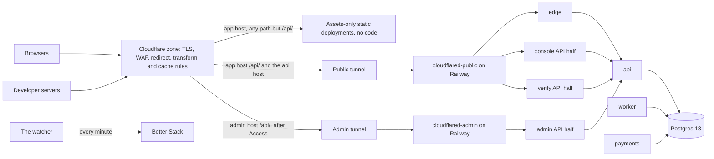

# Spec 01: Phase 0, the platform and the repository bootstrap

| | |
|---|---|
| Status | Specification for builders, written on Saturday 21 Nov 2026 for Phase 0 (Saturday 08:00 to 13:30 on the build clock; the time zone is in the private overlay, [G-09]) |
| Part of | The fin-next plan (R13): `docs/plan/ARCHITECTURE.md`, `docs/plan/DECISIONS.md` and `docs/plan/EXECUTION.md`. This spec details EXECUTION §2 and applies the owner's later decisions of 21 Nov (§1) and the decisions of Saturday morning (§1.2) |
| Requirements touched | R1, R2, R3, R4, R5, R6 (ground only), R7 (ground only), R8 (ground only), R9, R10, R11, R12, R13, R14, R15, R16 (§0.2) |
| Lanes | Steward, P0-B (CI), P0-D (server, host, core), P0-E (data, crypto, audit), P0-F (ops), P0-G (UI foundation), the ops agent. fin-review (P0-C) and the spec lane (L-SPEC) appear only where named; the fin-review MVP has its own section in EXECUTION §2.4 |
| Exit | §13: AC-P0-01 to AC-P0-41 (01 to 17 are EXECUTION §2.11's, as EXECUTION words them; 18 onwards are this spec's and add to them). Phase 0 exits at 13:30; AC-P0-04, AC-P0-27 and AC-P0-36 are checked by the end of Saturday. AC-P0-03 and AC-P0-13's builder-token half move to hardening (D6), and AC-P0-30's escrow check waits for CR-10 ([BD-14]); AC-P0-10's header check waits for the owner |

---

## 0. How to read this spec

### 0.1 Precedence, IDs and placeholders

**Precedence.** The plan's one order of precedence, highest first: (1) the owner's decisions of
21 Nov 2026; (2) DECISIONS.md, appendix C included; (3) ARCHITECTURE.md; (4) EXECUTION.md; (5) the
specifications, and between two specifications the one that owns the area, as README §8.3 lists
the owners. The owner's decisions are those DECISIONS.md records as the owner's: the overnight ones,
which §1 lists as OD-1 to OD-6, and the answers of Saturday morning, which §1.2 lists. They override
every other text. The decisions taken while the owner was away are register entries, for the
owner's review (§1.2). Among the specifications, this spec owns the platform (the
repository and its rules, the monorepo, the CI skeleton, Railway, Cloudflare, Better Stack's set-up,
Phase 0's secrets and spikes), the sibling owns any other area, and spec 08 owns the cross-cutting
rules of audit, security email, personal data, scrubbing, secrets and observability. A decision of
this spec (S0-nn, §14) binds where everything above it is silent. One that differs from
ARCHITECTURE.md or EXECUTION.md binds only once that file is changed to match; until then that
file's text holds. One that would change a register entry binds only as DECISIONS appendix C
settles it: S0-01, S0-03, S0-05 and S0-17 are folded (SF-01, SF-04, SF-05), and S0-04 and
S0-18's first form (CR-20 in `staging`) are not adopted (SF-02, SF-03). S0-11 (the overlay in CI) and
S0-18's later proposal (the zone name beside CR-20) would change register entries too, but have no
appendix C row, so they do not bind until the owner settles them there (§15, item 14). A conflict
with the register found later is settled the same way, and the register holds until it is. Where
this spec repeats a rule, it names the section it comes from and keeps it short; where it differs
from ARCHITECTURE or EXECUTION, §1 or §14 says so, and the higher file holds until it is amended.
Anything marked **UNVERIFIED** is confirmed by the spike named beside it before work that depends on
it merges.

| ID form | Meaning | Register |
|---|---|---|
| `[XX-nn]` | A decision | DECISIONS.md, the only register |
| `S0-nn` | A decision this spec makes where the plan is silent | §14. Those that change a register entry are settled in DECISIONS appendix C (SF-01 to SF-05); the steward copies the rest into DECISIONS.md in a later pull request of the plan |
| `SF-nn` | A spec decision settled in the register before the first commit, folded or not adopted | DECISIONS appendix C |
| `OD-n` | An owner decision of 21 Nov 2026, by this spec's short name; DECISIONS.md records each in its overnight table | §1 |
| `P0-n` | A Phase 0 step | EXECUTION §2.1 |
| `SP-nn`, `FW-Sn`, `S-nn` | A spike. `S-01` to `S-04` are EXECUTION's front-door spikes: S-01 is SP-25, S-02 is FW-S2's browser checks, S-03 is SP-07 and S-04 is SP-08's egress part | ARCHITECTURE §11.11, §5.15 and §3.4; EXECUTION §2.6; §11 here |
| `AC-P0-nn` | A Phase 0 acceptance criterion | §13 (01 to 17 are EXECUTION §2.11's; 18 onwards are new here and follow EXECUTION's last number) |
| `CR-nn` | A credential or account the owner provides | EXECUTION §2.9 (the whole list, CR-01 to CR-25, with CR-05b) and §0.3 (the exact scope of those due before 10:00); §9.4 here |
| `NF-n` | A new finding a spike run recorded | `docs/plan/spikes.md` |
| `(D6)` | Marks work that the owner's trim of Phase 0 on 21 Nov (about 08:25) moved to hardening, before production, as in "moves to hardening (D6)": the builder account, the agents' own OS users, signed review receipts and the private overlay's ceremony, and what stands in until then. It is not the 19 Nov decision D6 | §1.2 |
| `PG-nn` | A production gate | EXECUTION §7.3. Production gates use `PG-` only; `G-` belongs to governance decisions |
| `FW-Cnn`, `FW-Xn` | A framework condition or reversal trigger | ARCHITECTURE §3.4 |
| `L-SAT-nn` | A Saturday lane that takes files from a Phase 0 lane | EXECUTION §3.2 |

| Placeholder | Stands for |
|---|---|
| `<zone>` | A Fin zone in general |
| `<staging-zone>` | The shared staging zone ([FD-09]), which the old product's staging also uses; every Phase 0 host lives here, on fin-next's own names (§7.2) |
| `<app>.<zone>` | A host, for example `console.<staging-zone>`. On staging a host's first label is the name [FD-09] gives its role, which is not always the app's name: `staff.` is Fin Admin's, `onboard.` verify's, `docs.` the docs site's and `gateway.` the API's (§7.2) |
| `<builder account>` | The builder machine account ([CI-13]), which moves to hardening (D6) |
| `<tunnel id>`, `<account id>`, `<team>`, `<aud>` | Values that live only in Cloudflare, Railway, Better Stack or the private overlay, never in the repository |
| `<sha>` | A full 40-character commit SHA |

**Words.** A *static host* is an app host whose files Cloudflare serves from an assets-only static
deployment. An *API half* is the Hono service on Railway that answers `<app>.<zone>/api/*`. *The
overlay* is the private settings file that [G-09] lists ([OB-13]). Until hardening it is kept only
on the build machines (machine A and machine B), outside every repository, where `pnpm fin` and the
public-safety check read it. The ceremony (the owner giving it at the secure prompt, with its
encryption and escrow) moves to hardening (D6). *The secure prompt* is the only way a credential
reaches a command, except that until the owner is back `pnpm fin` reads the staging credentials the
owner gave there at about 08:37, and the vault's ops and state writer tokens minted from them
(CR-15), from their owner-only files on the build machine (§9.1). A *registered run* is a `pnpm fin`
run written to the ops bucket before it changes anything (ARCHITECTURE §6.10).

### 0.2 Requirements this spec touches

| Req | What Phase 0 delivers for it | Where |
|---|---|---|
| R1 | A from-scratch repository with the security core on from the first deploy: tunnels, the ingress check, the watcher, per-service database roles, the supply-chain policy, the merge gate | §3 to §10 |
| R2 | Every service and Postgres 18 on Railway staging; only what [P-02] lists sits elsewhere | §6 |
| R3 | The staging zone's `auth.` and `notify.` sending subdomains, the email token, and one email delivered through the outbox | §7.8, AC-P0-10 |
| R4 | Cloudflare in front of everything: tunnels for every API host, static hosting at Cloudflare with no code, no Railway public domain or TCP proxy | §7 |
| R5 | The `fin-staging` team: sources, Errors, monitors, heartbeats, alerts, the quiet staging policy | §8 |
| R6 | No feature. The ground Saturday needs: FW-S2 (Better Auth on Hono under the static shape) and the origin and cookie rules in the shared API host | §4.4, §11 |
| R7 | The verify and selfie static hosts; static egress on `api` and `worker` for Sumsub's allowlist | §6.5, §7.2 |
| R8 | The `payments` service and its static egress for MassPay's allowlist | §6.2, §6.5 |
| R9 | The platform's own audit (run registrations, deploy windows, privileged logins, settings drift, static deploys), and the audit tables, functions and guard from P0-E | §6.10, §10 |
| R10 | The fast CI skeleton, driven by fin-review's deterministic `plan` | §5 |
| R11 | Until hardening, the merge gate is fin-review's local run on the pull request's exact head, recorded in the pull request, whose sessions R11 bounds in code ([G-10]; the validator itself is EXECUTION §2.4's). The gate verifies signed receipts from hardening (D6) | §5.4 |
| R12 | The public repository `aktharazif/fin-next` and its settings | §3 |
| R13 | The plan merged first, as pull request 1, before any code | §3.1 |
| R14 | The UI foundation on the UI SDK, the tokens, both frames with the edge toggle | §4.3, §12 |
| R15 | Node 26.13.1 for everything; the Bun canary job skeleton (`bun` in `ci.yml`) | §4.1, §5.3 |
| R16 | `gateway.<staging-zone>` straight to the tunnel; `docs.<staging-zone>` as a static host; CORS on the edge for the docs origin only | §7.2 |

---

## 1. Owner decisions applied here (21 Nov 2026)

These were taken while the plan was being written. DECISIONS.md records each, with the owner's
words, in its table "The owner's decisions of 21 Nov 2026, overnight" and the blocks named there;
OD-1 to OD-6 are this spec's short names for them. ARCHITECTURE.md and EXECUTION.md follow them, so
the table names where each is recorded and what it changes in this spec. The last of them
(OD-2 and OD-3) supersede the owner's earlier same-day decisions to use Cloudflare Pages and Origin
Rules: research notes C1 and C3 found that the Origin Rules overrides that would route `/api/*` are
Enterprise-only, and the owner chose the assets-only static deployment instead.

| # | Decision | Register | What it changes here |
|---|---|---|---|
| OD-1 | cloudflared tunnels for all hosts: one public and one admin tunnel, each token only in its own connector service's sealed variables; connectors checked every minute for count, version and origin; an evict runbook; Cloudflare's headers trusted only from connector peers | [FD-01], [FD-13]; with [FD-11], [FD-14], [FD-15] and [FD-16] | §7.3, §7.11, §9.7 |
| OD-2 | The single-page apps (Shape B, [FW-01]) stay. Their static builds (console, Fin Admin, verify, docs) are served by Cloudflare's "Workers static assets" as an **assets-only deployment with no script**: no `main`, no bindings, no `run_worker_first`; `not_found_handling: single-page-application`; `workers_dev: false`; `preview_urls: false`; security headers from a `_headers` file per app. Hono stays only as the API and auth server on Railway | [FD-17], [SA-45]; the upload [FD-19], [BD-16]; the theme and sidebar [UI-13] | `console`, `admin` and `verify` on Railway answer only `/api/*` and private health; there is no `docs` service (SF-01); every static output's `_headers` is rendered at deploy from its profile in `packages/web-host/src/static/` (§7.4); `tools/static-deploy` uploads the builds through Cloudflare's API, with Node built-ins only and no `wrangler` ([BD-16]). It runs from the operator machine until the owner is back, then in a job and environment of its own (§6.9, [BD-05]) |
| OD-3 | Routing per app host: a Workers route `<app>.<zone>/*` to the assets-only deployment, and a zone route `<app>.<zone>/api/*` with **no Worker**, which falls through to the host's proxied CNAME to the tunnel. The tunnel matches the host plus `^/api/` and ends with `http_status:404`. `api.<zone>` goes straight to the tunnel. Fallback if the spike fails: per-app API hosts (`console-api.<zone>`), same site, with CORS and credentials | [FD-18] | §7.2 to §7.5; SP-25 (S-01), which passed on 21 Nov, so §7.12's fallback is not needed |
| OD-4 | Cookies are host-only `__Host-` on each app host: the session cookie `SameSite=Strict`, every other auth cookie `Lax`. CSRF: an exact `Origin` check, `Sec-Fetch-Site`, the `X-Fin-App` header and JSON-only bodies, plus Better Auth's origin check with exact trusted origins | [SA-43], [SA-44] | §4.4 (the shared API host); FW-S2 and S-02 |
| OD-5 | The UI is built on the UI SDK (`@ui-sdk/react` and `@ui-sdk/core`, Apache-2.0), not on a vendored copy of the design system's private source. Only the design system's token values and specs are used | [UI-10], [UI-12] (no, decided by the owner at about 08:28), [G-06] | §4.8's dependency set; P0-G builds the packages fresh on the UI SDK from the canvases and the specifications (§12); nothing is ported |
| OD-6 | The sidebar collapses with an **edge toggle**: a small round chevron button on the sidebar's right edge near the top, always visible, `‹` collapses and `›` expands. The logo is a plain 24px mark linking Home, with no hover swap | [UI-11] | P0-G's AppFrame, and AdminFrame at step 4 of Saturday's build order (L-SAT-12; EXECUTION §3.3) |

### 1.1 The framework conditions under the static shape

ARCHITECTURE §3.4 states each condition as rewritten; this table is a short guide for Phase 0's
builders, not a change to it.

| Condition | Under the static shape |
|---|---|
| FW-C02 | `packages/web-host` becomes the host the three API halves share (ingress, origin gate, error envelope, health, API headers, route-policy helper) plus the renderer of each static host's `_headers` and `env.json` (§7.4) |
| FW-C03 | Steps 5 (static files) and 9 (the document) move to Cloudflare. Steps 1 to 4 and 6 to 8 stay, under `/api`. On Fin Admin, Access covers the static files at Cloudflare's edge, and the API half checks the Access token on every `/api` request |
| FW-C04 | Rewritten under the same ID (it was the templated document with a per-request nonce). `index.html` is a static file with a nonce-less `<meta property="csp-nonce">`, a render-blocking external `/theme.js`, and the module entry |
| FW-C05 | The page policy has no nonce: `style-src 'self'` (§7.4). FW-X7's fallback is unchanged: `'unsafe-inline'` for styles only |
| FW-C06 | Rewritten under the same ID (it was the style nonce for injected styles). The UI SDK adopts constructed style sheets when the meta tag carries no nonce; each app's stylesheet starts with `@layer ui-sdk;` (research note D1 §9) |
| FW-C09 | The origin gate also requires `X-Fin-App: <app>` on every unsafe method (§4.4) |
| FW-C10 | A redirect before any JavaScript runs is impossible. The entry shows the skeleton and redirects to `/sign-in?next=` when the viewer request answers 401 |
| FW-C13 | The previous release's `assets/` travel in the static artefact, not in the image (§5.5) |
| FW-C16 | Readiness no longer waits for a templated document |
| FW-C17 | Journeys run against the static build served by `packages/testing`'s static host, which applies the same `_headers` and proxies `/api/` to the `test` image (§4.7) |
| FW-S1 | Redefined in §11 (no per-request nonce exists) |
| [UI-13] | The theme and the sidebar choice live in `localStorage` under the keys `fin-theme` and `fin-sidebar` (spec 06 S6-04), read by `/theme.js` before first paint, every access in try/catch (S0-07); [UI-05]'s cookies are superseded |

### 1.2 The decisions of Saturday morning (21 Nov 2026)

The owner answered the sitting's questions from about 08:25 and, from about 08:41, left the build to
work unsupervised. DECISIONS.md records each answer in its entry, and the decisions taken while the
owner was away in its away-time log ("Decided while the owner was away"), for the owner's review.
This table names what each changes here. Times are on the build clock.

| Decision | Who decided | What it changes here |
|---|---|---|
| The sitting's decisions take their defaults, except [UI-12] and [FD-09] (below); [G-06] is approved as amended | The owner, about 08:25 ("defaults") | §3.1, §3.6, §4.8; §15, items 2 and 3 |
| [UI-12] is no: nothing is ported from the old product's redesign branch, and the UI is built fresh on the UI SDK from the new design canvases | The owner, about 08:28. Saturday's build order for the UI lane (EXECUTION §3.3), which §12 follows, is the steward's | OD-5, §4.3, §12; §15, item 11 |
| [FD-09]: staging lives on the shared staging zone, in the existing Cloudflare account, so CR-05b is not needed | The owner, about 08:30. The staging names and the rules for the shared zone are the steward's, except the zone-rule writes ([BD-11]) and the DMARC records' policy and reports ([BD-17]), which are the build's | §0.1's placeholders, §7.1, §7.2 and every staging host; §7.5 to §7.8 and §7.11 |
| The staging accounts exist and their credentials are in; CR-06 is met | The owner, about 08:30 and 08:37; CR-06's status is the build's finding (Workers Paid and R2 already active) | §6.1, §7.1, §8.1, §9.4, §12 |
| The agents apply the repository settings, and fin-next's guard hooks start fresh | The owner, about 08:25 and 08:30 | §3.1, §3.2, §3.8 |
| Phase 0 is trimmed: the builder account, the agents' own OS users, signed review receipts and the private overlay's ceremony move to hardening (D6) | The owner, about 08:25. [G-10]'s interim merge rule and keeping the private settings on the build machines (machine A and machine B) are the steward's | §2, §3.5, §3.9, §5.4, §9.2, §13 |
| fin-review runs locally as the merge gate until CI has an Anthropic credential (CR-03) | The owner, about 08:49 | §5.4 |
| The Railway workspace token is a setup fallback, which the owner revokes on Mon 23 Nov | The owner, about 08:49 | §6.1 |
| Fin Admin's first staff admin on staging is the owner's staff address, never written in this repository; its two TOTP secrets, Fin Admin's and Access's own factor, are kept only on the build machine | The owner, about 08:49. Keeping its TOTP secrets on the build machine is the steward's | §6.6, §7.7, §9.1, §12 |
| Staging's Access lets the staff addresses in with a One-time PIN ([FD-05]) | The steward | §7.7 |
| CR-25 was not given as a token of its own: the operator token (CR-05) covers CR-25's part until the owner is back, and renewing CR-05 before Thu 26 Nov makes §7.10's narrow tokens, CR-05 and CR-25 | The steward | §7.9, §7.10, §9.4, §9.6 |
| The build's decisions, [BD-01] to [BD-29] (BD-15 and BD-25 are withdrawn) | The build, under the owner's away-time authority | where each is cited |

---

## 2. What Phase 0 delivers

Phase 0 is trimmed (the owner, 21 Nov, about 08:25). It covers the repository settings, the monorepo
scaffold, CI, the fin-review minimum (with R11's model and effort rules enforced in code), Railway,
Cloudflare and Better Stack staging, and the spikes. The builder account, the agents' own OS users,
signed review receipts and the private overlay's ceremony move to hardening (D6).

At the Phase 0 exit (13:30), staging is a walking skeleton:

- `aktharazif/fin-next` is public, with the plan merged as pull request 1, its settings applied, the
  ruleset on, CODEOWNERS, Dependabot and the minimal CI whose `gate` is the only required check.
- The monorepo builds, lints, typechecks and tests on Node 26.13.1 with pnpm and its supply-chain
  policy proven (SP-01).
- Railway staging runs 15 services (three at 0 replicas) and Postgres 18 with PITR, with no public
  domain and no TCP proxy anywhere.
- Cloudflare serves five static hosts with no code, four on staging for now (the fifth, `selfie.`,
  waits for Sunday, [BD-28]), routes `/api/*` and `gateway.<staging-zone>` through two tunnels, puts
  Access in front of Fin Admin, and has the email sending domains onboarded.
- Better Stack receives every service's lines and errors; monitors, heartbeats and alerts exist and
  email the quiet staging policy.
- The watcher checks the front door every minute from outside Railway.



Every request to Railway enters through a connector. The static half of every app host never reaches
Railway. `docs.<staging-zone>` has no `/api/` path at all.

---

## 3. The public repository

### 3.1 The repository as it stands, and the plan's merge

| Step | Who | What | Check |
|---|---|---|---|
| 0 | Owner | Before the plan is public, confirm outside this repository that the old product's staging is behind Access or on its dependencies' current security releases ([G-09]) | Recorded outside this repository; step 4 waits for it |
| 1 | Steward | Run the public-safety check (the script P0-4 commits as `scripts/public-safety.mjs`, run from the steward's scratch copy) over the plan branch's `docs/plan/` and root `README.md` with the overlay's refuse list | Exit 0, recorded outside this repository |
| 2 | Owner | Nothing to create: the repository exists, public, and `main` holds one commit, its root commit `Initial commit`, a two-line `README.md`. The plan is on branch `plan/initial` as pull request 1, which adds `docs/plan/**` and replaces the root `README.md` and changes nothing else | `git log origin/main` shows the root commit only; the pull request's file list is its 13 files: the root `README.md` and the 12 files then in `docs/plan/` |
| 3 | The build session (the agents apply the settings: the owner, 21 Nov, about 08:25, "u do") | Apply the settings of §3.2. Those §3.2 marks "applied 21 Nov" are on; each other row but the plan is applied the same way and read back. The ruleset is on too (§3.3, [BD-02]); the environments are made when the owner is back (§3.4, [BD-05]) | `pnpm fin github verify` once it exists; until then the steward's read-back script prints each setting |
| 4 | Owner | Merge pull request 1 with a merge commit (`gh pr merge 1 --merge --match-head-commit <full head sha>`, the head the steps above checked). It is the bootstrap merge: no gate exists yet, and it is the first entry in `docs/review/bootstrap.json` (spec 07 §2.3.4). The root `README.md` is the public repository's landing page and states [G-03], decided at its default; the `LICENSE` file follows with the root files of §3.8. Nothing is ever pushed to `main` directly | AC-P0-01 |
| 5 | The agents (the environments); the owner (the builder account, in hardening) | Create the `staging` and `staging-static` environments (§3.4) through GitHub's API when the owner is back ([BD-05]), with the owner's account as their only required reviewer. Adding the `<builder account>` as a collaborator with write access moves to hardening (D6), with its SP-23 check | §3.4; §3.5; SP-23, in hardening |

### 3.2 Repository settings

The agents apply these settings, not the owner in GitHub's UI (the owner, 21 Nov, about 08:25: "u
do"), through the REST calls below, later by `pnpm fin github apply` (with the owner's account's
token at the secure prompt), and `pnpm fin github verify` reads them back daily with a read-only
token. The build session applied these on 21 Nov: Actions limited to GitHub-owned actions, with SHA
pinning required; approval of fork pull requests for all outside contributors; Dependabot alerts and
security updates; private vulnerability reporting; "allow update branch"; interaction limits of
collaborators only, for six months, which lapse six months after 21 Nov 2026 unless renewed; and
artefact and log retention of 90 days, already GitHub's default. Every other row but the plan is
applied the same way and is not marked applied until it is read back. A difference is `github-settings-changed`
(§8.7). Where a REST field name is given, the implementer confirms it against GitHub's current REST
reference before writing the call; a field GitHub does not accept is reported, never skipped
silently, and so is a setting GitHub accepts but does not apply, like [BD-01]'s.

| Area | Setting | Value | REST call |
|---|---|---|---|
| Features | Issues, Projects, Wiki, Discussions | all off | `PATCH /repos/{o}/{r}`: `has_issues`, `has_projects`, `has_wiki`, `has_discussions` = `false` |
| Merging | Merge commits only | merge on; squash off; rebase off; auto-merge off; "always suggest updating" on (applied 21 Nov); delete head branches on | `allow_merge_commit: true`, `allow_squash_merge: false`, `allow_rebase_merge: false`, `allow_auto_merge: false`, `allow_update_branch: true`, `delete_branch_on_merge: true` |
| Strangers' text | Interaction limits | collaborators only, six months (applied 21 Nov), renewed before expiry ([CI-15]); the renewal date is in `ops/credentials.json` | `PUT /repos/{o}/{r}/interaction-limits`: `limit: collaborators_only`, `expiry: six_months` |
| Secrets | Secret scanning and push protection | on | `PATCH /repos/{o}/{r}`: `security_and_analysis.secret_scanning.status` and `secret_scanning_push_protection.status` = `enabled` |
| Secrets | Non-provider patterns and validity checks | off: a personal account does not offer them; the API accepts the change, but both stay off ([BD-01]) | `PATCH /repos/{o}/{r}`: their two `security_and_analysis` fields (names confirmed as above) |
| Dependencies | Dependabot alerts and security updates | on (applied 21 Nov) | `PUT /repos/{o}/{r}/vulnerability-alerts`; `PUT /repos/{o}/{r}/automated-security-fixes` |
| Reports | Private vulnerability reporting | on (applied 21 Nov) | `PUT /repos/{o}/{r}/private-vulnerability-reporting` |
| Code scanning | CodeQL default setup | not configured until code exists; then configured, with the default query suite for JavaScript and TypeScript, and Actions ([BD-04]) | `PATCH /repos/{o}/{r}/code-scanning/default-setup`: `state: configured`, made once code exists |
| Actions | Which actions | GitHub-owned actions only; no listed pattern and no "verified creators" (applied 21 Nov; the Bun canary installs Bun by checksum, [BD-03]) | `PUT /repos/{o}/{r}/actions/permissions`: `enabled: true`, `allowed_actions: selected`; `PUT .../actions/permissions/selected-actions`: `github_owned_allowed: true`, `verified_allowed: false`, `patterns_allowed: []` |
| Actions | Pinned to a full SHA | required (applied 21 Nov) | `sha_pinning_required: true` on the permissions call |
| Actions | Default `GITHUB_TOKEN` | read-only; Actions may not create or approve pull requests | `PUT .../actions/permissions/workflow`: `default_workflow_permissions: read`, `can_approve_pull_request_reviews: false` |
| Forks | Approval to run | required for all outside contributors ([CI-08]; applied 21 Nov); forks never receive secrets or write tokens (GitHub's rule on public repositories) | `PUT .../actions/permissions/fork-pr-contributor-approval`: `approval_policy: all_external_contributors` |
| Retention | Artefacts and logs | 90 days, already GitHub's default (applied 21 Nov; static artefacts need it for rollback, §5.5); e2e reports set 7 days on upload | `PUT .../actions/permissions/artifact-and-log-retention`: `days: 90` |
| Plan | GitHub Pro on the owner's account | from Saturday ([CI-06]); the owner's step, not the agents': it is a plan upgrade with new spending, which the away-time authority excludes | the owner, in GitHub's billing pages; `pnpm fin github verify` reads the plan back |

Discussions and Wiki stay off for good; GitHub keeps forking on for public repositories, and fork
pull requests are handled by approval, no secrets and no AI review ([CI-08]).

### 3.3 The ruleset on `main` (on from 21 Nov; `gate` added at P0-3, after the CI pull request merges)

The ruleset is on from 21 Nov ([BD-02], [BD-07]). It is made with `POST /repos/{o}/{r}/rulesets` and
this body less its `required_status_checks` rule. Since 21 Nov the ruleset also requires the status
`commit-dates-utc` ([BD-18]), which the body below does not show. `gate` joins as the CI pull
request's step, as planned: P0-3 adds it with `PUT /repos/{o}/{r}/rulesets/{ruleset id}` after the
CI pull request merges ([CI-01], [BD-02]), and the same call drops the separate `commit-dates-utc`
requirement, since `gate` needs CI's job of that name ([BD-18]); the body below is then exact.
`15368` is the GitHub Actions app's ID; the implementer confirms it with `GET /apps/github-actions`
before the call.

```json
{
  "name": "main",
  "target": "branch",
  "enforcement": "active",
  "conditions": { "ref_name": { "include": ["~DEFAULT_BRANCH"], "exclude": [] } },
  "bypass_actors": [],
  "rules": [
    { "type": "deletion" },
    { "type": "non_fast_forward" },
    {
      "type": "pull_request",
      "parameters": {
        "required_approving_review_count": 0,
        "require_code_owner_review": false,
        "dismiss_stale_reviews_on_push": true,
        "require_last_push_approval": false,
        "required_review_thread_resolution": false,
        "allowed_merge_methods": ["merge"]
      }
    },
    {
      "type": "required_status_checks",
      "parameters": {
        "strict_required_status_checks_policy": true,
        "do_not_enforce_on_create": false,
        "required_status_checks": [{ "context": "gate", "integration_id": 15368 }]
      }
    }
  ]
}
```

No `required_linear_history` (merge commits are the design). Until hardening the ruleset requires 0
approvals and no code-owner review ([BD-02]): with no builder account until hardening (D6), the owner's account
authors every pull request, and GitHub cannot record the owner's approval of the owner's own pull
request. So GitHub does not enforce [CI-14]'s control-path approval until hardening. fin-review's
reviews (EXECUTION §1.7) stand in, and every control-path pull request merged while the owner is
away is listed in DECISIONS' away-time log, for the owner's review when back. In hardening
`require_code_owner_review` becomes `true`, once the builder account authors pull requests, and
SP-23's check moves there: if code-owner review cannot be required while general approvals stay at
zero, `required_approving_review_count` becomes 1 and the owner approves in the merge batches
([CI-01]'s default).

### 3.4 The `staging` and `staging-static` environments

These environments come when the owner is back ([BD-05]). Until then none exists, no GitHub
environment holds a secret, and staging deploys run from the operator machine through `pnpm fin`
(§6.9). The table is what they are created with.

Two environments, so that no job ever holds both Railway's secrets and the static deploy token
([CI-03], [FD-19]):

| Field | `staging` | `staging-static` |
|---|---|---|
| Used by | `deploy-staging` and `finish-staging` (the Railway deploy's two halves around the static upload, `ops/fin`, §6.9) and `sourcemaps-staging` (the build's browser maps to Better Stack, [FD-19]), each naming in `env:` only the secret it needs | `deploy-static-staging` only (the render and the static uploads, `tools/static-deploy`) |
| Required reviewers | the owner's account only (`reviewers: [{ "type": "User", "id": <owner's user ID, read at run time> }]`) | the same |
| Prevent self-review | off (until hardening the owner's account authors and merges every pull request, [BD-02], so the owner approves runs that the owner's own account triggered) | off |
| Deployment branches | custom policy, one rule: branch `main` | the same |
| Wait timer | 0 | 0 |
| Secrets | §9.5's two for `staging` (CR-04 and staging's CI Telemetry token, [CI-03]), and nothing else | CR-20 alone, and nothing else ([FD-19], SF-03) |

### 3.5 Identities

Until hardening there is no builder account and no dedicated OS user: agent sessions work with the
owner's login ([BD-02]), and fin-review runs in the agents' sessions. The builder account, the
`fin-builder` and `fin-review` OS users, the receipt-signing key and the CI lane's second token move
to hardening (D6), as follows. As [CI-13] and ARCHITECTURE §11.1 say: the owner's account is admin,
code owner and the only reviewer of both environments; the `<builder account>` is a write collaborator whose token cannot change
workflow files, settings, environments or secrets and cannot approve a deployment (proven by
SP-23); agent sessions run as the `fin-builder` OS user, reviews as the `fin-review` OS user, which
alone holds the receipt-signing key. Only the CI lane's session holds a second token that may change
`.github/workflows/`.

### 3.6 CODEOWNERS

`CODEOWNERS` at the root, the owner for every control path ([CI-14], ARCHITECTURE §11.1). Until
hardening the ruleset does not require code-owner review ([BD-02]), so the file names each control
path's owner, and GitHub enforces the review from hardening. By [CI-14], decided at its default,
these include the header profiles and their renderer
(`packages/web-host/src/static/`, [SA-45]), each app's `static.json` and `tools/static-deploy/`,
because they decide the page policy and what Cloudflare serves. The file holds [CI-14]'s list and
nothing more. S0-12 proposes two more, `.githooks/` and `.gitleaks.toml`; they bind only once [CI-14]
adopts them, and then one pull request adds both lines here and both entries to `controlPaths`
(§4.3):

```
# Control paths: they need the owner (DECISIONS.md CI-14); GitHub enforces the review from hardening (BD-02).
/.github/                         @aktharazif
/.claude/                         @aktharazif
/CODEOWNERS                       @aktharazif
/AGENTS.md                        @aktharazif
/CLAUDE.md                        @aktharazif
/CONTRIBUTING.md                  @aktharazif
/SECURITY.md                      @aktharazif
/pnpm-workspace.yaml              @aktharazif
/scripts/check-supply-chain.mjs   @aktharazif
/scripts/public-safety.mjs        @aktharazif
/tools/fin-review/                @aktharazif
/tools/layout.json                @aktharazif
/docs/review/                     @aktharazif
/ops/fin/                         @aktharazif
/ops/docker/                      @aktharazif
/tools/static-deploy/             @aktharazif
/packages/web-host/src/static/    @aktharazif
/apps/*/static.json               @aktharazif
```

A test in `layout:check` fails when CODEOWNERS and the control-path list in `tools/layout.json`
differ, and when an app's `static.json` or a header profile is outside both (AC-P0-19).

### 3.7 Dependabot

`.github/dependabot.yml`. The cooldown matches `minimumReleaseAge` (three days). Grouped moves follow
FW-C18. Dependabot's own pull requests are treated like forks by GitHub (no secrets); fin-review
reviews them locally.

```yaml
version: 2
updates:
  - package-ecosystem: npm
    directory: /
    schedule: { interval: daily }
    cooldown: { default-days: 3 }
    open-pull-requests-limit: 5
    versioning-strategy: increase
    groups:
      tanstack:    { patterns: ["@tanstack/*"] }
      better-auth: { patterns: ["better-auth", "@better-auth/*", "better-call"] }
      hono:        { patterns: ["hono", "@hono/*"] }
      vite:        { patterns: ["vite", "@vitejs/*", "@tailwindcss/vite", "tailwindcss"] }
      react:       { patterns: ["react", "react-dom", "@types/react", "@types/react-dom"] }
      ui-sdk:      { patterns: ["@ui-sdk/*"] }
      sentry:      { patterns: ["@sentry/*"] }
  - package-ecosystem: github-actions
    directory: /
    schedule: { interval: daily }
    cooldown: { default-days: 3 }
  - package-ecosystem: docker
    directory: /ops/docker
    schedule: { interval: daily }
    cooldown: { default-days: 3 }
  - package-ecosystem: docker-compose
    directory: /
    schedule: { interval: weekly }
    cooldown: { default-days: 3 }
```

Whether Dependabot updates a pnpm 12 lockfile is checked in SP-01 (UNVERIFIED). If it cannot, the
`npm` entry is removed and `nightly.yml` lists outdated packages for the steward, who opens one
dependency pull request per package after the owner's yes. Images pinned inside workflow files (the
Postgres service and the Playwright container) are not seen by Dependabot; the steward moves them
with their package pins and records the digest read from the registry.

### 3.8 Files written fresh

EXECUTION §2.2's table holds (`AGENTS.md`, `CLAUDE.md`, `CONTRIBUTING.md`, `CODEOWNERS`,
`SECURITY.md`, `LICENSE` per [G-03], `pnpm-workspace.yaml`, `.node-version`, `tsconfig.base.json`,
`scripts/public-safety.mjs`, `tools/layout.json`; no merge guard in Phase 0, [BD-07]), with these
additions:

| File | What it says | Owner |
|---|---|---|
| `AGENTS.md` | Also: the static shape (OD-2, OD-3): no route under `/api` in any SPA, no code ever uploaded to a static deployment, no Worker except the watcher; cookies and the origin gate (OD-4); screens from `@fin/ui` on the UI SDK (OD-5) | Steward |
| `.gitleaks.toml` | Fin's token shapes: `fin_test_`, `fin_live_`, `cfat_`, `whsec_`, the `age` secret-key prefix, Cloudflare tunnel tokens (base64 JSON with `a`, `t`, `s` keys), Better Stack heartbeat URLs and source tokens, Railway token shapes, PEM private keys; redacted output | Steward |
| `.githooks/pre-push` | Calls `node scripts/pre-push.mjs`: the public-safety check and gitleaks over the pushed range ([CI-16]), and [G-09]'s commit-date rule, which refuses a pushed commit whose author or committer date carries an offset other than `+0000`. The pushed range is the commits not yet on the remote (`git rev-list <local sha> --not --remotes`), never a new branch's whole history, so the commits GitHub makes never trip it: the root commit and pull request merges, which carry the account's offset, and the update-branch merges, whose offset is UNVERIFIED ([G-09]'s note). The public-safety check in CI reads tracked files only and judges no commit date. Each machine runs `git config core.hooksPath .githooks` once | Steward |
| `scripts/check-supply-chain.mjs` | §4.2's refusals | Steward |
| `docs/plan/spikes.md` | The spike log (§11.3), started by the plan's follow-up pull request; S-01's run is its first row | Steward; the build adds rows through pull requests ([BD-06]) |
| `docs/flows/atlas.json` | Phase 0's flows (the atlas is kept, [G-07]): `F-deploy-staging` and `F-request-through-tunnel` | P0-F |
| `docs/security/threat-model.json` | Phase 0's services, hosts, secrets and roles, so `threat-model:check` runs from the start | Steward |

### 3.9 The order the rules come on (EX-03)

| Order | Change | Merged by | Server-side gate |
|---|---|---|---|
| 0 | The root commit `Initial commit`: a two-line `README.md` | already on `main` | none |
| 1 | Pull request 1: the plan, `docs/plan/**` and the root `README.md` (§3.1) | Owner, a bootstrap merge listed in `docs/review/bootstrap.json` | none |
| 2 | Pull request 2: the scaffold, the rules files, the workspace and root files, `CODEOWNERS` among them (no merge guard in Phase 0, [BD-07]); merged before any gate existed | Merged while the owner was away ([BD-02]); listed in `docs/review/bootstrap.json` (spec 07 §2.3.4, step 4) and in the away-time log | the ruleset without `gate` (pull request required, merge commits only, no push to `main`, [BD-02]) |
| 3 | The CI pull request, after pull request 2: minimal `ci.yml` (§5.2) | The owner, or the steward while the owner is away ([BD-02]), after the hand-started security and attack sessions (EX-18); one merged while the owner is away is listed in the away-time log | the ruleset without `gate` (pull request required, merge commits only, no push to `main`, [BD-02]); `gate` advisory |
| 4 | `gate` added to the ruleset (§3.3), which is on from 21 Nov ([BD-02]); later changes to the rules files and root files are control-path pull requests | `gate`: the steward, by API (the agents apply the settings). Later control-path pull requests: the owner, or the steward while the owner is away ([G-10], [BD-02]), with EX-18's reviews until the fin-review MVP gates them, then [G-10]'s interim merge rule; each one merged while the owner is away is listed in the away-time log | `gate` required; receipts advisory until hardening, with [G-10]'s interim merge rule (D6) |
| 5 | The pull request that adds `tools/fin-review/src/receipt/check.ts` (spec 07 §13.4, RP-05's receipt part): moves to hardening (D6) | Owner | receipts enforced (`enforcing-local`) from the moment it is on `main` (§5.4); until then [G-10]'s interim merge rule governs merges |

---

## 4. The monorepo scaffold

### 4.1 Runtime and package manager

| What | Pin | How it is installed |
|---|---|---|
| Node.js | 26.13.1 ([P-05]) | Locally from nodejs.org with its `SHASUMS256.txt` checked; in CI by `actions/setup-node` with `node-version-file: .node-version`; in images by the pinned base image (ARCHITECTURE §3.3) |
| pnpm | 12.21.0; 11.28.12 if SP-01 fails ([P-06]) | The linux-x64 release asset of the pnpm GitHub release, checked against SHA-256 `84c4773bcf4a217f4083cd7b2a91e4cee6103cf42426c1282ef37d308f55a410` (macOS assets by their own published checksums), by `.github/scripts/install-pnpm.sh` in CI and in the Dockerfile. Never Corepack (absent from Node 26), never `npm i -g` |

`package.json` carries `"packageManager": "pnpm@12.21.0"` and `"engines": { "node": ">=26.13.1 <27",
"pnpm": "12.21.0" }`. SP-01 also checks that pnpm never downloads another pnpm version when the field
and the running version differ (it must refuse instead).

### 4.2 Root files

**`.node-version`**: `26.13.1`.

**`pnpm-workspace.yaml`** (a control path; ARCHITECTURE §7.13; never loosened, AGENTS.md):

```yaml
packages:
  - apps/*
  - packages/*
  - tools/fin-review
  - tools/static-deploy
  - ops/fin
  - ops/monitoring
  - ops/watcher
  - ops/backup
minimumReleaseAge: 4320
minimumReleaseAgeStrict: true
minimumReleaseAgeIgnoreMissingTime: false
trustPolicy: no-downgrade
blockExoticSubdeps: true
strictDepBuilds: true
allowBuilds: {}        # an entry only for an install script the owner approved, with a dated comment ([G-06])
engineStrict: true
catalog:
  # Filled by the bootstrap dependency pull requests (§4.8). One version per package, exact.
```

Layer 4's install pull request (§4.8) adds one `overrides` entry to this file, pinning
`@better-auth/core` exactly with the dated comment the check below requires ([BD-09], [SA-02]); the
away-time log flags it for the owner's explicit review.

**`scripts/check-supply-chain.mjs`** (in `pnpm check`) refuses: any of the keys above missing or
changed; `minimumReleaseAgeExclude`, `trustPolicyExclude`, `trustPolicyIgnoreAfter`,
`dangerouslyAllowAllBuilds`, `overrides` or `allowBuilds` entries other than the ones listed with a dated
comment naming the owner's yes, or, for [BD-09]'s `@better-auth/core` pin, a dated comment naming its
approval under the owner's delegation, which the away-time log flags for the owner's explicit review;
`pnpmfile`, `globalPnpmfile`, `configDependencies`, `.pnpmfile.cjs` or `.pnpmfile.mjs`; a
dependency spec that is a git URL, tarball URL or local path; any `@fin/*` dependency that is not
`workspace:*` (the `@fin` scope on npm belongs to someone else); a workspace package without
`"private": true`; the packages FW-C01 refuses (`@tanstack/react-start`, `@tanstack/start-*`,
`@vitejs/plugin-rsc`, `react-server-dom-*`, `@rsbuild/core`) and Radix, Phosphor, `clsx` and
`tailwind-merge` (OD-5); `wrangler` in any manifest ([BD-16]: `tools/static-deploy` has no dependency);
`seroval` or `seroval-plugins` below 1.6.11 in the lockfile; a `uses:` in
`.github/` not pinned to a 40-character SHA with a version comment.

**`package.json`** (root, `"private": true`, `"type": "module"`), scripts:

| Script | Runs |
|---|---|
| `check` | `turbo run lint typecheck test` then `layout:check`, `supply-chain:check`, `public-safety`, `monitoring:check`, `flows:check`, `threat-model:check`, `imports:check`, `static:check` |
| `layout:check` | `node scripts/layout-check.mjs` (§4.3) |
| `supply-chain:check` | `node scripts/check-supply-chain.mjs` |
| `public-safety` | `node scripts/public-safety.mjs` (tracked files) |
| `imports:check` | `node scripts/import-rules.mjs` (§4.6) |
| `static:check` | `node scripts/static-check.mjs`: each built app as EXECUTION §1.5 (item 1) says, and each `static.json` against §7.4's allowlist |
| `monitoring:check` | `node ops/monitoring/src/check.ts` (no network, under a second) |
| `flows:check`, `threat-model:check` | their checkers (`docs/flows/check.mjs`, `docs/security/check.mjs`) |
| `test:db` | `turbo run test:db` (needs `FIN_TEST_DATABASE_URL`) |
| `e2e` | `playwright test` |
| `build` | `turbo run build` |
| `dev` | `node scripts/dev.mjs` (compose Postgres 18, services with `node --watch`, Vite, the email sink; ARCHITECTURE §11.9) |
| `fin` | `node ops/fin/src/main.ts` |

**`turbo.json`** (Turborepo 2.11.11 exactly; telemetry off with `TURBO_TELEMETRY_DISABLED=1`
everywhere; no remote cache and no `TURBO_TOKEN`, [CI-02]):

```json
{
  "$schema": "https://turborepo.com/schema.json",
  "globalDependencies": [
    ".node-version", "pnpm-workspace.yaml", "pnpm-lock.yaml", "tsconfig.base.json",
    "biome.json", "tools/layout.json", "turbo.json"
  ],
  "tasks": {
    "build":     { "dependsOn": ["^build"], "outputs": ["dist/**"] },
    "typecheck": { "dependsOn": ["^typecheck"], "outputs": [] },
    "lint":      { "outputs": [] },
    "test":      { "outputs": [] },
    "test:db":   { "cache": false }
  }
}
```

**`tsconfig.base.json`** (TypeScript 7.0.2; option names confirmed with `tsc --showConfig` in P0-4,
ARCHITECTURE §3.1):

```json
{
  "compilerOptions": {
    "target": "es2024",
    "lib": ["es2024"],
    "module": "nodenext",
    "moduleResolution": "nodenext",
    "strict": true,
    "noUncheckedIndexedAccess": true,
    "exactOptionalPropertyTypes": true,
    "noImplicitOverride": true,
    "noFallthroughCasesInSwitch": true,
    "erasableSyntaxOnly": true,
    "verbatimModuleSyntax": true,
    "isolatedModules": true,
    "allowImportingTsExtensions": true,
    "rewriteRelativeImportExtensions": true,
    "noEmit": true,
    "skipLibCheck": true,
    "types": []
  }
}
```

Each package extends it; browser packages add `"lib": ["es2024", "dom", "dom.iterable"]` and
`"jsx": "react-jsx"`. No `paths` aliases and never `preserveSymlinks`.

**`biome.json`** (Biome 2.6.8): formatter on (2 spaces, width 100); VCS integration with the ignore
file; the recommended linter, plus: `noConsole` as an error everywhere except
`packages/server/src/log/**`, `packages/core/src/console/**`, `scripts/**` and `ops/fin/**`;
`noRestrictedImports` for the lists in §4.6 where Biome can express them; `noDangerouslySetInnerHtml`
as an error outside `packages/ui/**`. What Biome cannot express, `scripts/import-rules.mjs` enforces.

**`.gitignore`** includes `node_modules/`, `dist/`, `.turbo/`, `.env*`, `*.local.*`, `coverage/`,
`playwright-report/`, `test-results/`, `blob-report/`, `*.age`, `overlay*.json`.

**`compose.yaml`**: Postgres 18 for development, `postgres:18.7-trixie` by digest (the digest read
from the registry when the file is written), listening on loopback only, with a throwaway password
from `.env.local`. The same image and digest run in CI's `db` and `e2e` jobs (§5.3).

### 4.3 Layout and `tools/layout.json`

`tools/layout.json` (a control path) is the one source for names, tiers, areas, lanes and control
paths (ARCHITECTURE §3.1). Shape:

```json
{
  "version": 1,
  "controlPaths": [".github/", ".claude/", "CODEOWNERS", "AGENTS.md", "CLAUDE.md",
    "CONTRIBUTING.md", "SECURITY.md", "pnpm-workspace.yaml",
    "scripts/check-supply-chain.mjs", "scripts/public-safety.mjs", "tools/fin-review/",
    "tools/layout.json", "docs/review/", "ops/fin/", "ops/docker/", "tools/static-deploy/",
    "packages/web-host/src/static/", "apps/*/static.json"],
  "entries": [
    { "path": "apps/console", "name": "@fin/console", "kind": "app", "status": "active",
      "tiers": { "src/server/**": "S", "static.json": "S", "**": "N" },
      "areas": ["console"], "image": "fin-next-console", "static": "console" }
  ]
}
```

`controlPaths` is [CI-14]'s list, as ARCHITECTURE §11.1 gives it. `.githooks/` and `.gitleaks.toml`
join it only once [CI-14] adopts S0-12 (§3.6).

`layout:check` fails when: a tracked file maps to no entry (longest path prefix wins; the root files
are one `root` entry listing them by name); an `active` entry's path does not exist; a document
under `docs/plan/` names an `@fin/*` package, an `apps/*` or a `packages/*` path that no entry
lists; CODEOWNERS differs from `controlPaths`; an app with a `static` output has no `static.json`, or
its `static.json` or a header profile in `packages/web-host/src/static/` is outside `controlPaths`; a
package's `name` differs from its entry. A `planned` entry whose path exists makes `layout:check`
warn, not fail, so parallel lanes do not each edit this control path; the steward flips such entries
to `active` at the Phase 0 exit ([BD-08]). `planned` entries let the day lanes create their packages
without a control-path pull request each (S0-15).

Phase 0's entries. "Status" is the state at the Phase 0 exit; "Lane" is who creates it.

| Path | Name | Tier | Status | Lane | What changes from ARCHITECTURE §3.1 |
|---|---|---|---|---|---|
| `apps/edge` | `@fin/edge` | S | active | P0-D | none |
| `apps/api` | `@fin/api` | S | active | P0-D (skeleton), P0-E (`--migrate`) | none |
| `apps/payments` | `@fin/payments` | S | active | P0-D | none |
| `apps/console` | `@fin/console` | S for `src/server/**` and `static.json` (a control path), N otherwise, `public/theme.js` included until the register adopts spec 06's S6-24 | active | P0-D (server), P0-G (client) | The server is the API half only (§4.4); `static.json` holds the assets-only settings (§7.4) |
| `apps/admin` | `@fin/admin` | as console | active | P0-D, P0-G | as console |
| `apps/verify` | `@fin/verify` | as console | active | P0-D, P0-G | Two static outputs, `verify` and `selfie`, under one `static.json` (§7.4's invariant is the same for both) |
| `apps/docs` | `@fin/docs` | N; S for `src/try-it/**` and `static.json` (a control path) | active | P0-G (placeholder) | Static only; no server and no Railway service (SF-01) |
| `apps/connector` | `@fin/connector` | S | active | P0-D | none |
| `packages/core` | `@fin/core` | S | active | P0-D | none |
| `packages/server` | `@fin/server` | S | active | P0-D | none |
| `packages/web-host` | `@fin/web-host` | S | active | P0-D | The API host, plus the header profiles and their renderer in `src/static/` (a control path, [SA-45], §7.4) |
| `packages/db` | `@fin/db` | S | active | P0-E | none |
| `packages/crypto` | `@fin/crypto` | S | active | P0-E | none |
| `packages/audit` | `@fin/audit` | S | active | P0-E | none |
| `packages/email` | `@fin/email` | S | active | L-SAT-05 (from 10:00) | none |
| `packages/testing` | `@fin/testing` | S | active | L-SAT-08 (from 09:00) | Adds the static host (§4.7) |
| `packages/tokens` | `@fin/tokens` | N | active | P0-G | Token values from the design system's export, in Fin's own CSS; no vendored or ported source (OD-5, [UI-12]) |
| `packages/icons` | `@fin/icons` | N | active | P0-G | Lands in Phase 0 (ARCHITECTURE §3.1 and §3.4): glyph data, `createIcon`, flags and cues, the brand marks |
| `packages/motion` | `@fin/motion` | N | active | P0-G | Lands in Phase 0: `fin-motion.css` with its hash test, and the motion helpers. The file is Fin's own, written from the motion spec and the token values ([UI-12]); no selector is remapped (spec 06 §5.1) |
| `packages/ui` | `@fin/ui` | N | active | P0-G | The design system's controls on the UI SDK, built fresh from the canvases and the specifications ([UI-12], §12) |
| `packages/frame` | `@fin/frame` | N (all of it, until the register adopts spec 06's S6-24) | active | P0-G | No nonce read (FW-C06 as rewritten) |
| `packages/app-contracts` | `@fin/app-contracts` | N | active | P0-G | none |
| `packages/identity`, `access`, `orgs`, `staff`, `keys`, `kyc`, `money`, `events`, `contract` | `@fin/<name>` | S | planned (the steward flips each to `active` at the Phase 0 exit if its path exists then, [BD-08]) | their day lanes | none |
| `tools/fin-review` | `@fin/fin-review` | S, control path | active | P0-C | none |
| `tools/static-deploy` | `@fin/static-deploy` | S, control path | active | P0-F | New in this table ([FD-19], [BD-16]): the API uploader, with Node built-ins only and no dependency. It holds the `static.json` allowlist, the upload through Cloudflare's API and the re-read; never in an app or an image |
| `ops/fin` | `@fin/ops-fin` | S, control path | active | P0-F | Adds the routes, rules, github and task commands, and `static render` and `static verify`; never a static upload ([FD-19]) (§7, §6.6) |
| `ops/monitoring` | `@fin/ops-monitoring` | S | active | P0-F | none |
| `ops/watcher` | `@fin/ops-watcher` | S | active | P0-F | Adds the static-deployment checks (§7.11) |
| `ops/backup` | `@fin/ops-backup` | S | active | P0-F | New: the backup uploader (S0-16) |
| `ops/docker` | (no package) | S, control path | active | P0-D | none |
| `ops/environments` | (no package) | S | active | P0-F | Adds `static` and `routes` sections (§7) |
| `ops/credentials.json` | (no package) | S | active | P0-F | none |
| `scripts`, `.githooks` | (no package) | S | active | Steward | none |
| `docs/plan` (specs in `docs/plan/specs/`, EX-08), `docs/flows`, `docs/security`, `docs/review`, `docs/operations`, `docs/runbooks`, `docs/api-changelog` | (no package) | D (`docs/review` a control path) | active | Steward, L-SPEC, the owning lanes | none |

An entry whose path first exists after the exit stays `planned`, and `layout:check` warns for it;
[BD-08] names no later flip point.

### 4.4 A web app under the static shape

```
apps/console/
  package.json            scripts: dev, build (client and server), test, typecheck, lint
  index.html              Vite's entry: <meta property="csp-nonce"> with no nonce attribute,
                          <script src="/theme.js"></script> in <head>, the module entry
  public/theme.js         render-blocking, sets data-theme and the sidebar flag from localStorage
  vite.config.ts          client build to dist/static/ (P0-G)
  vite.server.config.ts   server bundle to dist/server/main.js (P0-D)
  static.json             the assets-only settings tools/static-deploy reads (a control path, §7.4)
  src/client/**           the SPA (TanStack Router); never a route under /api
  src/server/main.ts      the Hono app, basePath("/api")
  src/server/server.node.ts  the Node entry (ARCHITECTURE §3.2's portability rule)
  e2e/**                  journeys, owned by the app's day lane
```

- **The client build** emits `dist/static/` with hashed files under `assets/`, source maps as
  hidden maps kept as the release's source-map artefact (`pnpm fin sourcemaps upload staging` uploads
  it, from the operator machine until the owner is back and in `sourcemaps-staging` after that, §5.5,
  [BD-05]) and deleted from `dist/static/` (a build check refuses any `*.map` left), and nothing environment-specific: the build writes no `_headers`, and per-environment values arrive
  at deploy in the rendered `_headers` and `env.json` (§7.4), so production serves exactly the bytes staging tested (S0-05).
- **The server bundle** is built with Vite's SSR build (`build.ssr`, everything bundled, `pg-native`
  ignored) to one `dist/server/main.js` with its map beside it, unserved (S0-13). SP-02 runs it on the
  distroless image.
- **The API half** listens on `[::]:8080` and answers: `GET /healthz` and `GET /readyz` on the
  private network only (§6.4); `GET /api/health` publicly (200, `{"status":"ok"}`); the app's routes
  under `/api`. Every answer carries `Cache-Control: no-store`, `Fin-Release: <sha>` and the API
  headers of ARCHITECTURE §7.12.
- **The origin gate** (`packages/web-host`, FW-C09 under OD-4), on every method but GET, HEAD and
  OPTIONS, in this order, each refusal a `403` problem with `type .../errors/invalid_origin` and one
  `csrf.refused` line with `reason` (the refusal code below) and `route` (the route pattern)
  ([SA-44], §8.9); the request's `request` line also carries `outcome: refused` and
  `reason: origin_gate.<code>`:

  | Order | Check | Refusal code |
  |---|---|---|
  | 1 | `Origin` is present, not `null`, and equals the configured origin exactly (`https://console.<zone>`) | `origin_missing`, `origin_mismatch` |
  | 2 | `Sec-Fetch-Site`, when present, is `same-origin` | `fetch_site` |
  | 3 | `X-Fin-App` equals the app's name (`console`, `admin` or `verify`) | `app_header` |
  | 4 | A body is `application/json`, except routes the policy names as `multipart/form-data` uploads; a body-less POST carries no content type | `content_type` |

  The only exemption is `GET /api/auth/callback/google`; `POST /api/auth/callback/*` is refused. No
  CORS headers are ever sent by an API half. A sign-in redirect's `next` must start with one `/` and
  be in the route list.
- **Better Auth** (Saturday's identity lane; FW-S2 proves it in Phase 0) uses the same-origin
  settings of research note C3 §4: `baseURL: "https://<app>.<zone>"` as a static setting, never from
  `Host`; `basePath: "/api/auth"`; `trustedOrigins: ["https://<app>.<zone>"]`, the app's origin set
  explicitly ([SA-43]), and a refusal to start if `BETTER_AUTH_TRUSTED_ORIGINS` is set;
  `advanced.cookiePrefix` `__Host-fin` (console) and `__Host-fin-admin` (Fin Admin), the only two
  Better Auth instances: verify runs no Better Auth and sets only its own two cookies,
  `__Host-fin-verify.ls` and `__Host-fin-selfie.s` ([SA-43]); `useSecureCookies: false` with
  `defaultCookieAttributes: { secure: true }` so no `__Secure-` prefix lands in front of `__Host-`;
  `cookies.session_token.attributes.sameSite: "strict"`; `disableOriginCheck: false` and
  `disableCSRFCheck: false` in every build; `crossSubDomainCookies` never set; passkey `rpID` the
  app host and `origin` the app origin. A configuration test asserts every cookie the app sets
  starts with `__Host-`, has no `Domain`, has `Path=/`, `Secure` and `HttpOnly`, that
  `session_token` is `Strict` and every other auth cookie `Lax`, and that the trusted origins the
  built instance resolves are exactly the app's origin.

### 4.5 The other apps

| App | Phase 0 skeleton |
|---|---|
| `apps/edge` | Hono on Node at `[::]:8080`: `GET /health` (200), `GET /v4/whoami` answering `401` with Fin's problem `type .../errors/unauthenticated` until API keys land; CORS only for the docs origin (`https://developer.<zone>`; on staging `https://docs.<staging-zone>`, [FD-09]), without credentials, methods `GET, POST, PATCH, DELETE`, headers `authorization, content-type, idempotency-key`, `Access-Control-Max-Age: 7200`; `/readyz` 404 for tunnel traffic; plain http refused with `403 https_required` (the key revocation of [FD-03] comes with API keys) |
| `apps/api` | `dist/main.js` (health and readiness, the door skeleton refusing every unsigned call with `403` and `api.outside_request`), `--worker` (the scheduler lease, the database probe, the email delivery check duty of §8.5), `--migrate` (the runner) and `--task <name>` (§6.6) |
| `apps/payments` | Health and readiness, the door skeleton, its scheduler lease |
| `apps/connector` | The supervisor (§7.3) |
| `apps/docs` | A static placeholder page with the docs' `_headers`; no `/api/` path |

### 4.6 TypeScript, lint and import rules

ARCHITECTURE §3.2's portability rules, enforced by Biome and `scripts/import-rules.mjs`:

| Rule | Where |
|---|---|
| No `bun:*`, `Bun.*`, `drizzle-orm/bun-sql` | everywhere |
| No `node:http`, `node:https`, `node:net`, `node:dns`, `node:cluster`, `node:worker_threads` | outside `packages/server` and `apps/connector` |
| No `node:*` import and no server package | in any `src/client/**`, `packages/ui`, `packages/tokens`, `packages/frame`, `packages/app-contracts` (FW-C12) |
| Imports only `node:*` and relative files | `ops/fin/src/**`, `tools/fin-review/src/**`, `ops/watcher/src/**` (the watcher: Web APIs only), `packages/web-host/src/static/**` (so the static job runs the renderer with no install), `tools/static-deploy/src/**` (Node built-ins only; it calls Cloudflare's API with `fetch`, [BD-16]) |
| No `@tanstack/react-start*`, `@remix-run/*`, `react-router-dom`, Radix, Phosphor, `clsx`, `tailwind-merge` | everywhere (FW-C18, OD-5) |
| No `console.error(error)`; errors go through `reportError` with `safeError` | everywhere (ARCHITECTURE §10.5) |
| A screen imports controls only from `@fin/ui`, never `@ui-sdk/*` directly | `src/client/**` |
| Relative imports carry `.ts` or `.tsx`; no enums, namespaces or parameter properties | everywhere (`erasableSyntaxOnly`) |

### 4.7 Tests

| Layer | Tool and file names | Phase 0 content |
|---|---|---|
| Unit | Vitest 5.1.1 (5.1.0 before 21 Nov 07:35 UTC), root `vitest.config.ts` with `test.projects` over the packages and apps; files `*.test.ts(x)`; `pool: "threads"` where tests allow | Scrubbers, configuration validation, the ingress check, the origin gate, the static header renderer, the supervisor's renderer and state machine, layout and supply-chain checks |
| Integration | Vitest, files `*.db.test.ts`, `FIN_TEST_DATABASE_URL` against Postgres 18 (compose locally, a service container in CI; never PGlite, [CI-12]) | Grants per role, the audit guard, the `login` trigger, migrations from empty (AC-P0-11) |
| Journeys | `@playwright/test` 1.65.1, root `playwright.config.ts` (L-SAT-08) with one project per app and browser (Chromium, Firefox, WebKit on Linux), files `apps/<app>/e2e/**/*.spec.ts` | One `shell.spec.ts` per web app: the page loads under the production `_headers` with no `securitypolicyviolation`, the theme from `localStorage` applies before first paint, `/api/health` answers through the harness |
| Static host | `packages/testing/src/static-host/` (Node built-ins only, `test` target only): serves `dist/static/<app>`, applies the rendered `_headers` with the same parser the deploy uses, answers unknown paths with `index.html` (200), proxies `/api/` to the app's `test` server with the configured `Host` and a test ingress proof | Parity with Cloudflare checked once against S-01's answers (§11.2, check (k)) and SP-26's served headers. Check (k) has not run: S-01 ran on 21 Nov, before this server existed, so once the server exists it is checked against S-01's recorded answers (`docs/plan/spikes.md`) |
| Seams | CI `seams` | Every `release` image exits 78 with any seam variable set (AC-P0-13) |

### 4.8 Dependencies installed in Phase 0 (the bootstrap set, amended)

[G-06] is decided: the owner approved the set, as amended, at the Saturday sitting (21 Nov). Each
install pull request prints and records each package's registry facts (`pnpm view <name>@<version>
time maintainers scripts dist.attestations repository dependencies license`). The set is [G-06]'s as
DECISIONS.md records it (§15, item 2): the UI SDK in place of Radix, Phosphor, `clsx` and
`tailwind-merge`, and no `wrangler`, because `tools/static-deploy` uploads through Cloudflare's API
with no dependency ([BD-16]). Versions are ARCHITECTURE §3.3's unless stated. Installed in four
grouped pull requests by layer, layers 1 to 4, after SP-01 and the owner's yes for each install
script (the one-time exception of [G-06]); every later change is one package per pull request.
There is no layer 0: [BD-16] removed it, so no `wrangler` and none of its install scripts are
installed, and [BD-16] can be reversed (§7.4). S-01 uploaded its throwaway through Cloudflare's API
on 21 Nov (§11.2).

| Layer pull request | Packages |
|---|---|
| 1 Toolchain | `typescript` 7.0.2, `@biomejs/biome` 2.6.8, `turbo` 2.11.11, `vitest` 5.1.1 (else 5.1.0), `@playwright/test` 1.65.1, `@types/node` 26.6.6 |
| 2 Server | `hono` 4.13.19, `@hono/node-server` 2.1.9, `pg` 8.23.1, `drizzle-orm` 0.45.4, `zod` 4.6.7, `@hono/zod-openapi` 1.6.3, `@sentry/core` 11.14.0 |
| 3 Web | `react` and `react-dom` 19.3.1, `@tanstack/react-router` 1.170.46, `@tanstack/router-plugin` 1.169.0, `vite` 8.3.8, `@vitejs/plugin-react` 6.3.0, `tailwindcss` and `@tailwindcss/vite` 4.3.5, `@sentry/react` 11.14.0, `@sentry/vite-plugin` (FSL-1.1-Apache-2.0 licence through Sentry's CLI, named as the rules require), `@ui-sdk/react` and `@ui-sdk/core` at one exact version (below) |
| 4 Auth (for FW-S2) | `better-auth`, `@better-auth/core`, `@better-auth/passkey`, `@better-auth/drizzle-adapter` 1.7.25; `@simplewebauthn/browser` 13.3.0 |

- **The UI SDK version** is the newest exact beta past the 4,320-minute (three-day) release age when
  the install pull request runs, both packages at the same version, no exclusion ([G-06]): beta.9 at
  P0-4, or beta.10 only if the install pull request runs after 09:47 UTC. 0.1.0-beta.9 clears at 21 Nov 03:02 UTC,
  beta.10 at 21 Nov 09:47 UTC, beta.12 at 22 Nov 09:33 UTC and beta.13 at 22 Nov 12:24 UTC (research
  notes D1 §2 and D2 §8). The move to beta.13 is its own dependency pull request on Sunday.
- **Outside [G-06]'s set:** `@types/react` and `@types/react-dom` (spec 06 §14 item 6), and the
  `overrides` entry that pins `@better-auth/core` ([SA-02]). Approving the set did not approve
  them: the build approved all three under the owner's away-time authority on 21 Nov ([BD-09]),
  for the owner's review, each with a dated comment. The `overrides` entry's comment names that
  approval, or §4.2's supply-chain check refuses it, and the away-time log flags the pin for the
  owner's explicit review.
- **Not installed:** Radix packages, `@phosphor-icons/react`, `clsx`, `tailwind-merge` (OD-5: icon
  path data lives in `packages/icons`, an in-house `cn` in `packages/ui`); `@fontsource-variable/inter` (Inter's
  variable woff2 and Fira Mono are committed as files with their OFL notices in `packages/tokens`,
  S0-14); `wrangler` anywhere ([BD-16]: static uploads go through Cloudflare's API, and the
  supply-chain check refuses it in every manifest; S0-04's `ops/fin` form stays not adopted, SF-02); `tsx`,
  `@logtail/*`, OpenTelemetry, Redis clients and the rest of ARCHITECTURE §3.3's "not used" list.

### 4.9 Images

| Image | Dockerfile and target | Base | Contents |
|---|---|---|---|
| `fin-next-edge`, `-api`, `-payments`, `-console`, `-admin`, `-verify` | `ops/docker/app.Dockerfile`, `ARG APP`, targets `test` and `release` ([SA-38]) | build `node:26.13.1-trixie-slim@sha256:e6bedef217677b276c591795e169840edd9096dbf13f29df8ef8d1856b8820bc`; run `gcr.io/distroless/nodejs26-debian13:nonroot@sha256:1d736cf8b5716c07a245301f92717143215d248fd55771ee1936ef4b3302e531` | `apps/<app>/dist/server/` copied to `/app/dist/` (so the entry is `dist/main.js` with `WORKDIR /app`), its map beside it; no `node_modules`; `ENV FIN_CONTAINER=1`; `test` adds the seams and `packages/testing` |
| `fin-next-connector` | `ops/docker/connector.Dockerfile` | the distroless run image | `cloudflared` copied from `cloudflare/cloudflared:2026.11.1@sha256:e613aadbc2d9511785d2e67a86b0c8ac18dd63a3f9af0d06faf04cbfdcb35f2d`, the supervisor bundle |
| `fin-next-backup` | `ops/docker/backup.Dockerfile` | the pinned build image with PGDG's `postgresql-client-18` and the `age` release binary by checksum | the `ops/backup` uploader |

Every Fin Node image runs `CMD ["--max-old-space-size-percentage=70", "--disable-proto=throw",
"--enable-source-maps", "dist/main.js"]` with Node as PID 1 (ARCHITECTURE §3.5); `worker`, `migrate` and
tasks run the same image with a Railway start command that gives the whole command line, because a
start command replaces the image's `ENTRYPOINT` and `CMD` (SP-03's run, `docs/plan/spikes.md`
run 2): the image's Node binary (`/nodejs/bin/node` in the distroless image), the image's Node
flags, then `dist/main.js` and the mode flag (§6.2). The static builds are not images: they are
artefacts uploaded to Cloudflare (§5.5, §7.4).

---

## 5. The fast CI skeleton (R10)

### 5.1 Conventions for every workflow

ARCHITECTURE §11.2 to §11.5 and EXECUTION §2.3 hold. In short: `permissions: {}` at the top and the
least per job; `timeout-minutes` on every job; `persist-credentials: false` on every checkout; no
`${{ }}` inside a `run:` line (values go through `env:`); every `uses:` pinned to a full SHA with its
version in a comment; runner `ubuntu-24.04`; pull-request runs cancel the run they supersede, `main`
runs never cancel; no comment trigger and never `pull_request_target`; `TURBO_TELEMETRY_DISABLED=1`.
Every workflow file is a control path, written by P0-B, which needs the owner's approval. Until
hardening GitHub does not enforce that approval ([BD-02]): fin-review's reviews stand in, and a
workflow pull request merged while the owner is away is listed in the away-time log. The CI lane's
token comes with the builder account in hardening (D6).

Pinned actions (ARCHITECTURE §11.5, read 21 Nov 2026):

| Action | Version | Commit |
|---|---|---|
| `actions/checkout` | v7.0.1 | `3d3c42e5aac5ba805825da76410c181273ba90b1` |
| `actions/setup-node` | v7.1.0 | `949feb2413d6458794dcd2491c4babbbce0c15c1` |
| `actions/cache` | v6.1.0 | `55cc8345863c7cc4c66a329aec7e433d2d1c52a9` |
| `actions/upload-artifact` | v7.0.2 | `cf430e030ddbb5b0abf93d22962f4752f3646cd9` |
| `actions/download-artifact` | v8.0.2 | `9000827ccba6bdab643e8b6fd33ac0654aef8333` |
| `actions/dependency-review-action` | v5.0.0 | `a1d282b36b6f3519aa1f3fc636f609c47dddb294` |
| `actions/attest` | v4.2.2 | `1e69f48acb82d1966a394da916b4c1698aa569d6` |

Every action above is GitHub-owned, as §3.2 allows; no third-party action is used ([BD-03]). Tool
binaries (`zizmor` 1.32.0, `actionlint` 1.7.12, `gitleaks` 8.30.1, `osv-scanner` 2.7.1, `squawk`
2.73.0, `hadolint` 2.15.1, `grype` and `syft` for `containers.yml`, and Bun 1.4.5 for the canary job
only) come from their releases checked against published checksums, by
`.github/scripts/install-tools.sh` with the checksums written in it; Bun's is its release archive's
published SHA-256 ([BD-03]). `grype` and `syft` each take an exact version, read from its releases
when that script is written, and never come through `anchore/scan-action` or `anchore/sbom-action`.
Images are built with the runner's own `docker buildx`, with no `docker/*` action ([BD-03]).

### 5.2 The CI pull request (P0-2, 08:30 to 09:00)

The CI pull request, after pull request 2 (the scaffold and rules files, `CODEOWNERS` among them),
adds `.github/workflows/ci.yml`, `.github/scripts/control-paths.mjs` and
`.github/scripts/commit-dates-utc.mjs` ([BD-18]), and nothing else. Its `ci.yml` has three jobs:

| Job | Steps |
|---|---|
| `check` | Checkout; setup-node; `node scripts/public-safety.mjs` once it exists (skipped with a notice before it does) |
| `commit-dates-utc` | Checkout with history; setup-node; reads the raw commit objects of every commit in the pull request (on a push to `main`, every pushed commit except GitHub's own merge commits) and fails on any author or committer offset other than `+0000`, with no exception for pull requests ([G-09], [BD-18]) |
| `gate` | `needs: [check, commit-dates-utc]`, `if: always()`; passes only if `check` and `commit-dates-utc` passed; then runs `main`'s `.github/scripts/control-paths.mjs` (fetched with `git show origin/main:<path>`, never the pull request's copy). Until hardening it lists the control paths the pull request touches and does not fail for want of the owner's review, because GitHub cannot record the owner's approval while the owner's account authors every pull request ([BD-02]). From hardening it fails when the pull request touches a control path and the owner's latest review on the head SHA is not `APPROVED` |

From hardening ([BD-02]; until then no approval is read): an approval does not re-trigger a
`pull_request` run, so after approving a control-path pull request the owner re-runs the `gate` job
alone (`gh run rerun <run id> --job <gate job id>`). A re-run keeps the other jobs' results and
reads the reviews afresh. `ci.yml` deliberately has no
`pull_request_review` trigger: a review-triggered run would carry its own `gate` result for the same
head SHA without the other jobs having run there.

### 5.3 `ci.yml` at the end of Phase 0 (P0-6)

| Job | Needs | Runs when `plan` says | What | Budget (p50 / p90, ARCHITECTURE §11.13) |
|---|---|---|---|---|
| `plan` | none | always | Blobless checkout of the pull request with history, and `main`'s engine copy in `engine/` (sparse: `.github/scripts`, `tools/fin-review`, `docs/review`); `node engine/tools/fin-review/src/main.ts plan --ci` over the pull request's tree (Node built-ins only; spec 07 §10.1, S7-04): changed files, tier per file from `tools/layout.json`, the jobs to run, the e2e shards, the images and static apps affected. Writes one JSON output `plan` | 15 s / 30 s |
| `check` | plan | always (a docs change still needs the public-safety and layout checks; Turborepo's cache makes the rest near free) | pnpm by checksum; `pnpm install --frozen-lockfile` (store cached by lockfile hash); `pnpm check` through Turborepo with its local cache restored from `actions/cache` | 4 min / 7 min warm |
| `db` | plan | migrations, `packages/db`, `packages/audit`, `*.db.test.ts` or any global input | Postgres `18.7-trixie` service by digest; `pnpm test:db`; squawk and the migration-order check | |
| `build` | plan | code | `turbo run build`: server bundles of both targets and the static builds; bundle checks (no seam markers in release bundles, no `*.map` in `dist/static`, no third-party origin in a built file, the built `index.html` has no inline script or handler) | |
| `seams` | build | an app or `packages/server` changed | Starts each `release` image with each seam variable set; expects exit 78 | |
| `e2e` | build | a web app, `packages/web-host`, `packages/ui`, `packages/frame`, `packages/testing` or a global input | Playwright in `mcr.microsoft.com/playwright:v1.65.1-noble@sha256:1507cbfc550a63a6b7396791ca4f00df17beb56342d2447b3f106c306f525579` with a Postgres service, against the `test` targets and the static host; 4 shards to start | 8 min / 12 min slowest shard |
| `e2e-report` | e2e | whenever `e2e` ran (`if: ${{ !cancelled() }}`) | Merges the shards' blob reports; the HTML report kept 3 days; `e2e-summary.json` for `ci-report` (spec 07 §10.4) | |
| `static` | plan | always | zizmor (offline audits), actionlint, gitleaks with `.gitleaks.toml` (redacted), hadolint | |
| `bun` | plan | `packages/**` changed | The Bun canary ([CI-10], R15), non-blocking (`continue-on-error: true`; not in `gate`'s `needs`): Bun 1.4.5 from its release archive, checked against the SHA-256 in `.github/scripts/install-tools.sh`, with no setup action ([BD-03]); the shared packages' unit tests. The SSRF refusal and known-answer tests join on Sunday | |
| `commit-dates-utc` | none | always | Blobless checkout with history, and `main`'s copy of `.github/scripts/commit-dates-utc.mjs` in `engine/` once `main` holds it; reads the raw commit objects (`git cat-file commit`) of every commit in the pull request (on a push to `main`, every pushed commit except GitHub's own merge commits) and fails on any author or committer offset other than `+0000`, with no exception for pull requests ([G-09], [BD-18]). `gate` needs it, so the ruleset's separate requirement of this status is dropped when `gate` joins (§3.3) | |
| `merge` | none | on `push` to `main` only | Spec 07 §2.3.4: the pushed commit is a merge and its tree equals the reviewed head's, unless `docs/review/bootstrap.json` lists the merge; from hardening the reviewed head's receipt must also pass the checker from the engine copy (D6). `pnpm fin deploy staging` deploys a commit only after this job succeeded for it (§6.9; spec 07 S7-12); it runs from the operator machine until the owner is back ([BD-05]), then in `deploy-staging` | 1 min / 3 min |
| `gate` | every job but `bun`, `commit-dates-utc` among them | always (`if: always()`) | §5.4; from P0-6, any job but `bun`, `commit-dates-utc` among them, missing from `gate`'s `needs` fails `workflow-rules.mjs` (spec 07 §10.8, T-RV-40) | |

Global inputs that force every job: `pnpm-lock.yaml`, `pnpm-workspace.yaml`, `turbo.json`,
`tsconfig.base.json`, `biome.json`, `.node-version`, `tools/layout.json`, anything under `.github/`.
An unmapped path also runs everything, and a test proves every path pattern maps (EXECUTION §2.3).

The `plan`, `check` and `gate` jobs, for shape:

```yaml
name: ci
on:
  pull_request:
  push:
    branches: [main]
  workflow_dispatch:
permissions: {}
concurrency:
  group: ci-${{ github.event.pull_request.number || github.sha }}
  cancel-in-progress: ${{ github.event_name != 'push' }}
env:
  TURBO_TELEMETRY_DISABLED: "1"
jobs:
  plan:
    runs-on: ubuntu-24.04
    timeout-minutes: 3
    permissions: { contents: read }
    outputs:
      plan: ${{ steps.plan.outputs.plan }}
    steps:
      - uses: actions/checkout@3d3c42e5aac5ba805825da76410c181273ba90b1 # v7.0.1
        with: { fetch-depth: 0, filter: "blob:none", persist-credentials: false }
      - uses: actions/checkout@3d3c42e5aac5ba805825da76410c181273ba90b1 # v7.0.1
        with:
          ref: main
          path: engine
          sparse-checkout: |
            .github/scripts
            tools/fin-review
            docs/review
          persist-credentials: false
      - uses: actions/setup-node@949feb2413d6458794dcd2491c4babbbce0c15c1 # v7.1.0
        with: { node-version-file: .node-version }
      - id: plan
        env:
          EVENT_NAME: ${{ github.event_name }}
          BASE_SHA: ${{ github.event.pull_request.base.sha || github.event.before }}
          HEAD_SHA: ${{ github.event.pull_request.head.sha || github.sha }}
        run: node engine/tools/fin-review/src/main.ts plan --ci --tree . --output "$GITHUB_OUTPUT"
  check:
    needs: plan
    if: fromJSON(needs.plan.outputs.plan).jobs.check
    runs-on: ubuntu-24.04
    timeout-minutes: 15
    permissions: { contents: read }
    steps:
      - uses: actions/checkout@3d3c42e5aac5ba805825da76410c181273ba90b1 # v7.0.1
        with: { persist-credentials: false }
      - uses: actions/setup-node@949feb2413d6458794dcd2491c4babbbce0c15c1 # v7.1.0
        with: { node-version-file: .node-version }
      - run: .github/scripts/install-pnpm.sh
      - uses: actions/cache@55cc8345863c7cc4c66a329aec7e433d2d1c52a9 # v6.1.0
        with:
          path: .turbo/cache
          key: turbo-check-${{ github.ref_name }}-${{ github.sha }}
          restore-keys: |
            turbo-check-${{ github.ref_name }}-
            turbo-check-main-
      - run: pnpm install --frozen-lockfile
      - run: pnpm check
  gate:
    needs: [plan, check, db, build, seams, e2e, e2e-report, static, commit-dates-utc, merge]
    if: always()
    runs-on: ubuntu-24.04
    timeout-minutes: 5
    permissions: { contents: read, pull-requests: read }
    steps:
      - uses: actions/checkout@3d3c42e5aac5ba805825da76410c181273ba90b1 # v7.0.1
        with: { fetch-depth: 0, persist-credentials: false }
      - uses: actions/checkout@3d3c42e5aac5ba805825da76410c181273ba90b1 # v7.0.1
        with:
          ref: main
          path: engine
          sparse-checkout: |
            .github/scripts
            tools/fin-review
            docs/review
          persist-credentials: false
      - uses: actions/setup-node@949feb2413d6458794dcd2491c4babbbce0c15c1 # v7.1.0
        with: { node-version-file: .node-version }
      - env:
          NEEDS: ${{ toJSON(needs) }}
          PLAN: ${{ needs.plan.outputs.plan }}
          HEAD_SHA: ${{ github.event.pull_request.head.sha || github.sha }}
          PR_NUMBER: ${{ github.event.pull_request.number }}
          GH_TOKEN: ${{ github.token }}
        run: node engine/.github/scripts/gate.mjs
```

(The pnpm store cache and the `db`, `build`, `seams`, `e2e`, `e2e-report`, `static`, `bun`,
`commit-dates-utc` and `merge` jobs follow the same pattern.) `plan` and `gate` run `main`'s engine
copy, never the pull request's (spec 07 §11.2, S7-04): `gate.mjs` recomputes the plan and, from
hardening (D6), also imports the receipt checker `engine/tools/fin-review/src/receipt/check.ts`, so
a pull request cannot weaken its own gate or skip a job by editing its planner. A pull request that
changes either is a control path, and needs the owner's approval, which GitHub enforces from
hardening ([BD-02]). Until spec 07's RP-06 merges (§13.4 there), the engine files are not yet on
`main`: `plan` runs the pull request's own planner, and `gate` fetches `main`'s `gate.mjs` alone and
has no rule 0.

### 5.4 The gate

`gate` passes only when all of these hold (spec 07 §11.2 has them in full). Each failure prints one
line naming the rule.

0. The plan is `main`'s: the engine copy recomputes the plan for the same base and head, and it must
   equal the `plan` job's output (`plan_mismatch`), from RP-06 on.
1. Every job in `NEEDS` is `success`, or `skipped` and `plan` listed it as not needed. A job that
   `plan` required and that was skipped, cancelled or failed fails the gate.
2. Control paths: from hardening, when the pull request touches one, the owner's latest review on
   the head SHA is `APPROVED` (read through the API with the job's read token) ([CI-14]). Until then
   the rule is advisory: it prints the control paths touched and does not fail, because GitHub
   cannot record the owner's approval while the owner's account authors every pull request
   ([BD-02]).
3. Receipts: from hardening, when `main` contains `tools/fin-review/src/receipt/check.ts` (the file
   lands in hardening, D6), `gate` runs it from the engine copy over
   `refs/fin-review/receipts/<head sha>` (SP-24), under the gate state below. The receipt must be signed by a key in
   `docs/review/receipt-keys/` on `main`, name the head SHA, cover every lens the tier needs, and record
   only sessions on models and efforts R11 and [RV-06]'s floor allow (AC-P0-03). Before that file
   exists on `main`, the gate prints `receipts: advisory` and does not fail on this rule, and
   [G-10]'s interim merge rule decides the merge: fin-review's local run on the pull request's exact
   head, recorded in the pull request.
4. On `push` to `main`, the `merge` job's rules (spec 07 §2.3.4): the merge commit's tree equals the
   reviewed head's tree.

The gate states are spec 07 §11.1's:

| Gate state | When | Receipt rule |
|---|---|---|
| `bootstrap` | from the CI pull request until `tools/fin-review/src/receipt/check.ts` is on `main`, which is in hardening (D6) | advisory (printed, not enforced): EX-18's hand reviews until the fin-review minimum merges (EXECUTION §2.4), then [G-10]'s interim merge rule |
| `enforcing-local` | in hardening (D6), from the merge that adds `src/receipt/check.ts` (RP-05's receipt part) | a local signed receipt in a gating chain |
| `enforcing-ci` | the owner sets the repository variable `FIN_REVIEW_MODE` to `ci` ([RV-04]) once CI has an Anthropic credential (CR-03), an owner step with no date yet; that credential is never exposed to pull requests from forks | a CI attested receipt |
| `ci-outage` | the owner sets `FIN_REVIEW_MODE` to `ci-outage` | a local receipt with `origin: local-outage` |

### 5.5 The other workflows in Phase 0

| Workflow | Trigger | Jobs in Phase 0 |
|---|---|---|
| `release.yml` | `push` to `main` | `images`: for each image `plan` marks affected, BuildKit build of the `release` target with **no cache** and `SOURCE_DATE_EPOCH`, push to `ghcr.io/aktharazif/fin-next-<name>` by digest, `actions/attest`. `static`: for each affected static app (`console`, `admin`, `verify`, `selfie`, `docs`), the client build with no cache; the previous release's `assets/` are downloaded from the previous release's artefact and merged in (FW-C13 under OD-2), then the result is uploaded as artefact `static-<app>-<sha>` (90 days) and attested. `manifest`: writes `release-manifest.json` (commit, image digests, static artefact SHA-256s, migrations, minimum schema version, the browser source-map artefact) as artefact `release-<sha>`. In Phase 0 `release.yml` has these three jobs, which build and attest. The four deploy jobs, `sourcemaps-staging`, `deploy-staging`, `deploy-static-staging` and `finish-staging` (§6.9), come when the owner is back ([BD-05]); until then the operator machine runs their `pnpm fin` steps (§6.9) |
| Staging deploys until the owner is back ([BD-05]) | by the operator, after `manifest` for the commit | No CI job. The operator machine runs, on the attested artefacts and in §6.9's order: `pnpm fin sourcemaps upload staging --release <sha>`, `pnpm fin deploy staging --release <sha>`, `pnpm fin static render staging --release <sha>` with `tools/static-deploy`, then `pnpm fin deploy staging --release <sha> --finish`. Prints names, never IDs |
| `sourcemaps-staging` (a job in `release.yml`; when the owner is back, [BD-05]) | after `manifest`, in the `staging` environment, waiting for the owner's approval with `deploy-staging` ([FD-19], [CI-03]) | Checks out the commit with no install and no cache; downloads the release's browser source-map artefact; runs `pnpm fin sourcemaps upload staging --release <sha>` (`node ops/fin/src/main.ts`, Node built-ins only) with only the CI Telemetry token (§9.5) in `env:`, which sends the maps to `fin-staging`'s browser Errors applications. Changes no service. Permissions: `contents: read`, `actions: read`. Prints names, never IDs |
| `deploy-staging` (a job in `release.yml`; when the owner is back, [BD-05]) | after `manifest`, in the `staging` environment, waiting for the owner's approval ([CI-03]) | Checks out the commit with no install and no cache; runs `node ops/fin/src/main.ts deploy staging --release <sha>` with §9.5's `staging` secrets in `env:`, which rolls the services and ends at `rolled` with the run still open (§6.9). Permissions: `contents: read`, `actions: read`, `attestations: read`. Prints names, never IDs |
| `deploy-static-staging` (a job in `release.yml`; when the owner is back, [BD-05]) | after `deploy-staging` reached `rolled`, in the `staging-static` environment, waiting for the owner's approval ([FD-19]) | Checks out the commit with no install and no cache, like the `ops/fin` jobs: `tools/static-deploy` has no dependency ([BD-16]); downloads the attested static artefacts; runs `pnpm fin static render staging --release <sha>` (`node ops/fin/src/main.ts`, Node built-ins only), then `node tools/static-deploy/src/main.ts staging --release <sha>` (§6.9), with CR-20 alone in `env:`. Permissions: `contents: read`, `actions: read`, `attestations: read`. Never shares a job with the Railway deploy; prints names, never IDs |
| `finish-staging` (a job in `release.yml`; when the owner is back, [BD-05]) | after `deploy-static-staging` has ended, passed or failed, when `deploy-staging` reached `rolled`; in the `staging` environment, waiting for the owner's approval ([CI-03]) | Checks out the commit with no install and no cache; runs `node ops/fin/src/main.ts deploy staging --release <sha> --finish` with §9.5's `staging` secrets in `env:`: the smoke tests and checks, the release registered, `deploy.done` (§6.9). Permissions: `contents: read`, `actions: read`. Prints names, never IDs |
| `dependencies.yml` | pull requests touching a manifest or the lockfile; `push` to `main`; daily | `pnpm audit`, `pnpm audit signatures`, OSV-Scanner, `actions/dependency-review-action` (denying GPL and AGPL). No caches |
| `containers.yml` | pull requests touching `ops/docker/**` or an app | hadolint; both targets built; SBOM; Grype (failing on fixable high and critical); non-root and no-secret-file checks; the Node version inside the image is 26.13.1 |
| `nightly.yml` | schedule, 01:00 UTC | The full e2e suite on all three browsers; zizmor's online audits; full-history gitleaks; `pnpm outdated` (if Dependabot cannot read the lockfile, §3.7) |
| CodeQL | GitHub's default setup, once code exists ([BD-04]) | as GitHub configures it; nothing runs before then |

### 5.6 How CI stays fast, and how that is shown

- `plan` decides what runs (a docs-only change skips `build`, `e2e` and `containers`), so most pull
  requests run `plan`, `check`, `static` and `gate` only.
- Turborepo's local cache through `actions/cache`: pull-request runs read `main`'s entries and write
  only into their own scope; release builds and scans never restore a cache; a job that restores a
  cache never holds a deploy credential ([CI-02], ARCHITECTURE §11.3).
- Drafts run `plan`, `check` and `static`; marking a pull request ready runs the rest.
- Each job prints its cache hits and timings in a stable line (`ci.timing job=<name> ms=<n>
  cache=<hit|miss>`), which `fin-review ci-report` reads from H-03; until then the steward records the
  p50 of the day's runs at C2 and C4 against §5.3's budgets (AC-P0-27).

---

## 6. Railway staging (R2)

Staging is provisioned once by hand against this checklist on Saturday morning ([P-13]); `pnpm fin
verify staging` then checks the rows §6.8 lists and reports drift; §6.1's workspace settings are
applied and read back once, at setup. Railway's API names are not guessed here:
`pnpm fin` reads and writes through Railway's GraphQL API (`serviceInstanceUpdate`,
`serviceInstanceDeployV2`, `environmentPatchCommit`, which sets each secret as a sealed variable
(`isSealed: true`, confirmed on 21 Nov, §6.7), and the read queries named in research note B2), and
SP-03 records which calls a project token may make.

### 6.1 Workspace, project and region

| Item | Value |
|---|---|
| Workspace | The Railway Pro workspace for staging only ([P-03]), which exists with one empty project (the owner, 21 Nov, about 08:30); two-factor sign-in enforced for every member; no workspace SSH keys |
| Project | One project, `fin-next-staging`, with only its default environment; no PR environments |
| Region | `us-east4-eqdc4a` for every service ([P-04]) |
| Tokens | One project token for staging (CR-04), the standing credential: at the secure prompt, per run, and, until the owner is back, in an owner-only file on the build machine (§9.1); then also in the `staging` environment ([BD-05]). The workspace token the owner gave on 21 Nov is a setup fallback only: the owner revokes it on Mon 23 Nov (agreed at about 08:49), and after setup no code, runbook or check depends on it |
| Deployment webhook | Railway's project webhook for deployment events to the Better Stack incoming webhook `railway-deployments` (§8.6) |
| Usage alerts | Soft alerts only (no hard limit) |

### 6.2 Services

Settings per ARCHITECTURE §4.2 and §4.3, with OD-2's changes (no `docs` service; `console`, `admin` and
`verify` serve only `/api/*`). Fifteen services; three at 0 replicas.

| Service | Image | Start command (it replaces the image's `ENTRYPOINT` and `CMD`: SP-03's run, `docs/plan/spikes.md` run 2) | Replicas | Health check | Overlap / draining | Restart | Memory | Static egress | Database login |
|---|---|---|---|---|---|---|---|---|---|
| `cloudflared-public` | `fin-next-connector` (staging: the stock `cloudflared` image by digest, [BD-23]) | image default; on staging, the whole command line naming the `cloudflared` binary, since the stock image runs there ([BD-23]; `docs/plan/spikes.md` runs 2 and 4) | 1 | `/readyz`, 60 s | 15 s / 35 s | Always | 256 MB | on | none |
| `cloudflared-admin` | `fin-next-connector` (staging: the stock `cloudflared` image by digest, [BD-23]) | image default; on staging, the whole command line naming the `cloudflared` binary, since the stock image runs there ([BD-23]; `docs/plan/spikes.md` runs 2 and 4) | 1 | `/readyz`, 60 s | 15 s / 35 s | Always | 256 MB | on | none |
| `cloudflared-public-b`, `cloudflared-admin-b` | `fin-next-connector`, no token | image default | 0 | `/readyz`, 60 s | 15 s / 35 s | Always | 256 MB | on | none |
| `edge` | `fin-next-edge` | image default | 1 | `/readyz`, 60 s | 15 s / 40 s | Always | 512 MB | off | `fin_edge_a` |
| `api` | `fin-next-api` | image default | 1 | `/readyz`, 60 s | 15 s / 40 s | Always | 1 GB | on | `fin_api_a` |
| `worker` | `fin-next-api` | the whole command line (SP-03's run, `docs/plan/spikes.md` run 2): `/nodejs/bin/node`, the image's Node flags, `dist/main.js --worker` | 1 | `/readyz`, 60 s | 15 s / 60 s | Always | 1 GB | on | `fin_worker_a` |
| `payments` | `fin-next-payments` | image default | 1 | `/readyz`, 60 s | 15 s / 60 s | Always | 1 GB | on | `fin_payments_a` |
| `console` | `fin-next-console` | image default | 1 | `/readyz`, 60 s | 15 s / 40 s | Always | 1 GB | off | `fin_console_a` |
| `admin` | `fin-next-admin` | image default | 1 | `/readyz`, 60 s | 15 s / 40 s | Always | 1 GB | off | `fin_admin_a` |
| `verify` | `fin-next-verify` | image default | 1 | `/readyz`, 60 s | 15 s / 40 s | Always | 512 MB | off | none |
| `migrate` | `fin-next-api` | the whole command line, as for `worker`: `/nodejs/bin/node`, the image's Node flags, `dist/main.js --migrate` (or `--task <name>`, §6.6) | one run per release | exit code | 0 / 0 | Never | 1 GB | off | `fin_owner`, per run ([AU-08]) |
| `backup` | `fin-next-backup` | image default; Railway cron `17 3 * * *` (nightly) and `5 * * * *` (hourly, high-value schemas), set on staging only once the owner gives CR-10 and the drill recipient ([BD-14]) | cron | exit code | 0 / 0 | Never | 1 GB | off | `fin_backup` |
| `cloudflared-db` | `fin-next-connector`, no token in Phase 0 | image default | 0 | `/readyz` | 0 / 35 s | Never | 256 MB | off | none |
| `postgres` | Railway's Postgres 18 template, standalone `postgres-ssl:18` | template | 1 | template | template | template | template | off | the template's superuser (§6.6) |

Every service also has: no public domain (generated or custom), no TCP proxy, outbound IPv6 off,
Serverless (app sleeping) off, image auto-updates off, the image set by digest, `PORT=8080`. Railway
checks health only at deploy time; the watcher and Better Stack watch afterwards (§7.11, §8.4).

### 6.3 Never on Railway (each one is refused by `pnpm fin deploy` and reported by `pnpm fin verify`)

Public domains of any kind; TCP proxies (including on `postgres`, so `railway connect` is not
available, S0-17); PR environments; `railway.json` or `railway.toml` (Config as Code, no longer read
after 2026-12-01); Railway building from the repository; Railway's CDN; Edge Rules; shared variables
holding a secret; hard usage limits; a template's superuser URL referenced into any service except a
registered bootstrap or task run (§6.6).

### 6.4 Private networking

- Every service listens on `[::]:8080` (the project is dual-stack); names are
  `<service>.railway.internal`; traffic inside is plain `http://`.
- There is no network policy inside an environment, so every listener authenticates its caller
  (ARCHITECTURE §4.4): web and API services trust Cloudflare's headers only from their connector
  peers with the host's ingress proof (§7.6); `api`, `worker` and `payments` answer only `/healthz`,
  `/readyz` and signed calls; anything else is `403` with `api.outside_request`.
- `/readyz` answers only Railway's health checker (`Host: healthcheck.railway.app`) and private
  callers that are not connectors; through any public host it is 404, and on app hosts the tunnel
  forwards only `^/api/` anyway. `/api/readyz` does not exist.
- `packages/server` resolves `*.railway.internal` with its own cache (short TTL, stale answers for up
  to 5 minutes, `dns.lookup_failed` lines) ([P-21]), and re-resolves the connector services every 15
  seconds for the peer check (ARCHITECTURE §5.5).

### 6.5 Static egress

Enabled on `cloudflared-public`, `cloudflared-admin` and their `-b` standbys (so the watcher can tell
a Railway connector from a rogue one), `api` and `worker` (Sumsub's allowlist, the email token's IP
filter, developer webhooks), and `payments` (MassPay's allowlist) (ARCHITECTURE §4.4). After enabling,
the ops agent reads each service's addresses back through the API and writes them into the overlay
(`staticEgress.<service>`), never into the repository. SP-08 records the price from the invoice
preview and whether addresses change on redeploy.

### 6.6 Postgres 18

| Step | What | Check |
|---|---|---|
| 1 | Create the database from Railway's Postgres 18 template (standalone `postgres-ssl:18`) in `us-east4-eqdc4a`, with no TCP proxy | `SHOW server_version` read by the bootstrap run: 18.7 or later; 18.6 recorded as an accepted staging risk (RK-15, SP-05) |
| 2 | Turn on PITR and volume backups (daily kept 6 days, weekly 27 days, monthly 89 days) | `pnpm fin verify` reads PITR as on |
| 3 | `pnpm fin db bootstrap staging`: a registered run that generates every login password locally and sets each plaintext as the sealed `FIN_DB_PASSWORD` of its one service (the `_a` login; the `_b` logins get no password until their first rotation, [P-20]), and hands the database only SCRAM-SHA-256 verifiers (`FIN_ROLE_VERIFIERS` on `migrate` for that run). No password is escrowed on staging until CR-10 arrives, and a lost one is regenerated ([BD-14]) | No plaintext password ever reaches `migrate` or a log |
| 4 | The same run starts `migrate --bootstrap` with the superuser URL referenced into `migrate` for that run only (`FIN_BOOTSTRAP_DATABASE_URL`, removed when the run ends). It creates `fin_owner`, the group roles `fin_edge`, `fin_api`, `fin_worker`, `fin_payments`, `fin_console`, `fin_admin`, two logins each (`<group>_a`, `<group>_b`, members of exactly their group, with the verifiers), `fin_backup`, `fin_probe` (`pg_monitor` only), `fin_readonly` (no password), each with `CONNECTION LIMIT` = pool max × replicas × 2 + 2 (ARCHITECTURE §4.5), `log_statement = 'all'` on `fin_owner` and `fin_readonly`, `pg_stat_statements` preloaded, and the guarded `login` event trigger ([P-19]) | AC-P0-11; the privileged-login record matches the registered run |
| 5 | Read the server certificate: `migrate --print-db-cert` connects once without verification inside the private network and prints the presented chain's PEM and SHA-256 fingerprint; the operator sets the PEM as the non-secret variable `FIN_DB_CA_PEM` on every service with a login and records the fingerprint in the overlay | Every later connection uses `verify-full` with that CA and `servername` set in code, never in the URL ([P-18]) |
| 6 | Later releases run `migrate --migrate` as `fin_owner` with a password set for that run only (`VALID UNTIL` the run's end), by the same short-lived superuser reference at the start of the run | The mechanism is Phase 0's interim; production's is an open item (§15) |

**Operator tasks** (S0-17). Until the operator database route exists ([FD-11]), anything the operator
must do inside the database runs as `pnpm fin task staging <name>`: a registered run of the `migrate`
service with `--task <name>`, its parameters as sealed variables that are removed after the run, its
output limited to IDs, and any secret it needs generated locally with only its hash passed in. Saturday
uses it for the `staff-bootstrap` task, which `pnpm fin staff bootstrap staging` runs after making
the enrolment code locally (CR-11: the first staff admin is the owner's staff address, given at
about 08:49 and never written in this repository; the enrolment code is made and shown locally, and
only its hash reaches the task; an agent then redeems the code and enrols the TOTP of spec 02 §10.6).
Every task that changes data writes its audit event with actor
`operator`, `via: operator`.

### 6.7 Variables per service

`process.env` is read once in `main()` and validated with Zod; a missing or malformed value exits 78
naming the variable, never its value (ARCHITECTURE §3.5). Sealed means a Railway sealed variable on
that one service; "no" means a plain variable, still never committed if it names a private value.
Confirmed on 21 Nov: Railway seals a variable through its API, with `environmentPatchCommit` and
`{services: {<id>: {variables: {NAME: {value, isSealed: true}}}}}`, tested by the build at about
09:58. `pnpm fin` sets every staging secret this way, so every "yes" below is a sealed variable
(`docs/plan/spikes.md`).

| Variable | Services | Sealed | Value |
|---|---|---|---|
| `FIN_SERVICE` | every Fin service | no | the service name |
| `FIN_ENVIRONMENT` | every Fin service | no | `staging` |
| `FIN_RELEASE` | every Fin service | no | the commit SHA, set by `pnpm fin deploy` |
| `FIN_DRAIN_SECONDS` | every Fin service | no | equal to the service's Railway draining time |
| `PORT` | every service | no | `8080` |
| `FIN_PUBLIC_ORIGIN` | edge, console, admin, verify | no | the service's own staging host ([FD-09]): `https://gateway.<staging-zone>` (edge), `https://console.<staging-zone>` (console), `https://staff.<staging-zone>` (admin); verify holds a JSON object for `verify` (`https://onboard.<staging-zone>`) and `selfie` (`https://selfie.<staging-zone>`) |
| `FIN_CONNECTOR_SERVICES` | edge, console, verify (public); admin (admin) | no | `cloudflared-public,cloudflared-public-b` or `cloudflared-admin,cloudflared-admin-b` |
| `FIN_INGRESS_PROOFS` | edge, console, admin, verify | yes | JSON: host role to `[current, previous]`, each 32 random bytes base64url |
| `FIN_ACCESS_TEAM`, `FIN_ACCESS_AUD` | admin, `cloudflared-admin` | no | Access team name and the application's audience tag, from the overlay |
| `TUNNEL_TOKEN` | `cloudflared-public`, `cloudflared-admin` (each its own) | yes | the tunnel's token; the supervisor passes it to `cloudflared` in the child's environment, never on its command line |
| `FIN_TUNNEL_ROLE`, `FIN_TUNNEL_HOSTS` | connector services | no | `public` or `admin`; JSON host role to hostname |
| `FIN_DB_HOST`, `FIN_DB_PORT`, `FIN_DB_NAME`, `FIN_DB_USER` | services with a login | no | `postgres.railway.internal`, `5432`, the template's database name, the login |
| `FIN_DB_PASSWORD` | services with a login | yes | that login's password |
| `FIN_DB_CA_PEM` | services with a login | no | the pinned CA (§6.6 step 5) |
| `FIN_CALLER_KEY_1` | each caller (edge, console, admin, verify, api, payments) | yes | its Ed25519 private key ([SA-23]) |
| `FIN_CALLER_PUBLIC_KEYS` | api, payments | no | JSON caller to public keys |
| `FIN_TELEMETRY_HOST`, `FIN_TELEMETRY_TOKEN` | every Fin service | host no, token yes | the service's Better Stack source |
| `FIN_ERRORS_DSN` | every Fin service | yes | the service's Errors application |
| `FIN_HEARTBEAT_<NAME>_URL` | the one process that pings | yes | the heartbeat URL (§8.5) |
| `FIN_EMAIL_TOKEN`, `FIN_EMAIL_ACCOUNT_ID`, `FIN_EMAIL_FROM` | worker | token yes; others no | the email token (CR-08); the account; `account-security@auth.<staging-zone>` |
| `FIN_SEED_INBOX` | worker | yes | the seed inbox for the delivery check (§8.5) |
| `FIN_VAULT_<BUCKET>_ACCESS_KEY_ID`, `FIN_VAULT_<BUCKET>_SECRET_ACCESS_KEY`, `FIN_VAULT_ENDPOINT` | worker (`AUDIT`), backup (`BACKUPS`) | keys yes | R2 credentials for the one bucket that service writes (§7.9) |
| `UV_THREADPOOL_SIZE` | console, admin | no | `8` |

### 6.8 What `pnpm fin verify staging` checks on Railway

Every row of §6.2 and §6.3; that each service runs the digest the last `deploy.done` recorded; no
staged but undeployed change; no public domain or TCP proxy (until SP-21's read-only credential exists,
this daily check and the refusal in `pnpm fin deploy` are the only checks, recorded as a gap); static
egress addresses equal the overlay's; PITR on; the deployment webhook present.

### 6.9 Deploying staging

Until the owner is back, a staging deploy runs from the operator machine through `pnpm fin`
([BD-05]), on the images and static artefacts `release.yml` built and attested, in the same order:
first `pnpm fin deploy staging --release <sha>` (steps 1 to 6), then
`pnpm fin static render staging --release <sha>` and `tools/static-deploy` (the static steps), then
`pnpm fin deploy staging --release <sha> --finish` (steps 7 to 10);
`pnpm fin sourcemaps upload staging --release <sha>` sends the maps. The three-job,
two-environment form below comes when the owner is back.

In that form, a staging deploy is three jobs of `release.yml` in two environments (§3.4), each
waiting for the owner's approval, which together run ARCHITECTURE §11.8's order, the only one: the
services roll, then the static deployments upload, then the smoke tests and checks run and
`deploy.done` is written. No job holds both Railway's secrets and the static deploy token ([CI-03], [FD-19]), so the
order is split: `deploy-staging` rolls the services and leaves the run open, `deploy-static-staging`
uploads, and `finish-staging` closes the run. The browser source maps are not part of any of them:
they go from the build ([FD-19]), uploaded by `sourcemaps-staging` (§5.5) once the owner approves it
with `deploy-staging`.

**`deploy-staging`** runs `pnpm fin deploy staging --release <sha>` with the `staging` secrets
(§9.5); until the owner is back it runs from the operator machine, with the Railway project token
the owner gave on 21 Nov, read from its owner-only file (§6.1, §9.1) ([BD-05]). Each step writes a
`deploy.step` line; the run is registered and holds the state lock until `finish-staging` releases
it.

| Order | Step | State |
|---|---|---|
| 1 | Register the run and take the lock (`fin-next-staging-state`); write the deploy window | `registered`, `locked`, `window_open` |
| 2 | Check that `ci.yml`'s `merge` job succeeded for the commit (spec 07 §2.3.4, S7-12; the two jobs are in different workflows, so the job reads that result for the commit and stops on anything but `success`); verify every image and static artefact's attestation, that the run was a `push` to `main` of `release.yml`, and that each digest and artefact hash is in the release manifest | `attested` |
| 3 | Run `migrate` with the new api image; wait for `migrate.done release=<sha>` and the schema version through `api`'s private health | `migrating` |
| 4 | Roll `payments`, `api`, `worker`, `edge`, `verify`, `admin`, `console`, each waiting for `SUCCESS`, `/readyz` and the running digest | `rolling` |
| 5 | Roll `cloudflared-admin` and `cloudflared-public`, only when their image changed | `connectors` |
| 6 | Record that every service and connector has rolled; leave the lock held and the window open for `finish-staging` | `rolled` |
| any | A failed step stops the deploy, leaves the previous deployment serving, writes `deploy.failed` with the step, prints the mixed state, closes the window and releases the lock | `failed` |

**`deploy-static-staging`** starts only after `deploy-staging` reached `rolled`, so a new page never
meets an old API (S0-06). It holds CR-20 alone (§9.5), which is minted when `staging-static` is
created and then lives only there, and runs the steps below. Until the owner is back the operator
machine runs them, in the same order, with a one-run static token that `pnpm fin` mints with CR-05
(Workers Scripts Edit on the staging account only, a one-hour expiry) and revokes after the run
([BD-05]):

| Order | Step |
|---|---|
| 1 | Check each static artefact's attestation and that its SHA-256 is the release manifest's |
| 2 | `pnpm fin static render staging --release <sha>`: render `_headers` and `env.json` into each artefact's copy from the profiles in `packages/web-host/src/static/` (§7.4; on the operator machine the hostnames come from the private settings kept there; how the CI job learns them is §15, item 14) |
| 3 | `tools/static-deploy staging --release <sha>`: refuse any `static.json` key outside the allowlist, then upload through Cloudflare's API (§7.4, [BD-16]), in the order `verify`, `selfie`, `admin`, `console`, `docs` |
| 4 | Re-read each deployment through Cloudflare's API: no script module (`has_assets: true`, `has_modules: false`), no binding, `workers_dev` and previews off, the asset manifest hash equal to the release manifest's |
| 5 | Fetch `index.html`, a deep link and one hashed asset on each static host, and compare the served headers with the rendered `_headers` |
| any | A failed step stops the job; a host not yet uploaded keeps the previous release, and the job prints which host serves which release |

**`finish-staging`** runs after `deploy-static-staging` has ended, whether it passed or failed, as
long as `deploy-staging` reached `rolled`. It is in the `staging` environment and waits for the
owner's approval, given at the same checkpoint once the static job has ended; until the owner is
back it runs from the operator machine, with no approval step ([BD-05]). It runs
`pnpm fin deploy staging --release <sha> --finish` with the `staging` secrets (§9.5), in the run
`deploy-staging` registered:

| Order | Step | State |
|---|---|---|
| 7 | If `deploy-static-staging` failed: write `deploy.failed` with its step and the mixed state (which host serves which release), close the window, release the lock and stop. The services stay on the new release, which a page one release behind still works with (FW-C13) | `failed` |
| 8 | Smoke through the public hosts: `/health` on `gateway.`; `/api/health` on `console.` and `onboard.`; `GET /v4/whoami` with no key is `401` with Fin's problem `type`; `staff.` answers Access's redirect; the served headers of `/`, a deep link and an asset on each browser host equal the `_headers` rendered again from the release's artefacts | `smoke` |
| 9 | No service has a domain or TCP proxy; the watcher reports the expected connectors and routes (that no static deployment has a script is `deploy-static-staging`'s step 4) | `checks` |
| 10 | Register the release with Better Stack (the maps went from the build, through `pnpm fin sourcemaps upload`: from the operator machine until the owner is back, then `sourcemaps-staging`); write `deploy.done`, which now covers both halves; close the window; release the lock | `done` |
| any | A failed step writes `deploy.failed` with the step and prints the mixed state; it changes no service and no page; the window closes and the lock is released | `failed` |

The job holds no Better Stack token, so its lines (`deploy.static_step`, `deploy.static_done`) stay in
the job log (on the operator machine, in the run's output, [BD-05]) and the watcher's next run
(§7.11) records the deployments in Better Stack; a deployment whose asset manifest matches neither
this release nor the previous one raises `static-deployment-changed`.

**Rollback** takes the two halves separately, in reverse order, and never runs `migrate`. First the
static half. Until the owner is back, the operator re-renders the previous release's attested
artefacts with `pnpm fin static render` and re-uploads them with `tools/static-deploy` from the
operator machine, with a one-run static token as for a forward upload ([BD-05], [BD-16]). Once the
environments exist, the owner re-runs the previous release's `deploy-static-staging` job (GitHub
keeps a run re-runnable for 30 days, and the artefacts for 90), which renders the previous release's
attested artefacts again with `pnpm fin static render` and re-uploads them with CR-20, after the
owner's approval like any static deploy. CR-20 lives only in `staging-static`, once it exists, and is
never typed at the secure prompt. If CI cannot run, the operator uses a one-run static token
instead, minted the same way, and revokes it after the run. Then the operator runs `pnpm fin rollback staging`, which redeploys the previous manifest's
digests in reverse order with the Railway token alone, typed at the secure prompt or, until the
owner is back, read from its owner-only file (§9.1).

### 6.10 Data model (Phase 0)

P0-E creates these tables and functions with the bootstrap (§6.6, step 4) and the first migrations,
before any day lane adds its own. They are the contract the day specs build on: a later spec adds
columns, rows, kinds or templates only through a migration of its own, never by editing these files.
Every object is owned by `fin_owner` unless the table says otherwise. Grants are written in
`packages/db/roles/grants/{ops,audit,email}.json` and rendered by the runner (ARCHITECTURE §6.3); any
statement a role is not granted fails with 42501 (AC-P0-11, AC-P0-39). `verify` has no login and
reads none of them.

**Files, in the order they apply** (names as EXECUTION §1.3 sets them; `<ts>` is the 14-digit time the
lane writes the file, so the order below is also the order of the names):

| Order | File | Run as | Creates |
|---|---|---|---|
| 1 | `packages/db/bootstrap/010_roles.sql` | the template's superuser, in `migrate --bootstrap` (§6.6) | the roles of §6.6, step 4; the schemas `identity`, `staff`, `keys`, `kyc`, `money`, `events`, `email`, `audit` and `ops`, each `AUTHORIZATION fin_owner`, with `CREATE` and `USAGE` revoked from `PUBLIC` |
| 2 | `packages/db/bootstrap/020_privileged_login.sql` | the superuser | `ops.privileged_login` and its triggers; the guarded `login` event trigger ([P-19]); the event trigger that refuses `DROP` or `ALTER` of that table |
| 3 | `packages/db/migrations/<ts>_audit_core.sql` | `fin_owner` (`migrate --migrate`) | spec 08 §3.2, §3.3, §3.5 and §3.6: `audit.event_type`, `audit.event`, `audit.event_context`, `audit.head` (epoch 1 seeded), their functions and the append-only triggers |
| 4 | `<ts>_audit_journal.sql` | `fin_owner` | spec 08 §3.7 and §3.10: `audit.anchor`, `audit.anchor_conflict`, `audit.journal_entry`, `audit.journal_shipped` and their functions |
| 5 | `<ts>_ops_core.sql` | `fin_owner` | the `ops` tables below and their functions; the guard on `ops.kill_switch` (spec 08 §3.5, D08-20), installed after its seed rows |
| 6 | `<ts>_email_outbox.sql` | `fin_owner` | `email.template_grant`, `email.outbox`, `email.enqueue()` |
| 7 | `<ts>_events_shell.sql` | `fin_owner` | `events.emit()`, which refuses every type until spec 05's migration adds `events.event`, `events.delivery` and its allowlist |

`ops.schema_migrations` belongs to the runner and is in no file.

**Tables.** "Writes" and "Reads" are the only grants; a role not named holds nothing on the table.

| Table | Columns and constraints | Writes | Reads | Extended by |
|---|---|---|---|---|
| `ops.schema_migrations` | `name text PRIMARY KEY` (the file name); `checksum bytea NOT NULL` (SHA-256 of the file); `release text NOT NULL`; `applied_at timestamptz NOT NULL`. The runner holds `LOCK TABLE ops.schema_migrations IN EXCLUSIVE MODE` for its whole run, so no other login can take the migration lock | `fin_owner` (the runner) | every service group and `fin_probe` (the minimum schema version in `/readyz`, ARCHITECTURE §6.4) | none |
| `ops.privileged_login` | `id bigint GENERATED ALWAYS AS IDENTITY PRIMARY KEY`; `login_role text NOT NULL`; `application_name text`; `client_addr inet`; `backend_pid integer NOT NULL`; `logged_in_at timestamptz NOT NULL`. **Owned by the superuser.** A trigger refuses `UPDATE`, `DELETE` and `TRUNCATE`; rows come only from the `login` trigger's `SECURITY DEFINER` function, which returns at once on a standby and never raises ([P-19]). Because a schema's owner may drop any table in it, a superuser-owned event trigger refuses `DROP` or `ALTER` of this table by anyone but the superuser | the `login` trigger only | `fin_worker` (`SELECT`) | none |
| `ops.privileged_login_check` | `login_id bigint PRIMARY KEY REFERENCES ops.privileged_login (id)`; `result text NOT NULL CHECK (result IN ('matched', 'unmatched', 'replication'))`; `run_id text` (the registered run it matched); `checked_at timestamptz NOT NULL` | `fin_worker` (`INSERT`), the duty that matches logins with registered runs and raises `privileged-login` (§8.7) | `fin_worker` | none |
| `ops.kill_switch` | `name text PRIMARY KEY CHECK (name ~ '^[a-z][a-z_]*(:[a-z0-9][a-z0-9_-]{0,62})?$')`; `state text NOT NULL CHECK (state IN ('on', 'off'))` (`on` stops the work); `reason_code text`; `changed_by_kind text CHECK (changed_by_kind IN ('staff', 'operator', 'system'))`; `changed_by_id text`; `changed_at timestamptz NOT NULL`. Seeded `off`: `live_keys`, `live_money`, `signups`, `hosted_verify`, `outbound_webhooks`, `sumsub_writes` (ARCHITECTURE §15.1, [OP-01]; there is no whole-API switch: all of `api.` is stopped only by the prepared Cloudflare rule of §7.6, spec 08 §8.6) | no direct write by any service role. `ops.set_switch(name, state, reason_code, actor jsonb)`: `EXECUTE` for `fin_admin` and for `fin_owner` in an operator task; the caller records `switch.set` or `switch.cleared` in the same transaction. `ops.trip_switch(name, reason_code)`: `EXECUTE` for `fin_payments` and `fin_worker`; it only sets `on`, never clears, and records `switch.tripped` itself. Until those events are in `audit.event_type`, both fail closed (`FA001`) | `SELECT` for `fin_edge`, `fin_api`, `fin_worker`, `fin_payments`, `fin_console`, `fin_admin`, read on every request with no cache | spec 02 (the switches route and screen, S2-27), spec 04 (`provider_instance:<instance>` rows; XC-03), spec 08 (the guard and the journal kinds) |
| `ops.scheduler_lease` | `name text PRIMARY KEY CHECK (name IN ('worker', 'payments'))`; `holder text`; `until timestamptz`; `renewed_at timestamptz`. Both rows seeded. Row-level security: `fin_worker` sees and updates only `worker`, `fin_payments` only `payments` (ARCHITECTURE §4.6: only the scheduler's role may update its row) | its scheduler (`UPDATE` of `holder`, `until`, `renewed_at`) | its scheduler; `fin_probe` | none |
| `ops.duty_state` | `scheduler text NOT NULL CHECK (scheduler IN ('worker', 'payments'))`; `duty text NOT NULL CHECK (duty ~ '^[a-z][a-z0-9-]{1,62}$')`; `last_success_at timestamptz`; `last_attempt_at timestamptz`; `last_result text CHECK (last_result IN ('ok', 'failed'))`; `consecutive_failures integer NOT NULL DEFAULT 0`; primary key `(scheduler, duty)`. The lease's row-level security, on `scheduler` | its scheduler (`INSERT`, `UPDATE`) | its scheduler; `fin_probe` | each area's duties are rows written at run time (Phase 0: the database probe, `email-delivery-check`, the privileged-login match, the grant drift check) |
| `ops.rate_window` (`UNLOGGED`) | `key text NOT NULL`; `window_start timestamptz NOT NULL`; `count integer NOT NULL`; primary key `(key, window_start)` | `fin_edge`, `fin_console`, `fin_admin`, `fin_api` (`INSERT`, `UPDATE`); `fin_worker` deletes old windows only through `ops.sweep_rate_windows()` | the same writers | spec 02 (the auth limiter and `ops.lockout`), spec 05 (delivery caps) |
| `ops.job_kind` | `kind text PRIMARY KEY`; `enqueue_roles text[] NOT NULL`; `runner text NOT NULL CHECK (runner IN ('worker', 'payments'))`. Phase 0 registers only `ops.noop`, for the tests | `fin_owner` (migrations) | the enqueue and claim functions | spec 03 (`kyc.golive_push`, `money.customer_changed`), spec 04 (`money.*`) |
| `ops.job` | `id text PRIMARY KEY CHECK (id ~ '^job_[0-9a-hjkmnp-tv-z]{26}$')`; `kind text NOT NULL REFERENCES ops.job_kind (kind)`; `payload jsonb NOT NULL DEFAULT '{}'` (IDs only, at most 4 KB); `priority smallint NOT NULL DEFAULT 100`; `due_at timestamptz NOT NULL`; `lease_until timestamptz`; `leased_by text`; `attempts integer NOT NULL DEFAULT 0`; `max_attempts integer NOT NULL DEFAULT 10`; `state text NOT NULL DEFAULT 'pending' CHECK (state IN ('pending', 'done', 'failed'))`; `last_error_code text`; `created_at`, `updated_at timestamptz NOT NULL`. Index `(priority, due_at) WHERE state = 'pending'` | rows are inserted only through `ops.enqueue_job(kind, payload, due_at)` (`EXECUTE` for `fin_api`, `fin_worker`, `fin_payments`; refuses a kind whose `enqueue_roles` lacks the caller's group); the kind's runner claims and updates rows (ARCHITECTURE §4.6's claim), under row-level security on the kind's `runner` | the runner | the kinds above |
| `email.template_grant` | `template text NOT NULL`; `role text NOT NULL`; `category text NOT NULL CHECK (category IN ('code', 'security', 'notice'))`; primary key `(template, role)`. Phase 0 registers `ops/delivery-check` for `fin_worker` (S0-09; spec 08 §4.4) | `fin_owner` (migrations) | `email.enqueue()` | L-SAT-05 and each area's templates (spec 02, spec 08 §4) |
| `email.outbox` | `id text PRIMARY KEY CHECK (id ~ '^eml_[0-9a-hjkmnp-tv-z]{26}$')`; `template text NOT NULL`; `category text NOT NULL`; `priority smallint NOT NULL` (codes and security first); `recipient_kind text NOT NULL CHECK (recipient_kind IN ('address', 'customer', 'person'))`; `recipient text NOT NULL` (an address, or the customer's or person's ID, resolved by `worker`); `params jsonb NOT NULL` (IDs and the values the template allows); `carries_code boolean NOT NULL`; `due_at`, `lease_until`, `leased_by`, `attempts`, `last_error_code`; `enqueued_by text NOT NULL` (`session_user`, stamped); `created_at timestamptz NOT NULL`. Left out of dumps ([DA-15]) | inserted only through `email.enqueue(p jsonb)` (`SECURITY DEFINER`, `search_path` pinned; `EXECUTE` for `fin_api`, `fin_worker`, `fin_payments`, `fin_console`, `fin_admin`; refuses a template its role may not send); `fin_worker` claims, updates and deletes | `fin_worker` | L-SAT-05 (priorities, per-recipient counts, digests and budgets; ARCHITECTURE §9.4, spec 08 §4) |
| `audit.event_type`, `audit.event`, `audit.event_context`, `audit.head` | as spec 08 §3.2, §3.3 and §3.6 give them | only through `audit.record()`, the sequencer and `audit.start_epoch()`; no service role holds `INSERT`, `UPDATE` or `DELETE` on any `audit` table | as spec 08 §3.3 and §3.11 | every area's events and guards (spec 02 §13.8, spec 03 §4.7, spec 04 §7.7) |
| `audit.anchor`, `audit.anchor_conflict`, `audit.journal_entry`, `audit.journal_shipped` | as spec 08 §3.7 and §3.10 give them | the anchoring and journal duties, through their functions | `fin_worker` | anchoring runs once the vault's writer token exists (§7.9) |

**Functions Phase 0 creates**, each `SECURITY DEFINER` with `search_path` pinned and `EXECUTE`
revoked from `PUBLIC`: `audit.record()`, `audit.install_guard()`, `audit.require_event()`,
`audit.sequence()`, `audit.row_hash()`, `audit.unsequenced_age()` and `audit.start_epoch()` (spec 08
§3); `ops.set_switch()`, `ops.trip_switch()`, `ops.enqueue_job()` and `ops.sweep_rate_windows()`;
`email.enqueue()`; `events.emit()` (the shell).

**Not in Phase 0**, so that no spec assumes them: `ops.step_up_intent` and `ops.lockout` (spec 02),
the stored idempotent responses (spec 05), the `events` tables (spec 05), and every area's own
tables.

---

## 7. Cloudflare (R3, R4, R16)

### 7.1 Account, zone and plan

| Item | Value |
|---|---|
| Account | The existing Cloudflare account, which also holds the old product's staging ([FD-09]); two-factor on every member. The old product's Cloudflare credentials have authority over the shared zone, so they could change fin-next's staging DNS, routes and Access: an accepted risk, because staging holds test data only, until the cutover. They also reach fin-next's account-level objects (its tunnels, Workers scripts, R2 vault buckets and the tokens it minted), part of the same shared-account risk ([FD-09], [DA-09]). Accepting that reach is for the owner (DECISIONS, the away-time section), and the shared account stays meanwhile. fin-next's own credentials are new (EX-23), and fin-next touches only its own names and account objects (§7.2, EX-27) |
| Zone | `<staging-zone>`, the shared staging zone that the old product's staging uses ([FD-09]). No new zone is made, so CR-05b is not needed. fin-next uses only the names in §7.2 and never touches the old product's records |
| Plan | Zone on Free ([FD-04]); Workers Paid on the account, already active (CR-06 met: the build found Workers Paid and R2 active on 21 Nov, so neither Email Sending to any recipient nor the vault needs an add-on; the watcher's cron needs it too); Zero Trust Free for Access |
| Products used | DNS, Tunnels, Workers static assets (assets only, no code), one Worker with code (the watcher, §7.11), WAF, Rules, Access, Email Sending, R2 |

### 7.2 Hostnames

Names stay one level below the zone, so Universal SSL covers them (ARCHITECTURE §5.2).

| Host | DNS record | Static | `/api/*` | Tunnel and service | Access | Requirement |
|---|---|---|---|---|---|---|
| `gateway.<staging-zone>` | proxied CNAME to the public tunnel | none | (every path) | public tunnel to `edge` | no | R16 |
| `console.<staging-zone>` | proxied CNAME to the public tunnel | `fin-next-staging-console-static` | no-Worker route | public tunnel to `console` | no | R6 |
| `onboard.<staging-zone>` | proxied CNAME to the public tunnel | `fin-next-staging-verify-static` (on staging, until `pnpm fin` lands, the build's scripts named it after the host, `fin-next-staging-onboard-static`: [BD-28]) | no-Worker route | public tunnel to `verify` | no | R7 |
| `selfie.<staging-zone>` (on Sunday, with the hosted verify pages: [BD-28]) | proxied CNAME to the public tunnel | `fin-next-staging-selfie-static` | no-Worker route | public tunnel to `verify` | no | R7, [SA-26] |
| `docs.<staging-zone>` | proxied CNAME to the public tunnel (the catch-all answers 404 if the static route ever vanished) | `fin-next-staging-docs-static` | none | none | no | R16 |
| `staff.<staging-zone>` | proxied CNAME to the admin tunnel | `fin-next-staging-admin-static` (on staging, until `pnpm fin` lands, the build's scripts named it after the host, `fin-next-staging-staff-static`: [BD-28]) | no-Worker route | admin tunnel to `admin` | whole host (on staging, until `pnpm fin` lands, the application is named `fin-next-staging-staff` after the host, and its independent MFA is not set yet: [BD-28]) | R6 |
| `auth.<staging-zone>`, `notify.<staging-zone>` | written and locked by Email Sending when it onboarded them on 21 Nov; it also wrote their DMARC records, `_dmarc.auth.<staging-zone>` and `_dmarc.notify.<staging-zone>`, at `p=reject` ([BD-17]) | none | none | none | no | R3 |

Every CNAME targets `<tunnel id>.cfargotunnel.com`, written by `pnpm fin routes apply staging` from the
tunnel's ID read at run time. No CAA record excludes Universal SSL's authorities. Production's three
zones ([FD-10]) are out of Phase 0's scope.

**fin-next's names on the shared zone** ([FD-09]). The hosts above are fin-next's allow-list on the
zone, with `pg.<staging-zone>` once the db tunnel exists, before production ([FD-11]), the routing
spike's throwaway hosts `c1-spike.<staging-zone>` and `c1-spike-admin.<staging-zone>` (deleted after
the spike), and, only if S-01's fallback were taken, `console-api.`, `staff-api.` and
`onboard-api.<staging-zone>` (§7.12), each with any record under it (such as `_dmarc.auth.`).
fin-next never creates, changes or deletes a record, route, Access application or policy, or Email
Sending domain that is not one of these names or under one of them. `pnpm fin`'s staging writes
check this allow-list in code before every write and refuse anything else (EX-27). The old product's
records, the zone's apex `_dmarc` and its DKIM records included, are never touched. Every host on
the zone, old and new, is same-site with every other; fin-next's cookies are host-only `__Host-`
([SA-43]).

**fin-next's objects in the shared account** ([FD-09]). In the account, fin-next creates, changes
or deletes only its own objects: tunnels, Workers scripts and R2 buckets whose names start
`fin-next-staging-` (a spike's throwaways, `fin-next-spike-`), the API tokens `pnpm fin` minted, and
its own Access application, `fin-next-staging-admin` (§7.7; on staging, until `pnpm fin` lands,
`fin-next-staging-staff`, named after the host: [BD-28]). `pnpm fin` and `tools/static-deploy`
check each such write in code before the call and refuse anything else (AC-P0-41, EX-27), so the old
product's Workers scripts, buckets, tunnels and tokens are never touched.

### 7.3 Tunnels and the connector supervisor

**Tunnels** (`pnpm fin tunnel create staging <role>`): `fin-next-staging-public` and
`fin-next-staging-admin`, created **locally managed** (`config_src: local` on
`POST /accounts/{account_id}/cfd_tunnel`), so no dashboard or remote configuration applies. They are created at 11:00, after SP-04a's result (§11.1;
EXECUTION §2.5 step 4).
The token is fetched with Tunnel Edit and set as the sealed `TUNNEL_TOKEN` of its one connector
service, never printed ([FD-13]). The db tunnel, its Access TCP application and its record,
`pg.<staging-zone>`, are built in hardening, before production ([FD-11]; EXECUTION H-05).

**The ingress map** lives in `apps/connector/src/map.ts` as host roles and fixed targets; the
supervisor renders `cloudflared`'s configuration at start from the map and `FIN_TUNNEL_HOSTS`, and
refuses to start (exit 78) if a hostname in `FIN_TUNNEL_HOSTS` is not the name its environment gives
that role (on staging, the name [FD-09] gives it, since the old product's hosts are inside the shared
zone too), a role is unknown, or a target is anything but the map's own. Rendered for the public tunnel:

```yaml
ingress:
  - hostname: gateway.<staging-zone>
    service: http://edge.railway.internal:8080
    originRequest: { httpHostHeader: gateway.<staging-zone> }
  - hostname: console.<staging-zone>
    path: ^/api/
    service: http://console.railway.internal:8080
    originRequest: { httpHostHeader: console.<staging-zone> }
  - hostname: onboard.<staging-zone>
    path: ^/api/
    service: http://verify.railway.internal:8080
    originRequest: { httpHostHeader: onboard.<staging-zone> }
  - hostname: selfie.<staging-zone>
    path: ^/api/
    service: http://verify.railway.internal:8080
    originRequest: { httpHostHeader: selfie.<staging-zone> }
  - service: http_status:404
```

And for the admin tunnel:

```yaml
ingress:
  - hostname: staff.<staging-zone>
    path: ^/api/
    service: http://admin.railway.internal:8080
    originRequest:
      httpHostHeader: staff.<staging-zone>
      access: { required: true, teamName: <team>, audTag: [<aud>] }
  - service: http_status:404
```

`cloudflared` forwards the full path unchanged, so each API half mounts Hono at `/api`. A unit test
renders both maps and runs each rule against the URLs of S-01 (g) and §11.2's check (j) with `cloudflared tunnel ingress
rule <url>` in CI's `build` job.

**The supervisor** (`apps/connector`, Node, no dependency; ARCHITECTURE §5.4) starts `cloudflared
tunnel --no-autoupdate --loglevel info --transport-loglevel warn --protocol http2 --metrics
127.0.0.1:20241 --config /tmp/cloudflared/config.yml run` with `TUNNEL_TOKEN` in the child's
environment, forwards `SIGTERM`, and answers only `GET /healthz` and `GET /readyz` on `[::]:8080`.

| State | Enters when | `/readyz` | Line |
|---|---|---|---|
| `starting` | the process starts; renders and validates the configuration | 503 | `process.start` |
| `connecting` | `cloudflared` is running; its `/ready` (loopback) is not yet 200 | 503 | `connector.state` |
| `ready` | `/ready` answers 200 | 200 | `connector.state` |
| `degraded` | `/ready` fails 3 polls in a row (polled every 5 s) | 503 | `connector.state` |
| `exiting` | 12 failed polls in a row (60 s), `cloudflared` exits, or `SIGTERM` | 503 | `connector.exited` (code, reason), then exit so Railway restarts it |

`connector.health` every minute carries `connections`, `restarts`, `version` and `state`.
`cloudflared`'s metrics never leave loopback, so `/config`, `/diag/*` and `/debug/pprof/*` are never
served to neighbours (SP-04g).

### 7.4 Static deployments (OD-2, [FD-17], [FD-19], [SA-45])

Five assets-only deployments, one per static app, each a Worker **with no script**:

| Deployment | Built from | Host route | `_headers` profile |
|---|---|---|---|
| `fin-next-staging-console-static` | `apps/console` `dist/static` | `console.<staging-zone>/*` | `app` (console) |
| `fin-next-staging-admin-static` (on staging, until `pnpm fin` lands, the build's scripts named it after the host, `fin-next-staging-staff-static`: [BD-28]) | `apps/admin` `dist/static` | `staff.<staging-zone>/*` | `app` (admin) |
| `fin-next-staging-verify-static` (on staging, until `pnpm fin` lands, the build's scripts named it after the host, `fin-next-staging-onboard-static`: [BD-28]) | `apps/verify` `dist/static/verify` | `onboard.<staging-zone>/*` | `hosted` |
| `fin-next-staging-selfie-static` (on Sunday: [BD-28]) | `apps/verify` `dist/static/selfie` | `selfie.<staging-zone>/*` | `selfie` (strict until SP-11 lists Sumsub's hosts on Sunday) |
| `fin-next-staging-docs-static` | `apps/docs` `dist/static` | `docs.<staging-zone>/*` | `docs` |

**The invariant.** Each deployment's configuration is exactly: `compatibility_date: "2026-11-20"`;
`assets.not_found_handling: "single-page-application"`; `assets.html_handling: "auto-trailing-slash"`;
`workers_dev: false`; `preview_urls: false`; no `main`, no module, no binding, no `run_worker_first`, no
cron, no custom domain. `pnpm fin static verify staging`, `deploy-static-staging`'s re-read (§6.9)
and the watcher read each deployment back (`has_assets: true` and `has_modules: false`, the fields
SP-26's data points name) and raise `static-deployment-changed` on any difference (§8.7).

**`static.json`** (one per app, a control path, [CI-14]) holds only allowlisted keys, with the same
values for every deployment, so verify's one file serves both of its outputs:

```json
{ "compatibility_date": "2026-11-20",
  "assets": { "not_found_handling": "single-page-application", "html_handling": "auto-trailing-slash" },
  "workers_dev": false, "preview_urls": false }
```

**Upload** (§6.9; [FD-19], [BD-16]). `tools/static-deploy` (a control path, P0-F) builds each
deployment's upload from `static.json`, with Node built-ins only and no `wrangler`. It adds only the
name (`fin-next-<env>-<app>-static`) and the artefact's files, and refuses any other key and any
`main`, module, binding, `run_worker_first`, cron, route or custom domain. It opens an assets upload
session with every file's path, size and hash, and uploads the files Cloudflare does not hold yet.
It then uploads the deployment: the metadata carries only `compatibility_date` and `assets` (`jwt`,
the completion token, plus `config` with `not_found_handling`, `html_handling` and `_headers`), with
no module part. It turns `workers.dev` and previews off through the script's subdomain endpoint. It
uses the static deploy token (CR-20) in `deploy-static-staging`, and on the operator machine, until
the owner is back, a one-run static token with the same scope (§6.9, [BD-05]); either can write
scripts on the staging account only, which on the shared account includes the old product's
Workers, so `tools/static-deploy` writes only the `fin-next-<env>-<app>-static` deployments it
names (EXECUTION EX-27). After
each upload it re-reads the deployment through Cloudflare's API (`has_assets: true`,
`has_modules: false`, no binding, `workers_dev` and previews off) and compares its asset manifest
hash with the release manifest. Routes are never part of an upload: `pnpm fin routes apply` makes
them with the operator token (§7.5). SP-26's data points from S-01's run (21 Nov;
`docs/plan/spikes.md`) confirmed `has_assets: true` and `has_modules: false`, and that the script's
subdomain endpoint turns `workers.dev` and previews off. The read-back showing no binding has not
run yet, and stays UNVERIFIED until SP-26 runs it before the first staging deploy.

**The way back.** [BD-16] can be reversed to [FD-19]'s pinned `wrangler` in `tools/static-deploy`,
with the owner's yes for each install script it brings. S0-04's form, the upload from `ops/fin`,
stays not adopted (SF-02).

**What the deploy adds to the artefact.** Builds are environment-neutral and write no `_headers`
(S0-05). In `deploy-static-staging` (until the owner is back, on the operator machine, [BD-05]),
before the upload, `pnpm fin static render` (Node built-ins, no Railway credential) renders two
files into each artefact's copy from the profiles in `packages/web-host/src/static/` (one template
per profile and the renderer, a control path, [SA-45]), the environment's settings and the overlay's
zone name ([SA-45], SF-05), and checks both against the deploy's hostnames. On the operator machine
it reads the zone from the private settings kept there, so §15's item 14 does not block today's
deploys ([BD-05]). The CI job holds CR-20 alone, so how it receives the zone name stays open (§15,
item 14): S0-18's masked `FIN_STATIC_ZONE` would put it beside CR-20, but binds only once DECISIONS
appendix C adopts it:

1. **`_headers`** (the parser in `packages/testing`'s static host reads the same file). Profile `app`,
   shown for the console on staging:

   ```
   /*
     Cache-Control: no-cache
     Content-Security-Policy: default-src 'none'; script-src 'self'; style-src 'self'; img-src 'self'; font-src 'self'; connect-src 'self'; manifest-src 'self'; worker-src 'none'; frame-src 'none'; object-src 'none'; base-uri 'none'; form-action 'self'; frame-ancestors 'none'; report-to csp
     Reporting-Endpoints: csp="/api/monitoring/csp"
     Strict-Transport-Security: max-age=63072000; includeSubDomains
     X-Content-Type-Options: nosniff
     Referrer-Policy: same-origin
     Cross-Origin-Opener-Policy: same-origin
     Cross-Origin-Resource-Policy: same-origin
     Permissions-Policy: accelerometer=(), autoplay=(), camera=(), display-capture=(), geolocation=(), gyroscope=(), magnetometer=(), microphone=(), payment=(), usb=(), publickey-credentials-get=(self), publickey-credentials-create=(self)
     X-Robots-Tag: noindex, nofollow
   /assets/*
     ! Cache-Control
     Cache-Control: public, max-age=31536000, immutable
   ```

   | Profile | Differs from `app` |
   |---|---|
   | `app` (admin) | the same |
   | `hosted` (verify) | `Referrer-Policy: no-referrer`; `Permissions-Policy` denies every feature, passkeys included |
   | `selfie` | as `hosted` until Sunday; then `script-src 'self' https://static.sumsub.com`, `frame-src` the exact hosts SP-11 records, camera and microphone for that frame only ([SA-26]); a test fails if any other profile names a Sumsub host (FW-C20) |
   | `docs` | `connect-src 'self' https://gateway.<staging-zone>` for Try it (R16, [AP-10]); the docs exception, `style-src 'self' 'unsafe-inline'` and `img-src 'self' data:` for Scalar's run-time styles and images, added to the profile only by the pull request that records the owner's yes in [AP-11]'s status, and `'self'` alone until then ([SA-45], FW-C05); `form-action 'none'`; no `report-to` and no `Reporting-Endpoints` (the docs host has no `/api/`; the page reports violations to the edge, spec 05 §8.13); `Referrer-Policy: no-referrer`; `Permissions-Policy` as `hosted`. This row is the docs site's only header source; `apps/docs` has no headers file of its own, and spec 05 §8.11 shows the rendered result |

   `Strict-Transport-Security` takes the value of the zone's class (ARCHITECTURE §5.8): on the
   staging zone and production's main zone `max-age=63072000; includeSubDomains`, with no `preload`
   (the API host, `gateway.` on the staging zone and `api.` on the main zone, must stay reachable
   over plain http for [FD-03]); on production's admin and hosted zones
   `max-age=63072000; includeSubDomains; preload`. The header-matrix test asserts the exact value.
   `X-Robots-Tag` appears outside production only. FW-X7's fallback, if FW-S1 fails, changes
   `style-src` to `'self' 'unsafe-inline'` in every profile and nothing else. The header-matrix test
   (FW-C05) renders every profile and allows `'unsafe-inline'` only in the `docs` profile's
   `style-src` (and in every `style-src` once FW-X7 is recorded), `data:` only in the `docs` profile's
   `img-src`, Sumsub's hosts only in `selfie`, and the other exceptions [SA-45] lists only where it
   lists them; any other `unsafe-*`, `data:`, `ws:` or origin fails it. The docs deployment keeps
   the invariant above unchanged, the single-page fallback included (spec 05 §8.1). SP-26's data
   points from S-01's run confirmed on 21 Nov that `! Cache-Control` detaches the header, so a
   hashed asset carries exactly one `public, max-age=31536000, immutable`. The same run found a gap
   (NF-1): the single-page fallback answers a missing `/assets/*` path with `index.html` and 200,
   and the `/assets/*` rule gives that answer `immutable` whatever `Sec-Fetch-Mode` and
   `Sec-Fetch-Dest` say, so a deploy-skew race would cache HTML under a chunk URL for a year. §7.6's
   response header rule ([BD-12]) sets `Cache-Control: no-store` on a `text/html` answer under
   `/assets/` on the app hosts and the docs host, so real assets keep `immutable` and `index.html`
   keeps `no-cache`.

2. **`env.json`** (`Cache-Control: no-cache` through `/*`), one schema for every app, in
   `packages/frame/src/env/`: `{ "environment", "release", "apiOrigin"?, "docsOrigin",
   "consoleOrigin" }`. `apiOrigin` is present only on the docs site and under the fallback (§7.12);
   the docs site adds its own fields (spec 05 §8.2). Fin Admin's origin is never a field, so it never
   appears in a public app's file. The SPA fetches it at entry, in parallel with the viewer request.

**Deploy skew** (FW-C13): the artefact already carries the previous release's `assets/` (§5.5), so a
tab on the old release keeps loading its chunks; a `vite:preloadError` reloads once; every API answer
carries `Fin-Release`. FW-S6 checks it at the first staging deploy.

### 7.5 Workers routes

Applied by `pnpm fin routes apply staging` through the zone's Workers routes API; every route write
is checked against §7.2's allow-list, and fin-next never adds, changes or removes a route on another
name ([FD-09]). A route with no Worker is created without a `script` field. Patterns are exact:
never `<host>/api*`, which also matches `/apix` and has a documented specificity problem (research
note C1 §2).

| Pattern | Worker |
|---|---|
| `console.<staging-zone>/*` | `fin-next-staging-console-static` |
| `console.<staging-zone>/api/*` | none |
| `staff.<staging-zone>/*` | `fin-next-staging-admin-static` (on staging, until `pnpm fin` lands, `fin-next-staging-staff-static`, named after the host: [BD-28]) |
| `staff.<staging-zone>/api/*` | none |
| `onboard.<staging-zone>/*` | `fin-next-staging-verify-static` (on staging, until `pnpm fin` lands, `fin-next-staging-onboard-static`, named after the host: [BD-28]) |
| `onboard.<staging-zone>/api/*` | none |
| `selfie.<staging-zone>/*` | `fin-next-staging-selfie-static` (on Sunday: [BD-28]) |
| `selfie.<staging-zone>/api/*` | none (on Sunday: [BD-28]) |
| `docs.<staging-zone>/*` | `fin-next-staging-docs-static` |

`gateway.<staging-zone>` has no route. A request for `/api` with no slash reaches the SPA, which draws
"Page not found"; no SPA defines a route under `/api` (a test walks each route tree).

The zone had no Workers routes when it was read on 21 Nov ([FD-09]), so this table is the zone's
whole route list today. S-01b also confirms that each new host reaches only fin-next's deployments
(§11.2).

### 7.6 Rules and zone settings

Applied by `pnpm fin rules apply staging` through the per-rule endpoints: each rule's `ref` starts
`fin_next_` and names the rule; where a phase has no entry point ruleset yet, `pnpm fin` checks that
none exists just before it creates one holding only fin-next's rules; no write replaces (PUTs) a
whole phase that holds another product's rules, and every write is checked against §7.2's allow-list
first ([BD-11]). The hash of
fin-next's own rules in each phase (those whose `ref` starts `fin_next_`) is kept in the registered
run and compared by the watcher (§7.11). When the zone was read on 21 Nov, its only zone-level
ruleset was the old product's dynamic-redirect rule, which matches one of the old product's hosts
only, so the Single Redirect below joins that phase as one more rule. Free plan limits, per zone and
shared with the old product's rules: 5 custom WAF rules, 1 rate rule (path only, 10 s), 10
transform, redirect, configuration and cache rules each. In Phase 0 fin-next uses two of the five
custom WAF rules, `http-unsafe-block` and [BD-13]'s path rule. The other three are kept for the
kill-switch rules `killswitch-api`, `killswitch-money` and `killswitch-signups` (spec 08 §8.6),
which move to hardening with `pnpm fin killswitch` (H-04, [OP-01]). All five are then fin-next's,
so `killswitch-verify` and the monitors' WAF skip rule are production's only.

| Kind | Name | Expression | Action |
|---|---|---|---|
| Request header transform | `ingress-proof-api` | `http.host eq "gateway.<staging-zone>"` | set `Fin-Ingress-Proof` to the api host's current proof |
| Request header transform | `ingress-proof-console`, `-admin`, `-verify`, `-selfie` | `http.host eq "<host>" and starts_with(http.request.uri.path, "/api/")` | set `Fin-Ingress-Proof` to that host's proof (S0-08: the static half never sees it) |
| Single redirect | `https-browser-hosts` | `not ssl and http.host in {<console> <admin> <verify> <selfie> <developer>} and http.request.method in {"GET" "HEAD"}` | 308 to `https://` with the same host, path and query |
| WAF custom | `http-unsafe-block` | `not ssl and http.host in {<console> <admin> <verify> <selfie> <developer>} and not http.request.method in {"GET" "HEAD"}` | block |
| WAF custom | (the path rule) | `http.host in {<console> <admin> <verify> <selfie> <developer>}` and the raw path, `raw.http.request.uri.path` lower-cased, containing `..`, `//`, `%2e`, `%2f`, `\` or `;`, or ending `.map` | block; one shared rule ([BD-13]; S-01 (g), NF-2) |
| Response header transform | (the asset rule) | `http.host in {<console> <admin> <verify> <selfie> <developer>}`, a path starting `/assets/` and a `text/html` response | set `Cache-Control: no-store` ([BD-12], NF-1); real assets keep `immutable`, `index.html` keeps `no-cache` |
| WAF custom (prepared, disabled; moves to hardening, H-04, [OP-01]: not written in Phase 0) | `killswitch-api`, `killswitch-money`, `killswitch-signups` (spec 08 §8.6) | all of `gateway.<staging-zone>` except `/hooks/`, so provider webhooks still arrive; the money path prefixes on `gateway.<staging-zone>`; the sign-up paths under `/api/auth/` on fin-next's app hosts only ([BD-11], [FD-09]) | block, toggled by `pnpm fin killswitch staging <rule> on` (or `off`) ([OP-01]) |
| Rate limit | `api-v4` | not written while the zone is shared ([FD-09]): the Free plan's one rate rule matches on path only, so a rule on `/v4/` would also count and block the old product's requests on that path (ARCHITECTURE §5.7) | none; Fin's own limits stand alone on staging |
| Configuration | `api-paths-no-challenge` | `http.host eq "gateway.<staging-zone>" or (http.host in {<console> <admin> <verify> <selfie>} and starts_with(http.request.uri.path, "/api/"))` | Browser Integrity Check off; Security Level `essentially_off` ([FD-07]) |
| Cache | `api-bypass` | `http.host eq "gateway.<staging-zone>" or (http.host in {<console> <admin> <verify> <selfie>} and starts_with(http.request.uri.path, "/api/"))` | bypass cache |

In the expressions, `<console>`, `<admin>`, `<verify>`, `<selfie>` and `<developer>` stand for each
role's staging host ([FD-09], §7.2): `console.`, `staff.`, `onboard.`, `selfie.` and
`docs.<staging-zone>`. Every rule carries a `fin_next_` ref, and every expression names fin-next's
hosts only, so the rules never block, challenge or cache the old product's hosts on the shared zone
([BD-11]). The path rule matches the raw path, `raw.http.request.uri.path` ([BD-13], amended by the
build on 21 Nov): matched on the normalised `http.request.uri.path`, `..` got through, because the
WAF sees the normalised path while the tunnel receives the raw one (S-01 (g)). The normalised path
may not hold `\` either under Cloudflare's default normalisation (UNVERIFIED); AC-P0-23's checks
confirm the rule on the first write.

Ingress proofs are 32 random bytes generated by `pnpm fin secrets generate staging ingress-proofs`,
set on the services as sealed variables (`FIN_INGRESS_PROOFS`) and then in the transform rules, in
that order; they are not escrowed on staging until CR-10 arrives ([BD-14]). Rotation follows
[FD-12]. A client-sent `Fin-Ingress-Proof` is overwritten by the rule.

**Zone settings** (ARCHITECTURE §5.8 and §5.11, checked by the watcher): minimum TLS 1.2; TLS 1.3 on;
0-RTT off; Always Use HTTPS off; Universal SSL on; Bot Fight Mode off; IP Geolocation on; Rocket
Loader, Email Address Obfuscation, Automatic HTTPS Rewrites, Web Analytics automatic setup, Zaraz,
Polish, Mirage, Markdown for Agents and Hotlink Protection off; zone HSTS off (the API halves and
`_headers` send it); URL normalisation left at Cloudflare's default for incoming URLs. On the shared
staging zone each of these settings is zone-wide, so it is also the old product's: `pnpm fin zone
apply staging` only reads them and changes none of them ([FD-09]). A setting that differs is
reported to the owner and changed only with the owner's yes; AC-P0-34 needs Always Use HTTPS off, so
it waits for the owner's answer if the zone has it on (EXECUTION §2.5 step 1). The watcher still
checks them every minute. S-01 (g) recorded on 21 Nov what the tunnel sees: the edge normalises `/x/../api/ping` and `//api/ping` for
route matching and sends them to the tunnel, which receives the raw path and answers 404 from its
catch-all (safe, but the two disagree); `/api%2Fping` goes to static, with a 307 to `/api/ping`.
[BD-13]'s rule refuses such paths at the edge.

### 7.7 Access for Fin Admin

`pnpm fin access apply staging` from the overlay ([FD-05], ARCHITECTURE §5.10):

| Field | Value |
|---|---|
| Application | self-hosted, name `fin-next-staging-admin`, destination `staff.<staging-zone>` (the whole host: static and `/api/` alike). On staging, until `pnpm fin` lands, the build's scripts made it, named `fin-next-staging-staff` after the host ([BD-28]) |
| Session | 8 hours; binding cookie on; HTTP-only cookie; `SameSite=Lax`; not shown in the App Launcher |
| Policy | one Allow policy whose include is the **exact list of staff addresses** from the overlay; never a domain, never "Everyone", never a bare one-time-PIN include |
| Independent MFA | required on the application, and set on this application only, never in the Zero Trust organisation's settings, which the old product's staging shares ([FD-09]); a needed setting that SP-09 shows exists only there waits for the owner, and Fin Admin's sign-in on staging waits with it (CR-07); staging allows TOTP as well as security keys and biometrics; MFA session no longer than the Access session (SP-09 confirms availability on Zero Trust Free, the API field names, and whether each setting is per application); on staging the first staff admin's Access factor is a TOTP that an agent enrols at that address's first Access sign-in, its secret held only in a local secret file on the build machine, never printed, logged or in CI (spec 02 §10.6; the steward's decision, for the owner's review). On staging it is not set yet: the requirement waits for SP-09's field names and `pnpm fin access apply staging`, and the agent's TOTP enrolment follows at the first staff admin's first Access sign-in ([BD-28]) |
| Identity provider | a One-time PIN for the staff addresses on the policy's exact list, as the old product's staging did ([FD-05]: the steward's decision, for the owner's review); Google Workspace with 2-Step Verification is production's |
| At the connector | `access.required` with the team name and audience tag (§7.3) |
| In the app | the admin API half validates `Cf-Access-Jwt-Assertion` on every `/api` request before any handler (RS256 by `kid`, `iss`, `aud`, `exp`, `nbf`) |

S-01 (i) proved on 21 Nov, on `c1-spike-admin.<staging-zone>`, that Access stands in front of the
assets-only route as well as the `/api/` route: unauthenticated requests for `/`, a hashed asset,
`/api/` and `/api/ping` all received Access's redirect, and the `workers.dev` copy answered error
1042.

### 7.8 Email Sending (R3)

| Item | Value |
|---|---|
| Sending domains | `auth.<staging-zone>` (codes and security notices) and `notify.<staging-zone>` (invitations, mail to developers' customers) ([EM-08]). Both were onboarded on 21 Nov, before `pnpm fin` had a command for it; Cloudflare wrote records only under those two names, and the zone's apex `_dmarc` is untouched. From then on the watcher reads both back (§7.11), and any later change goes through `pnpm fin` (`POST /zones/{zone_id}/email/sending/subdomains` and the calls below) and touches only these two names (§7.2) |
| Settings | `preview_enabled: false` and `drop_suppressed_recipients: false` on both, by `PATCH .../subdomains/{id}`; set and read back on 21 Nov, and the watcher reads them back every minute ([EM-06]) |
| DMARC | `_dmarc.auth.<staging-zone>` and `_dmarc.notify.<staging-zone>` at `p=reject`, as Cloudflare wrote them when it onboarded the sending subdomains, and kept at `p=reject` ([BD-17]). That is stronger than [EM-05]'s `p=none` first step, and fin-next's mail is DKIM- and SPF-aligned. No aggregate reports on staging for now: Cloudflare's DMARC Management would edit the zone's apex `_dmarc`, and an outside report mailbox has to be authorised in its own domain's DNS. The zone's apex `_dmarc` and the old product's DKIM records are never touched ([FD-09]). Production's zones ([FD-10]) keep [EM-05]'s design. `pnpm fin` never removes a sending domain without restoring its DMARC record |
| Sender | `account-security@auth.<staging-zone>` |
| Token (CR-08) | Email Sending: Edit only (Cloudflare's token page names this group Email Sending Write: [BD-28]; `docs/plan/spikes.md`, run 5), account-owned, client IP filter to `worker`'s static egress addresses if SP-07 shows it is honoured, expiry 180 days or less, minted by `pnpm fin email token staging` with the operator token and set as `worker`'s sealed `FIN_EMAIL_TOKEN` |
| Path | REST `POST /client/v4/accounts/{account_id}/email/sending/send`, from `worker` only ([EM-01], [EM-04]) |

### 7.9 The R2 vault (staging)

`pnpm fin vault create staging` creates the five buckets of ARCHITECTURE §6.10 in the staging account
(location hint `enam`, public access and custom domains off) with the R2 bucket-administration token
(CR-25), and one writer token per bucket (CR-15) with CR-05, except the escrow and backups
buckets', which wait for CR-10 ([BD-14]). Until the owner is back, CR-05 covers CR-25's part
(§7.10), so the run uses the operator token for both. It is the first registered run, at about
10:00 once its command has merged (EXECUTION §2.1 and §2.5 step 0): it makes the ops and state
buckets before anything else, registers itself there, and only then makes the rest, so every later
run is registered. No secret is escrowed on staging until the owner gives CR-10;
staging secrets are regenerated if lost ([BD-14]). The audit bucket's writer token can wait for
12:00 (EXECUTION §2.9). The backups bucket's waits for CR-10 and the drill recipient, and until then
Railway's PITR and volume backups cover staging ([BD-14]):

| Bucket | Writer | Lock | Phase 0 use |
|---|---|---|---|
| `fin-next-staging-audit` | worker | 1 year | audit heads once anchoring lands |
| `fin-next-staging-ops` | operator | 1 year | run registrations, deploy windows, release manifests, settings snapshots |
| `fin-next-staging-escrow` | operator | 1 year | none until the owner gives CR-10 ([BD-14]); then the escrow ciphertext of each staging secret generated or rotated from then on |
| `fin-next-staging-backups` | backup | 70 days nightly, 7 days hourly, then a lifecycle rule | none until the owner gives CR-10 and the drill recipient ([BD-14]): dumps are `age`-encrypted to the escrow and drill recipients (spec 08 §8.4), and staging has neither yet; then the first dumps |
| `fin-next-staging-state` | operator | none | `pnpm fin`'s run lock (`If-None-Match: *`, then `If-Match`) |

### 7.10 Cloudflare tokens in Phase 0

| Token | Scope | Held | Used by |
|---|---|---|---|
| Operator token (CR-05) | ARCHITECTURE §5.12's list, plus Workers Routes Edit on the zone, with Zone Settings Read only: on the shared zone `pnpm fin` never changes a zone-wide setting (§7.6, AC-P0-41); short expiry. On the shared zone these permissions also reach the old product's resources, so `pnpm fin` checks every write against §7.2's allow-list ([FD-09]) | secure prompt, per run; until the owner is back, an owner-only file on the build machine (§9.1) | `pnpm fin` provisioning commands; until the owner is back, also CR-25's part (below) |
| Static deploy token (CR-20) | Workers Scripts Edit on the staging account only; nothing else. On the shared account it also reaches the old product's Workers scripts, so `tools/static-deploy` writes only the `fin-next-staging-<app>-static` scripts it names and refuses any other name before the call ([FD-09], AC-P0-41, EX-27) | the `staging-static` environment only, once it exists, when the owner is back ([BD-05]); until then each upload from the operator machine uses a one-run static token minted with CR-05 (§6.9) | `tools/static-deploy`'s API upload ([FD-19], [BD-16]) |
| Email token (CR-08) | Email Sending: Edit (Cloudflare's token page names this group Email Sending Write: [BD-28]; `docs/plan/spikes.md`, run 5) | `worker` only | the sender |
| Watcher tokens (CR-18) | read-only: Zone, DNS, Rulesets, Tunnel, Access, Workers Scripts and Routes, Analytics, Account Settings | the watcher's own secrets | the watcher |
| R2 bucket-administration token (CR-25) | Workers R2 Storage Edit on the staging account only; on the shared account it also reaches the old product's buckets, so `pnpm fin vault create` makes only `fin-next-staging-` buckets, checked before the call ([FD-09]) | not given as a token of its own: until the owner is back, CR-05 covers its part (below); once the owner makes it, the secure prompt, per run ([SA-22]) | `pnpm fin vault create` and the R2 rotation runbook |
| R2 writer tokens (CR-15) | one bucket each | the one writer (the operator's: the secure prompt, per run, and until the owner is back owner-only files on the build machine, §9.1, EXECUTION NB-08, [SA-22]; the worker's and the backup's: a sealed variable on that one writer) | worker, backup, operator |

On 21 Nov the owner gave one Cloudflare token, the operator token (CR-05); CR-25 was not given as a
token of its own. That token also holds the R2 permission, so until the owner is back
`pnpm fin vault create staging` uses it for CR-25's part: CR-25 is covered by CR-05 until then,
neither met nor waiting. When the owner renews the operator token before Thu 26 Nov, the owner
makes this table's narrow tokens, CR-05 and CR-25.

A static deploy token can also upload a script with code; the watcher's check that every static
deployment has no module, binding or `workers.dev` route is the control for that (§7.11);
`tools/static-deploy` refuses to send one, and the token sits in no other job.

### 7.11 The watcher (Phase 0 scope)

`ops/watcher` is the one Worker with code ([OB-11], ARCHITECTURE §10.6): `fin-next-staging-watcher`
in the staging account, a cron of `* * * * *`, deployed by `pnpm fin watcher deploy staging` through
the Workers API (no wrangler), read-only tokens only (CR-18), live before the first staging deploy
(owner's answer on [OB-11] due 11:00, when CR-18 is needed). Its checks, one `watcher.check_failed` line per failure (field
`check`) and one `watcher.run` line per minute, shipped to source `fin-next-staging-watcher`, then a
ping of its heartbeat:

| Check | Pass rule | Alert |
|---|---|---|
| `connectors` | per tunnel: count equals the expected replicas; every connector's version equals 2026.11.1; every origin address is one of its service's static egress addresses (from the watcher's own non-secret settings) | `tunnel-connectors` |
| `tunnel-config` | each tunnel is locally managed with no remote configuration (or, under SP-04a's fallback, its configuration hash equals the expected one) | `tunnel-config-drift` |
| `dns` | each host's record is a proxied CNAME to its own tunnel | `tunnel-config-drift` |
| `routes` | the Workers routes on fin-next's names equal §7.5 exactly, and no other route on the zone matches one of them | `static-deployment-changed` |
| `static` | each static deployment matches §7.4's invariant | `static-deployment-changed` |
| `rules` | the hash of fin-next's own rules in each phase (those whose `ref` starts `fin_next_`, [BD-11]), [BD-12]'s response header rule and [BD-13]'s path rule among them, equals the last registered run's | `cloudflare-config-changed` |
| `zone` | §7.6's settings | `cloudflare-config-changed` |
| `access` | the application and policy hash, MFA required, binding cookie on | `cloudflare-config-changed` |
| `email` | both sending domains have preview and drop-suppressed off; `_dmarc.auth.<staging-zone>` and `_dmarc.notify.<staging-zone>` exist at `p=reject` ([BD-17]) | `email-setting-changed` |
| `railway` | no service has a domain or TCP proxy (only if SP-21 gives a read-only credential) | `railway-exposed` |
| `vault` | the inventory of every locked object in the staging vault's buckets (§7.9): none removed or changed before its lock ends; once the backup duty has run, the newest dumps are recent and of a sensible size (ARCHITECTURE §10.6), with the vault inventory token of CR-18 | `vault-inventory-changed`, `backup-stale` |

The vault inventory is part of the Phase 0 watcher (EXECUTION §2.5 step 10). The hourly GitHub
settings check joins in hardening (H-04, [AU-09]); until then `pnpm fin verify` reads the GitHub
settings daily.

### 7.12 If SP-25 fails: the fallback shape

Not needed: S-01 passed on 21 Nov (SP-25; `docs/plan/spikes.md`), so the same-origin shape holds.
This shape stays documented as the fallback.

Per-app API hosts on the same site (OD-3's fallback; research note C3 §3): `console-api.`,
`staff-api.` and `onboard-api.<staging-zone>` ([FD-09]), each a proxied CNAME to its tunnel with
the ingress rule matching the whole API host; the static hosts keep their assets-only deployments,
bound by a Workers Custom Domain instead of a route; exact single-origin CORS with credentials and
`Access-Control-Max-Age: 7200` in `packages/web-host`; `Sec-Fetch-Site` must be `same-site`;
cookies `__Host-` on the API host; Better Auth `baseURL` on the API host with `trustedOrigins` the app
origin; `connect-src 'self'` with `https://console-api.<staging-zone>`,
`https://staff-api.<staging-zone>` or `https://onboard-api.<staging-zone>` in each app's profile;
Fin Admin's Access application covering both hosts. The decision to fall back is recorded in `docs/plan/spikes.md` and the steward
opens the plan change at once, because it moves cookie names, the passkey origin and every app's
client.

---

## 8. Better Stack (R5)

Everything below is applied by `pnpm fin monitoring apply staging` from `ops/monitoring/staging/`
([OB-05], ARCHITECTURE §10.11), with the dry run printed first, the team name checked against the
environment, deletions capped without `--confirm-delete <count>`, and heartbeats paused rather than
deleted ([OB-16]). Files name things; IDs, ingest hosts, DSNs and heartbeat URLs are resolved at run
time and never committed.

### 8.1 Team and settings (CR-09)

| Item | Value |
|---|---|
| Organisation | one, with teams `fin-staging` (exists; CR-09 met 21 Nov; its objects in `us_west`, the only region the organisation offers: [BD-24]) and `fin-production` (before production) ([OB-02]) |
| Data region | `europe` for every source and Errors application, set at creation; staging: `us_west` until the owner decides ([BD-24]; `docs/plan/spikes.md`, run 6) |
| Members | two-factor sign-in enforced; "members can upgrade to Responder" off |
| AI | every AI feature off; AI SRE never an escalation member; no MCP connection; no standing token for agents ([OB-10]) |
| Tokens | team tokens per product (Telemetry, Uptime) from the secure prompt per run, and until the owner is back from an owner-only file on the build machine (§9.1); no global token kept |
| Spending | no cap that could stop ingest, or one far above the forecast with an alert at 80% |

### 8.2 Sources and Errors applications

One HTTP source per running Fin process, deletion-protected; one Errors application per server
process kind and per browser app, correlated with its source, 90-day retention, spike protection on,
repository links and AI off.

| Source (`fin-next-staging-…`) | Errors application | Writes |
|---|---|---|
| `edge`, `api`, `worker`, `payments`, `console`, `admin`, `verify` | one each, same name, platform `node_errors` | §8.9's lines |
| `migrate` | shared with `api` | `migrate.*`, task lines |
| `backup` | `backup` | `job.run` |
| `connector` (all four `cloudflared-*` services, `service` field tells them apart) | `connector` | `connector.*` |
| `watcher` | none (its failures are lines) | `watcher.*` |
| `ops` (lines `pnpm fin` ships for its runs) | none | `deploy.*`, `run.*` |
| (no source) | `console-web`, `admin-web`, `verify-web`, platform `react_errors` | browser errors through each app's `/api/monitoring/envelope` |
| (no source) | `docs-web`, platform `react_errors` | the docs pages' failure reports, through the edge at `POST https://gateway.<staging-zone>/reports/docs` |

The docs site has no `/api/` path, no ingress rule and no service ([FD-18], DECISIONS appendix C
SF-01), so its pages report to the edge instead: `POST https://gateway.<staging-zone>/reports/docs`, which
feeds the Errors application `fin-next-staging-docs-web` (spec 05 §8.13, spec 08 D08-32, ARCHITECTURE
§10.5). Phase 0's `monitoring apply` makes `docs-web`; the edge's receiver (`apps/edge/src/reports/`)
and the pages' reporter land with the docs lanes (spec 05 §12), and Phase 0's docs placeholder sends
nothing until they do.

### 8.3 Metrics (logs to metrics, defined before the first deploy)

Per source, ARCHITECTURE §10.4's labels and values. Phase 0 defines them for `request` (count,
`durationMs` histogram, by `service`, `route`, `statusClass`, `outcome`, `reason`), `process.health`
(`eventLoopP99Ms`, `heapUsedMb`, `rssMb`, `poolWaiting`, `clockSkewMs`), `connector.health`
(`connections`, `restarts`), `job.run` (count by `job` and `result`, `lagMs`) and `watcher.run`. No ID
is ever a label.

### 8.4 Monitors (staging: email only)

Each checks every 60 s from two regions (`us`, `eu`) with a confirmation period, checks the
certificate (14 days), sends the secret monitor header (a sealed value in Better Stack, never in the
repository), and names the `staging-quiet` policy (ARCHITECTURE §10.6).

| Monitor | Check | Expect |
|---|---|---|
| `api-health` | `GET https://gateway.<staging-zone>/health` | 200 |
| `api-unauthenticated` | `GET https://gateway.<staging-zone>/v4/whoami` with no key | 401 with the keyword `errors/unauthenticated` |
| `api-canary` | `GET /v4/whoami` with the canary's restricted Sandbox key (CR-19) | 200; created once API keys land, `api-health` until then |
| `console-sign-in` | `GET https://console.<staging-zone>/sign-in` | 200 with the app shell's keyword (the static half) |
| `console-api-health` | `GET https://console.<staging-zone>/api/health` | 200 (the tunnel half) |
| `verify` | `GET https://onboard.<staging-zone>/` | 200 with keyword |
| `verify-api-health` | `GET https://onboard.<staging-zone>/api/health` | 200 |
| `admin` | `GET https://staff.<staging-zone>/` without following redirects | 302 to the Access sign-in |
| `docs` | `GET https://docs.<staging-zone>/` | 200 with keyword |

### 8.5 Heartbeats

| Heartbeat | Period | Pinged by | Second check |
|---|---|---|---|
| `watcher` | 60 s | the watcher, after each run | `pnpm fin verify` |
| `scheduler-worker` | 60 s | worker's scheduler, each minute it holds the lease | `no-logs-worker` |
| `scheduler-payments` | 60 s | payments' scheduler | `no-logs-payments` |
| `email-delivery-check` | 1 day | worker, after the delivery check sends (S0-09) | `email-not-sent` |
| `backup-nightly`, `backup-hourly` | 1 day, 1 hour | backup | the watcher's vault inventory (`backup-stale`, §7.11); both heartbeats are applied, and `backup-stale` armed, once the owner gives CR-10 and the backup crons are set ([BD-14]) |
| `verify-daily` | 1 day | the scheduled `pnpm fin verify` | none |

Grace periods are in the overlay ([OB-13]). Each heartbeat URL is a sealed variable of the one
process that pings it, and the scrubbers know the URL's shape.

**The email delivery check** (S0-09): a `worker` duty, `email-delivery-check`, that enqueues template
`ops/delivery-check` (spec 08 §4.4's name; a lean security-style template with no code and no personal data) to
`FIN_SEED_INBOX` through `email.enqueue()` once after each new release and once a day, so the outbox,
the sender and Cloudflare are proven continuously. It feeds AC-P0-10 and, later, PG-04's email soak.

### 8.6 Policy, on-call and the deployment webhook

- One policy for staging, `staging-quiet`: email only, no call, SMS or push, no escalation ("staging
  stays quiet"); the apply script refuses a staging object that calls, texts or pushes, and any alert
  with no policy (ARCHITECTURE §10.9).
- No on-call schedule in staging; production's roster lives in the overlay ([OB-06], [OB-13]).
- Incoming webhook `railway-deployments`: receives Railway's deployment events (§6.1) and raises
  `deploy-outside-window` when a deployment's digest is not in an open registered window
  ([OB-11]); Railway's own restarts of the same digest and its database patches do not alert.

### 8.7 Alerts Phase 0 adds

Each carries `incident_cause`, `metadata.check`, `metadata.flow` and `metadata.runbook`, and
`monitoring:check` fails if the runbook file does not exist. Phase 0's runbooks are short: what it
means, the first check, containment, and when to wake the owner. Severities are production's (P pages,
N notifies); in staging every alert emails.

| Alert | Group | Fires on | Runbook (`docs/runbooks/`) |
|---|---|---|---|
| `no-logs-<service>` | A | no line from a service for its window; grouped and downgraded while the monitors are green | `no-logs.md` |
| `process-crash`, `process-restarts` | A | `process.uncaught_exception`, `process.unhandled_rejection`; restart count | `process-crash.md` |
| `telemetry-gaps` | A | `telemetry.recovered` with lines lost; any 402 | `telemetry-gaps.md` |
| `clock-skew`, `dns-lookup-failing` | A | `clockSkewMs` past its threshold; `dns.lookup_failed` | `clock-skew.md`, `private-dns.md` |
| `deploy-outside-window` | A | §8.6 | `deploy-outside-window.md` |
| `5xx-rate-<service>` | B | ratio with a minimum count, and an absolute count | `5xx.md` |
| `tunnel-connectors` | B | the watcher's `connectors` check | `evict-tunnel.md` |
| `tunnel-config-drift` | B | `tunnel-config` or `dns` checks | `tunnel-config-drift.md` |
| `railway-exposed` | B | a domain or TCP proxy on any service | `railway-exposed.md` |
| `ingress-untrusted-peer` | B | any `ingress.untrusted_peer` | `ingress-untrusted-peer.md` |
| `outside-request`, `caller-signature-invalid` | B | `api.outside_request`; `caller.signature_invalid` | `outside-request.md` |
| `static-deployment-changed` | B (new, S0-10) | `routes` or `static` checks | `static-deployment-changed.md` |
| `cloudflare-config-changed` | J (ARCHITECTURE §5.9's "changed outside a `pnpm fin` run") | `rules`, `zone` or `access` checks | `cloudflare-config-changed.md` |
| `email-not-sent`, `email-outbox-age`, `email-setting-changed` | G | `email.send_failed`; row age; the watcher's `email` check | `email.md` |
| `vault-inventory-changed`, `backup-stale` | J; H | the watcher's `vault` check: a locked object removed or changed; the newest dump older than its period (spec 08 §7.8) | `vault-inventory-changed.md`, `backup.md` |
| `database-unreachable`, `pool-exhausted`, `wal-archiving-stalled`, `privileged-login`, `grants-drift` | H | `dbOk` false; `poolWaiting`; the probe's archiver reading; a privileged login outside a registered run; the hourly grant drift check | `database.md`, `pitr-gap.md`, `privileged-login.md` |
| `csp-reports` | B (notify only, above a volume threshold) | `csp.report` lines | `csp-reports.md` |
| `github-settings-changed` | J | `pnpm fin github verify` finds a difference | `github-settings-changed.md` |
| `monitoring-drift` | J | the daily dry run shows a difference, or Better Stack paused an alert itself | `monitoring-drift.md` |
| `watcher` heartbeat | J | no ping | `watcher-down.md` |

### 8.8 Files

`ops/monitoring/staging/`: `sources.json`, `errors.json`, `metrics.json`, `monitors.json`,
`heartbeats.json`, `policies.json`, `webhooks.json`, `alerts/platform.json`, `alerts/email.json`,
`alerts/database.json`, `dashboards/fin-services.json`; `ops/monitoring/catalog/platform.ts` lists
§8.9's events with their kind (`unit`, `failure`, `security`, `info`) and the alerts that watch each
or a written reason for none. `monitoring:check` (ARCHITECTURE §10.11) runs over these from the first
pull request that adds them.

### 8.9 Lines Phase 0 writes

ARCHITECTURE §10.2's shape (one JSON object per line, at most 8 KB, common fields `dt`, `message`,
`event`, `level`, `service`, `environment`, `release`, `replica`, `requestId` or `runId`), scrubbed by
`packages/core/src/scrub.ts` before stdout and before shipping, shipped after the response
(ARCHITECTURE §10.3).

| Event | Kind | Written by |
|---|---|---|
| `request` | unit | every HTTP service, one per request, `route` as the template |
| `process.start`, `process.health`, `shutdown.started`, `shutdown.done`, `shutdown.forced`, `process.uncaught_exception`, `process.unhandled_rejection`, `background.failed`, `database.pool_error`, `dns.lookup_failed` | unit and failure | every Fin process |
| `connector.state`, `connector.health`, `connector.exited` | unit and failure | the supervisor |
| `ingress.untrusted_peer` | security | web and API services |
| `csrf.refused` (`reason`, the refusal code; `route`, the route pattern) | security | the origin gate (§4.4, [SA-44]) in each app's API half, one per refusal; watched by `csrf-refused-jump` (ARCHITECTURE §10.8 group B) from Saturday (spec 02 §18.2) |
| `api.outside_request`, `caller.signature_invalid` | security | `api`, `payments` |
| `telemetry.ship_failed` (stdout only), `telemetry.recovered` | failure | every Fin process |
| `error.unexpected` (with `errorId`) | failure | beside every unexpected error, through `reportError` |
| `migrate.started`, `migrate.done`, `migrate.failed`, `task.done`, `task.failed` | unit and failure | `migrate` |
| `job.run` | unit | worker and payments duties (the database probe, the email delivery check), backup |
| `email.sent`, `email.send_failed` | unit and failure | worker (template, category, code, IDs; never the address) |
| `csp.report` | security (notify) | the API halves' `/api/monitoring/csp`, parsed, scrubbed and capped ([SA-42]) |
| `watcher.run`, `watcher.check_failed` | unit and security | the watcher |
| `deploy.started`, `deploy.step`, `deploy.done`, `deploy.failed`, `run.registered`, `run.done` | unit | `pnpm fin` |

---

## 9. Secrets handling

### 9.1 The rules

[SA-22], [G-09], ARCHITECTURE §4.9 and §7.8, and AGENTS.md: every secret is generated by `pnpm fin`
(32 random bytes unless a provider issues it) and set as a sealed Railway variable on the one service
that needs it, and nowhere else. On staging, escrow (first, to the staging `age` recipient in
`fin-next-staging-escrow`) waits for the owner's recipient, CR-10 ([BD-14]). Until then a staging
secret has no escrow copy and is regenerated if lost. No secret in the repository, an image, a build
argument, a log line, an event, an error report, a pull request, a workflow log or a test fixture. No shared Railway variable holds a secret.
Operator credentials are never stored by Fin; the owner types each into the secure prompt when the
next command needs it, and nothing prints one. Until the owner is back, the staging credentials the
owner gave at the secure prompt at about 08:37 on 21 Nov, and the operator's writer tokens for the
vault's ops and state buckets that `pnpm fin vault create staging` mints from them (CR-15, §7.9),
are kept on the build machine, each in an owner-only file outside every repository and never in CI,
and `pnpm fin` reads them there for each run (the build's practice, [SA-22]); where this spec has
the owner type one of them, it is read from its file until then.
On staging only, the first staff admin's two TOTP secrets, Fin Admin's ([SA-04]) and Access's own
factor (§7.7; spec 02 §10.6), sit in local secret files on the build machine, outside every
repository, never printed, logged or given to CI (ARCHITECTURE §7.8, EXECUTION NB-08); production
has no such exception.

### 9.2 The private overlay

Until hardening, a JSON file kept only on the build machines (machine A and machine B), outside
every repository (CR-21; path by `FIN_OVERLAY_FILE`); `pnpm fin` and the public-safety check read it
there. It is never committed
(`overlay*.json` is in `.gitignore` and the public-safety check refuses its keys' values). It holds
every item [G-09] lists, plus two this spec adds. Keys: `zone` (the staging zone name), `refuseList`
(the zone names, the old product's names, the design system's private repository name, the redesign
pull request's reference and source commit), `cloudflare.accountName`, `access.team`,
`access.aud` (the audience tags), `access.staff` (the exact staff addresses, which the owner supplies as CR-07), the account,
workspace, team, source and tunnel IDs that no API can resolve from a name, `email.seedInbox`,
`oncall.roster` with its time zone, quiet hours and escalation timings, `clock.timeZone` (the build
clock's and the owner's decision times'), `annex` (the threat model's private annex, spec 08 §2.5),
`providerNotes`, `thresholds.<alert>` and `grace.<heartbeat>` (every numeric alert threshold and
grace period, [OB-13]), and this spec's additions, `staticEgress.<service>` and `db.caFingerprint`.
IDs are resolved at run time from names wherever an API allows it. Fin's own labels (the Better Stack
teams `fin-staging` and `fin-production`, the Railway project, the vault buckets, the static
deployments) are public ([G-09]) and live in the public settings, not here.

Until hardening the private settings stay on the build machines (machine A and machine B) and are
never a GitHub secret ([G-09], CR-21), unless the owner settles S0-11 in DECISIONS appendix C (§15,
item 14). The owner giving the overlay at the secure prompt, with its encryption and escrow, moves
to hardening (D6).
Wherever `pnpm fin` reads it, it registers **every value** with `::add-mask::` before printing
anything (GitHub masks only whole secret values, so a host name built from the zone would otherwise
appear), and prints names, never IDs.

### 9.3 Secrets generated in Phase 0

| Family | Variable | Held by | Rotation (runbook) |
|---|---|---|---|
| Tunnel tokens | `TUNNEL_TOKEN` | `cloudflared-public`, `cloudflared-admin`, each its own | 90 days and on any notice, by the blue and green swap ([FD-12], [FD-15]); before the evict commands exist, by deleting and recreating the tunnel with a short outage (staging only) (`rotate-tunnel-token.md`) |
| Ingress proofs | `FIN_INGRESS_PROOFS` | edge, console, admin, verify, each its own hosts | 90 days, two values accepted (`rotate-ingress-proof.md`) |
| Caller keys | `FIN_CALLER_KEY_1` | each caller its own | 90 days, callees accept `n+1` first (`rotate-caller-keys.md`) |
| Database logins | `FIN_DB_PASSWORD` | each service its own `_a` login | 180 days by switching to the idle `_b` login ([P-20]) (`rotate-db-login.md`) |
| Better Stack | `FIN_TELEMETRY_TOKEN`, `FIN_ERRORS_DSN`, `FIN_HEARTBEAT_<NAME>_URL` | each service its own | on suspicion (`rotate-betterstack.md`) |
| Email token | `FIN_EMAIL_TOKEN` | worker | 180 days, IP-filtered (`rotate-email-token.md`) |
| R2 writer tokens | `FIN_VAULT_<BUCKET>_*` | worker (audit), backup (backups) | 180 days, staggered (`rotate-r2.md`) |
| Better Auth secrets (Saturday, for FW-S2 a throwaway) | `BETTER_AUTH_SECRETS` | console; admin (its own) | add a version, re-encrypt, retire |
| The seed inbox | `FIN_SEED_INBOX` | worker | not a credential; private, so sealed |

The personal-data seal and index keys, the money keys, the API key pepper and the provider credentials
are generated by the lanes that first need them (Saturday to Monday), by the same command and order.

### 9.4 Operator credentials Phase 0 needs

EXECUTION §2.9's whole list, CR-01 to CR-25 with CR-05b, holds, with the exact scope of those due
before 10:00 in EXECUTION §0.3. Phase 0 needs CR-01, CR-02, CR-04, CR-05, CR-06, CR-07, CR-08,
CR-09, CR-15, CR-18, CR-21 and CR-25. CR-02 covers the agents' sessions; the `fin-builder` and
`fin-review` OS users, and CR-17 (the builder account and its tokens), move to hardening (D6). CR-21
is the private settings file kept on the build machines (machine A and machine B) until hardening,
when its ceremony comes (§9.2, D6). CR-05b is not needed: staging uses the shared zone ([FD-09]).
CR-04, CR-05, CR-06 and CR-09 are met (21 Nov). CR-25 was not given as a token of its own: it is
covered by CR-05 until the owner is back, neither met nor waiting (§7.10). CR-05's operator token
expires on Thu 26 Nov, and renewing it before then is an owner step, which makes §7.10's narrow
tokens, CR-05 and CR-25. CR-10 is still open, an owner step (with the drill recipient), and Phase 0
runs without escrow or encrypted dumps until it comes, with Railway's PITR and volume backups
covering staging ([BD-14]). CR-05, with CR-25's part, is needed by 08:30, ahead of the first
registered run (ARCHITECTURE §6.10), and CR-15's operator part (the ops and state buckets with the
operator's writer tokens) is made by that run, `pnpm fin vault create staging` at about 10:00
(EXECUTION §2.5 step 0). CR-20 is minted when `staging-static` is created, once the owner is back;
until then each static upload uses a one-run static token (§6.9, [BD-05]). CR-20, as EXECUTION §2.9
gives it ([FD-19]):

| ID | What | Created by | Scope | Lives in | Needed by | Blocks |
|---|---|---|---|---|---|---|
| CR-20 | Cloudflare static deploy token | `pnpm fin` with CR-05 | Account-owned; Workers Scripts Edit on the staging account only, nothing else (routes are made by `pnpm fin routes apply` with CR-05); expiry 90 days, rotated with the front door's secrets ([FD-12]) | the `staging-static` environment secret `CF_STATIC_DEPLOY_TOKEN`, once that environment exists, the environment's only secret ([FD-19], SF-03), never typed at the secure prompt; until then each static upload from the operator machine uses a one-run static token instead (§6.9, [BD-05]); the inventory | When the owner is back ([BD-05]) | staging static deploys from CI, which come when the owner is back ([BD-05]) (S-01's throwaway was uploaded through Cloudflare's API on 21 Nov, recorded) |

### 9.5 What CI holds

Until the owner is back, no GitHub environment exists and CI holds no secret: staging deploys run
from the operator machine ([BD-05]). The table is what the environments hold once they come.

Only the two environments hold secrets ([CI-03], [FD-19]; SF-03). `staging-static` is used by
`deploy-static-staging` alone; `staging` by `deploy-staging`, `finish-staging` and `sourcemaps-staging`,
each naming in `env:` only what it needs:

| Environment | Secret | What |
|---|---|---|
| `staging` | `RAILWAY_TOKEN` | the staging project token (CR-04), for `deploy-staging` and `finish-staging` |
| `staging` | `BETTERSTACK_TELEMETRY_TOKEN` | CR-09's CI Telemetry token for `fin-staging`: `finish-staging` registers releases with it and `sourcemaps-staging` uploads the build's browser maps ([FD-19], ARCHITECTURE §10.5) |
| `staging-static` | `CF_STATIC_DEPLOY_TOKEN` | CR-20, the environment's only secret |

Neither environment holds any part of the overlay. S0-11 (the overlay as `FIN_OVERLAY` in `staging`)
and S0-18's zone name (`FIN_STATIC_ZONE` in `staging-static`) are proposals that would change
[G-09], [CI-03], [FD-19] and SF-03 and have no DECISIONS appendix C row, so they do not bind until
the owner settles them there (§15, item 14). No repository-level secret exists. No job that restores a cache holds one. Pull-request jobs hold
none. Whoever controls `deploy-staging` or `finish-staging` holds every staging secret on Railway, and whoever controls
`deploy-static-staging` can replace every staging page; so the two never share a job, staging holds
test data and sandbox credentials only, and the owner approves each job.

### 9.6 The credential inventory

`ops/credentials.json` ([OP-05]) gets a row for each Phase 0 credential: name, holder, issuer, created
and expiry dates, cadence and runbook, never a value. Phase 0 rows: the staging Railway project token,
CR-05 (the token given on 21 Nov, which expires on Thu 26 Nov; the owner renews it before then,
making §7.10's narrow tokens, CR-05 and CR-25), CR-20 once it is minted, when the owner is back
([BD-05]), the email token, each R2 token (CR-25 once the owner makes it, covered by CR-05 until
then, and CR-15's), the tunnel tokens, the
ingress proofs, the caller keys, the database logins, the Better Stack tokens, the heartbeat URLs,
the watcher's read-only tokens (CR-18) and the interaction-limit renewal date. The builder
account's token (CR-17) and the receipt-signing keys join the file in hardening (D6).
`monitoring:check` validates the file and checks every runbook exists.

### 9.7 If a secret leaks in Phase 0

Anything that reaches a public branch, a workflow log or an artefact is rotated at once by its
runbook, and the incident is recorded ([CI-16]). A tunnel token is an interception credential: until
the blue and green commands exist (hardening), the staging containment is to delete the tunnel at
Cloudflare (which drops every connector and the service with it), create a new one, set its token,
and repoint the CNAMEs.

---

## 10. Auditing the platform itself (R9)

R9 covers the platforms' own changes and the operator's actions as well as the app's (ARCHITECTURE
§8.1 item 5, §8.8). Phase 0 delivers:

| What | How | Where it is kept |
|---|---|---|
| Every mutating `pnpm fin` run (deploy, rollback, tunnel, routes, rules, access, static render, email, vault, secrets, db, task, monitoring apply, killswitch) | registered before it changes anything: who (the operator user), what, the commit, the start and end, the result; settings snapshots and the hashes of fin-next's own rules after it ([BD-11]) | `fin-next-staging-ops` (locked one year); a `run.registered` and `run.done` line |
| Deploy windows | opened and closed by `pnpm fin deploy`; a Railway deployment outside one alerts | the ops bucket; `deploy-outside-window` |
| Static deploys | until the owner is back, run by the operator from the operator machine as a registered run, with a one-run static token minted with CR-05 and revoked after ([BD-05]); once the environments exist, run only by the approved `deploy-static-staging` job (a rollback re-runs the previous release's job, §6.9), or, when CI cannot run, by the operator with a one-run static token minted with CR-05 and revoked after; each run's release and asset manifest hashes are in its log, and the watcher compares every deployment with the release manifest every minute | the registered run in the ops bucket, beside the workflow run; Better Stack (`watcher.*` lines, `static-deployment-changed`) |
| Privileged database logins | the guarded `login` trigger writes `ops.privileged_login`, matched against registered runs by the worker | the database; `privileged-login` |
| Operator tasks that change data | an audit event with actor `operator`, `via: operator` ([AU-08]) | `audit.event` |
| GitHub settings | read back daily by `pnpm fin github verify`; the owner exports the account's security log weekly ([AU-09]) | the ops bucket |
| Railway | the workspace audit log exported weekly from the operator's machine ([AU-06]), with a workspace token the owner types at the secure prompt for that one run and revokes afterwards, never the setup token of 21 Nov (CR-04) | the ops bucket |
| Cloudflare | the watcher's minute checks; the account audit log read by `pnpm fin verify` | Better Stack lines |
| The app's audit foundation | P0-E's `audit.event`, `audit.record()`, the guard triggers and the sequencer, with AC-P0-11's tests | the database |

---

## 11. Spikes

### 11.1 Schedule

Times are targets on the build clock and match EXECUTION §2.1, §2.6 and §2.9, which hold if the two
ever differ, because EXECUTION.md ranks above this spec (§0.1). No spike stops Phase 0: each failure has a fallback, and the fallback is recorded the
moment it is taken. Spikes use throwaway names (`c1-spike.<staging-zone>`,
`c1-spike-admin.<staging-zone>`, `fin-next-spike-*`) and are torn down at the end; no credential is
printed, and any token a spike needs comes through the secure prompt.

| Spike | Slot | Owner | Needs |
|---|---|---|---|
| SP-23 GitHub controls | its builder-token part moves to hardening with the builder account (D6), and its code-owner part with [BD-02]; its interaction-limits part is checked in Phase 0 by AC-P0-18's read-back of the limits applied 21 Nov (§3.2) | Owner, steward | CR-01, CR-17 |
| SP-03 Railway deploy path | 08:45 to 09:45 | Ops agent | CR-04 |
| SP-01 pnpm 12.21.0 | 09:00 to 09:30 | Steward | P0-3 |
| S-01 (SP-25) Same-host routing | ran 21 Nov, 09:10 to 09:25; everything torn down at 09:25 | Ops agent | CR-05 (given at about 08:37); its connector on the operator machine ([BD-10]); its deployment through Cloudflare's API |
| SP-06 Better Stack | 09:30 to 10:30 | P0-F, ops agent | CR-09 |
| SP-05 Postgres, SP-08's private-network part | 09:45 to 10:15 | Ops agent | CR-04 |
| SP-04a, c, d, e Tunnels with the stock `cloudflared` image | 10:00 to 11:00 | Ops agent | CR-04, CR-05 |
| FW-S2 Better Auth on Hono, same origin | 10:00 to 12:00 | P0-E with L-SAT-02 | layer 4 installed |
| S-03 (SP-07) Email Sending | 10:15 to 10:45 | Ops agent; the owner's read of the delivered message's headers waits for the owner (EXECUTION §2.6; DECISIONS, "For the owner to decide": the email header check; `docs/plan/spikes.md`, run 5) | CR-06, CR-08, the seed inbox |
| SP-24 Receipt refs | moves to hardening (D6), with signed receipts | P0-C | SP-23 |
| SP-26 Static deploys | data points from S-01's run (09:10 to 09:25); the rest 10:45 to 11:45, before the first staging deploy | P0-F | CR-05; `tools/static-deploy`'s API upload ([BD-16]) |
| SP-21 Railway read-only credential | waits for the owner, who adds a Viewer-only member to the workspace (a new member, EXECUTION §2.9 CR-18); `not-run` until then, with its fallback in force (EXECUTION §2.6) | Ops agent, once the owner has added the member | CR-04, the owner's Viewer-only member |
| SP-02 Node on Railway | 11:00 to 11:45 | P0-D, ops agent | the first `release` images |
| SP-04b, f, g Tunnels with `fin-next-connector` | 11:30 to 12:30 | Ops agent, P0-D | the first connector image, the watcher |
| S-04 (SP-08's egress part) | from 12:00, once `cloudflared-public` and `cloudflared-admin` hold their tunnel tokens and have connected (EXECUTION §2.5 steps 4 and 11, §2.6); S-01's connector ran on the operator machine, not on Railway ([BD-10]) | Ops agent | CR-04, CR-05; the real connector services `cloudflared-public` and `cloudflared-admin` with their tunnels ([BD-10]) |
| FW-S6 Deploy skew | the first staging deploy, 13:00 to 13:30, run from the operator machine with no approval ([BD-05]) | P0-B, ops agent | §6.9 |
| SP-09 Access MFA | 12:00 to 12:30 | Ops agent (a setting it shows exists only at the Zero Trust organisation level waits for the owner, §7.7) | CR-07's staff list, the Access application (§7.7) |
| FW-S1 The static page policy with the UI SDK (redefined) | 12:15 to 13:00; AdminFrame's case once step 4 of Saturday's build order builds it (EXECUTION §3.3) | P0-G, then L-SAT-12 for AdminFrame's case | P0-9 |
| S-01b (SP-25's checks on the real hosts) | 13:00 to 13:30, after the first staging deploy ([BD-05]): (a) to (f) on `console.<staging-zone>`, and the route check on each new host (§11.2) | Ops agent | the first staging deploy and §7.5's routes |
| S-02 (FW-S2's browser checks) | 13:00 to 13:30, on `console.<staging-zone>` | P0-E with L-SAT-02 | FW-S2's sign-in stub deployed by the first staging deploy ([BD-05]) |
| SP-12 Models and sessions | afternoon (fin-review doctor) | P0-C | CR-02 |

### 11.2 Pass rules and fallbacks

| Spike | Steps and pass rule | If it fails |
|---|---|---|
| **SP-25** (S-01) Same-host routing ([FD-18]) | EXECUTION §2.6's S-01 is the one procedure, and its hosts hold: the throwaway hosts `c1-spike.<staging-zone>` and `c1-spike-admin.<staging-zone>`; a throwaway, locally managed tunnel with one published route (`path: ^/api/`, service `http_status:418`) and a rendered ingress map, whose connector, `cloudflared` 2026.11.1 with its checksum and signature checked, ran on the operator machine, not on Railway ([BD-10]); a throwaway assets-only deployment of `index.html` (body `STATIC-OK`) and `assets/a.js`, uploaded through Cloudflare's API. It passes when EXECUTION's checks (a) to (i) hold, and this spec cites that lettering. It adds two checks, recorded in the same row: **(j)** `/api/../settings`, `/API/ping` and `/api` with no slash reach the static deployment, as the edge's normalised path says; **(k)** the static test server of §4.7 gives the same answers as the edge for (a) to (g) and (j). **Result:** S-01 ran on 21 Nov, 09:10 to 09:25, and passed (S-01's row in `docs/plan/spikes.md`; EXECUTION §2.6); everything was torn down at 09:25, and the zone read back with only the old product's records. (j) held: `/api/../settings`, `/API/ping`, `/api` and `/apix` reached the static deployment. (g) took its fallback rule ([BD-13]). (k) has not run, because §4.7's static test server does not exist yet; it runs once the server exists, against S-01's recorded answers. **S-01b** repeats (a) to (f) on `console.<staging-zone>` at P0-12, after the first staging deploy, and also confirms that each new host reaches only fin-next's deployments, with no other route or rule on the shared zone matching it ([FD-09]) | As EXECUTION §2.6: (c) shows `STATIC-OK` or a Workers error, or an assets-only deployment cannot hold a route: the fallback shape of §7.12, the owner told at C2 (not needed: S-01 passed); (g) disagreed, so the rule is taken ([BD-13]): one shared WAF custom rule on the app hosts and the docs host refuses `..`, `//`, `%2E`, `%2F`, `\`, `;` and `*.map` in the raw path (§7.6); (k) disagrees: the static test server is fixed to match the edge before any journey relies on it |
| **SP-26** Static deploys (ARCHITECTURE §5.15; before the first staging deploy) | With `tools/static-deploy`'s API upload ([BD-16]) and a rendered `app` profile, on a throwaway deployment: the served headers equal the rendered `_headers` for `/`, a deep link and an asset, and the asset carries `Cache-Control: public, max-age=31536000, immutable` exactly once (the `!` line replaced the general value); the single-page fallback; `workers_dev` and preview URLs off; a redeploy keeps the previous release's assets; reading the deployment back shows assets and no module or binding (the fields that say so are recorded for §7.11); and whether Cloudflare's API alone can make an assets-only deployment, recorded. **Data points from S-01's run** (21 Nov; the note under the table in `docs/plan/spikes.md`): Cloudflare's API alone can make an assets-only deployment, with upload metadata of only `compatibility_date` and `assets` (`jwt` plus `config` with `not_found_handling`, `html_handling` and `_headers`) and no module part, and the result reports `has_assets: true` and `has_modules: false`, the fields §7.11 reads; `! Cache-Control` detaches a header, so a hashed asset carries exactly one `public, max-age=31536000, immutable`; the script's subdomain endpoint turns `workers.dev` and previews off. SP-26 stays open, not complete: the served headers for `/`, a deep link and an asset under a rendered `app` profile, a redeploy keeping the previous release's assets, and a read-back showing no binding have not run | If the API upload fails a check, [BD-16] is reversed to [FD-19]'s pinned `wrangler`, with the owner's yes for each install script it brings. If `!` does not detach (not needed: S-01's run showed that it does): HTML and assets get disjoint path rules (HTML by `/` and `/index.html`, assets by `/assets/*`), re-tested |
| **SP-01** pnpm | ARCHITECTURE §11.11's pass rule, plus: pnpm never fetches another pnpm version when `packageManager` differs; Dependabot can update the pnpm 12 lockfile (a test pull request on a throwaway branch) | pnpm 11.28.12 ([P-06]); without Dependabot, §3.7's nightly list |
| **SP-02** Node on Railway | ARCHITECTURE §11.11's rule, plus: the Vite SSR bundle with `pg` runs on the distroless image; `process.constrainedMemory()` shows the service's limit | An explicit `--max-old-space-size` per service ([P-15]); if the bundle fails, ship the server's `node_modules` from `pnpm deploy` in the image and record the change |
| **SP-03** Railway deploy path | ARCHITECTURE §11.11's rule, plus: how Railway applies a start command to an image whose `CMD` is exec-form flags (§6.2) | Immutable per-commit tags plus a digest check; the start command moves into an image `ENTRYPOINT` per role |
| **SP-04a to g** Tunnels | ARCHITECTURE §5.15. SP-04a, c, d, e run first with the stock image and a rendered configuration; b, f, g with `fin-next-connector` | ARCHITECTURE §5.3's remote-configuration fallback, hashed every minute; the proof header alone while the peer check is fixed |
| **SP-05**, **SP-08**, **SP-06**, **SP-07**, **SP-09**, **SP-21**, **SP-23**, **SP-24** | ARCHITECTURE §11.11 and §5.15; EXECUTION §2.5. SP-23's builder-token part and SP-24 run in hardening (D6), and SP-23's code-owner part with [BD-02]; SP-23's interaction-limits part is AC-P0-18's read-back in Phase 0 | EXECUTION §2.5's fallbacks |
| **FW-S1** The static page policy (redefined) | The console shell, and Fin Admin's built app with the kit route, built and served by the static host with the production `_headers` (`style-src 'self'`, no nonce anywhere), on Chromium, Firefox and WebKit: open and close the UI SDK-based Drawer, Modal, Select, DropdownMenu, Tooltip, Toast and OTP input. Pass: zero `securitypolicyviolation`; the SDK's sheets are in `document.adoptedStyleSheets`; the `[data-slot][hidden]` rule applies; popover content has no browser border or padding; the page behind an open drawer or modal does not scroll (AC-P0-16); Avatar, Flag and Textarea compute their sizes; the built `index.html` has no inline script or handler. Fin Admin's shell, AdminFrame, comes at step 4 of Saturday's build order (EXECUTION §3.3), and its case runs then, under this pass rule | FW-X7: `style-src 'self' 'unsafe-inline'` in every profile, scripts unchanged, recorded |
| **FW-S2** Better Auth on Hono, same origin | Better Auth 1.7.25 in the console API half at `/api/auth/*`, behind the exact endpoint allowlist, with §4.4's settings, first through the static host locally and then on staging behind the real routes. Pass: emailed-code sign-in, a passkey on Playwright's virtual authenticator, and a step-up proof that `api()` re-sends once; an unlisted endpoint answers 404 before the library sees it; the `Set-Cookie` lines match research note C3 §3.4's attributes with `__Host-fin.session_token` `Strict` and the rest `Lax`; a cross-site POST, a POST without `X-Fin-App` and a POST with `text/plain` each get `403 invalid_origin`; the page's JSON POST sends no OPTIONS | The identity lane does not merge until it passes. If the cause is the same-origin shape itself, the fallback shape of §7.12 |
| **FW-S6** Deploy skew | A tab on release N keeps working after release N+1's static upload (old chunks served); a cold load during Railway's overlap gets consistent answers | Keep two releases of assets; reload on `vite:preloadError` |

### 11.3 The spike log

`docs/plan/spikes.md` is the spike log. It exists from the plan's follow-up pull request, with
S-01's run as its first row. A short opening says what it records; then one row per spike run, with
the columns Run, Spike, When (build clock), Result, What it showed and Follow-ups.
The result is `pass`, `pass (part)`, `fail`, `pass-with-fallback` or `not-run`; a fallback taken is
among the follow-ups. `pass (part)` means the checks that ran passed and some of the spike's pass
rule is still to run, listed among the follow-ups. `pass-with-fallback` means the spike as a whole
took its fallback (for S-01, §7.12's per-app API hosts). A run that passes while one check takes
that check's own fallback, as S-01 (g) took [BD-13]'s rule, is `pass`, with the fallback among its
follow-ups. Data points a run gathers for another spike, as SP-26's from S-01's run, go in a note
under the table. Every row is public-safe: never a zone name, an ID, an address, a token, a local
path or a time zone. The build adds rows through its pull requests ([BD-06]). A spike that has not
run by the Phase 0 exit is `not-run` with its new slot.

---

## 12. Lanes and file ownership

Two machines, each lane on one machine only (EX-01). Paths are `tools/layout.json`'s. A lane edits
only its own paths; anything else goes through the lane board (EXECUTION §1.3).

| Lane | Machine | Owns in Phase 0 | Delivers (this spec) | Hands to |
|---|---|---|---|---|
| Steward | A | root files (`package.json`, `pnpm-workspace.yaml`, `pnpm-lock.yaml`, `turbo.json`, `tsconfig.base.json`, `biome.json`, `vitest.config.ts`, `compose.yaml`, `.node-version`, `.gitignore`), `tools/layout.json`, `CODEOWNERS` (from pull request 2), the rules files, `.claude/**`, `.githooks/**`, `.gitleaks.toml`, `scripts/**`, `docs/plan/**`, `docs/security/**` | §3.1, §3.6, §3.8, §3.9, §4.1 to §4.3, §4.6's scripts, §4.8's install pull requests, §11.3 | keeps them |
| P0-B CI | B | `.github/**` (the CI lane's token comes in hardening, D6) | §3.7, §5; in Phase 0 `release.yml`'s build and attest jobs (§5.5). The four deploy jobs, `sourcemaps-staging`, `deploy-staging`, `deploy-static-staging` and `finish-staging` (§5.5, §6.9), come when the owner is back ([BD-05]) | the CI lane after Phase 0 |
| P0-C fin-review | A | `tools/fin-review/**`, `docs/review/**` | `src/plan/plan.ts` (§5.3) and EXECUTION §2.4, as spec 07 §13 splits them; `src/receipt/check.ts` (§5.4) moves to hardening (D6) | keeps them |
| P0-D Server, host, core | B | `packages/core/**`, `packages/server/**`, `packages/web-host/**`, `ops/docker/**`, `apps/connector/**`, `apps/edge/**`, `apps/payments/**`, `apps/api/src/{main.ts,server.node.ts,doors/**}`, each web app's `src/server/**` and `vite.server.config.ts` | §4.4 (API half, origin gate), §4.5, §4.9, §6.4's DNS cache and peer check, §7.3's supervisor and map, §7.4's header profiles and renderer with the header-matrix test | `apps/console/src/server` to L-SAT-06, `apps/admin/src/server` to L-SAT-07, `apps/edge` to L-SAT-11, `apps/verify/src/server` to Sunday's verify lane |
| P0-E Data, crypto, audit | A | `packages/db/**`, `packages/crypto/**`, `packages/audit/**`, `apps/api/src/{migrate,tasks}/**`, `apps/api/src/worker/probe/**` | §6.6's bootstrap, migrate and task modes; §6.10's tables and functions; AC-P0-11 and AC-P0-39; FW-S2 with L-SAT-02 | `packages/db` fragments to each area's lane |
| P0-F Ops | B | `ops/fin/**`, `ops/environments/**`, `ops/monitoring/**`, `ops/watcher/**`, `ops/backup/**`, `ops/credentials.json`, `tools/static-deploy/**`, Phase 0's `docs/runbooks/**` and `docs/flows/**` entries | §6 (commands and checks), §7 (commands), `tools/static-deploy` (§6.9, §7.4), §7.11, §8, §9's commands, §10 | L-SAT-09 after P0-7 |
| P0-G UI foundation | B | `packages/tokens/**`, `packages/icons/**`, `packages/motion/**`, `packages/ui/**`, `packages/frame/**`, `packages/app-contracts/**`, `apps/docs/**`, each web app's `index.html`, `public/**`, `static.json` (a control path), `vite.config.ts` and `src/client/**` shell | The design system on the UI SDK ([UI-10]) as EXECUTION §2.10 and spec 06 §3.4 give it: built fresh from the canvases and the specifications ([UI-12]: nothing is ported), one pull request per group within each wave (spec 06 §3.4, §11.1; the inputs group starts in wave 2, L-SAT-12), checked against the SDK version in use, in Saturday's build order (EXECUTION §3.3). `packages/frame` is built fresh, with §4.4's client side, the edge toggle (OD-6) in AppFrame (AdminFrame follows at step 4 of Saturday's build order, in L-SAT-12), and `/theme.js`; then FW-S1 | the client shells to L-SAT-06, L-SAT-07 and Sunday's verify lane |
| L-SAT-05 Email | B | `packages/email/**` except other areas' template folders (EXECUTION §1.3; it keeps `ops/`), `apps/api/src/worker/email/**` (from 10:00) | the sender and the email delivery check (§8.5) for AC-P0-10 | keeps them |
| L-SAT-08 Test harness | A | `packages/testing/**`, `playwright.config.ts` (from 09:00) | the static host (§4.7) | keeps them |
| Ops agent | B | no files (spike rows go in through the build's pull requests, [BD-06]) | the spikes, the hand provisioning of §6.1 to §6.6 and §8.1, and the read-back of §7.1, with the credentials the owner gave at about 08:37 (the Railway workspace and its one empty project, the Cloudflare account and zone, and the Better Stack team `fin-staging` already exist, so §6.1 and §8.1 are settings to apply and check, not accounts to make; §7.1 is [FD-09]'s shared account and zone, whose settings are also the old product's, so the ops agent reads and checks them and changes none of them, and a difference goes to the owner, as §7.6 says); the runs of P0-F's commands, among them `pnpm fin access apply staging` for §7.7 (the Access application is never built by hand; `access apply` sets the MFA settings on fin-next's own application, and any part that SP-09 shows exists only at the Zero Trust organisation level waits for the owner, CR-07; the staff list's first entry is the owner's staff address, given at about 08:49; staging's identity method is the One-time PIN, [FD-05], the steward's decision) | |

**Pull requests per lane in Phase 0** (each small, tier from the layout, reviewed per EX-18 until the
fin-review MVP gates them):

| Lane | Pull requests, in order |
|---|---|
| Steward | rules files (no merge guard in Phase 0, [BD-07]); workspace and root files; `tools/layout.json` and `layout:check`; supply-chain, import and public-safety scripts with the pre-push hook; layers 1 to 4 of §4.8 (there is no layer 0, [BD-16]); `docs/security/threat-model.json` |
| P0-B | the CI pull request (§5.2); `ci.yml` in full, with `plan` and `gate` on the engine copy and the `merge` job (spec 07 RP-06 and RP-09); `release.yml` with its build and attest jobs (the four deploy jobs come when the owner is back, [BD-05]); `dependencies.yml` and `containers.yml`; `nightly.yml`; `dependabot.yml` |
| P0-D | `packages/core` (IDs, `Clock`, errors, scrubbers with tests); `packages/server` (config, log and telemetry, health, shutdown, DNS cache, ingress check, signatures and the door matrix shell); `packages/web-host`; `apps/connector`; the app skeletons; the Dockerfiles and the `seams` check |
| P0-E | the pool and unit of work; the migration runner and bootstrap; roles, grants and the `login` trigger; `audit.record()` and the guard; crypto; §6.10's `ops` tables (leases, duty state, kill switches, rate windows, jobs), the outbox and the `events.emit()` shell; tasks |
| P0-F | in EXECUTION §2.1's order, each merged under EXECUTION EX-18 before any step runs it: `pnpm fin` core (registered runs, the lock, the secure-prompt reader, masking) with `vault create`, `zone apply`, `email token` and Railway verify (about 10:00); tunnels and rules (about 10:30); the watcher's deploy and Access (about 11:00); static render and verify, routes, `sourcemaps upload` and Railway deploy (before the first staging deploy); `tools/static-deploy`; Better Stack apply; the watcher; the credential inventory |
| P0-G | wave 0, one pull request per group (tokens; icons and cues; motion; foundation), then wave 1 (overlays; data and shell; Avatar), built fresh from the canvases and the specifications ([UI-12]), in Saturday's build order (EXECUTION §3.3); AppFrame with the edge toggle; app shells, `/theme.js` and each `static.json`; the docs placeholder |

---

## 13. Acceptance checklist (Phase 0 exit)

Labels as in EXECUTION: `[U]` unit, `[I]` integration on real Postgres 18, `[E2E]` Playwright against
the built static apps, `[CI]` a CI job or the gate, `[STG]` checked on staging, `[M]` checked locally
on a build machine (spec 07's label). AC-P0-01 to AC-P0-17 are
EXECUTION §2.11's, repeated here as EXECUTION words them; EXECUTION holds if the two ever differ.
AC-P0-18 onwards are this spec's and add to them, numbered after EXECUTION's last.

Phase 0 runs from 08:00 to 13:30 and exits at 13:30, when every criterion below holds except the
three marked "(end of Saturday)": AC-P0-04 (the self-test, fin-review's slice 3), AC-P0-27 (the CI
numbers recorded at C2 and C4) and AC-P0-36 (the staging deploy and its rollback by C3). Those three
are checked by 23:59 on Saturday (EXECUTION §2.11, §3.7). Also not checked at the exit: AC-P0-03
and AC-P0-13's builder-token half, which move to hardening (D6), and AC-P0-30's escrow check, which
waits for CR-10 ([BD-14]) and is not met at the exit, and AC-P0-10's header check, which waits for
the owner (§11.1, S-03) and is not met at the exit either. C2 at 13:00 is a checkpoint, not the
exit.

| ID | Statement |
|---|---|
| AC-P0-01 [CI] | `main` starts with the root commit `Initial commit` (a two-line `README.md`) and the merge of pull request 1, which adds `docs/plan/` and replaces the root `README.md` and changes nothing else, listed in `docs/review/bootstrap.json`; every later commit on `main` is a merge commit of a pull request whose `gate` passed, except the pull requests merged before `gate` existed (pull request 2, the scaffold and rules files, among them), each also listed there (spec 07 §2.3.4, step 4). Until hardening ([BD-02]), each control-path pull request records its review on its exact head (EX-18's hand-started sessions until fin-review's slice 1 merges, then fin-review's local run), and each one merged while the owner was away is listed in DECISIONS' away-time log; from hardening, control-path pull requests carry the owner's approval |
| AC-P0-02 [U] | The R11 validator accepts exactly the 27 valid combinations and refuses the 9 with `--model fable` and `--attack-model opus`, every effort below `high`, `ultracode`, `auto`, any alias outside {opus, fable} and bare model IDs, at the CLI, the config file and the CI inputs; the second sceptic resolves to the attack model |
| AC-P0-03 [CI] | **Moves to hardening (D6)**, checked when signed receipts and the checker land. A pull request whose receipt is missing, unsigned, signed by an unknown key, names another head, lacks a required lens, or records a session served by a model or effort outside R11 or the floor fails `gate`; a receipt posted as a comment counts as missing |
| AC-P0-04 [M] (end of Saturday) | The fin-review self-test finds at least 3 of its 4 planted items with real agents, run locally on a build machine (EX-09; spec 07's AC-RV-03), the miss logged and fixed by Sunday |
| AC-P0-05 [CI] | An install that breaks each supply-chain setting (a young version, a downgraded provenance, a git sub-dependency, an unlisted install script, a refused package from FW-C01 or Radix) fails |
| AC-P0-06 [CI] | The public-safety check fails on a planted staff-shaped address, a token-shaped string, a tunnel-ID-shaped string and a zone name from the refuse list; the pre-push hook refuses the same |
| AC-P0-07 [STG] | No Railway service has a public domain or a TCP proxy; `/api/health` answers through `console.` and `onboard.` (and through `staff.` after Access), `/health` through `gateway.`, and no path of `docs.` reaches Railway; `/readyz` answers from the private network and is 404 through every public host; a request from a non-connector peer, or without the host's ingress proof, gets 403 with `ingress.untrusted_peer` |
| AC-P0-08 [STG] | The watcher lists each tunnel's connectors with the expected count, version and origin addresses; a connector run with a staging token from outside Railway emails the staging policy within 2 minutes (staging alerts are email only, ARCHITECTURE §4.7) |
| AC-P0-09 [STG] | One request line per request reaches Better Stack with `release` equal to the deployed SHA; a forced error appears in Better Stack Errors with `release` and `environment` |
| AC-P0-10 [STG] | One email sent through the outbox and Cloudflare Email Sending, by `worker`, reaches the seed inbox, as Email Sending's own delivery record shows (recorded); DKIM, SPF and DMARC passing on it (checked by the owner and recorded): waiting for the owner, not met, because [G-10] does not let agents read its headers (DECISIONS, "For the owner to decide": the email header check; `docs/plan/spikes.md`, run 5) |
| AC-P0-11 [I] | Each service's database login is refused (42501) on every statement its grant fragment does not allow; no role can update or delete audit rows; a critical-table insert with no audit row in its transaction is refused at commit; a failing `login` trigger body does not block a login |
| AC-P0-12 [U] | Each scrubber removes every shape it knows (codes, tokens, cookies, email addresses, IP addresses, query strings, ID-bearing paths) |
| AC-P0-13 [CI] | The builder account's token cannot push a change to `.github/workflows/` (SP-23; this half moves to hardening, D6), and every `release` image exits 78 with any seam variable set |
| AC-P0-14 [STG] | On each app host, `/` and a deep link answer the SPA from its assets-only deployment with the app's `_headers` (the page policy, `no-cache` on `index.html`, `immutable` on a hashed asset); on each app host but `docs.`, `/api/health` reaches the app's API service through its tunnel, and on `docs.` every path, `/api/` included, is answered by the static deployment, except the paths [BD-13]'s rule refuses at the edge (AC-P0-23); a same-origin POST to `/api/*` sends no OPTIONS; no `/api/*` request ever returns the SPA |
| AC-P0-15 [STG] | Every static deployment has no script module, no bindings, `workers_dev` and preview URLs off, routes exactly as rendered, and an asset manifest equal to the release manifest's; changing one outside a registered deploy run (a drill on a throwaway file) emails the staging policy within 2 minutes |
| AC-P0-16 [E2E] | Under each app's production `_headers`, the kit route raises no `securitypolicyviolation` on Chromium, Firefox or WebKit; a plain popover has no border, padding or fill; a layered utility beats the SDK's reset; `[data-slot][hidden]` stays hidden under a display class; no `style[id^="ui-sdk-"]` is in `<head>`; the page behind an open drawer does not scroll |
| AC-P0-17 [CI] | S-01 to S-04 and SP-26 are recorded in `docs/plan/spikes.md`, with the front-door shape they chose |
| AC-P0-18 [CI] | `pnpm fin github verify` reads back every setting of §3.2 (the plan once the owner has taken GitHub Pro, [CI-06]), the ruleset of §3.3 and the environments of §3.4 once they exist ([BD-05]) with no difference; CodeQL's default setup reads back as not configured until code exists, then as configured ([BD-04]) |
| AC-P0-19 [CI] | `layout:check` passes; a planted unmapped file, a planted `docs/plan/` mention of an unlisted package and a CODEOWNERS line missing from `controlPaths` each fail it; so do a `packages/*` directory with no entry, and an app's `static.json` or a header profile outside `controlPaths`; a `planned` entry whose path exists makes it warn and still pass ([BD-08]) |
| AC-P0-20 [CI] | `pnpm check` passes on a clean checkout with Node 26.13.1 and the pinned pnpm; no `TURBO_TOKEN` or remote cache is configured anywhere; Turborepo telemetry is off in every job |
| AC-P0-21 [CI] | `check-supply-chain.mjs` fails on each planted case: an `@fin/*` dependency not `workspace:*`, a workspace package without `"private": true`, a loosened or missing policy key, a pnpmfile, a `uses:` not pinned to a SHA, a refused package in the lockfile, `wrangler` in any manifest ([BD-16]), and an `allowBuilds` entry without its dated comment |
| AC-P0-22 [CI] | `import-rules.mjs` fails on `node:http` outside `packages/server` and `apps/connector`, a `node:*` import in client code, an `@ui-sdk/*` import in a screen, and a non-built-in import in `ops/fin`, `tools/static-deploy/src` or `packages/web-host/src/static` |
| AC-P0-23 [STG] | Each static host answers with its profile's headers exactly (§7.4): the CSP, HSTS, `Cache-Control: no-cache` on HTML and `env.json`, `public, max-age=31536000, immutable` once on `/assets/*`; an unknown path answers `index.html` with 200, and that answer under `/assets/` carries `Cache-Control: no-store`, never `immutable` ([BD-12], NF-1); a `*.map` path, and any raw path containing `..`, `//`, `%2E`, `%2F`, `\` or `;`, is refused at the edge by [BD-13]'s rule (NF-2: without the rule the single-page app answers a `*.map` path with 200) |
| AC-P0-24 [STG] | On `console.` and `onboard.`, `/api/health` is answered by the API half through the tunnel; a JSON POST from the page reaches the API half with no OPTIONS and no 3xx; `/api` without a slash is the SPA; on `docs.` no path reaches Railway |
| AC-P0-25 [STG] | Every static deployment has assets only (no module, no binding, no `workers.dev` address, no preview URL), and the Workers routes on fin-next's names equal §7.5, and no other route on the zone matches one of them; a change made in a drill to a throwaway deployment raises `static-deployment-changed` within 2 minutes |
| AC-P0-26 [STG] | Unauthenticated requests to `staff.<staging-zone>` for `/`, a hashed asset and `/api/health` all receive Access's redirect; a request to the admin API half from a non-connector peer with a forged `Cf-Access-Jwt-Assertion` gets 403 |
| AC-P0-27 [CI] (end of Saturday) | Over the day's pull-request runs, `plan` p50 is at most 15 s and warm `check` p50 at most 4 minutes; a docs-only pull request runs only `plan`, `check`, `static`, `commit-dates-utc` and `gate` (numbers recorded by the steward at C2 and C4) |
| AC-P0-28 [STG] | `pnpm fin verify staging` exits 0: every row of §6.2, Serverless off, outbound IPv6 off, static egress on exactly the listed services with the overlay's addresses, PITR on, the deployment webhook present, no staged change |
| AC-P0-29 [STG] | Postgres reports its version (recorded); every service connects with `verify-full` against `FIN_DB_CA_PEM`; `fin_owner` has no valid password outside a registered run; a privileged login outside a registered run raises `privileged-login` |
| AC-P0-30 [STG] | Every Phase 0 secret has an escrow object written before its Railway variable was set (the run registration's timestamps): waiting for CR-10 ([BD-14]), not met. A secret set before CR-10 cannot be escrowed afterwards, because a sealed variable cannot be read back (ARCHITECTURE §4.9); it meets this check only once it is rotated by its runbook, escrow first, after CR-10 is given. Checked at the exit: gitleaks with Fin's shapes finds nothing in the repository, in the CI runs' downloaded logs and the operator machine's deploy output ([BD-05]), or in the release images' layers |
| AC-P0-31 [STG] | Until the owner is back, no overlay value, the zone name included, appears in `release.yml`'s build and attest logs, which are public (a check greps each downloaded log for each value); the `deploy-staging` and `deploy-static-staging` logs are checked the same way once those jobs exist ([BD-05]) |
| AC-P0-32 [STG] | `pnpm fin monitoring apply staging --dry-run` shows no difference; every service has its source and Errors application; every monitor is up; every Phase 0 heartbeat that is applied has pinged (`backup-nightly` and `backup-hourly` are applied once the owner gives CR-10, [BD-14]); a forced alert emails `staging-quiet`, and no staging object calls, texts or pushes |
| AC-P0-33 [STG] | Both sending domains have preview and drop-suppressed off; `_dmarc.auth.<staging-zone>` and `_dmarc.notify.<staging-zone>` exist at `p=reject` ([BD-17]); the email token is refused from an address outside `worker`'s static egress (if SP-07 shows the filter is honoured; otherwise recorded) |
| AC-P0-34 [STG] | Plain http: a GET to each browser host gets 308 to https; a POST gets 403; a request to `gateway.` reaches the edge and gets `403 https_required`; a client-sent `Fin-Ingress-Proof` is replaced by the rule's value |
| AC-P0-35 [STG] | The connector's `/readyz` is 200 only in `ready`; its metrics port refuses connections from another service; a killed `cloudflared` makes the supervisor exit and Railway restart it; a request for an unknown host on the tunnel gets 404 |
| AC-P0-36 [STG] (end of Saturday) | One staging deploy from the operator machine through `pnpm fin`, on CI's attested artefacts, in ARCHITECTURE §11.8's order ([BD-05]): `pnpm fin deploy staging` reaches `rolled`, then `tools/static-deploy` uploads every static output and its re-read matches the release manifest, then the finish step passes the smoke tests and reaches `done` with a `deploy.done` line naming the release; a planted static failure ends the run with `deploy.failed` and no `deploy.done`; by C3, the two-step rollback of §6.9 (the static half re-uploaded from the operator machine, then `pnpm fin rollback staging` with the Railway token) returns staging to the previous release, static artefacts included. The CI form, with the owner's approval of each job, is checked when the owner is back |
| AC-P0-37 [STG] | FW-S1 passed (its AdminFrame case comes with step 4 of Saturday's build order, §11.2), or FW-X7 is applied and recorded; FW-S2 passed |
| AC-P0-38 [CI] | Every Phase 0 spike has a row in `docs/plan/spikes.md` with its result, what it showed and its follow-ups, any fallback taken among them |
| AC-P0-39 [I] | From an empty Postgres 18, the bootstrap and the Phase 0 migrations of §6.10 apply in order and create exactly its tables and functions with exactly its grants (any other statement fails with 42501); `ops.kill_switch` holds its six seed rows `off`; each scheduler's role sees and updates only its own lease and duty rows; `fin_owner` cannot drop, alter, update, delete or truncate `ops.privileged_login`; `email.enqueue()` refuses a template the caller's role may not send, and `ops.enqueue_job()` a kind it may not enqueue |
| AC-P0-40 [U] | Beyond AC-P0-12's shapes, the scrubbers also remove heartbeat URLs (§8.5) and tunnel tokens (§7.3) |
| AC-P0-41 [U] | On staging, `pnpm fin`'s Cloudflare client refuses, before any call: a write to a DNS record, Workers route, rule, Access application or policy, or Email Sending domain that is not one of §7.2's names or under one of them; a create, change or delete of a tunnel, Workers script, R2 bucket or API token that is not fin-next's own (§7.2); a rule without a `fin_next_` ref; a whole-phase write to a phase that holds a rule without one; and a change to a zone-wide setting (§7.6); and `tools/static-deploy` refuses, before any call, a script name other than the `fin-next-staging-<app>-static` deployments it names ([FD-09], [BD-11], EX-27) |

Where this spec details EXECUTION's criteria: AC-P0-23 and AC-P0-24 detail AC-P0-14; AC-P0-25
details AC-P0-15; AC-P0-37 and FW-S1 as redefined in §11 detail AC-P0-16; AC-P0-38 covers every spike
AC-P0-17 does not name; AC-P0-26 details AC-P0-07's `staff.` part; AC-P0-40 adds to AC-P0-12's
shapes. AC-P0-10's message is §8.5's email delivery check, sent from `auth.<staging-zone>`.

---
## 14. Decisions this spec makes

Where the plan is silent or the owner's later decisions leave a gap, this spec decides. Six of these
would change a register entry, and DECISIONS appendix C settled them before the first commit: S0-01,
S0-03, S0-05 and S0-17 are folded into the register (SF-01, SF-05, SF-04), and S0-04 and S0-18's
first form (CR-20 in `staging`) are not adopted (SF-02, SF-03). S0-11 and S0-18's later proposal (the
zone name beside CR-20) would change register entries too but have no appendix C row, so they are
marked **Proposed, not binding** below and wait for the owner (§15, item 14). The steward copies the
rest into DECISIONS.md, with their status as Recommended, in a later pull request of the plan.

| ID | Decision | Why |
|---|---|---|
| S0-01 | There is no `docs` service on Railway; `console`, `admin` and `verify` serve only `/api/*` and private health | OD-2: the static halves are at Cloudflare |
| S0-02 | Public health is `GET /api/health` on app hosts and `GET /health` on `api.`; `/healthz` and `/readyz` stay private | a root path on an app host reaches the static deployment, which answers `index.html` with 200 |
| S0-03 | Five static deployments named `fin-next-<env>-<app>-static`, `selfie` among them; `developer.` is bound by a route with a proxied CNAME to the public tunnel, like every other host | [SA-26] keeps the selfie on its own origin; one shape for every host keeps the watcher's checks uniform |
| S0-04 | **Not adopted** (DECISIONS appendix C, SF-02): proposed that static uploads go through Cloudflare's direct-upload API from `ops/fin` with Node built-ins, with no `wrangler`. [BD-16] now takes the API upload from `tools/static-deploy` instead, for the owner's review, so no `wrangler` is installed | `ops/fin` would have had no npm dependency; [BD-16] puts the API upload in `tools/static-deploy` instead |
| S0-05 | Static builds are environment-neutral and write no `_headers`; `pnpm fin static render` renders `_headers` and `env.json` in `deploy-static-staging` from the profiles in `packages/web-host/src/static/` (control paths). The same holds for today's operator-machine deploys ([BD-05]); the job names are the CI form | production serves exactly the bytes staging tested, and no zone name enters a public CI build (folded as SF-05) |
| S0-06 | `deploy-static-staging` starts only after `deploy-staging` reached `rolled` (every service and connector rolled), and uploads `verify`, `selfie`, `admin`, `console` and `docs` in that order; the smoke tests and `deploy.done` come after it, in `finish-staging`; a rollback takes the static half first. The same order holds for today's operator-machine deploys ([BD-05]); the job names are the CI form | API changes are additive within a release (FW-C13), so new pages need the new API first; ARCHITECTURE §11.8's order |
| S0-07 | Theme and sidebar choices live in `localStorage` under `fin-theme` and `fin-sidebar` (spec 06 S6-04), read by an external `/theme.js` | [UI-13]: no server reads cookies for a static document; [UI-05] is superseded |
| S0-08 | The ingress-proof transform rules on app hosts match `/api/` paths only | the static half never needs the proof |
| S0-09 | A daily and per-release `email-delivery-check` duty with template `ops/delivery-check` (spec 08 §4.4) | proves the email path continuously; feeds AC-P0-10 and PG-04 |
| S0-10 | New alerts `static-deployment-changed` and `csp-reports`; ARCHITECTURE §5.9's "changed outside a `pnpm fin` run" alert is named `cloudflare-config-changed` | the static invariant needs its own alarm |
| S0-11 | **Proposed, not binding** (no DECISIONS appendix C row; §15, item 14): the overlay would reach CI as one `staging` environment secret, `FIN_OVERLAY`, with every value masked by `::add-mask::` before output. It would change [G-09], [CI-03] and CR-21, so until the owner settles it in appendix C the private settings stay on the build machines (machine A and machine B) only, the secure-prompt ceremony moves to hardening (D6), and no GitHub environment holds any of it. Wherever `pnpm fin` reads the overlay, it masks every value before printing | GitHub masks only whole secret values |
| S0-12 | Proposed to [CI-14], not binding until [CI-14] adopts it: `.githooks/` and `.gitleaks.toml` become control paths, added to CODEOWNERS (§3.6) and `controlPaths` (§4.3) in one pull request. Until then they are tier S paths outside the control-path list | they are part of the public-safety and supply-chain checks |
| S0-13 | Server bundles are built with Vite's SSR build | no new bundler dependency |
| S0-14 | Inter and Fira Mono are committed as woff2 files with their OFL notices in `packages/tokens` | no font package dependency |
| S0-15 | `tools/layout.json` entries carry `status: active` or `planned`; a planned path may be absent, and a planned path that exists is a warning, not a failure ([BD-08]); the steward flips such entries to `active` at the Phase 0 exit | day lanes create their packages without a control-path pull request each |
| S0-16 | The backup uploader lives in `ops/backup` | ARCHITECTURE §3.1 named the image but no source path; it now lists `ops/backup`, and EXECUTION §2.10 gives it to P0-F |
| S0-17 | Postgres has no TCP proxy in staging either, so `railway connect` is not used; operator work inside the database runs as registered `migrate --task` runs; the bootstrap hands the database SCRAM verifiers, never passwords, and references the superuser only for the length of a registered run | [FD-11]'s interim needs a TCP proxy, which AC-P0-07 forbids |
| S0-18 | CR-20 sits in the `staging-static` environment and nothing else does, as [FD-19] and SF-03 say (the first proposal, CR-20 in `staging`, is not adopted), once that environment exists, when the owner is back ([BD-05]). **Proposed, not binding** (no appendix C row; §15, item 14): one value that is not a credential beside it, the overlay's zone name as the masked secret `FIN_STATIC_ZONE`, so `pnpm fin static render` can fill `_headers` and `env.json` without the rest of the overlay. It would change [FD-19], SF-03, EX-29 and ARCHITECTURE §11.1 | a zone name must never appear in a public workflow log or artefact, and the static job must not hold Railway's secrets |
| S0-19 | The configuration variable names of §6.7 | builders need one set of names |
| S0-20 | FW-S1 is redefined for a static policy with no nonce; SP-25 is EXECUTION's S-01 with the two checks §11.2 adds, and SP-26 is ARCHITECTURE §5.15's | OD-2 and OD-3 |
| S0-21 | One Errors application per server process kind (the four connector services share one, `migrate` shares `api`'s) and one per browser app | fewer DSNs, the same triage |
| S0-22 | Cloudflare Logpush waits for hardening with [FD-08]; in staging the uptime monitors catch a tunnel with no connector | Phase 0's time; the 530 and 1033 alert needs Logpush |
| S0-23 | Each static artefact carries the previous release's `assets/` and is kept 90 days | FW-C13 under OD-2, and rollback needs the artefact |
| S0-24 | Development and CI use `postgres:18.7-trixie` by digest | the closest public image to Railway's template |
| S0-25 | Phase 0's data model (§6.10): `ops.privileged_login_check` for the match results, `ops.job_kind` and `email.template_grant` as the per-role allowlists, row-level security on the scheduler tables, and an event trigger that keeps `fin_owner` from dropping `ops.privileged_login` | the day specs need one schema to build on, and a schema's owner could otherwise drop a table in it |

---

## 15. Open items

| # | Item | Who | By |
|---|---|---|---|
| 1 | Closed: DECISIONS.md records OD-1 to OD-6 (§1), and ARCHITECTURE.md follows them, the `docs` service included. Every text now renders each `_headers` at deploy from its profile in `packages/web-host/src/static/` ([SA-45], SF-05, §7.4), owned by P0-D (EXECUTION §1.3), and no app commits one, verify's selfie output included (spec 06 §1.2, S6-27) | none | none |
| 2 | Closed: the owner approved [G-06]'s set, as amended, as DECISIONS.md records it (§4.8), at the Saturday sitting, 21 Nov ("defaults"): the UI SDK instead of Radix, Phosphor, `clsx` and `tailwind-merge`, and the fonts as files. It holds no `wrangler`: [BD-16] uploads through Cloudflare's API instead | none | none |
| 3 | Closed: [OB-18] is decided at its default at the Saturday sitting (21 Nov): the watcher stays a Worker | none | none |
| 4 | Answered: SP-26's data points from S-01's run (21 Nov) show that Cloudflare's API alone can make an assets-only deployment: the upload metadata holds only `compatibility_date` and `assets`, with no module part; the result reports `has_assets: true` and `has_modules: false`; `!` detaches; the script's subdomain endpoint turns `workers.dev` and previews off. [BD-16] puts the API upload in `tools/static-deploy` rather than in `pnpm fin` ([FD-19]'s alternative, SF-02), with no `wrangler`, for the owner's review | Owner, reviewing [BD-16] | the owner's review of the away-time log |
| 5 | Done before the first commit: S0-17 is folded into [FD-11] as its staging rule (DECISIONS appendix C, SF-04), and ARCHITECTURE §5.13 and EXECUTION §2.5 (steps 4 and 6) follow it: no db tunnel and no `railway connect` on staging until the db tunnel is built before production (EXECUTION H-05). The owner may still reverse it | Owner (to confirm) | Saturday |
| 6 | How a registered run sets `fin_owner`'s per-run password in production without referencing the superuser into a service ([AU-08]); Phase 0's mechanism is staging-only | Data spec (P0-E) | before production |
| 7 | Closed by DECISIONS appendix C, SF-01: the docs site, which has no `/api/` path, reports its browser failures to the edge at `POST https://api.<zone>/reports/docs`, which feeds `fin-next-<env>-docs-web` (§8.2; spec 05 §8.13). The receiver and the reporter are the docs lanes' work (spec 05 §12) | none | none |
| 8 | Whether Dependabot reads a pnpm 12 lockfile (SP-01) | Steward | Saturday |
| 9 | Closed: research notes D1, D2 and D3 are all present and were read; P0-G follows D3 through ARCHITECTURE §3.4 and spec 06 (§12) | none | none |
| 10 | Production static deploys: the operator's token for them belongs in CR-16's production list | Steward | before production |
| 11 | Closed: [UI-12] is no, decided by the owner on 21 Nov 2026 at about 08:28: nothing is ported, and P0-G builds the packages fresh on the UI SDK from the canvases and the specifications (§12) | none | none |
| 12 | Access's API field names for independent MFA and the binding cookie, and whether each MFA setting is per application or only for the Zero Trust organisation (SP-09) | Ops agent | Saturday |
| 13 | Closed: SP-25 passed on 21 Nov (S-01), so §7.12's shape is not needed | none | none |
| 14 | How CI learns the hostnames. `staging-static` holds CR-20 and nothing else ([FD-19], SF-03, EX-29, ARCHITECTURE §11.1), and the overlay is not a GitHub secret ([G-09], CR-21), yet `pnpm fin static render` needs the zone name and `deploy-staging`'s smoke needs the hosts. S0-11 (`FIN_OVERLAY` in `staging`) and S0-18's zone name (`FIN_STATIC_ZONE` in `staging-static`) would settle it but have no DECISIONS appendix C row, so they do not bind. Either the owner settles them in appendix C, and [FD-19], SF-03, EX-29, NB-08, CR-21 and ARCHITECTURE §5.16 and §11.1 then change in the same pull request, or this spec gets the hostnames some other way. Today's operator-machine deploys read the hostnames from the private settings on the build machine ([BD-05]), so the item no longer blocks Saturday | Owner, then the steward | before `deploy-static-staging` first runs, when the owner is back ([BD-05]) |
